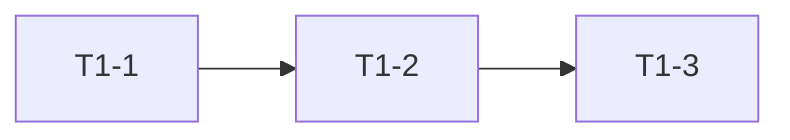
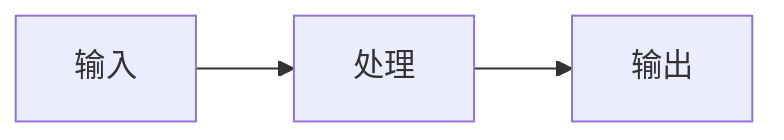

<!-- plan-doc:v1 -->

# {标题}

> **一句话**：{目标，人一眼懂}
> **仓库**：`{仓库A}`｜`{仓库B}`
> **规则**：改需求先记 C；一功能一机制；执行一次只做一条。

## 0. 看板

<!--
人和 AI 都先读这里。只放"现在"，不放历史。
"下一条"必须与任务池 P0 第一条一致。
-->

- **阶段**：
- **下一条**：
- **本次范围**：只做 ______，不做 ______
- **事实源**：代码 / 测试 > 仓库 README、AGENTS > 本文
- **最后更新**：{YYYY-MM-DD}｜**活跃变更**：—｜**冻结**：—｜**血缘**：前身 —｜后继 —

### 需求登记

<!--
R = 为什么做。任务必须挂 R；变更必须落到某个 R。
链条：需求 R → 任务 T → 提交 / 归档；变更 C 作用于 R。
-->

| R | 需求 | 来源 | 状态 | 覆盖任务 |
|---|---|---|---|---|
| R1 | 示例需求 | 立项 / 客户 / 调研 | 待做 | T1-1 |

### 任务总览

| 任务 | 状态 | 出口条件 |
|---|---|---|
| T1 名称 | todo | 一句话可验收的结果 |

### 机制登记

<!--
一功能一机制。任务必须写"机制：复用 X / 新建 D#"。
新建机制必须先立 D 决策；执行中发现要新建必须停下。
-->

| 机制 | 位置 | 用途 | 扩展方式 | 使用者 |
|---|---|---|---|---|
| 示例机制 | `src/foo.c` | 统一 X 的处理 | 加参数，不复制代码 | T1-1 |

### 基线

- 仓库 / 分支 / 提交：
- 构建命令：
- 测试：X/X 通过

## 1. 任务池

<!--
一次只领一条 P0。任务必须自包含，执行AI 不需要读全文。
固定顺序：需求 → 产出 → 验证 → 机制 → 边界
任务有先后/依赖时，加依赖图（可选）：

-->

### P0（立即）

- [ ] **T1-1 动作** → 需求：R1；产出：`文件`；验证：`命令` → 期望；机制：复用 X；边界：不做什么

### P1 / P2

- [ ] **T1-2 动作** → 需求：R1（← C2）；产出：…；验证：…；机制：复用 X；边界：…

### 外部依赖与验收

- [ ] **V-1 真机验证** → 验收：…

## 2. 契约

<!-- 带版本；只写会影响任务的约束。契约变更引 C。 -->

- 架构 / 关键约束：
- 协议 / 数据格式 / 命名 / 单位：
- 构建与测试命令：

## 3. 设计要点

<!-- 复杂任务才写。方案要点 + 明确不做什么，不贴完整代码。
能用图表达就用图：流程 / 数据流 / 机制关系。

-->

### 3.1 任务名

- 方案要点：
- 边界：

## 4. 决策与变更

### 决策（D）

| D | 决策 | 结论 |
|---|---|---|

### 变更（C）

<!--
类型：新增 / 修改 / 删除 / 延期 / 否决 / 待定；否决和待定也要记。
变更必须落到某个 R：新增 R# / 修改 R# / 否决 R#。
影响列写五个面：任务 / 契约 / 测试 / 文档 / 机制。
-->

| C | 日期 | 类型 | 需求 | 内容 | 影响 | 处理 |
|---|---|---|---|---|---|---|

## 5. 实施记录

<!--
一行一条：
- [x] **T1-1 名称** —— 改了什么；验证：`命令` → X/X；结果：通过
没有跑验证不许勾 [x]。
-->

## 6. 归档

<!-- 结果只有 4 个：完成 / 取消 / 取代 / 延期；原文保留。 -->

| 任务 | 结果 | 关联 | 提交 |
|---|---|---|---|

## 7. 参考

- 源码：
- 文档：`README.md`、`AGENTS.md`
- 测试：
