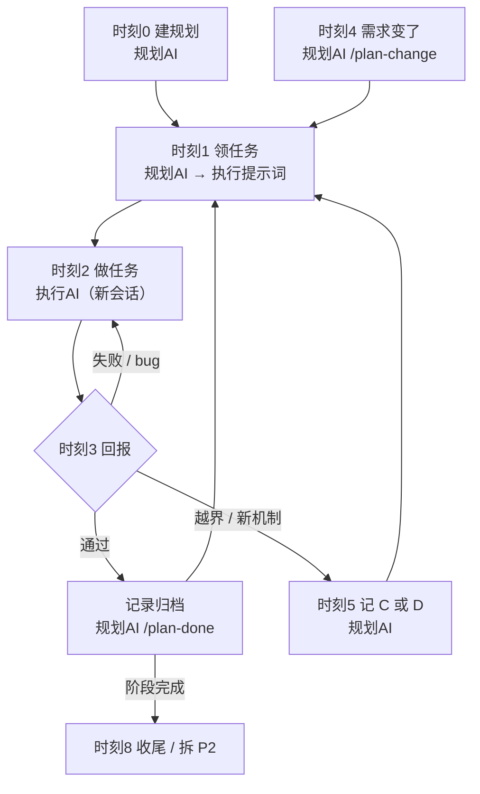
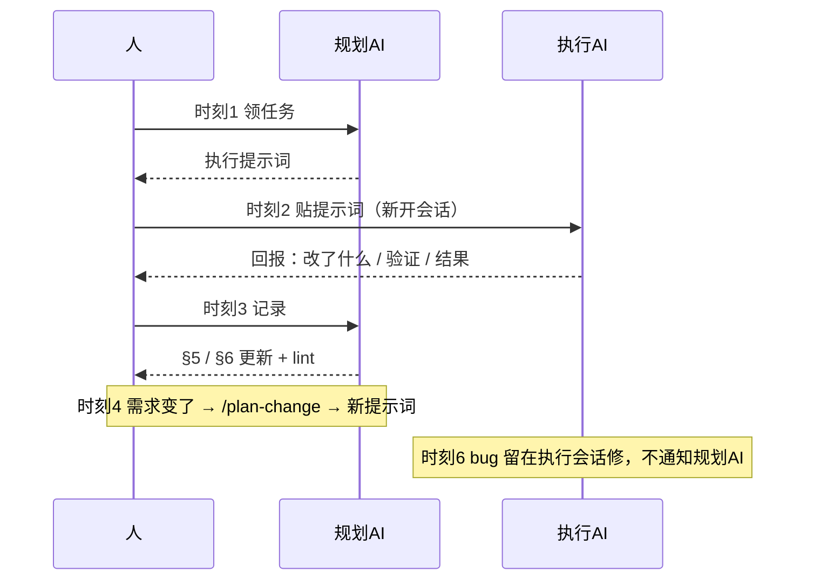

# 使用手册：怎么和 AI 说话

> 你只负责发提示词和判断；**规划AI 管"做什么"，执行AI 管"怎么做"**。
> 提示词全部可复制。【规划AI】【执行AI】表示发给哪个会话。

---

## 1. 三个角色

| 谁 | 干什么 | 不干什么 |
|---|---|---|
| **你** | 发提示词、做决策、验收 | 不用自己写任务记录 |
| **规划AI** | 拆任务、记变更、出执行提示词 | 不做实现 |
| **执行AI** | 做一条任务、跑验证、回报 | 不改规划、不越界 |

**文档是唯一事实源**。只在聊天里说的变更，下一个 AI 不知道。

---

## 2. 时刻表：什么时候发什么

### 时刻 0｜项目开工 ——【发给规划AI】

```text
你是本项目的规划AI。加载 skill plan-doc。

目标：<一句话>
仓库/路径：<...>
出口条件：<怎么算完>

请：
1. 建规划文档（默认 docs/plan.md），填 §0 看板、需求登记、机制登记、基线
2. 先登记需求 R1、R2…（需求 / 来源 / 状态 / 覆盖任务），再拆任务池
   - 每条任务必须标 `需求：R#`，写清为什么做
   - 每条自包含：需求 / 产出 / 验证 / 机制 / 边界
   - 一条任务 = 一次会话能完成
   - 验证 = 命令 → 期望结果
   - 机制：复用 X 或 新建 D#（新建必须立 D 决策）
3. 只输出需求登记 + 任务池，先不做任何实现
```

**你得到**：规划文档 + §1 任务池

---

### 时刻 1｜每天开工 / 领下一条 ——【发给规划AI】

```text
你是规划AI。规划文档：<路径>。加载 skill plan-doc。

读 §0 看板、§1 任务池、§4 变更。
1. 未处理的变更先 /plan-change
2. 用 /plan-next 输出下一条任务的执行提示词
   - 任务必须有 `需求：R#` 和 `机制：复用 X / 新建 D#`
   - 会新建机制的任务，先在 §4 立 D 决策

只输出提示词，不做实现。本次只做一条。
```

**你得到**：一段"执行提示词"（这就是给执行AI 的任务）

---

### 时刻 2｜开始干活 ——【新开会话 → 发给执行AI】

```text
你是执行AI。只做下面这条任务，不做其他。开工前先 git status。

先读规划文档 §0 机制登记：已有机制就扩展它；要新建机制时先停下说"需要 D决策"。
需求超出任务边界（含引入新机制）时，先停下说"这需要记 C"。

<粘贴上一步的执行提示词>

结束时固定回复：
1. 改了什么
2. 验证命令 + 结果
3. 行为变化：现在系统 / 界面实际会 …（给用户看）
4. 遗留问题
5. 下一步建议
```

**要点**：换一个会话做执行，不要和规划AI混在一个对话。

---

### 时刻 3｜执行AI 回报了 ——【发给规划AI】

```text
任务 <ID> 的执行回报如下：

<粘贴执行AI 的回复>

加载 skill plan-doc，/plan-done：
- 验证通过 → §5 一行（含"行为：…"）+ 归档 + §0 看板同步 + lint
- 验证失败 → 记阻塞，不勾选
```

也可以直接：`/plan-done <路径> <任务ID>`

---

### 时刻 4｜需求变了 ——【发给规划AI】

```text
需求变更：<一句话>
原因：<为什么>

加载 skill plan-doc，/plan-change：
1. 生成 C 号（不复用），定类型：新增 / 修改 / 删除 / 延期 / 否决 / 待定
2. 变更必须落到某个 R：`新增 R5` / `修改 R1` / `否决 R3`，同步更新需求登记状态
3. 影响五个面：任务 / 契约 / 测试 / 文档 / 机制
4. 更新任务池：
   - 新增 → 加任务，标 `需求：R#`
   - 修改 → 不改旧任务；新开"重做 T1-x（← C#）"，旧任务进归档标"取代"
   - 删除 / 否决 / 延期 → 移入归档，原文保留
5. 更新看板（活跃变更 / 最后更新）+ 跑 lint
6. 输出新的执行提示词
```

---

### 时刻 4b｜你自己改了需求 ——【一句话发给规划AI】

需求入口只有 §0 需求登记那一张表。你可以自己改；改完**分两种**：

| 你改了什么 | 要不要通知规划AI |
|---|---|
| 错别字 / 措辞 / 格式 / 顺序 | 不用 |
| 做什么 / 验收 / 范围 / 优先级 / 接口 | **要**，一句话 |

```text
我改了需求 R2：<改了什么>。
请加载 skill plan-doc，/plan-change（类型=修改，需求=R2）：
同步受影响的任务 / 契约 / 测试 / 机制，更新看板和需求登记状态，
然后输出新的执行提示词。
```

**为什么必须通知**：范围变了，任务、机制、测试不跟着改，执行AI 又按旧的做。

---

### 时刻 5｜执行AI 说"超出边界" / "需要 D决策" ——【发给规划AI】

执行AI 会自动停。把它原话贴给规划AI：

```text
执行AI 报告：

<粘贴执行AI 的原话>

请 /plan-change 记 C（或立 D 决策），然后重新出执行提示词。
```

---

### 时刻 6｜发现 bug ——【留在执行AI 会话】

直接说，**不用告诉规划AI**：

```text
<描述现象>；这是实现细节，继续修当前任务。
```

修完让它按固定格式回报，走时刻 3。

---

### 时刻 7｜换会话 / 换 AI ——【发给新AI】

```text
你是（规划AI / 执行AI）。加载 skill plan-doc，读规划文档 <路径>。

事实源：代码 > 测试 > README/AGENTS > §0 看板。
当前阶段、下一条任务、活跃变更见 §0。

先复述：当前阶段 / 下一条任务 / 活跃变更。确认理解后再继续。
```

**要点**：先复述再干。复述错了立刻纠正，比干错了返工便宜。

---

### 时刻 8｜阶段收尾 ——【发给规划AI】

```text
阶段收尾。加载 skill plan-doc：
1. /plan-check（-Strict）
2. §0 看板全部完成，status: done，补 completed
3. §6 归档所有任务
4. 标"冻结：<阶段> @ <commit>（日期）"
5. 正文超 800 行就建 {同名}-P2.md，写血缘：前身 [[旧文档]]
```

---

## 3. 命令快捷方式

命令 = 上面提示词的快捷键，效果一样。

| 命令 | 对应时刻 | 说明 |
|---|---|---|
| `/plan-new <路径> <标题>` | 时刻 0 | 建骨架 |
| `/plan-next <路径>` | 时刻 1 | 出执行提示词 |
| `/plan-done <路径> <ID>` | 时刻 3 | 跑验证并记录 |
| `/plan-change <路径> <描述>` | 时刻 4 | 记变更 |
| `/plan-check <路径>` | 时刻 8 | 校验 |

---

## 4. 一图流



谁和谁说话：



---

## 5. FAQ

**Q：bug 和需求变更怎么分？**
A：改"怎么做"是 bug，留在执行会话；改"做什么 / 验收 / 接口"是变更，发规划AI。不确定就发规划AI，记错可以删，漏记代价高。

**Q：执行AI 做一半会话断了？**
A：下次规划AI 的 /plan-next 会捞未完成项；§5 有 `进行中：卡在…` 记录。

**Q：两个执行AI 能并行吗？**
A：能，但任务边界和改动文件不能重叠。任务里写清"涉及文件"。

**Q：能不能直接跟规划AI 说"顺手把这个做了"？**
A：不能。规划AI 不做实现。让它加任务，再走时刻 1~2。

**Q：lint 一堆 WARN？**
A：WARN 是提醒不是门禁，回复里说明原因即可；ERROR 必须清零。
