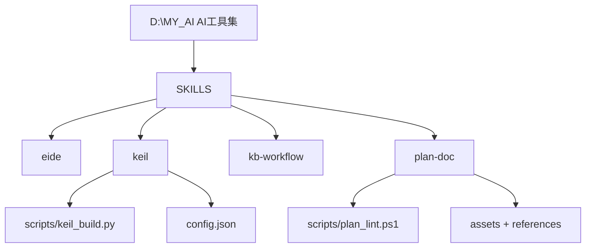
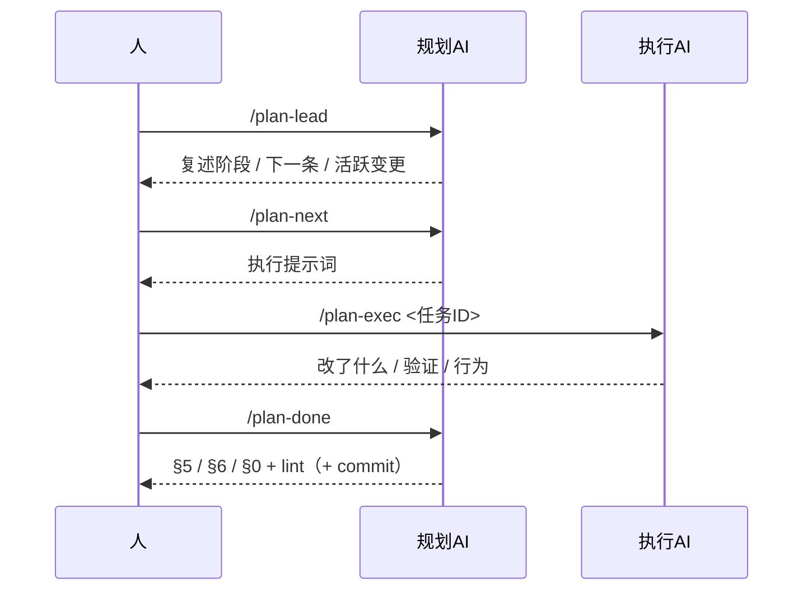
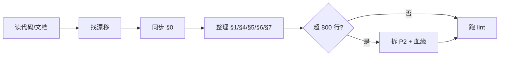

<!-- plan-doc:v1 -->

# AI工具集

> **一句话**：维护个人 AI 工具集（opencode skills：eide / keil / kb-workflow / plan-doc），逐步补齐能力与规范。
> **仓库**：`D:\MY_AI`
> **规则**：改需求先记 C；一功能一机制；执行一次只做一条。

## 0. 看板

- **阶段**：R2 角色/提交（T2-1/T2-2 完成，T2-3 待做）；R8/R9 待实现
- **下一条**：T2-3
- **本次范围**：只做 T2-3（提交归属 D2），不做实际提交
- **事实源**：代码 / 测试 > 仓库 README、AGENTS > 本文
- **最后更新**：2026-10-29｜**活跃变更**：—｜**冻结**：—｜**血缘**：前身 —｜后继 —

### 需求登记

| R | 需求 | 来源 | 状态 | 覆盖任务 |
|---|---|---|---|---|
| R1 | 需求可关联独立 Obsidian 任务笔记，完成时可选回写（非必选） | 用户 | 待做 | T1-1 ~ T1-4 |
| R2 | 角色边界 + 提交归属：规划AI 不实现不询问，规划AI 审代码后提交，执行AI 不提交 | 用户 | 待做 | T2-1 ~ T2-3 |
| R3 | 新增 `/plan-lead`（规划AI 入口/续接）与 `/plan-exec`（执行AI 入口） | 用户 | 待做 | T3-1 ~ T3-3 |
| R4 | 规划文档不绑定 opencode 命令目录；§7 只索引仓库内文件 | 用户 | 交付 | —（文档维护） |
| R5 | 新增 `/plan-tidy`：规划AI 按现有代码/情况整理文档，防止长期运行变乱 | 用户 | 待做 | T5-1 ~ T5-2 |
| R6 | 决策/变更/任务就近关联：§1 顶部关联表 + 任务行关联 + D/C 回链 | 用户 | 待做 | T6-1 ~ T6-3 |
| R7 | 命令参数改为主要对象优先 + `--doc` 可选 + 自动定位，旧形式兼容 | 用户 | 待做 | T7-1 ~ T7-3 |
| R8 | 需求/任务顺序动态调整：以 §1 任务池为唯一排序源，R-T-D-C 关联表为视图（关联 R6） | 用户 | 待做 | T8-1 ~ T8-2 |
| R9 | 实施记录靠近任务池：§1 顶部状态总览（含已完成）+ §5 回链，显示完成/未完成与关联（关联 R6/R8） | 用户 | 待做 | T9-1 ~ T9-2 |

### 任务总览

| 任务 | 状态 | 出口条件 |
|---|---|---|
| T2-3 | todo | `/plan-done` 含提交归属 D2（规划AI 提交，执行AI 不提交） |
| T3-1 | todo | `/plan-lead` 命令含角色自报与续接流程 |
| T3-2 | todo | `/plan-exec` 命令含只做一条、验证与固定回报 |
| T3-3 | todo | SKILL.md 命令表与 sop.md 引用新命令 |
| T5-1 | todo | `/plan-tidy` 命令含读代码、同步看板、整理各节、拆 P2 |
| T5-2 | todo | SKILL.md 命令表与 sop.md 含 /plan-tidy |
| T6-1 | todo | format.md 含关联表定义与 D/C 任务列 |
| T6-2 | todo | lint 对关联引用做 WARN 级检查 |
| T6-3 | todo | 本规划文档切到关联表布局 |
| T7-1 | todo | 文档含新旧参数对照与自动定位顺序 |
| T7-2 | todo | 6 个命令文件支持新形式且兼容旧形式 |
| T7-3 | todo | 无 `--doc` 时按指针/搜索定位，歧义时询问 |
| T8-1 | todo | 文档含唯一排序源、重排记 C、下一条规则 |
| T8-2 | todo | 模板与本文档的关联表行序与任务池一致 |
| T9-1 | todo | 文档含 §1.0 状态总览定义（含已完成） |
| T9-2 | todo | 本文档 §1 顶部出现状态总览且回链 §5 |
| T1-1 | todo | format.md 含 `文档` 列与同步规则，obsidian.md 含外部笔记约定 |
| T1-2 | todo | 文档含 `/plan-req --doc` 读入流程 |
| T1-3 | todo | 文档含完成回写流程（R 级 + 可选待办级） |
| T1-4 | todo | lint 对 `文档` 列做 WARN 级检查 |

### 机制登记

| 机制 | 位置 | 用途 | 扩展方式 | 使用者 |
|---|---|---|---|---|
| keil 构建/扫描 | `SKILLS/keil/scripts/keil_build.py`、`keil_project.py`、`keil_runtime.py` | Keil MDK 工程扫描、Target 枚举、build/rebuild/clean，JSON 结构化返回产物路径 | 加子命令 / 参数，不复制脚本 | — |
| keil 配置 | `SKILLS/keil/config.json`（环境）+ `.embeddedskills/config.json`（工程）+ `state.json`（状态） | 三级配置，参数解析优先级 CLI > 环境 > 工程 > 状态 | 加字段 | — |
| eide MCP 工具 | `SKILLS/eide/SKILL.md` | 经 eide-mcp-server 读写 EIDE 工程（build/flash/源目录/宏/builder） | 走 MCP 工具，不直改 eide.yml | — |
| plan-doc 模板/规则 | `SKILLS/plan-doc/assets/`、`references/` | 规划文档格式、任务/变更/归档规则 | 改模板/参考，不复制规范 | — |
| plan-doc lint | `SKILLS/plan-doc/scripts/plan_lint.ps1` | 规划文档校验门禁（ERROR/WARN） | 加检查规则 | — |
| kb-workflow | `SKILLS/kb-workflow/SKILL.md` | Obsidian 知识库绑定/维护，规范.md 为唯一事实源 | — | — |
| 需求文档同步（可选） | `SKILLS/plan-doc/references/format.md`、`obsidian.md` | R 关联外部任务笔记，完成后可选回写（非必选） | 扩展现有 /plan-req、/plan-done（D1） | T1-1~T1-4 |

### 基线

- 仓库 / 分支 / 提交：`D:\MY_AI`｜`main`｜`fd712ee`
- 构建命令：无（skills 集合；keil 脚本为标准库 Python，无依赖）
- 测试：未找到测试目录 / 命令

## 1. 任务池

### P0（立即）

- [ ] **T2-3 落地提交归属 D2** → 需求：R2；产出：`references/format.md`、`references/tasks.md`、`references/sop.md`、`SKILL.md`；验证：读 tasks.md 的 /plan-done → 含"审 diff + 验证 + 更新文档 + 提交；执行AI 不提交；commit 需显式开启"；机制：复用 /plan-done（D2）；边界：push 仍禁止
- [ ] **T1-1 需求登记加可选文档列** → 需求：R1；产出：`SKILLS/plan-doc/references/format.md`、`references/obsidian.md`；验证：读 format.md 需求登记表 → 含 `文档` 列与"空/— 不同步"规则；机制：复用 plan-doc 文档格式（D1）；边界：不改命令与 lint

### P1 / P2

- [ ] **T3-1 新增 /plan-lead 命令** → 需求：R3（依赖 T2-1）；产出：`plan-lead` 命令（opencode command）；验证：读命令文件 → 含角色自报、复述阶段/下一条/活跃变更、不实现；机制：复用 plan-doc 规则（D2）；边界：不改现有命令
- [ ] **T3-2 新增 /plan-exec 命令** → 需求：R3（依赖 T2-1）；产出：`plan-exec` 命令（opencode command）；验证：读命令文件 → 含角色自报、git status、只做一条、固定回报、不改规划；机制：复用 plan-doc 规则（D2）；边界：不 commit/push
- [ ] **T3-3 命令表与 SOP 同步** → 需求：R3；产出：`SKILLS/plan-doc/SKILL.md`、`references/sop.md`；验证：SKILL.md 命令表含 /plan-lead 与 /plan-exec；sop.md 时刻 7 引用新命令；机制：复用 plan-doc 规则；边界：不改 lint
- [ ] **T5-1 新增 /plan-tidy 命令** → 需求：R5（依赖 T2-1）；产出：`plan-tidy` 命令（opencode command）；验证：读命令文件 → 含读代码/文档、同步 §0、整理 §1/§4/§5/§6/§7、超 800 行拆 P2；机制：复用 plan-doc 规则与 lint；边界：不改需求语义、不改代码
- [ ] **T5-2 整理命令写入命令表与 SOP** → 需求：R5；产出：`SKILLS/plan-doc/SKILL.md`、`references/sop.md`；验证：SKILL.md 命令表含 /plan-tidy；sop.md 含整理流程；机制：复用 plan-doc 规则；边界：不改 lint
- [ ] **T6-1 定义 R-T-D-C 关联表** → 需求：R6；产出：`SKILLS/plan-doc/references/format.md`、`assets/plan-template.md`、`references/sop.md`；验证：读 format.md → §1 顶部含「R-T-D-C 关联表」定义，§4 D/C 表含 `任务` 列；机制：复用 plan-doc 模板/规则（D4）；边界：不重排章节
- [ ] **T6-2 lint 校验关联引用** → 需求：R6；产出：`SKILLS/plan-doc/scripts/plan_lint.ps1`；验证：对含关联表的样例跑 lint → 0 ERROR；引用不存在的 D/C → WARN；机制：复用 plan-doc lint；边界：WARN 级，不阻断
- [ ] **T6-3 规划文档迁移新布局** → 需求：R6；产出：本规划文档；验证：§1 顶部出现关联表、任务行含关联、lint 0/0；机制：复用 plan-doc 规则；边界：不改需求语义
- [ ] **T7-1 定义命令参数规范** → 需求：R7；产出：`SKILLS/plan-doc/SKILL.md`、`references/tasks.md`、`references/sop.md`；验证：读文档 → 含新旧参数对照表、`--doc` 可选、自动定位顺序；机制：复用 plan-doc 规则（D5）；边界：不改命令行为
- [ ] **T7-2 更新 6 个命令文件** → 需求：R7；产出：`plan-new/req/next/done/change/check` 命令；验证：每个命令文件同时支持新形式与旧形式；机制：复用现有命令（D5）；边界：不新增命令
- [ ] **T7-3 自动定位与指针** → 需求：R7；产出：`SKILL.md`、`references/tasks.md`；验证：无 `--doc` 时按 `--doc` → 文件 → `AGENTS.md` 指针 → 搜索顺序定位；机制：复用 AGENTS.md 指针与搜索；边界：多文档时询问，不猜
- [ ] **T8-1 定义动态排序规则** → 需求：R8（关联 R6）；产出：`references/format.md`、`references/tasks.md`、`references/sop.md`；验证：读文档 → 含"唯一排序源=§1 任务池；R-T-D-C 关联表为视图；重排记 C；下一条=P0 第一条"；机制：复用 R6 关联表（D4/D6）；边界：不改 ID、不动已完成任务
- [ ] **T8-2 模板与本文档落地排序** → 需求：R8；产出：`assets/plan-template.md`、本规划文档；验证：§1 顶部关联表行序与任务池一致；lint 0/0；机制：复用 plan-doc 模板/规则（D6）；边界：不改需求语义
- [ ] **T9-1 定义状态总览** → 需求：R9（关联 R6/R8）；产出：`references/format.md`、`assets/plan-template.md`、`references/sop.md`；验证：读文档 → 含 §1.0 状态总览定义（任务/状态/需求/决策/变更/记录），已完成任务也列出；机制：复用 R6 关联表（D4/D6）；边界：不移动 §5 章节号
- [ ] **T9-2 本文档落地状态总览** → 需求：R9；产出：本规划文档；验证：§1 顶部总览含 T2-1（完成）与 T2-2（未完成），行内 R/D/C 链接正确；lint 0/0；机制：复用 plan-doc 规则（D7）；边界：不改需求语义
- [ ] **T1-2 /plan-req 支持 --doc** → 需求：R1；产出：`SKILLS/plan-doc/SKILL.md`、`references/sop.md`；验证：读 sop.md 时刻 9 → 含 `--doc <笔记>` 与读入步骤；机制：复用 /plan-req（D1）；边界：未传 --doc 时行为不变
- [ ] **T1-3 /plan-done 与执行 AI 回写** → 需求：R1；产出：`SKILL.md`、`references/tasks.md`、`references/sop.md`；验证：读 tasks.md 的 /plan-done 流程 → 含外部笔记回写（状态/完成时间/待办项）；机制：复用 /plan-done（D1）；边界：笔记缺失不猜、记 WARN
- [ ] **T1-4 lint 检查文档列链接** → 需求：R1；产出：`SKILLS/plan-doc/scripts/plan_lint.ps1`；验证：对含 `文档` 列的样例执行 lint → 0 ERROR，缺文件仅 WARN；机制：复用 plan-doc lint；边界：WARN 级，不阻断

### 外部依赖与验收

- [ ] **V-1 真机验证** → 验收：在 Obsidian 建一条需求任务笔记，跑 /plan-req --doc 与 /plan-done，确认笔记状态/完成时间/待办项按约定更新

## 2. 契约

- 架构 / 关键约束：每个 skill 一个目录（`SKILL.md` + `scripts/` + `references/`）；skill 之间不互相硬依赖。
- 协议 / 数据格式：keil 脚本输出 JSON（`status` / `action` / `summary` / `details` / `metrics` 等）。
- 构建与测试命令：无统一构建；keil 脚本用 `python <skill>/scripts/keil_*.py ...`。

## 3. 设计要点

### 3.1 目录结构

### 3.2 角色交接

### 3.3 整理流程（/plan-tidy）

## 4. 决策与变更

### 决策（D）

| D | 决策 | 结论 |
|---|---|---|
| D1 | 需求外部文档同步 | 可选扩展：需求登记加 `文档` 列；`/plan-req` 读入、`/plan-done`/执行 AI 回写；不新建独立机制，不做实时双向同步 |
| D2 | 提交归属 | 规划AI 在 /plan-done 审 diff + 验证 + 更新文档后提交；执行AI 不提交；commit 默认关闭，push 禁止 |
| D3 | 参考索引边界 | §7 只收仓库内文件与直接依赖；外部安装目录（如 opencode command）不入索引 |
| D4 | D/C/T 就近关联 | §1 顶部加 R-T-D-C 关联表；任务行保留 `需求：R#` / `机制：D#`，可选 `关联：C#`；§4 D/C 表加 `任务` 列回链；不重排章节 |
| D5 | 命令参数约定 | 主要对象优先（需求/任务ID/描述），文档路径用 `--doc` 可选并自动定位；旧形式兼容 |
| D6 | 动态排序 | 唯一排序源=§1 任务池（P0→P1→P2，区内行序）；R-T-D-C 关联表为视图；重排记 C（修改）；不改 ID、不动已完成；下一条=P0 第一条 |
| D7 | 状态总览 | §1 顶部加状态总览（任务/状态/需求/决策/变更/记录），已完成与未完成同表；§5 保留明细并回链；不移动章节号 |

### 变更（C）

| C | 日期 | 类型 | 需求 | 内容 | 影响 | 处理 |
|---|---|---|---|---|---|---|
| C1 | 2026-10-29 | 修改 | R3 | T3-1/T3-2 产出不写外部绝对路径；§7 移除命令目录 | 任务、文档 | 已改 T3-1/T3-2 与 §7 |

## 5. 实施记录

- [x] **T2-1 补角色与边界说明** —— SKILL.md 新增「角色与边界」段（规划AI 拆任务/记变更/出提示词/收尾、不实现不询问；执行AI 只做一条/验证/固定回报、不改规划不提交）；sop.md 三角色表与时刻 7 同步并写入加载后自报角色；验证：`$t=Get-Content SKILLS/plan-doc/SKILL.md -TotalCount 40 -Encoding UTF8; ($t -match '角色与边界')-and($t -match '规划AI')-and($t -match '执行AI')-and($t -match '自报')` → True；行为：加载 skill 后先自报角色，规划与执行职责分离；结果：通过
- [x] **T2-2 规划AI 不实现不询问** —— pitfalls.md 新增「角色越界（反例）」4 条（规划AI 改代码/征询、执行AI 改规划/提交），sop.md 三角色段补正反例表并回链 pitfalls，SKILL.md 角色段加一句指向；验证：`$t=Get-Content SKILLS/plan-doc/references/pitfalls.md -Encoding UTF8 -Raw; ($t -match '角色越界')-and($t -match '规划AI')-and($t -match '执行AI')` → True；行为：越界有反例可对照，规划只出提示词、执行只做一条；结果：通过

## 6. 归档

| 任务 | 结果 | 关联 | 提交 |
|---|---|---|---|
| T2-1 | 完成 | R2 | — |
| T2-2 | 完成 | R2 | — |

## 7. 参考与索引

### 仓库

| 仓库 | 路径 | 角色 | 构建 | 测试 |
|---|---|---|---|---|
| AI工具集 | `D:\MY_AI` | skill 集合（源仓库） | 无 | 无 |

### 关键文件

| 文件 | 作用 |
|---|---|
| `readme.md` | 项目标题「AI工具集」 |
| `SKILLS/keil/scripts/keil_build.py` | Keil 构建/重建/清理/烧录 + JSON 输出 |
| `SKILLS/keil/scripts/keil_project.py` | 工程扫描 + Target 枚举 |
| `SKILLS/keil/scripts/keil_runtime.py` | 运行时（日志解析/配置加载） |
| `SKILLS/keil/config.json` | 环境级配置（uv4_exe / operation_mode） |
| `SKILLS/plan-doc/scripts/plan_lint.ps1` | 规划文档 lint 门禁 |
| `SKILLS/plan-doc/assets/plan-template.md` | 规划文档模板 |
| `SKILLS/eide/SKILL.md` | EIDE MCP 工具使用规则 |
| `SKILLS/kb-workflow/SKILL.md` | 知识库维护工作流 |

### 文档

- `readme.md`

### 相关仓库 / 依赖

- Python 3（keil 脚本，仅标准库）
- Keil MDK（UV4.exe）
- eide-mcp-server（eide skill 依赖）
- Obsidian vault：`C:\Users\SiaZh\OneDrive\SIA的obsidian系统`（规划文档落点）
