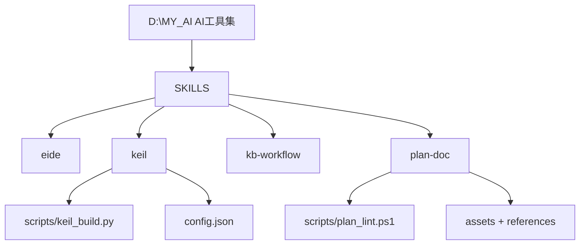
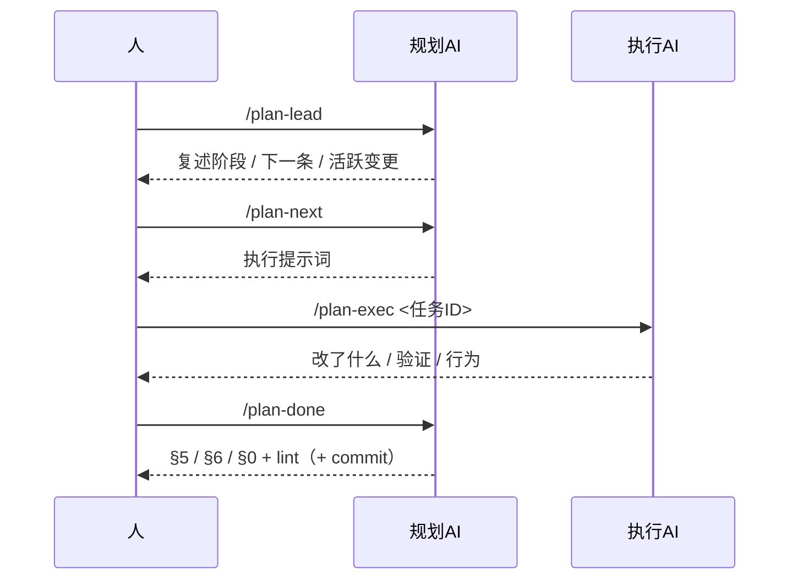
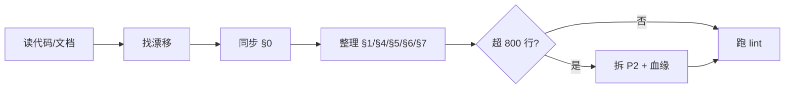

<!-- plan-doc:v1 -->

# AI工具集

> **一句话**：维护个人 AI 工具集（opencode skills：eide / keil / kb-workflow / plan-doc），逐步补齐能力与规范。
> **仓库**：`D:\MY_AI`
> **规则**：改需求先记 C；一功能一机制；执行一次只做一条。

## 0. 看板

- **阶段**：R3 命令体系（T3-1 待做）→ R15 命令提示词 → R16 方案单一入口 → R6 文档可读性 → R5 tidy → R1 功能
- **下一条**：T3-1
- **本次范围**：只做 T3-1（/plan-enter 命令），不改其他
- **事实源**：代码 / 测试 > 仓库 README、AGENTS > 本文
- **最后更新**：2026-10-29｜**活跃变更**：—｜**冻结**：—｜**血缘**：前身 —｜后继 —

### 需求登记

| R | 需求 | 来源 | 状态 | 覆盖任务 |
|---|---|---|---|---|
| R1 | 需求可关联独立 Obsidian 任务笔记，完成时可选回写（非必选） | 用户 | 待做 | T1-1 ~ T1-4 |
| R2 | 角色边界 + 提交归属：规划AI 不实现不询问，规划AI 审代码后提交，执行AI 不提交 | 用户 | 交付 | T2-1 ~ T2-3 |
| R3 | 命令体系：`/plan-enter <lead/exec>` 入口 + 参数规范（主要对象优先、`--doc` 自动定位），合并原 R7 | 用户 | 待做 | T3-1、T3-3、T7-1 |
| R4 | 规划文档不绑定 opencode 命令目录；§7 只索引仓库内文件 | 用户 | 交付 | —（文档维护） |
| R5 | `/plan-tidy`：内容整理 + `--format` 格式同步 + 合并/去重 | 用户 | 待做 | T5-1 ~ T5-2 |
| R6 | 规划文档可读性：R-T-D-C 关联表 + 动态排序 + 状态总览（合并原 R8/R9） | 用户 | 待做 | T6-1 ~ T6-3 |
| R7 | 命令参数规范（已并入 R3） | 用户 | 取消 | → R3（T7-1/T7-2） |
| R8 | 需求/任务顺序动态调整（已并入 R6） | 用户 | 取消 | → R6 |
| R9 | 实施记录靠近任务池（已并入 R6） | 用户 | 取消 | → R6 |
| R10 | 新增 `/plan-sync`：重读最新 skill 文件并把规划文档迁移到最新格式（已并入 R5 / `--format`） | 用户 | 取消 | —（并入 R5） |
| R11 | 执行AI 回报去掉“下一步”：只报改了什么/验证/行为/§5/遗留，下一步由规划AI 定（并入 R12） | 用户 | 变更 | → R12（T12-1） |
| R12 | 简化执行AI 汇报 + 验证归执行AI：规划AI 只看代码/文档，不跑代码验证 | 用户 | 交付 | T12-1 ~ T12-2 |
| R13 | 项目参考表存放规矩（已取消） | 用户 | 取消 | —（C8） |
| R14 | 提交策略：默认由规划AI 判断是否提交，`--commit` 强制提交，`--no-commit` 跳过 | 用户 | 交付 | T14-1 |
| R15 | 按对话经验统一重写核心 6 命令提示词（规则内聚、参数/输出/失败处理一致） | 用户 | 待做 | T15-1 |
| R16 | 方案单一入口 + 需求查重：方案只放 §3，用户可改；每次提需求先扫 R/T/D/§3 查重复/冲突/合并 | 用户 | 待做 | T16-1 ~ T16-2 |

### 任务总览

| 任务 | 状态 | 出口条件 |
|---|---|---|
| T3-1 | todo | `/plan-enter` 命令含 lead/exec 双分支与角色自报 |
| T3-3 | todo | SKILL.md 命令表与 sop.md 改为 /plan-enter |
| T5-1 | todo | `/plan-tidy` 含内容整理、`--format`、合并/去重 |
| T5-2 | todo | SKILL.md 命令表与 sop.md 含 /plan-tidy 模式 |
| T6-1 | todo | format.md 含关联表 + 状态总览 + 排序规则 |
| T6-2 | todo | lint 对关联引用做 WARN 级检查 |
| T6-3 | todo | 本规划文档切到关联表 + 状态总览布局 |
| T15-1 | todo | 6 个命令提示词规则内聚、参数/输出一致 |
| T16-1 | todo | 文档含方案只放 §3、用户改后以 §3 为准 |
| T16-2 | todo | `/plan-req` 新增前查重冲突并提议合并 |
| T1-1 | todo | format.md 含 `文档` 列与同步规则，obsidian.md 含外部笔记约定 |
| T1-2 | todo | 文档含 `/plan-req --doc` 读入流程 |
| T1-3 | todo | 文档含完成回写流程（R 级 + 可选待办级） |
| T1-4 | todo | lint 对 `文档` 列做 WARN 级检查 |

### 机制登记

| 机制 | 位置 | 用途 | 扩展方式 | 使用者 |
|---|---|---|---|---|
| keil 构建/扫描 | `SKILLS/keil/scripts/keil_build.py`、`keil_project.py`、`keil_runtime.py` | Keil MDK 工程扫描、Target 枚举、build/rebuild/clean，JSON 结构化返回产物路径 | 加子命令 / 参数，不复制脚本 | — |
| keil 配置 | `SKILLS/keil/config.json`（环境）+ `.embeddedskills/config.json`（工程）+ `state.json`（状态） | 三级配置，参数解析优先级 CLI > 环境 > 工程 > 状态 | 加字段 | — |
| eide MCP 工具 | `SKILLS/eide/SKILL.md` | 经 eide-mcp-server 读写 EIDE 工程（build/flash/源目录/宏/builder） | 走 MCP 工具，不直改 eide.yml | — |
| plan-doc 模板/规则 | `SKILLS/plan-doc/assets/`、`references/` | 规划文档格式、任务/变更/归档规则 | 改模板/参考，不复制规范 | — |
| plan-doc lint | `SKILLS/plan-doc/scripts/plan_lint.ps1` | 规划文档校验门禁（ERROR/WARN） | 加检查规则 | — |
| kb-workflow | `SKILLS/kb-workflow/SKILL.md` | Obsidian 知识库绑定/维护，规范.md 为唯一事实源 | — | — |
| 需求文档同步（可选） | `SKILLS/plan-doc/references/format.md`、`obsidian.md` | R 关联外部任务笔记，完成后可选回写（非必选） | 扩展现有 /plan-req、/plan-done（D1） | T1-1~T1-4 |

### 基线

- 仓库 / 分支 / 提交：`D:\MY_AI`｜`main`｜`36aa033`
- 构建命令：无（skills 集合；keil 脚本为标准库 Python，无依赖）
- 测试：未找到测试目录 / 命令

## 1. 任务池

### P0（立即）

- [ ] **T3-1 新增 /plan-enter 命令** → 需求：R3（← C2）；产出：`plan-enter` 命令（opencode command）；验证：读命令文件 → 含 `lead` / `exec` 分支与角色自报；lead 复述阶段/下一条/活跃变更；exec 读任务 + git status + 只做一条 + 固定回报；机制：复用 plan-doc 规则（D9）；边界：不新增其他角色命令

### P1 / P2

- [ ] **T3-3 命令表与 SOP 同步** → 需求：R3（← C2）；产出：`SKILLS/plan-doc/SKILL.md`、`references/sop.md`；验证：SKILL.md 命令表含 /plan-enter；sop.md 时刻 7 引用 /plan-enter 并移除 /plan-lead、/plan-exec；机制：复用 plan-doc 规则；边界：不改 lint
- [ ] **T15-1 重写核心 6 命令提示词** → 需求：R15（依赖 T14-1/T7-1/T3-3）；产出：`plan-new/req/next/done/change/check` 命令；验证：每个命令含角色自报、主对象优先、`--doc` 可选、执行AI 5 行、验证归执行AI、提交 D15；机制：复用现有命令（D16）；边界：不新增命令、不改 lint
- [ ] **T16-1 定义方案单一入口** → 需求：R16；产出：`references/format.md`、`references/tasks.md`、`SKILL.md`、`references/sop.md`；验证：读 format.md / sop.md → 含“方案只放 §3、用户改后以 §3 为准、不另建方案文档、方案讨论流程”；机制：复用 plan-doc 规则（D17）；边界：不覆盖用户编辑
- [ ] **T16-2 /plan-req 加查重/冲突检查** → 需求：R16；产出：`plan-req` 命令、`references/sop.md`；验证：读 plan-req → 含“新增前扫 R/T/D/§3，重复/冲突先报告并提议合并（D12）”；机制：复用 /plan-req（D17）；边界：不静默合并，需确认
- [ ] **T6-1 定义关联表 + 状态总览 + 排序** → 需求：R6（← C4）；产出：`SKILLS/plan-doc/references/format.md`、`assets/plan-template.md`、`references/sop.md`；验证：读 format.md → §1 顶部含关联表/状态总览（含已完成）、唯一排序源、§4 D/C 含 `任务` 列；机制：复用 plan-doc 模板/规则（D4/D6/D7）；边界：不重排章节
- [ ] **T6-2 lint 校验关联引用** → 需求：R6（← C4）；产出：`SKILLS/plan-doc/scripts/plan_lint.ps1`；验证：对含关联表的样例跑 lint → 0 ERROR；引用不存在的 D/C → WARN；机制：复用 plan-doc lint；边界：WARN 级，不阻断
- [ ] **T6-3 规划文档迁移新布局** → 需求：R6（← C4）；产出：本规划文档；验证：§1 顶部出现关联表 + 状态总览（含 T2-1/T2-2 完成）、行内 R/D/C 链接正确、lint 0/0；机制：复用 plan-doc 规则（D4/D6/D7）；边界：不改需求语义
- [ ] **T5-1 新增 /plan-tidy 命令** → 需求：R5（← C2/C5）；产出：`plan-tidy` 命令（opencode command）；验证：读命令文件 → 默认内容整理（读代码/文档、同步 §0、整理 §1/§4/§5/§6/§7、超 800 行拆 P2、合并/去重记 C）；`--format` 重读最新 skill 迁移格式；`--all` 两者；机制：复用 plan-doc 规则与 lint（D8/D9/D12）；边界：不改需求语义、不改代码
- [ ] **T5-2 整理命令写入命令表与 SOP** → 需求：R5（← C2/C5）；产出：`SKILLS/plan-doc/SKILL.md`、`references/sop.md`；验证：SKILL.md 命令表含 /plan-tidy 与 `--format`/`--all`/合并去重；sop.md 含整理与格式同步流程；机制：复用 plan-doc 规则；边界：不改 lint
- [ ] **T1-1 需求登记加可选文档列** → 需求：R1；产出：`SKILLS/plan-doc/references/format.md`、`references/obsidian.md`；验证：读 format.md 需求登记表 → 含 `文档` 列与"空/— 不同步"规则；机制：复用 plan-doc 文档格式（D1）；边界：不改命令与 lint
- [ ] **T1-2 /plan-req 支持 --doc** → 需求：R1；产出：`SKILLS/plan-doc/SKILL.md`、`references/sop.md`；验证：读 sop.md 时刻 9 → 含 `--doc <笔记>` 与读入步骤；机制：复用 /plan-req（D1）；边界：未传 --doc 时行为不变
- [ ] **T1-3 /plan-done 与执行 AI 回写** → 需求：R1；产出：`SKILL.md`、`references/tasks.md`、`references/sop.md`；验证：读 tasks.md 的 /plan-done 流程 → 含外部笔记回写（状态/完成时间/待办项）；机制：复用 /plan-done（D1）；边界：笔记缺失不猜、记 WARN
- [ ] **T1-4 lint 检查文档列链接** → 需求：R1；产出：`SKILLS/plan-doc/scripts/plan_lint.ps1`；验证：对含 `文档` 列的样例执行 lint → 0 ERROR，缺文件仅 WARN；机制：复用 plan-doc lint；边界：WARN 级，不阻断

### 外部依赖与验收

- [ ] **V-1 真机验证** → 验收：在 Obsidian 建一条需求任务笔记，跑 /plan-req --doc 与 /plan-done，确认笔记状态/完成时间/待办项按约定更新

## 2. 契约

- 架构 / 关键约束：每个 skill 一个目录（`SKILL.md` + `scripts/` + `references/`）；skill 之间不互相硬依赖。
- 协议 / 数据格式：keil 脚本输出 JSON（`status` / `action` / `summary` / `details` / `metrics` 等）。
- 构建与测试命令：无统一构建；keil 脚本用 `python <skill>/scripts/keil_*.py ...`。

## 3. 设计要点

### 3.1 目录结构

### 3.2 角色交接

### 3.3 整理流程（/plan-tidy）

## 4. 决策与变更

### 决策（D）

| D | 决策 | 结论 |
|---|---|---|
| D1 | 需求外部文档同步 | 可选扩展：需求登记加 `文档` 列；`/plan-req` 读入、`/plan-done`/执行 AI 回写；不新建独立机制，不做实时双向同步 |
| D2 | 提交归属 | 规划AI 在 /plan-done 审 diff + 验证 + 更新文档后提交；执行AI 不提交；提交策略见 D15；push 禁止 |
| D3 | 参考索引边界 | §7 只收仓库内文件与直接依赖；外部安装目录（如 opencode command）不入索引 |
| D4 | D/C/T 就近关联 | §1 顶部加 R-T-D-C 关联表；任务行保留 `需求：R#` / `机制：D#`，可选 `关联：C#`；§4 D/C 表加 `任务` 列回链；不重排章节 |
| D5 | 命令参数约定 | 主要对象优先（需求/任务ID/描述），文档路径用 `--doc` 可选并自动定位；旧形式兼容 |
| D6 | 动态排序 | 唯一排序源=§1 任务池（P0→P1→P2，区内行序）；R-T-D-C 关联表为视图；重排记 C（修改）；不改 ID、不动已完成；下一条=P0 第一条 |
| D7 | 状态总览 | §1 顶部加状态总览（任务/状态/需求/决策/变更/记录），已完成与未完成同表；§5 保留明细并回链；不移动章节号 |
| D8 | 文档同步 | /plan-tidy --format 每次从磁盘重读最新 skill（优先仓库 SKILLS/plan-doc，其次安装目录），对比格式并迁移；只改结构不改语义；不 commit |
| D9 | 命令合并 | 8 个命令：核心 6 + `/plan-enter <lead/exec>` + `/plan-tidy [--format/--all]`；不单设 /plan-lead、/plan-exec、/plan-sync |
| D10 | 执行AI 不规划 | 执行AI 回报固定：改了什么 / 验证 / 行为 / §5 记录 / 遗留；不写“下一步”，下一步由规划AI 定 |
| D11 | 验证归属 | 执行AI 跑代码验证并在回报给命令+结果；规划AI 不跑代码验证，只审 diff/文档并跑 plan-doc lint |
| D12 | 合并策略 | 同类 R 合并到最早 R；被并 R 标取消；任务保留最早 ID，其余取消；已完成/交付 R 不动 |
| D13 | 参考表存放（已撤销，见 D14） | 参考表放项目下单独文档，一表一档；规划文档 §7 只放链接；具体文件名按项目需要，不预先指定 |
| D14 | 项目文档定位 | 项目文档（含指令表/报错表）作为普通项目需求走 /plan-req；不单设全局存放规矩 |
| D15 | 提交策略 | /plan-done 默认由规划AI 判断（本任务文件 + 验证通过 + 文档更新 + lint 0 → 提交）；`--commit` 强制提交；`--no-commit` 强制跳过；push 永不自动 |
| D16 | 命令提示词规范 | 角色自报 + 主对象优先 + `--doc` 可选 + 执行AI 5 行回报 + 验证归执行AI + 提交 D15 + push 禁止；6 个核心命令一致 |
| D17 | 方案单一入口 | 方案只放规划文档 §3（任务行保留摘要）；用户可改 §3，规划AI 以 §3 为准，不另建方案文档；/plan-req 新增前扫 R/T/D/§3 查重冲突，重复先报告并提议合并 |

### 变更（C）

| C | 日期 | 类型 | 需求 | 内容 | 影响 | 处理 |
|---|---|---|---|---|---|---|
| C1 | 2026-10-29 | 修改 | R3 | T3-1/T3-2 产出不写外部绝对路径；§7 移除命令目录 | 任务、文档 | 已改 T3-1/T3-2 与 §7 |
| C2 | 2026-10-29 | 修改 | R3、R5、R10 | 命令合并：lead+exec → `/plan-enter`；sync → `/plan-tidy --format`；总命令数 10→8 | 任务、文档 | T3-1/T3-3/T5-1/T5-2；R10 取消，T10-1/T10-2 取消 |
| C3 | 2026-10-29 | 修改 | R11、R12 | R11 并入 R12；T11-1/T11-2 取消，由 T12-1 覆盖（简化回报含移除“下一步”与反例） | 任务、文档 | T12-1；R11 改变更 |
| C4 | 2026-10-29 | 修改 | R3、R6、R7、R8、R9 | 合并同类：R7→R3（命令体系）；R8/R9→R6（文档可读性） | 任务、文档 | R7/R8/R9 取消；T7-3、T8-1/T8-2、T9-1/T9-2 取消 |
| C5 | 2026-10-29 | 修改 | R5 | /plan-tidy 增加合并/去重（重叠 R/T、过期任务） | 任务、文档 | T5-1 扩范围 |
| C6 | 2026-10-29 | 修改 | R1、R3、R5、R6、R12 | 重排执行顺序：R12 → R3 → R6 → R5 → R1；R1 任务降 P2 | 任务、文档 | 已重排 §1 |
| C7 | 2026-10-29 | 修改 | R13 | 仅记录通用规矩，不指定具体文件名；T13-1 取消 | 任务、文档 | R13 交付；T13-1 取消 |
| C8 | 2026-10-29 | 否决 | R13 | 撤回参考表专门规矩；项目文档作为普通需求处理 | 文档 | R13 取消；D14 |
| C9 | 2026-10-29 | 修改 | R2、R14 | 提交策略从“默认不提交”改为“默认判断 + `--commit` 强制 + `--no-commit` 跳过” | 任务、文档 | T14-1/T14-2 |
| C10 | 2026-10-29 | 修改 | R3、R14、R15 | 取消 T7-2/T14-2，并入 T15-1 统一重写命令提示词 | 任务、文档 | T15-1；T3-1/T5-1 按 D16 建 |

## 5. 实施记录

- [x] **T2-1 补角色与边界说明** —— SKILL.md 新增「角色与边界」段（规划AI 拆任务/记变更/出提示词/收尾、不实现不询问；执行AI 只做一条/验证/固定回报、不改规划不提交）；sop.md 三角色表与时刻 7 同步并写入加载后自报角色；验证：`$t=Get-Content SKILLS/plan-doc/SKILL.md -TotalCount 40 -Encoding UTF8; ($t -match '角色与边界')-and($t -match '规划AI')-and($t -match '执行AI')-and($t -match '自报')` → True；行为：加载 skill 后先自报角色，规划与执行职责分离；结果：通过
- [x] **T2-2 规划AI 不实现不询问** —— pitfalls.md 新增「角色越界（反例）」4 条（规划AI 改代码/征询、执行AI 改规划/提交），sop.md 三角色段补正反例表并回链 pitfalls，SKILL.md 角色段加一句指向；验证：`$t=Get-Content SKILLS/plan-doc/references/pitfalls.md -Encoding UTF8 -Raw; ($t -match '角色越界')-and($t -match '规划AI')-and($t -match '执行AI')` → True；行为：越界有反例可对照，规划只出提示词、执行只做一条；结果：通过
- [x] **T2-3 落地提交归属 D2** —— tasks.md 新增 /plan-done 五步流程（审 diff → 验证 → 更新 §5/§6/§0 → 可选提交 → push 禁止）并改执行AI 硬约束，sop.md 时刻 3 与命令表、SKILL.md 角色段/铁律/命令表、format.md §6 归档同步提交归属；验证：`$t=Get-Content SKILLS/plan-doc/references/tasks.md -Encoding UTF8 -Raw; ($t -match '规划AI')-and($t -match '提交')-and($t -match '执行AI 不提交|执行AI 不 commit')-and($t -match 'push')` → True；行为：规划AI 审 diff 后按需提交，执行AI 不提交，push 永不自动；结果：通过
- [x] **T12-1 简化执行AI 回报** —— sop.md 时刻 2 回报模板改为 5 行并注明只给事实，tasks.md 执行AI 硬约束同步 5 行、删除下一步建议，SKILL.md 角色段补一句，pitfalls.md 新增 3 条越界反例；验证：`$s=Get-Content SKILLS/plan-doc/references/sop.md -Encoding UTF8 -Raw; $t=Get-Content SKILLS/plan-doc/references/tasks.md -Encoding UTF8 -Raw; (-not($s -match '下一步建议'))-and(-not($t -match '下一步建议'))` → True；行为：执行AI 回报固定 5 行、不再给下一步，方向由规划AI 定；结果：通过
- [x] **T12-2 验证归属执行AI** —— tasks.md 的 /plan-done 改为核对执行AI 回报并新增验证归属，sop.md 时刻 3 同步不重跑，SKILL.md 角色段补验证归属，plan-done 命令步骤 2/3/4/5 改为核对回报、[x] 依据执行AI 验证、规划AI 只跑 plan-doc lint；验证：`$t=Get-Content SKILLS/plan-doc/references/tasks.md -Encoding UTF8 -Raw; $d=Get-Content C:\Users\SiaZh\.config\opencode\command\plan-done.md -Encoding UTF8 -Raw; ($t-match'执行AI')-and($t-match'验证')-and($d-match'执行AI')-and($d-match'核对')` → True；行为：执行AI 跑验证并回报，规划AI 核对并只跑文档 lint；结果：通过
- [x] **T14-1 更新提交策略** —— tasks.md 的 /plan-done 改为默认判断提交并补 --commit/--no-commit，sop.md 时刻 3 与快捷命令、SKILL.md 角色段/铁律 10/命令表、format.md §6 同步默认规则与开关；验证：`$t=Get-Content SKILLS/plan-doc/references/tasks.md -Encoding UTF8 -Raw; $s=Get-Content SKILLS/plan-doc/references/sop.md -Encoding UTF8 -Raw; ($t-match'默认')-and($t-match'--commit')-and($t-match'--no-commit')-and($s-match'--no-commit')` → True；行为：规划AI 按本任务文件/验证/文档/lint 默认判断提交，--commit 强制、--no-commit 跳过，push 禁止；结果：通过
- [x] **T7-1 定义命令参数规范** —— tasks.md 新增命令参数与定位（主对象在前、--doc 可选、6 级定位、多文档询问、新旧对照表），sop.md 命令表/参数节同步，SKILL.md 文件位置与命令表同步；验证：`$t=Get-Content SKILLS/plan-doc/references/tasks.md -Encoding UTF8 -Raw; $s=Get-Content SKILLS/plan-doc/references/sop.md -Encoding UTF8 -Raw; ($t-match'--doc')-and($s-match'--doc')-and($s-match'自动定位|定位顺序')` → True；行为：命令支持主对象在前与 --doc，自动定位按序查找、多文档先询问，旧写法兼容；结果：通过

## 6. 归档

| 任务 | 结果 | 关联 | 提交 |
|---|---|---|---|
| T2-1 | 完成 | R2 | 2a25654 |
| T2-2 | 完成 | R2 | 2a25654 |
| T2-3 | 完成 | R2 | 2a25654 |
| T12-1 | 完成 | R12 | 2a25654 |
| T12-2 | 完成 | R12 | — |
| T14-1 | 完成 | R14 | b77395b |
| T7-1 | 完成 | R3 | 36aa033 |
| T7-2 | 取消 | → T15-1（C10） | — |
| T14-2 | 取消 | → T15-1（C10） | — |
| T13-1 | 取消 | → R13（C7） | — |
| T7-3 | 取消 | → T7-1（C4） | — |
| T8-1 | 取消 | → T6-1（C4） | — |
| T8-2 | 取消 | → T6-3（C4） | — |
| T9-1 | 取消 | → T6-1（C4） | — |
| T9-2 | 取消 | → T6-3（C4） | — |
| T11-1 | 取消 | → T12-1（C3） | — |
| T11-2 | 取消 | → T12-1（C3） | — |
| T3-2 | 取消 | → T3-1（C2） | — |
| T10-1 | 取消 | → T5-1（C2） | — |
| T10-2 | 取消 | → T5-2（C2） | — |

## 7. 参考与索引

### 仓库

| 仓库 | 路径 | 角色 | 构建 | 测试 |
|---|---|---|---|---|
| AI工具集 | `D:\MY_AI` | skill 集合（源仓库） | 无 | 无 |

### 关键文件

| 文件 | 作用 |
|---|---|
| `readme.md` | 项目标题「AI工具集」 |
| `SKILLS/keil/scripts/keil_build.py` | Keil 构建/重建/清理/烧录 + JSON 输出 |
| `SKILLS/keil/scripts/keil_project.py` | 工程扫描 + Target 枚举 |
| `SKILLS/keil/scripts/keil_runtime.py` | 运行时（日志解析/配置加载） |
| `SKILLS/keil/config.json` | 环境级配置（uv4_exe / operation_mode） |
| `SKILLS/plan-doc/scripts/plan_lint.ps1` | 规划文档 lint 门禁 |
| `SKILLS/plan-doc/assets/plan-template.md` | 规划文档模板 |
| `SKILLS/eide/SKILL.md` | EIDE MCP 工具使用规则 |
| `SKILLS/kb-workflow/SKILL.md` | 知识库维护工作流 |

### 文档

- `readme.md`

### 相关仓库 / 依赖

- Python 3（keil 脚本，仅标准库）
- Keil MDK（UV4.exe）
- eide-mcp-server（eide skill 依赖）
- Obsidian vault：`C:\Users\SiaZh\OneDrive\SIA的obsidian系统`（规划文档落点）
