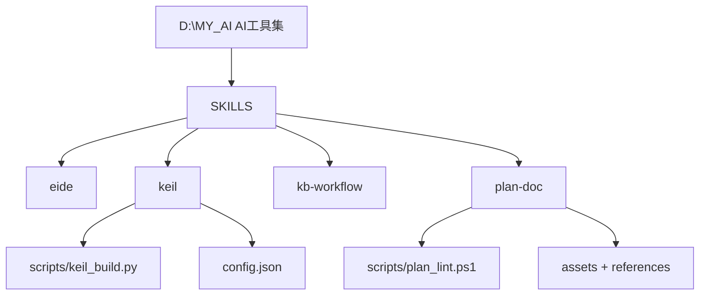

<!-- plan-doc:v1 -->

# AI工具集

> **一句话**：维护个人 AI 工具集（opencode skills：eide / keil / kb-workflow / plan-doc），逐步补齐能力与规范。
> **仓库**：`D:\MY_AI`
> **规则**：改需求先记 C；一功能一机制；执行一次只做一条。

## 0. 看板

- **阶段**：初始化（基线已建，需求待进）
- **下一条**：—
- **本次范围**：只做 ______，不做 ______
- **事实源**：代码 / 测试 > 仓库 README、AGENTS > 本文
- **最后更新**：2026-10-29｜**活跃变更**：—｜**冻结**：—｜**血缘**：前身 —｜后继 —

### 需求登记

| R | 需求 | 来源 | 状态 | 覆盖任务 |
|---|---|---|---|---|
| — | 待进（用 /plan-req） | — | 待澄清 | — |

### 任务总览

| 任务 | 状态 | 出口条件 |
|---|---|---|
| — | — | — |

### 机制登记

| 机制 | 位置 | 用途 | 扩展方式 | 使用者 |
|---|---|---|---|---|
| keil 构建/扫描 | `SKILLS/keil/scripts/keil_build.py`、`keil_project.py`、`keil_runtime.py` | Keil MDK 工程扫描、Target 枚举、build/rebuild/clean，JSON 结构化返回产物路径 | 加子命令 / 参数，不复制脚本 | — |
| keil 配置 | `SKILLS/keil/config.json`（环境）+ `.embeddedskills/config.json`（工程）+ `state.json`（状态） | 三级配置，参数解析优先级 CLI > 环境 > 工程 > 状态 | 加字段 | — |
| eide MCP 工具 | `SKILLS/eide/SKILL.md` | 经 eide-mcp-server 读写 EIDE 工程（build/flash/源目录/宏/builder） | 走 MCP 工具，不直改 eide.yml | — |
| plan-doc 模板/规则 | `SKILLS/plan-doc/assets/`、`references/` | 规划文档格式、任务/变更/归档规则 | 改模板/参考，不复制规范 | — |
| plan-doc lint | `SKILLS/plan-doc/scripts/plan_lint.ps1` | 规划文档校验门禁（ERROR/WARN） | 加检查规则 | — |
| kb-workflow | `SKILLS/kb-workflow/SKILL.md` | Obsidian 知识库绑定/维护，规范.md 为唯一事实源 | — | — |

### 基线

- 仓库 / 分支 / 提交：`D:\MY_AI`｜`main`｜`fd712ee`
- 构建命令：无（skills 集合；keil 脚本为标准库 Python，无依赖）
- 测试：未找到测试目录 / 命令

## 1. 任务池

### P0（立即）

（待进需求后拆分）

### P1 / P2

（暂无）

### 外部依赖与验收

（暂无）

## 2. 契约

- 架构 / 关键约束：每个 skill 一个目录（`SKILL.md` + `scripts/` + `references/`）；skill 之间不互相硬依赖。
- 协议 / 数据格式：keil 脚本输出 JSON（`status` / `action` / `summary` / `details` / `metrics` 等）。
- 构建与测试命令：无统一构建；keil 脚本用 `python <skill>/scripts/keil_*.py ...`。

## 3. 设计要点

### 3.1 目录结构

## 4. 决策与变更

### 决策（D）

| D | 决策 | 结论 |
|---|---|---|

### 变更（C）

| C | 日期 | 类型 | 需求 | 内容 | 影响 | 处理 |
|---|---|---|---|---|---|---|

## 5. 实施记录

（暂无）

## 6. 归档

| 任务 | 结果 | 关联 | 提交 |
|---|---|---|---|

## 7. 参考与索引

### 仓库

| 仓库 | 路径 | 角色 | 构建 | 测试 |
|---|---|---|---|---|
| AI工具集 | `D:\MY_AI` | skill 集合（源仓库） | 无 | 无 |

### 关键文件

| 文件 | 作用 |
|---|---|
| `readme.md` | 项目标题「AI工具集」 |
| `SKILLS/keil/scripts/keil_build.py` | Keil 构建/重建/清理/烧录 + JSON 输出 |
| `SKILLS/keil/scripts/keil_project.py` | 工程扫描 + Target 枚举 |
| `SKILLS/keil/scripts/keil_runtime.py` | 运行时（日志解析/配置加载） |
| `SKILLS/keil/config.json` | 环境级配置（uv4_exe / operation_mode） |
| `SKILLS/plan-doc/scripts/plan_lint.ps1` | 规划文档 lint 门禁 |
| `SKILLS/plan-doc/assets/plan-template.md` | 规划文档模板 |
| `SKILLS/eide/SKILL.md` | EIDE MCP 工具使用规则 |
| `SKILLS/kb-workflow/SKILL.md` | 知识库维护工作流 |

### 文档

- `readme.md`

### 相关仓库 / 依赖

- Python 3（keil 脚本，仅标准库）
- Keil MDK（UV4.exe）
- eide-mcp-server（eide skill 依赖）
- Obsidian vault：`C:\Users\SiaZh\OneDrive\SIA的obsidian系统`（规划文档落点）
