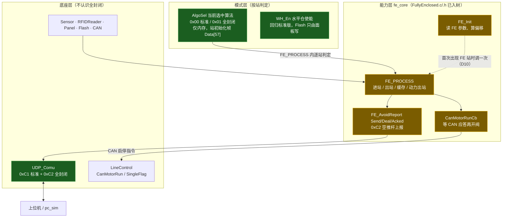
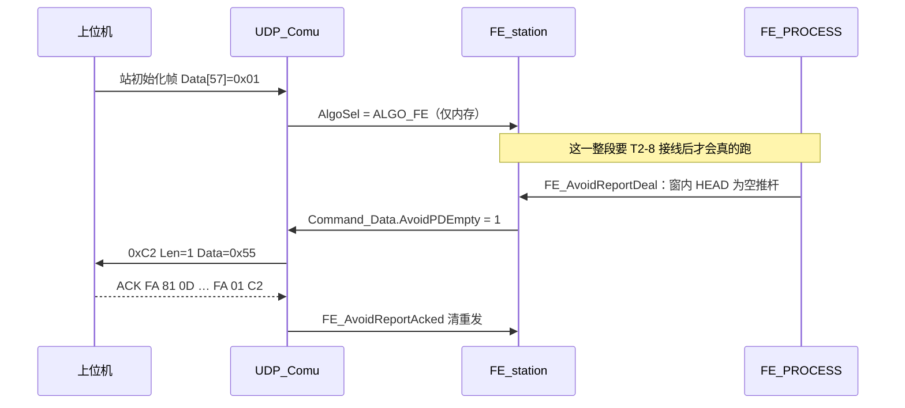

---
领域:
  - 工作
类型:
  - 开发
项目:
  - "[[S3全封闭轨道]]"
任务:
  - "[[261124V3重构方案]]"
相关任务:
  - "[[261118全封闭轨道维护]]"
状态: 进行
创建时间: 2026-11-24T17:00:00
截止时间:
完成时间:
---

# 261124 V3 重构方案（R2）

> **一句话**：标准版与全封闭合并成一条线（`V3/develop`），全封闭由「分支」改成「运行时线体使能」；多进站仍走分支、从 V3 拉出。
> **仓库**：`D:\S3\Project\S3_Controller`｜基线 `develop@aeef0ca`（V3.0.07.0）｜集成分支 `V3/develop`
> **规则**：一功能一机制；底座层不认识「全封闭」；一次只做一条；事实源：代码 > 仿真 > 本文。
> **归属**：本文件是 R2 的唯一细节载体；总规划 `261118全封闭轨道维护.md` 只留摘要与链接。

## 1 目标与边界

**目标**：一条线、一次编译、两个线体（标准 / 全封闭），以后标准版演进靠常规 merge 跟上；多进站在此基础上另开分支。

**做**：控制器 `APP/` 层的线体判定、上报、进站出站缓存、参数与端口、面板交互、构建工程。

**不做**：面板固件、读卡器固件、上位机源码、`LIB/` 第三方、Bootloader；不改帧格式；不在 `develop` 上直接动刀。

## 2 现状基线（2026-11-24，T2-1/T2-2 实测）

| 项 | 数字 |
|---|---|
| 标准线 / 全封闭线 | `develop` `aeef0ca` ↔ `全封闭轨道/v2/develop` `3cf2b62` |
| 共享文件差异 | 23 文件，+3850 / −1089；其中 581 行（53.4%）为纯搬移缩进 |
| 全封闭模块 | `FullyEnclosed.c` 2294 行、`.h` 314 行，38 个函数 |
| 全封闭判据 | 9 文件 24 处（真判据 17 处：比较 14 / 写值 1 / 枚举 1 / 宏 1） |
| 功能矩阵 | 52 项：一致 9 / 标准超集 3 / 全封闭独有 21 / 实现冲突 19 |
| 资源 | Flash 273244 B（约 52%）、RAM 205720 B，余量充足 |
| 构建 | Keil `MDK/network.uvprojx` → `DGController_3`；`MDK/` 不入库、各分支共用 |

**必须补回的标准侧功能（9 项）**：避让光电 `0xC1`、主轨延迟 3 秒停、出站读卡器代替出站光电、CAN 电机 SingleFlag 重构、`QCFailMode`/`Shield`、满光电防抖、提升类型持久化、SEGGER_RTT、电机升级静默失败补报。

**`0xC1`/`0xC2` 分布（实测）**：`develop`、`v2/多进站支持`、`archive/fe-v3-*` 有 `0xC1` 无 `0xC2`；`v2/develop` 两者皆无；`全封闭轨道/feature/避让上报` 有 `0xC2`（200ms×3）无 `0xC1`。

## 3 目标架构

### 3.1 三层

```
模式层  线体算法：AlgoSel（当前选中算法）+ WH_En（水平仓使能）
  ↑
能力层  fe_core：站点模型、进站、出站、缓存、动力出站、避让上报、FE 参数
  ↑
底座层  通讯、读写卡、运动、传感器、面板、升级、参数读写（不认识「全封闭」）
```

**收口门槛**：底座层 `wmFullyEnclosed` 与 `exFunction_En` 判据归零，用 `git grep -c` 定量。

### 3.2 五个扩展点

| 编号  | 扩展点      | 落点                                    | 做法                                                                   |
| --- | -------- | ------------------------------------- | -------------------------------------------------------------------- |
| E1  | 线体算法     | `StatParam[].WH_En` / `AlgoSel`        | `WH_En` 回归标准版原义（水平仓，Flash 归它）；`AlgoSel` 新增为「当前选中算法」、仅内存、来源参数应答帧；`WORKMODE_E` 删除 |
| E2  | 站点生命周期钩子 | `BusinessLogic.c` 进站/出站/缓存/下放         | 四处函数指针，标准注册空实现，全封闭注册 `FE_*`                                          |
| E3  | 上报路由     | `UDP_Comu.c` `Pc_UDPSend`             | **沿用标准版 `if` 链**（一轮一帧）；`0xC1` 与 `0xC2` 各自一段、互不替代，按 `AlgoSel` 判据分流；不建函数指针表（← C11）                              |
| E4  | 参数与端口    | `FEParamPack`/`FEReadPack`、`OBJ_FE_*` | 统一参数表（ID/默认值/地址/长度），地址不与 `WAREHOUSE_EN_ADDR` 冲突                      |
| E5  | 传感器语义    | `Sensor.c`                            | 采样归 `Sensor.c`，上报语义归 E3；全封闭判空只看 `occupy==0x55`                       |

### 3.3 线体算法设计（定稿）

- `WH_En`：`uint8_t` 0/1，水平仓使能，**只由面板写 `WAREHOUSE_EN_ADDR+站`**，上电读回。
- `AlgoSel`：`uint8_t`，「**当前选中算法**」，`0x00` 默认算法（标准版）、`0x01` 全封闭非均匀推杆算法。来源＝上位机参数应答帧（`0x82 0x0F`）**第 64 字节**，即固件里的 `UDP_CMD_R.Data[64 - offset]`＝`Data[57]`（`offset=7`）。**仅内存、不写 Flash**；断电复位，由下一次参数下发恢复。
- 宏：`ALGO_STD 0x00` / `ALGO_FE 0x01`；原 24 处 `== wmFullyEnclosed` 改判 `AlgoSel == ALGO_FE`。
- 两者属于不同线体，全封闭线不用水平仓，**不做优先级裁决**；只做配置校验（同站 `AlgoSel==ALGO_FE` 且 `WH_En==1` 视为配置错误，按错误上报）。
- 原 `main.c:457/469` 写 `WAREHOUSE_EN_ADDR+stat` 的做法废止。

### 3.4 工程解耦

`FullyEnclosed.c` 常驻编译（标准线也编，仅不启用），`network.uvprojx` 不再依赖「当前分支有没有该文件」——切分支不再断编。备选是双 target，代价是两套工程要同步维护，先不用。

落地顺序：T2-7 先放**空占位文件**（零逻辑、头部写明「T2-4 将用 `全封闭轨道/v2/develop:APP/FullyEnclosed.c` 覆盖」），保证每一步都编得过；T2-4 再用真模块覆盖。这样 `V3/develop` 在任何时刻都是可编译的。

## 4 分批 WBS

| 批次 | 内容 | 交付物 | 验收 | 依赖 |
|---|---|---|---|---|
| **B1 骨架** | 建 `V3/develop`、`AlgoSel` 落地、判据改判、`FullyEnclosed.c` 常驻编译（判据复现命令与 E1–E5 归属见 §8） | 可编译的 V3 树 | Keil 0 error；`exFunction_En`/`WORKMODE_E` 归零；标准线行为不变 | T2-1/T2-2 |
| **B2 上报** | `0xC1` 补回、`0xC2` 带入（按标准版 `if` 链并入，注册表方案已撤 ← C11）（范围取 §8 的 52 项归属统计与 §2 的必补 9 项） | 上报路由层 | 标准线 `0xC1` 与 `develop` 逐项一致；全封闭 `0xC2` 与 `767c84d` 一致 | B1 |
| **B3 站点能力** | E2 四钩子、`FE_*` 状态机搬入 `fe_core`、动力出站/缓存 | `fe_core` 与钩子注册 | 标准三处行为不变；全封闭四支路进站、动力出站、缓存全过 | B1 |
| **B4 参数与端口** | E4 统一参数表、端口配置、`WH_En` 只归水平仓、旧 Flash 值迁移 | 参数表 + 迁移说明 | 老参数块能读、能迁移、断电保持 | B1 |
| **B5 多进站** | 从 V3 拉分支，移植 `3.6.06.1` 差异，写死参数改可配 | 多进站分支 | 逐项与 `3.6.06.1` 对齐；共用 `AlgoSel` 字节（`0x02` 留给多进站） | B1、B3 |
| **B6 回归合入** | 三档回归、真机、合回 `develop` | 回归记录 + 合入 | 第 6 节清单全绿；三台机各跑一遍 | B2–B5 |

> 2026-11-25：**B1 完成**（T2-7 + T2-4）——`V3/develop` 0E0W，FE 模块（2355 行 `.c` + 370 行 `.h`）入树但未接线，镜像内 `FE_` 符号 0 个；Flash 258544 B/49.4%、RAM 204144 B/28.3%；底座 `wmFullyEnclosed`/`exFunction_En` 归零，`LineControl.c` 一行未改。下一步 B2 上报。
>
> 2026-11-25：**B2 代码完成**（T2-10）——`0xC2` 按标准版 `if` 链并入（E3 注册表已撤，← C11），`FE_PROCESS` 里的避让上报排在出站之前；`Command_Num`/ACK/重发与 `767c84d` 逐字节一致，判据用 `AlgoSel`；Flash 258728 B、RAM 206360 B（`FE_Instance` 因 ACK 路径进镜像）。**运行时仍未接线**（`FE_PROCESS` 未进主循环），`0xC2` 尚不可触发。

## 5 三档回归清单（每项都要在对应线体上验）

| 功能项 | 标准 | 全封闭 | 多进站 | 判定依据 |
|---|---|---|---|---|
| 进站·衣架 | ✓ | ✓ | ✓ | 阀动作与站号正确 |
| 进站·推杆 | ✓ | ✓ | ✓ | 同上 |
| 多支路进站（1A–4B） | — | ✓ | ✓ | 四路各自独立 |
| 出站与动力出站 | ✓ | ✓ | ✓ | 出站时机、结果上报 |
| 出站缓存 | ✓ | ✓ | ✓ | 防晃 2s、保持 1s |
| 下放、提升 | ✓ | ✓ | ✓ | 动作与延时 |
| 避让上报 `0xC1` | ✓ | — | ✓ | 满/取消满 |
| 避让上报 `0xC2` | — | ✓ | — | 200ms×3、等 ACK |
| 上报队列优先级 | ✓ | ✓ | ✓ | 每轮一帧、顺序正确 |
| 故障上报 `0x7E` | ✓ | ✓ | ✓ | 码位与站号 |
| 参数读写（含 `WH_En`） | ✓ | ✓ | ✓ | 写入/回读/断电保持 |
| 端口配置 | ✓ | ✓ | ✓ | 与丝印一致 |
| 面板交互 | ✓ | ✓ | ✓ | 菜单与参数同步 |
| 远程升级 | ✓ | ✓ | ✓ | 四类目标 |
| 读卡器 `0x10` | ✓ | ✓ | ✓ | 进站/下放帧 |
| 心跳校正（主轨启停） | ✓ | ✓ | ✓ | ChainStart 跟随 |
| 线体算法切换 | ✓ | ✓ | ✓ | 参数应答帧第 64 字节生效、`AlgoSel` 断电复位 |
| 配置冲突校验 | ✓ | ✓ | ✓ | 同站 `AlgoSel=0x01` 且 `WH_En=1` 报错 |

## 6 里程碑

- **M1** 功能矩阵与差分归因定稿（已完成，2026-11-24）
- **M2** B1 完成：V3 可编译、判据归零、标准线行为不变（已完成，2026-11-25）
- **M3** B2–B4 完成：上报、站点能力、参数三块收口
- **M4** B5 完成：多进站移植到 V3
- **M5** B6 完成：三档回归全绿，合回 `develop`

## 7 风险与回退

| 风险 | 处置 |
|---|---|
| 合并把标准线改坏 | `develop@aeef0ca` 冻结为对照；V3 独立分支；每批跑标准回归 |
| 判据漏改 | `git grep -c` 定量归零作为门槛，不是「改完就行」 |
| 参数/Flash 迁移出错 | 参数版本号 + 迁移任务；禁止用「重新初始化」糊过去 |
| 内存增长 | 每次编译记账（Flash/RAM），单批超 5% 说明原因 |
| 多进站带回旧漂移 | 只按功能项移植，禁止整支合并（落后 51 个提交） |
| 断电后 `AlgoSel` 丢失 | 已定仅内存：必须靠参数应答帧第 64 字节恢复；若现场上位机不发该字节（`Len<58`），机器会落到标准算法，需在上板前抓包确认（见 T2-6、Q-09） |
| 回退 | V3 分支废弃即回 `develop`；旧全封闭线用 `archive/fe-v3-*` tag 取回 |
| v2 旧算法缺陷不回补 | `v2.3.05.8` 现场每次参数初始化仍会写一次 Flash（恒真条件）；V3 替换后消失。若现场继续跑 v2，是否回补需单独决策 |
| RTT 源不在库 | `MDK/` 工程不含 RTT 源、`develop` 自 `74797a3` 起却调 `SEGGER_RTT_Init` → 链接缺符号；处置＝注释 `main.c:105`（D9），RTT 调试输出暂无通道、控制逻辑不受影响；恢复＝把 `D:\S3\Project\RTT` 入库后取消注释 |
| 面板/上位机码位偏移 | v2 的动力出站两条消息在 35/36，V3 已被标准侧占用 → 追加为 37/38；`dOutMtrDrv` 同理追加在 `FD_DEVICE_e` 末尾、数值与 v2 不同。面板文本映射与上位机故障码解析各需对一次 |
| ~~`CanComu` 无互斥~~ **已关闭（T2-13）**：CAN 通道合并为单一执行器，`CanComu` 只有一个使用者 | 新风险：队列深度 8，满时 `StatMotorInitCallback` 不检查 `MotorCmdPush` 返回值、FE 命令静默丢弃，且标准命令现在也占队列 |

## 8 输入与未决项

> 原 `261124功能矩阵.md`、`261124差分归因.md` 的结论已并入本节，两个原文件已于 2026-11-24 删除。

**判据清单（B1 的作业单，随时可复现）**

- 复现：`git grep -c -E 'wmFullyEnclosed|FullyEnclosed' 全封闭轨道/v2/develop -- APP` → 9 文件 24 处
- 归属分布：E1 6、E2 6、E3 2、E4 2、E5 1，另 7 处是 `#include` 与注释残留（B1 清理项）
- 通过标准：V3 底座层上该命令输出 0

**功能覆盖（B2–B5 的范围）**

- 52 项：一致 9 / 标准超集 3 / 全封闭独有 21 / 实现冲突 19；`FullyEnclosed.c` 38 个函数全部有归属
- 必补的 9 项标准侧功能见 §2；每批开工前按类目自查，矩阵原文已删，需要时按同一口径重新生成

**未决项（开工前要定）**

| 编号 | 内容 | 风险 | 谁定 |
|---|---|---|---|
| Q-05 | 面板「动力出站使能」`0x501` 保存分支被整段注释，恒返回 `aSaveFail` | 现场改不了该参数，只能靠帧下发 | 架构师 |
| Q-06 | ~~`FE_Init` 上电无条件写 `OutPinUsed[]`~~ **已定（← D10）**：`FE_Init` 只在 `AlgoSel==ALGO_FE` 时执行，标准站不调，端口占用不会互相干扰 | — | 架构师（已定） |
| Q-07 | 0t 版本对 `Data[64-offset]` 是**写**，本基线是**读** | 两版对同一字节方向相反，合并会打架 | 架构师（需 0t 源码） |
| Q-08 | 标准侧心跳结构体 22 字节，FE 侧按 `Len>=56/57` 解析 | 上位机与固件版本必须成对 | 质量工程师 |
| Q-09 | 参数应答帧表头示例 `Len=0x0037`（55）与第 64/65 字节矛盾（有第 64 字节则需 `Len>=58`） | 示例值可能已过期；若真实帧长 55，算法字节读不到、全封闭静默不生效 | 质量工程师（抓一包真实帧） |
| Q-10 | ~~发布镜像基址~~ **已澄清、撤销**：镜像本就链接 `0x08020000`（`OCR_RVCT4=0x8020000`；`:21` 的 `IROM(0x08000000,…)` 是容量声明），与 `D:\S3\固件` 9 个发布包同形态；烧录只覆盖 app 槽 | — | 已定 |
| Q-11 | **FE 站缺「出站完成」上报**：`Hanger_Out`（`command.h:161`）只在 `Func_OutStation` 里置位，FE 站被排除后永远到不了；v2 同样没有 | 若上位机靠 `Hanger_Out` 判定出站完成，全封闭站会一直显示「未出站」 | 用户/上位机确认 |

**合并风险（B1–B4 逐条关闭，关闭记录写进总规划 §5）**

| 编号 | 内容 | 级别 |
|---|---|---|
| U2 | ~~CAN 电机两套实现（FE 队列+回调 vs 标准 SingleFlag），只能保一套~~ **已定（← D11）**：标准 `CanMotorRun`/`SingleFlag` 不动，FE 动力出站新增 `CanMotorRunCb`，按 `AlgoSel` 互斥；两者驱动不同电机类型 | 中（并存互斥） |
| U3 | 故障状态机与码位不一致（`CanErr==3` vs `0x82`；提升箱码 8 vs 12） | 中 |
| U4 | `BoardIP` 默认值 154→1 | 低 |
| U5 | 下放阀/提升臂两套语义（`DlyStartTP` 1600→0、`StaAct_StoreValve` 计时口径） | 高 |
| U6 | 满光电/缓存阈值与防抖（FE 去掉了 `ExDetcTC` 防抖） | 中 |
| U7 | 心跳字段 `Shield`+`QCFailMode` → `is_masked`，字段少一个 | 高（跨项目） |
| U8 | 电机升级静默失败（FE 缺 `UPDATE_OTTP` 看门狗与三处 `uFail` 补报） | 中 |
| U9 | 581 行同文异位只做去空白匹配，未逐行确认语义等价 | 低-中 |

## 9 上位机参数应答帧（0x82 0x0F）字节表

帧头 7 字节，第 7 字节起为数据区，即固件中的 `Data[字节号 - 7]`（`offset = 7`）。

> ⚠️ 表头示例 `Len=0x0037`（55）与第 64/65 字节矛盾：若存在第 64 字节，`Len` 至少 58。真实帧长待抓包（Q-09）。

| 字节 | 含义 |
|---|---|
| 0–6 | 帧头：`0xFA`、`0x82`、`0x0F`、线号、站号、`LenHi`、`LenLo` |
| 7 | 面板全屏显示开启：`0x55` 开 / `0xAA` 关 |
| 8 | 衣架快出慢出：`0x55` 慢出 / `0xAA` 快出 |
| 9 | 空 |
| 10 | 进站到出站推杆总数：默认 3，最大 20 |
| 11–12 | 进站阀打开保持时间（高 / 低） |
| 13–14 | 杆值接收延处理时间（高 / 低） |
| 15 | PC 版本 |
| 16 | 站功能标志：`0xAA` 标准站 / `0x55` 桥接站 |
| 17–18 | 出站阀保持时间（高 / 低） |
| 19–20 | 出站偏移延时（高 / 低） |
| 21–28 | 空 |
| 29 | 链条启动标志：`0x01` 启动 / `0x00` 未启动 |
| 30–31 | 空 |
| 32 | 进站容量（任务数）最大 255，默认 15 |
| 33 | 提升臂 1 行程时间 |
| 34 | 空 |
| 35 | 总杆数信息 |
| 36 | 吊挂线模式：`0xAA` 普通标线 / `0xA5` 普通链式线 / `0x55` 普通吊篮线 / `0x50` 链式吊篮线 |
| 37 | 读卡查询功能：`0x55` 返工查询 / `0xAA` 多道工序查询 / `0xA5` 单一工序查询 |
| 38 | 低频卡功能：`0x55` 开放低频捆绑 / `0x50` 线外采集 / `0xAA` 开捆绑及采集 / 其他关闭 |
| 39 | 读卡处理方式：`0x55` 卡号发送 / `0xA0` 后道捆绑 |
| 40 | 空 |
| 41 | 提升臂（箱）电机与阀联动：`0x55` 联动 / `0xAA` 阀动 |
| 42 | 出站缓存容量（衣架数，默认 2） |
| 43 | 自动出衣：`0x55` 自动关 / `0xAA` 自动开 |
| 44 | 自动出衣间隔（默认 5s） |
| 45–46 | 下放阀 1 延时打开（高 / 低） |
| 47 | 防晃启用：`0x55` 首个防晃 / `0xAA` 每个防晃 / 其他关闭 |
| 48–49 | 防晃时间（高 / 低） |
| 50 | 语言版本：0 简中 / 1 繁中 / 2 英文 / 3 高棉文 / 4 西班牙文 |
| 51–56 | 空 |
| 57 | 进站 1 偏移延迟杆数（1–20） |
| 58–59 | 进站 2 偏移延迟时间（高 / 低） |
| 60–61 | 下放阀延迟启动时间（高 / 低） |
| 62 | 当前支轨（1–9，希音） |
| 63 | 空 |
| **64** | **控制算法：`0x00` 默认算法（标准版）；`0x01` 全封闭非均匀推杆算法（全封闭模式）** |
| 65 | 进站模式：`0x00` 按任务进站 / `0x01` 按序进站 |

## 10 整体看板（可视化，2026-11-25 起实验）

> 目的：一屏看清「东西在哪一层、落地到哪、坑在哪」。颜色：绿＝已落地并与基线一致，黄＝代码就位但没跑起来／没验，灰＝未开工。mermaid 由 Obsidian 原生渲染，在阅读视图里看。

### 10.1 分层与落地状态



### 10.2 批次进度


### 10.3 `0xC2` 链路时序（断在哪一眼能看到）



### 10.4 当前三个坑（随任务关闭）

| 位置 | 坑 | 关闭条件 |
|---|---|---|
| `CanMotorRunCb` | 未实现，FE 动力出站发不出 CAN | T2-8 编过 + 真机「等应答再开阀」 |
| `FE_PROCESS` | 未接主循环，`0xC2` 冲不出去 | T2-8 接线 + 真机 |
| `FE_Init` | 未调；不能上电无条件跑（Q-06 端口占用） | 首次出现 FE 站时调一次（D10） |

**判读口径**：模式层、底座层的绿色＝行为与 `develop`/`12e3941` 一致；能力层要等 T2-8 接线 + 真机验证后才转绿。