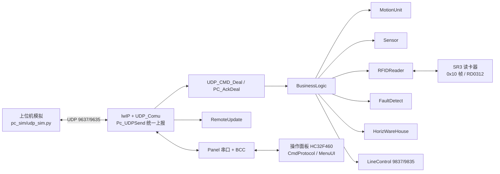

---
领域:
  - 工作
类型:
  - 开发
项目:
  - "[[S3吊挂控制器]]"
任务:
  - "[[261029S3维护]]"
相关任务:
状态: 进行
创建时间: 2026-10-29T12:03:48
截止时间: 2027-10-29T12:03:00
完成时间:
---
<!-- plan-doc:v1 -->

# S3吊挂控制器维护

> **一句话**：维护标准线 S3 控制器（GD32F407/470）、操作面板（HC32F460）、上位机模拟器与 SR3 读卡器（HC32F002）的通讯与业务；R1「屏蔽 `0x00000055` 上报」代码已交付，等真机验证与合入。
> **仓库**：`D:\S3\Project\S3_Controller`（控制器，标准线 `develop`）｜`D:\Screen\HangerOperatePanel\Operation_Panel`（面板）｜`D:\S3\pc_sim`（上位机模拟）｜`D:\Reader\SR3`（读卡器）｜`D:\Reader\ReaderUpdater`（读卡器升级）
> **规则**：改需求先记 C；一功能一机制；一次只做一条；事实源：代码 > 测试 > 本文。

## 0. 看板

- **阶段**：R1 只差真机；标准线与全封闭线同仓库不同分支，本文只管标准线与配套（全封闭见 [[261118全封闭轨道维护]]）；V3 重构（标准版+全封闭合并成一条线，分支 `V3/develop`）的需求与任务记在那份文档的 R2
- **下一条**：T1-2 真机验证 0x55 屏蔽
- **最后更新**：2026-11-24｜**活跃变更**：C1｜**冻结**：—｜**血缘**：全封闭线 `全封闭轨道/*`（同仓库，人工合并）

### 需求登记

| R | 需求 | 状态 | 覆盖任务 |
|---|---|---|---|
| R1 | 控制器不再把不确定卡号 `0x00000055` 上报上位机（152/141/186/187/139 六条），但保留推杆占用与避让 | 交付（真机待验） | T1-1、T1-2、T2-1 |

### 机制登记

| 机制 | 位置 | 用途 | 扩展方式 |
|---|---|---|---|
| UDP 通讯 | `S3_Controller/APP/UDP_Comu.c/h`、`UDP_CMD.c/h`、`command.h`：端口 9637/9635，线控制 9837/9835 | 控制器↔上位机、线控制器的命令帧 | 加命令码 + `UDP_CMD_Deal` / `PC_AckDeal` 分支 |
| 上报队列 | `UDP_Comu.c` `Pc_UDPSend`：`Command_Data[站]` 标志 + `Command_Num`，每轮只发一帧 | 所有主动上报的唯一出口 | 在队列里加标志与发送分支（越靠前越优先） |
| 业务逻辑 | `APP/BusinessLogic.c` `Business()`：进站、出站、桥接缓存、下放、提升；按 `exFunction_En` 分标准/水平仓/全封闭三条线 | 衣架流转 | 在对应 `Func_*` 内扩，不另起流程 |
| 运动单元 | `APP/MotionUnit.c`：进站阀、出站阀、下放阀、提升臂、提升电机、缓存阀，`StaBitUpt_* → StaUpt_* → StaAct_*` 三级状态机 | 阀与电机动作 | 加动作参数与端口，复用状态机 |
| 传感器 | `APP/Sensor.c`：`IN_IO_FLAG` 去抖、`AvoidPD` 沿检测、`InPinConfig` 端口配置 | 光电采集与避让上报 `0xC1` | 加信号类型与上报命令 |
| 故障 | `APP/FaultDetect.c`：`FD_*` 判定 + `SendFault`（`0x7E`，`Len=4`） | 故障判定与上报 | 加故障类型与判定条件 |
| 面板链路 | `S3_Controller/APP/Panel.c`（UART3/USART5，帧带 BCC）+ `Operation_Panel/midware/CmdProtocol.c`、`MenuUI.c`、`MenuParam.c` | 控制器↔面板数据与菜单 | 两端加字段/命令 ID |
| 读卡器链路 | `S3_Controller/APP/RFIDReader.c`（`0x10` 帧）+ `D:\Reader\SR3`（RD0313，模式 0/1/2/3）+ `ReaderUpdater`（`0x55` IAP） | 卡号读取、下放、升级 | 协议改动需 App/Bootloader/上位机三端同步 |
| 远程升级 | `APP/RemoteUpdate.c`：控制器、面板、电机、读卡器四类目标 | 网络升级 | 复用升级状态机 |
| 参数持久化 | 控制器 `BSP/W25QXX`、`BSP/FLASH`；面板 `midware/ziflash.c`、`w25qxx/` | 站号/线号/参数 | 加地址宏，复用读写接口 |

### 基线（2026-11-24 按代码复核）

- 控制器 `D:\S3\Project\S3_Controller`：标准线 `develop` = `aeef0ca`（= `origin/develop`，2026-10-14）；本机工作区检出的是 `全封闭轨道/v2/develop`（`3cf2b62`），标准线不在本机检出——复核用 `git show develop:<文件>`（旧记录里的 `D:\S3\.worktrees\std` 已不存在）
- 面板 `D:\Screen\HangerOperatePanel\Operation_Panel`：`E1/硕达报废/develop` = `8bb846e`，干净（旧文档里的 `D:\Screen\Projects\...` 不存在）
- 读卡器 `D:\Reader\SR3`：`main` = `768e92d`（2026-11-23），RD0313（`03_Application/reader_app.h:44`，`READER_VER_MINOR` 0x13，升级结果帧 PackNo 随之 0x0313）；比旧基线 `36f0f76`/RD0312 多 17 个提交，改动集中在 LPUART 波特率、EM4095 边沿与 `reader_app.c`，`0x10` 帧格式未变；工作区有未跟踪文件（`04_Doc/sr3_decode_sim.html`、`07_Script/*.py|js`）
- 升级上位机 `D:\Reader\ReaderUpdater`：`master` = `3619bcb`，`FirmwareUpdater.cpp`、`ReaderUpdater.cpp` 仍有未提交修改；`ReaderUpdaterV2.0` 只有 exe + Qt6 DLL
- 构建：Keil，配置见各仓库 `.embeddedskills/config.json` —— 控制器 `MDK/network.uvprojx`→`DGController_3`（ARMCC 5.06u7，106 条引用中 `APP/FullyEnclosed.c` 只有全封闭分支有）；面板 `MDK/HC32F460KETA.uvprojx`→`HC32F460KETA_Debug`；读卡器 `00_Project/Keil/SR3.uvprojx`→`SR3`（ARMCLANG 6.24）
- 构建陷阱：`MDK/` 被 `.gitignore` 忽略、不入库、被各分支共用，现工程引用 `..\APP\FullyEnclosed.c`；切到 `develop` 后该文件不存在 → 直接编译会缺文件（旧记录 2026-11-02 的链接失败与此一致）
- 编译：`MDK/_build.log` 2026-11-20 14:46 `0 Error(s), 0 Warning(s)`；该次产物 `MDK/Objects/app.bin` 里的版本串是 `V3.3.05.9`，属全封闭线树，不是标准线；标准线树未在本机复编
- 测试：无自动化测试 / CI；控制器用 `pc_sim/udp_sim.py` 联调，读卡器用真机串口 + `06_TEST/*.py`
- 版本：控制器 `ControlVer` = `V3.0.07.0`（`UDP_Comu.c:26`）；面板 `CPVER` = `E10`（`midware/MenuUI.h:9`）；读卡器 RD0313
- 固件：`D:\S3\固件\比帆\app3.e.07.1`（2026-11-13，含 `_encrypted`）为最新发布
- 文档：控制器 / 面板 / 读卡器均无 `README.md` / `AGENTS.md`（仅 `LIB/` 下第三方 README）

## 1. 任务池

### P0（立即）

- [ ] **T1-2 真机验证 0x55 屏蔽** → 需求：R1；产出：§5 一行验证记录；验证：人工：烧 `feature/T1-1-unknown-card-filter`@`6bb33bf` → 让读卡器投票未决（现场触发 `0x00000055`）→ 152/141/186/187/139 均不携带该卡号，推杆占用、避让、其他卡号上报不受影响；机制：复用 `Pc_UDPSend` 过滤；边界：只验证不改码，异常另开任务

### P1

- [ ] **T2-1 合入 develop** → 需求：R1；产出：`develop` 含 `6bb33bf`；验证：`git log develop --oneline -1` → 含该提交，Keil `DGController_3` 编译 0 error；机制：—；阻塞：T1-2 未过 → 解除条件：真机通过；边界：不动全封闭分支

### P2

- [ ] **T2-2 让标准线能独立编译** → 需求：运维；产出：独立于全封闭的 Keil 工程或切换说明（写进本文基线）；验证：切到 `develop` 树 → 编译 `DGController_3` 0 error 且不再缺 `FullyEnclosed.c`；机制：复用现有 MDK 工程，只改工程文件；边界：不改被跟踪的源码
- [ ] **T2-3 收口 `ReaderUpdater` 未提交改动** → 需求：运维；产出：干净工作区或明确丢弃；验证：`git -C D:\Reader\ReaderUpdater status --short` → 空；机制：—；边界：不动固件协议

## 2. 契约

- MCU：控制器 GD32F407/470 + lwIP；面板 HC32F460；读卡器 HC32F002C4PZ
- 端口：UDP 9637（控制器收）/9635（PC 收）；线控制 9837/9835。代码两个分支都绑 9837，注释写的「服务器版 9838+线号」未实现
- 帧：`FA CMD2 CMD3 LineNo StatNo LenHi LenLo Data`；应答帧 `FA 81 0D … Data=FA CMD2 CMD3`
- 0x55 过滤点：`Pc_UDPSend` 发送层。命中不组帧、清对应 `apply`、`Command_Num--`；186/187 另置 `AvoidPDBan[0]=1`，187 清 `RecvFlag[B]`，139 清 `ID_Perd`
- 只屏蔽上报：`RFIDReader.c` 仍把 0x55 写入 `InReader.ID` 并置 `InToOutPoleFlag`，进站匹配、占用与避让不变
- `0xC1` 避让上报（标准线既有）：`Func_AvoidPDReport` 上升沿报 `FULL`、下降沿报 `NO_FULL`，`Data[0]=NowPoleNum`；桥接站看 `AvoidPDBan[0]`、标准站看 `[1]`
- 面板：串口帧带 BCC（`BCC_CheckSum` 异或），`Panel_Comu` 每轮收发；菜单与参数在面板端 `midware`
- 读卡器：`0x10 FF 7A`（进站）/`0x10 FF 75`（下放、出站），19200-8-N-1（桌面 9600）；RD0313 四种模式（桌面/进站/下放/连续），升级结果帧 PackNo=`0x0313`（控制器 `RFIDReader.c` 只记录、不比对，旧上位机不受影响）
- 故障：`0x7E`，`Len=4` = [状态, 设备, 位置, 名称]；线路故障 `CMD3=1`、`StatNo=0xC9`
- 参数应答帧（`0x82 0x0F`）：第 64 字节＝控制算法，`0x00` 默认算法（标准版）、`0x01` 全封闭非均匀推杆算法；标准版固件目前不判这个字节，V3 起由 `AlgoSel` 承接。完整字节表见 [[261124V3重构方案]] §9
- 升级：`0x55` IAP，App / Bootloader / 上位机三端同步；控制器、面板、读卡器版本号互相独立

## 3. 方案

### 3.1 模块关系

主循环 `APP/main.c`：`LineFunction` → `UDP_Comu` → `Business`/`FaultDetect` → `Panel_Comu` → `CAN_Comu` → `MotionFunc` → `SensorDetect` → `RFID_Recv`/`RFID_Send` → `Func_BridgeBuff`/`Func_Horiz_Storeage`，每轮喂看门狗。

### 3.2 屏蔽 `0x00000055`（R1 / T1-1）

在 `Pc_UDPSend` 的 6 个上报分支入口加 `IsUnknownHangerID()` 判断，命中则清标志、`Command_Num--`、不组帧（`continue` 跳到下一站）：

| 上报 | 码 | 判据字段 | 命中额外动作 |
|---|---|---|---|
| 下放读卡器卡号 | 152 | `StoreReader[站].ID` | — |
| 出站读卡器卡号 | 141 | `OutReader[站].ID` | — |
| 下放衣架出站申请 | 141 | `StoreReader.ID`（标线）/ `ID_In`（高线），与 `StoreRfidPack` 同源 | — |
| 进站衣架 ID | 186 | `InReader[站].ID_In` | `AvoidPDBan[0]=1`（等价上位机 ACK） |
| 非进站衣架 ID | 187 | `InReader[站].ID_In` | 清 `RecvFlag[B]`、`AvoidPDBan[0]=1` |
| 衣架已出站 | 139 | `OutReader[站].ID_Perd` | 清 `ID_Perd` |

- 选发送层而不是读卡解析层：一处覆盖全部 6 条，`RFIDReader` 仍按原样记卡号、置 `InToOutPoleFlag`，占用与避让不受影响
- 边界：不改读卡器固件、上位机、`0x10` 帧；不新建机制

### 3.3 依赖与边界

- 控制器依赖 `LIB/` 的 `GD32F4x_FWLib`、`lwip`、`CANopenNode`、`cm_backtrace`
- `0xC1` 在全封闭 v2 里被删掉了（`v2/develop` 的 `command.h` 无 `M_CMD_AVOID_PD`、`Sensor.c` 无 `Func_AvoidPDReport`），`0xC2` 只在 `全封闭轨道/feature/避让上报`（`UDP_Comu.c:1027`、`command.h:130`）。两条语义不同（`0xC1`＝光电触发即有满、带满/取消满；`0xC2`＝空推杆、200ms×3 重发、等 ACK），V3 合并要分别补回，不能合成一条
- 本文不含全封闭业务（`FullyEnclosed.c` 只在 `全封闭轨道/*` 分支），也不含面板 UI 细节（见 [[261102SR3读卡器维护]] 等笔记）

## 4. 决策与变更

### 决策

| D | 决策 | 结论 | 任务 |
|---|---|---|---|
| D1 | 0x55 过滤放在 `Pc_UDPSend` 发送层 | 发送层一处覆盖 6 条上报，读卡解析与占用逻辑零改动；`AvoidPDBan` 用本地置位等价上位机 ACK | T1-1、T1-2 |

### 变更

| C | 日期 | 类型 | 需求 | 内容 | 影响 | 处理 |
|---|---|---|---|---|---|---|
| C1 | 2026-11-24 | 修改 | R1 | 读卡器基线由 RD0312（`36f0f76`）变为 RD0313（`768e92d`，2026-11-23），升级结果帧 PackNo 变 0x0313 | 契约、文档、真机验证 | 契约已改；T1-2 真机验证按 RD0313 读卡器执行 |

## 5. 实施记录

- [x] **T1-1 屏蔽 0x00000055 卡号上报** —— `UDP_Comu.c` 加 `IsUnknownHangerID()`，在 152/141/141/186/187/139 六个分支入口过滤，命中清标志与计数、186/187 补 `AvoidPDBan[0]=1`、187 清 `RecvFlag[B]`、139 清 `ID_Perd`；验证：静态核对 6/6 分支（`git diff develop..feature/T1-1-unknown-card-filter`）+ 旧记录的单文件编译 `UDP_Comu.c` 0 error → 通过；行为：0x55 不再上报上位机，推杆占用与避让保持；结果：通过（真机待 T1-2）

## 6. 归档

| 任务 | 结果 | 关联 | 提交 |
|---|---|---|---|
| T1-1 屏蔽 0x00000055 上报 | 完成 | ← D1 | `6bb33bf` |
