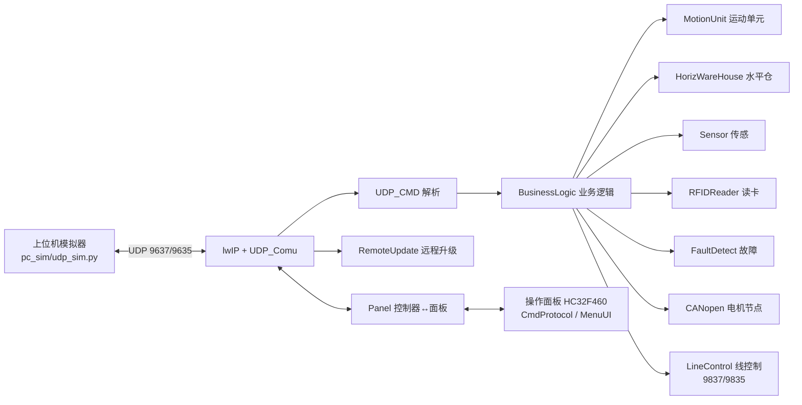

---
领域:
  - 工作
类型:
  - 开发
项目:
  - "[[S3吊挂控制器]]"
任务:
  - "[[261029S3维护]]"
相关任务:
状态: 待办
创建时间: 2026-10-29T12:03:48
截止时间: 2027-10-29T12:03:00
完成时间:
---
<!-- plan-doc:v1 -->

# S3吊挂控制器维护

> **一句话**：维护 S3 吊挂控制器（GD32F407）、操作面板（HC32F460）与上位机模拟器三端的 UDP 通讯与业务逻辑。
> **仓库**：`S3_Controller`（控制器）｜`Operation_Panel`（面板）｜`pc_sim`（上位机模拟）
> **规则**：改需求先记 C；一功能一机制；执行一次只做一条。

## 0. 看板

- **阶段**：基线已建，待需求登记
- **下一条**：（空，待 `/splan-req` 登记需求）
- **本次范围**：只做 ______，不做 ______
- **事实源**：代码 / 测试 > 仓库 README、AGENTS > 本文
- **最后更新**：2026-10-30｜**活跃变更**：—｜**冻结**：—｜**血缘**：前身 —｜后继 —

### 需求登记

<!-- 需求只有一个入口：这张表。当前为空，待 /splan-req 登记。 -->

| R | 需求 | 来源 | 状态 | 覆盖任务 |
|---|---|---|---|---|
| — | — | — | — | — |

### 任务总览

| 任务 | 状态 | 出口条件 |
|---|---|---|
| — | — | — |

### 机制登记

<!-- 一功能一机制。任务必须写"机制：复用 X / 新建 D#"。 -->

| 机制 | 位置 | 用途 | 扩展方式 | 使用者 |
|---|---|---|---|---|
| UDP 通讯 | `S3_Controller/APP/UDP_Comu.c/h`、`UDP_CMD.c/h`、`command.h` | PC↔控制器命令/心跳，端口 9637/9635，0xFA 帧头 | 在 `command.h` 加命令码 + `UDP_CMD_Deal` 解析 | — |
| 故障上报 | `S3_Controller/APP/FaultDetect.c/h` | 故障检测与上报（`CMD_FAULT_UPLOAD 0x7E`） | 在 FaultDetect 加故障类型/触发条件 | — |
| 业务逻辑 | `S3_Controller/APP/BusinessLogic.c/h` | 衣架流转、出站、桥接、满站等流程 | 在流程分支扩展，不另起状态机 | — |
| 水平仓 | `S3_Controller/APP/HorizWareHouse.c/h` | 水平仓参数（进出仓/满检/同步/桥接/电机/阀）读写与初始化 | 加参数项，复用 `W25QXX` 存储 | — |
| 运动单元 | `S3_Controller/APP/MotionUnit.c/h` | 提升机/推杆/气缸动作控制 | 新增动作参数，复用定时逻辑 | — |
| 传感器 | `S3_Controller/APP/Sensor.c/h` | 光电/避让信号采集与上报 | 加信号类型与上报命令 | — |
| BSP I/O 与定时 | `S3_Controller/BSP/INPUT`、`OUTPUT`、`RELAY`、`TIMER`、`SPI`、`GD32_BSP` | 端口采样/输出、继电器、定时与底层驱动 | 加端口配置，复用现有驱动接口 | — |
| RFID 读卡 | `S3_Controller/APP/RFIDReader.c/h` | 高低频卡号读取与上传 | 复用卡号打包接口 | — |
| 远程升级 | `S3_Controller/APP/RemoteUpdate.c/h` | 网络远程升级（`CMD_REMOTE_UPDATE`） | 复用升级状态机 | — |
| 线控制 | `S3_Controller/APP/LineControl.c/h` | 线控制功能，端口 9837/9835 | 加线控制命令 | — |
| 面板交互 | `S3_Controller/APP/Panel.c/h` | 控制器↔面板数据交换 | 加字段/命令码 | — |
| CANopen | `S3_Controller/BSP/CanOpen/`、`LIB/CANopenNode/` | CAN 电机节点通讯 | 加节点/对象字典 | — |
| Flash 存储 | `S3_Controller/BSP/FLASH/`、`BSP/W25QXX/` | 站号/线号/参数持久化 | 加地址宏，复用读写接口 | — |
| 面板命令协议 | `Operation_Panel/midware/CmdProtocol.c/h` | 面板↔上位机命令帧 + BCC 校验 + 重发 | 加命令 ID 与解析分支 | — |
| 面板菜单 | `Operation_Panel/midware/MenuUI.c`、`MenuParam.c`、`LangMenu.c`、`SC_MenuParam.c`、`TC_MenuParam.c` | 菜单显示与参数配置 | 加菜单项/参数表 | — |
| 面板显示 | `Operation_Panel/midware/LCD.h`、`Dispaly.c`、`fonts.c` | 液晶显示 | 复用显示接口 | — |
| 面板远程升级 | `Operation_Panel/midware/RemoteUpdate.c/h` | 面板端远程升级 | 复用升级状态机 | — |
| 面板存储 | `Operation_Panel/midware/flash/`、`w25qxx/`、`interflash.c`、`ziflash.c` | 面板参数持久化 | 复用读写接口 | — |
| 上位机模拟 | `pc_sim/udp_sim.py` | UDP 上位机模拟器（Typer + Rich TUI），收发/心跳/Bug 复现 | 加命令解析与模拟动作 | — |

### 基线

- 仓库 / 分支 / 提交（2026-10-30 侦察）：
  - 控制器 `D:\S3\Project\S3_Controller`｜`develop`｜`e9120b3`（工作区干净）
  - 面板 `D:\Screen\Projects\Operation_Panel`｜`release/V061`｜`7bd9a43`
  - 上位机 `D:\S3\pc_sim`｜非 git（仅 `udp_sim.py` + `__pycache__`）
- 构建命令：Keil MDK（`.embeddedskills/config.json`）
  - 控制器 `MDK/network.uvprojx` → `DGController_3`（编译器 ARM Compiler 5.06u7）
  - 面板 `MDK/HC32F460KETA.uvprojx` → `HC32F460KETA_Debug`
- 版本：控制器 `ControlVer = "V3.0.06.3"`（`UDP_Comu.c:26`）｜面板 R61（提交 `c0c3b68`）
- 测试：未找到自动化测试目录 / CI；联调用 `pc_sim/udp_sim.py`
- 已知问题：`MDK/build_output.txt` 最近一次构建 1 error（`L6218E: Undefined symbol SEGGER_RTT_Init`，由 `main.o` 引用）
- 备注：`UDP_Comu.c:123` 注释称线控制接收口"单机版 9835 / 服务器版 9838+线号"，但 `124-131` 两分支实际都绑 `9837`，以代码为准

## 1. 任务池

<!-- 一次只领一条 P0。任务自包含，执行 AI 不需要读全文。 -->

### P0（立即）

- （空，待 `/splan-req` 拆任务）

### P1 / P2

- （空）

### 外部依赖与验收

- （空）

## 2. 契约

<!-- 带版本；只写会影响任务的约束。 -->

- 控制器 MCU：GD32F407/427/450（`CORE/startup_gd32f*.s`），协议栈 lwIP（`LIB/lwip/`）
- 面板 MCU：HC32F460（`src/hc32f460_*.c`）
- 通讯：UDP，控制器端口 9637（PC→控制器）/9635（PC←控制器），线控制 9837/9835；帧格式 `0xFA CMD1 CMD2 CMD3 LineNo StatNo LenHi LenLo Data`
- 版本字段：控制器 `ControlVer[10]`（V3.0.06.3），面板版本号 R61
- 构建与测试命令：见 §0 基线（暂无自动化测试）

## 3. 设计要点

<!-- 复杂任务才写。用图表达结构与关系。 -->

- 控制器主循环入口：`S3_Controller/APP/main.c`，通讯处理 `UDP_Comu()` / `UDP_CMD_Deal()`。

## 4. 决策与变更

### 决策（D）

| D | 决策 | 结论 |
|---|---|---|

### 变更（C）

| C | 日期 | 类型 | 需求 | 内容 | 影响 | 处理 |
|---|---|---|---|---|---|---|

## 5. 实施记录

<!-- 一行一条，只写结果。 -->

## 6. 归档

| 任务 | 结果 | 关联 | 提交 |
|---|---|---|---|

## 7. 参考与索引

### 仓库

| 仓库 | 路径 | 角色 | 构建 | 测试 |
|---|---|---|---|---|
| S3_Controller | `D:\S3\Project\S3_Controller` | 吊挂控制器（GD32F407） | Keil `network.uvprojx` → DGController_3 | 无 |
| Operation_Panel | `D:\Screen\Projects\Operation_Panel` | 操作面板（HC32F460） | Keil `HC32F460KETA.uvprojx` → HC32F460KETA_Debug | 无 |
| pc_sim | `D:\S3\pc_sim` | 上位机模拟器 | Python（`python udp_sim.py [IP]`） | 手动调试 |

### 关键文件

| 文件 | 作用 |
|---|---|
| `S3_Controller/APP/main.c` | 控制器入口，全局参数/状态 |
| `S3_Controller/APP/command.h` | 通讯命令码宏定义（PC/控制器/MOTOLAN/三代） |
| `S3_Controller/APP/UDP_Comu.c` | UDP 收发与接收解析 |
| `S3_Controller/APP/UDP_CMD.c` | 命令处理/应答 |
| `S3_Controller/APP/BusinessLogic.c` | 衣架流转业务逻辑 |
| `S3_Controller/APP/HorizWareHouse.c` | 水平仓参数与仓储逻辑（W25QXX 持久化） |
| `S3_Controller/APP/FaultDetect.c` | 故障检测上报 |
| `Operation_Panel/source/MAIN.C` | 面板入口 |
| `Operation_Panel/midware/CmdProtocol.c` | 面板命令协议（帧/BCC/重发） |
| `Operation_Panel/midware/MenuUI.c` | 面板菜单 |
| `pc_sim/udp_sim.py` | 上位机模拟器（帧构建/解析/命令） |

### 文档

- 项目级 `README.md` / `AGENTS.md` / `CLAUDE.md`：三仓库均未找到（仅 `LIB/` 下第三方 README）
- 相关笔记：[[260918立冠架构整理]]（通信/控制逻辑）、[[261020立冠RGV料箱站位硬件参考]]

### 相关仓库 / 依赖

- `S3_Controller` 依赖 `GD32F4x_FWLib`、`lwip`、`CANopenNode`、`cm_backtrace`、`MALLOC`、`SYSTEM`（均在 `LIB/`）
- 控制器 BSP：`GD32_BSP`、`LAN8720`（PHY）、`INPUT`/`OUTPUT`/`RELAY`/`TIMER`/`SPI`/`W25QXX`/`FLASH`、`CanOpen`
- 三仓库通过 UDP 协议互通；`pc_sim/udp_sim.py` 是控制器联调工具（Typer + Rich TUI）
