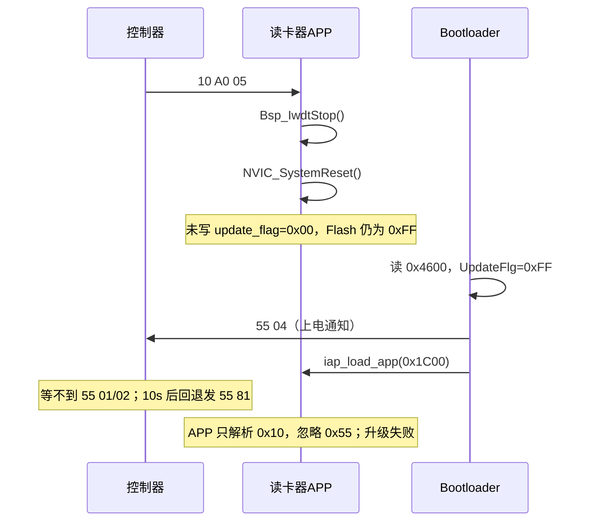
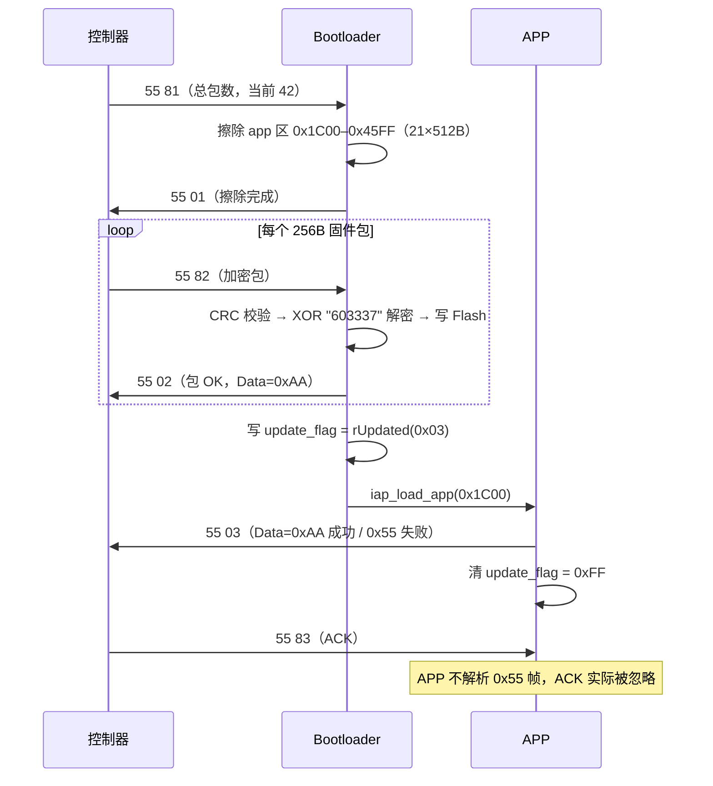
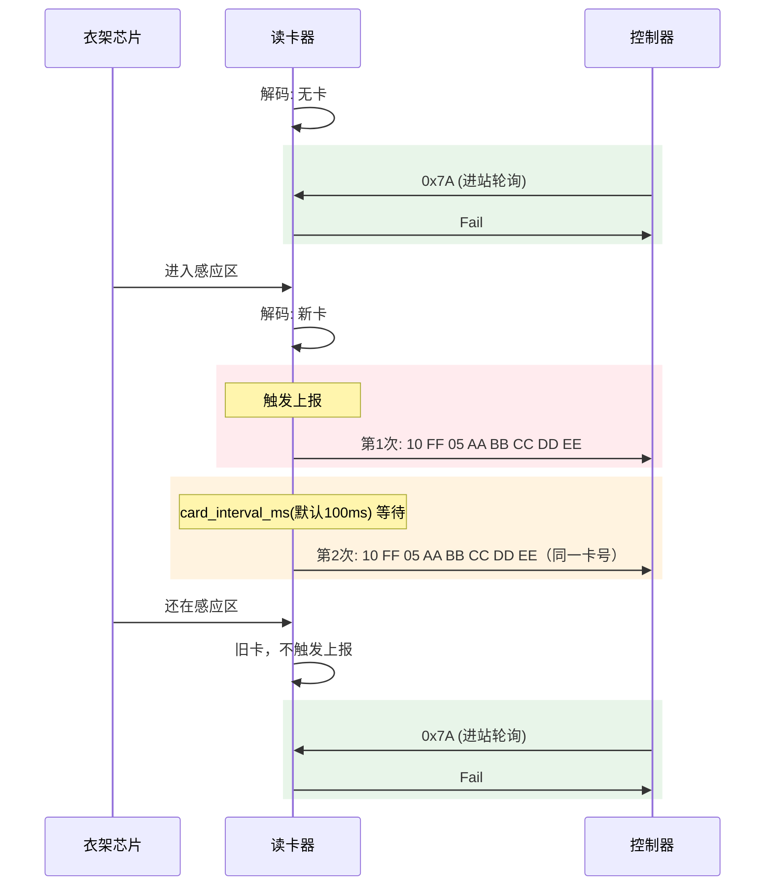
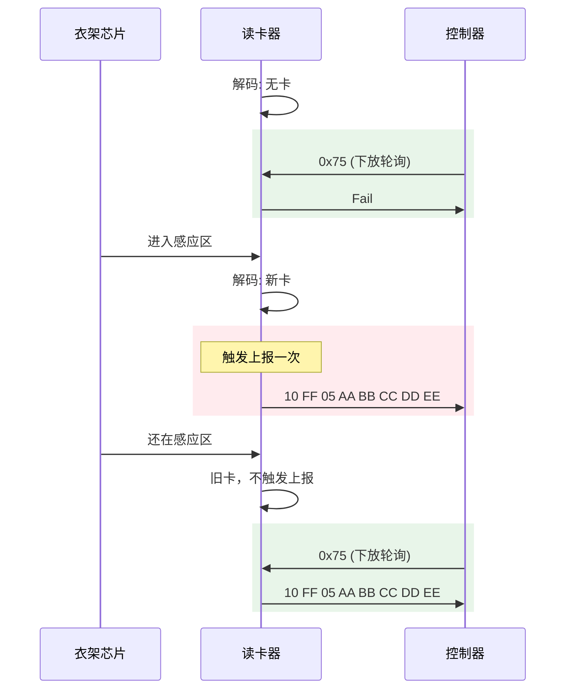
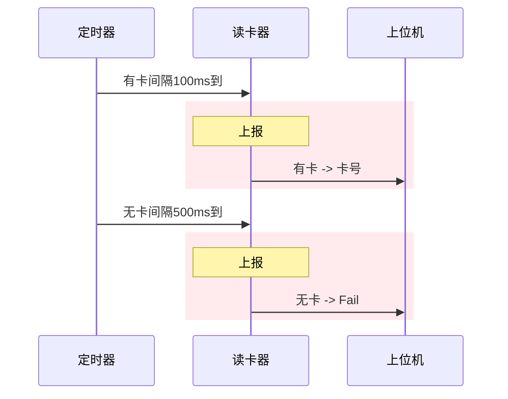
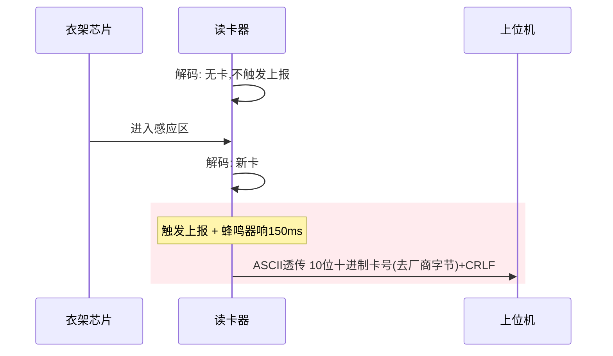
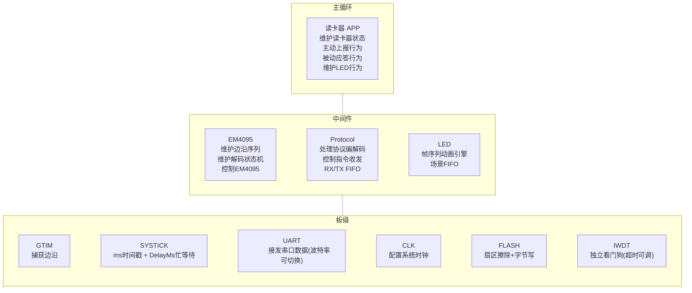
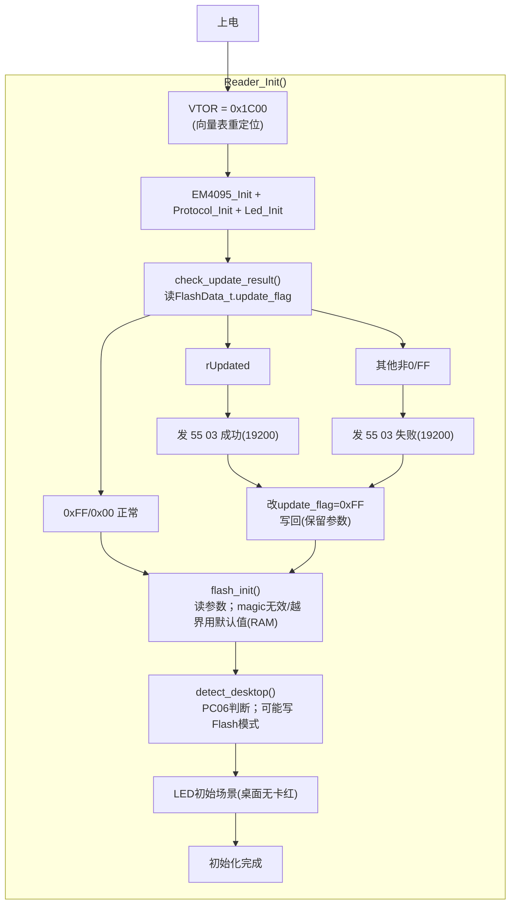
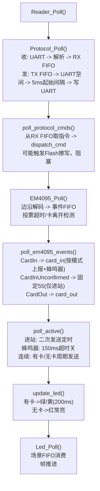

2026-11-02 维护更新：按 RD0312 同步

> 本文以 `D:\Reader\SR3` 当前固件与 `D:\Reader\ReaderUpdater` 工作区源码为准；旧版图示 / 附件保留作对照，冲突处以正文与代码为准。

## 待办列表
- [x] 连续模式无卡时上报间隔不一样：500ms（已实现，有卡100ms/无卡500ms可设）
- [x] LED动画进一步细化（RD0312 实际：无卡红常亮，有卡绿/黄；不同模式不再用不同闪烁）
- [x] 可视化动画模式
- [x] 考虑异常衣架上报，固定卡号，延迟判断 \[A]，\[A B]（未确认固定 `00 00 00 00 55`，400ms 超时）
- [ ] 特殊卡号亮黄灯：是否要多个特殊卡号，增加更改指令（当前仅硬编码 `00 00 00 00 5A`，无配置指令）

# 需求

## Flash 布局

| 地址 | 大小 | 用途 | 谁读写 |
| :--: | :--: | :--- | :----- |
| 0x0000 | 7KB | Bootloader | 仅 bootloader |
| 0x1C00 | 10.5KB（0x2A00） | 主程序 | 仅 app |
| 0x4600 | 512B 扇区，`FlashData_t` 实际 15B | FlashData_t（升级标志 + 读卡器参数） | bootloader + app |

> [!note] FlashData_t 布局（packed，共 15B，不是 16B）
> 升级标志和读卡器参数合并在一个结构体，共享 `0x4600` 的 512B 扇区。擦写时整体读-改-写，互不清零；bootloader 只读写前 6 字节，app 读写全部 15 字节。
>
> | 偏移 | 大小 | 字段 | 写入方 |
> | :--: | :--: | :--- | :--- |
> | 0 | 2 | `packed_num` | bootloader / app 读-改-写 |
> | 2 | 1 | `target` | bootloader |
> | 3 | 1 | `sector_num` | bootloader |
> | 4 | 1 | `update_flag` | bootloader / app |
> | 5 | 1 | `update_res` | bootloader |
> | 6 | 2 | `magic = 0xA55A` | app |
> | 8 | 1 | `mode` | app |
> | 9 | 1 | `bcc_enable` | app |
> | 10 | 2 | `card_interval_ms` | app |
> | 12 | 2 | `nocard_interval_ms` | app |
> | 14 | 1 | `vote_enable` | app |
>
> 默认值：模式进站 `01`；BCC 关 `55`；有卡间隔 `100ms`；无卡间隔 `500ms`；投票开 `AA`；magic `0xA55A`。
>
> 升级后 bootloader 只写回前 6 字节，读卡器参数区变 `0xFF`；app `flash_init()` 用 RAM 默认值，不主动写回。`detect_desktop()` 若判定需要改模式，会执行一次读-改-写：magic 无效时先填默认值，再把模式写回 Flash；因此升级后实际可能从默认参数 / 桌面模式开始。

## 升级 (IAP)

> [!warning] RD0312 现状
> 正常 app 收到 `10 A0 05` 后只停看门狗并复位，**没有把 `update_flag` 改成 `0x00`**；标志仍是 `0xFF`，bootloader 会直接跳回 app，正常入口无法升级。以下先记录实际行为，再记录“已进入 bootloader 时”的可用流程。

### 入口现状（P0，未修复）



- `handle_reset_cmd()` 仅执行 `Bsp_IwdtStop(); NVIC_SystemReset();`，没有写 `rNormal(0x00)`；正常 `check_update_result()` 又把标志清成 `0xFF`。
- bootloader `main()` 只在 `UpdateFlg == 0xFF` 时 `iap_load_app()`；因此 `10 A0 05` 复位后仍回 app。
- 上位机 `sendInitHandshake()` 发 `10 A0 05` 后等 10s；超时后按“纯 boot 模式”发 `55 81`，app 不解析 `0x55`，最终失败。
- 只有手动把 `update_flag` 置为 `0x00`（或任意非 `0xFF`）时，bootloader 才会停留等待升级；`0x00` 不触发失败帧，`0x01/0x02/0x04/0x05` 会触发 `55 03` 失败帧。当前代码没有正常入口完成这一步。

### Bootloader 内部流程（已进入 bootloader 时）



- bootloader 上电先发 `55 04`；运行期间每约 0.5s 还会发 `10 FF 0A 00 00 00 00 00`。`0x10 FF 0A` 不是 `0x55` 升级帧，app 会忽略。
- `GotoUpdate()` 擦除 `UPDATE_APP_MAX(0x2A00)` 对应的 21 个 512B 扇区，然后回 `55 01`。
- 数据包按 256B 处理；最后一包由上位机补 `0xFF` 到 256B。
- 所有包收齐后写 `rUpdated`，擦写 `0x4600` 前 6 字节，跳 app；app 上报 `55 03` 后清 `0xFF`。
- 当前 bootloader 发送数据 ACK 时，包号为大端；启动 ACK 的包号是内存原样（小端）；CRC 见下节。

### 0x55 协议帧格式

```text
字节:  0     1     2-3        4-5         6~6+Len-1      6+Len  7+Len   8+Len
       0x55  CMD   Len(小端)  PackNo       Data[Len]      CRC_HB CRC_LB  0xAA
```

- CRC：CRC-16/USB（poly=0x8005，init=0xFFFF，refin/refout，xorout=0xFFFF），仅对 Data 计算。
- 上图 `CRC_HB/CRC_LB` 按设备→控制器标注；控制器→设备实际是 `CRC_LB/CRC_HB`。
- 字节序**不能笼统写成“PackNo/CRC 大端”**，按方向/命令区分：

| 字段 | 控制器 → 设备 | 设备 → 控制器 |
| :--: | :--- | :--- |
| Len | 小端 | 小端 |
| PackNo | 小端（`buildFrame` 先低后高） | 数据 ACK 大端；启动 ACK 为内存原样（小端）；APP 结果用版本号 `03 12` |
| CRC | 小端（`buildFrame` 先低后高） | 大端（bootloader / `send_update_frame` 先高后低） |

- `FirmwareUpdater::buildFrame()`：PackNo 低字节在前，CRC 低字节在前；bootloader `UPD_RFID_Prase()` 按低字节在前解析，二者匹配。
- `FirmwareUpdater::parseResponse()`：PackNo 按小端读，CRC 按大端读；收到 bootloader 数据 ACK 后，`processStateMachine()` 再把 PackNo 交换一次（因为数据 ACK 是大端）。
- `send_update_frame()`（app 升级结果）：Len 小端，PackNo=`READER_VER_MAJOR/MINOR`（`03 12`），CRC 大端。
- 升级结果包号显示为版本号 `0312`，不是“总包数”。

### 升级标志值

| 值 | 名称 | 当前实际行为 |
| :--: | :--- | :--- |
| 0xFF | 擦除态 | bootloader 直接跳 app；app `check_update_result()` 视为正常 |
| 0x00 | rNormal | bootloader 停留等命令；app 视为正常；当前 `handle_reset_cmd()` 不会写入该值 |
| 0x01 | rNeedUpdate | `RemoteUpdateInit()` 判定非 0/FF，发 `55 03` 失败并停留 |
| 0x02 | rBackup | 同上 |
| 0x03 | rUpdated | app 上报 `55 03` 成功（Data=0xAA）后清 `0xFF`；若此时掉电，bootloader 下次按失败处理 |
| 0x04 | rRollBack | 同 0x01 |
| 0x05 | rRecive | bootloader 开始接收时写入；掉电后 bootloader 按失败处理 |

- bootloader `GotoUpdate()` 先写 `rRecive(0x05)`；收齐后写 `rUpdated(0x03)`；app `check_update_result()` 对 `0x03` 报成功，对其他非 `0x00/0xFF` 报失败，然后统一写 `0xFF`。
- `rUpdated` 掉电后设备会停在 bootloader：`RemoteUpdateInit()` 发 `0x55 03` 失败，`main()` 只认 `0xFF` 跳 app；bootloader 也没有启用独立看门狗。

### 加密

- bootloader `Decrypt()` 对每个包 `U_FILE_MAX=256` 字节逐字节 XOR，密钥 `"603337"` 在每个包内从 `i=0` 重新取，等价于“每 256B 重置密钥”。
- `ReaderUpdater` 只读取原始 `.bin` 并原样分包发送，**没有加密步骤**。普通 `SR3.bin` 会被 bootloader 解密成乱码后写 Flash。
- 必须使用按 256B 分包、每包重置密钥加密后的 bin；`05_Output/SR3_RD0312_jjtest_encrypted.bin` 已按此规则验证。仓库内没有加密生成脚本，生成方式需另行固化。
- CRC 在解密前对收到的加密 Data 计算，上位机按同一份加密数据算 CRC。

### 波特率

- app：桌面模式 `9600`（接 CH9329），其他模式 `19200`（`bsp_config.h`）。
- bootloader：固定 `19200`；`ReaderUpdater` 的波特率下拉可手选，但升级握手/数据阶段必须与 bootloader 一致。
- 桌面读卡器在 app 阶段是 `9600`，`10 A0 05` 复位后 bootloader 切 `19200`；若上位机仍用 `9600`，握手和数据都会失败。需要 app 复位前临时切 `19200`，或上位机自动切换。
- app 启动时 `check_update_result()` 在 `flash_init()` 前发送 `55 03`，此时仍是默认 `19200`；桌面模式的结果帧也用 `19200` 发出。

### 包数、写入与恢复风险

- `PACK_MAX=42`；`SR3.bin` 10744B，按 256B 分包为 42 包；`05_Output` 的明文/加密 bin 为 10752B（42×256，末包补齐），同样 42 包。
- `GetPackFlag[PACK_MAX]` 只有下标 0–41，代码使用 `GetPackFlag[PackNo]`（1–42）和完成检查 `GetPackFlag[i+1]`（1–42），第 42 包越界；当前依赖相邻数组布局“碰巧”通过，属未定义行为。
- `FLASH_WriteByte` 失败时只把 `WorkState` 置 `sFail`，仍会发 `55 02`、置 `GetPackFlag`，收齐后仍可能写 `rUpdated` 并跳 app；擦除返回值也未检查。
- bootloader 没有启用 IWDT；app 启动/运行分别 500ms/200ms，Flash 擦写前喂狗，但擦写后没有补喂。

### ACK 与超时

- 上位机收齐后等待 `55 03`，收到后发 `55 83`；app 在发完结果后已清标志，且只解析 `0x10` 帧，不接收 `55 83`，bootloader 的 `0x83` 分支又要求 `State==sWaitRes`（当前流程不满足），所以 ACK 实际被忽略。
- 上位机 `onReadyRead()` 对任意可解析的 `0x55` 帧都会停超时；包号不匹配或状态外命令只打日志、不重启超时，可能永久挂起。
- 上位机 `onTimeout()` 在握手超时后会回退发 `55 81`，但 app 不解析 `0x55`，这条回退只在已经处于 bootloader 时才有意义。

## 通信协议

### 指令表
长度不在协议中体现，靠约定长度解析。
**`0xFF`**：卡号相关
**`0xA0`**：下发设置和查询相关
**`0xA1`**：上报信息相关

#### **接收指令**（控制器 -> 读卡器）
| HEAD | TYPE | CMD  |        DATA         |                   完整字节序列                   | 功能                            | 约定长度 | 备注                  |
| :--: | :--: | :--: | :-----------------: | :----------------------------------------: | :---------------------------- | :--: | :------------------ |
| 0x10 | 0xFF | 0x7A |          无          |                 `10 FF 7A`                 | 进站查询 + 失能 BCC + 切进站模式         |  3   | 不存 Flash            |
| 0x10 | 0xFF | 0x75 |          无          |                 `10 FF 75`                 | 下放查询 + 失能 BCC + 切下放模式         |  3   | 不存 Flash            |
| 0x10 | 0xFF | 0x9A |          无          |                 `10 FF 9A`                 | 进站查询 + 使能 BCC + 切进站模式         |  3   | 不存 Flash            |
| 0x10 | 0xFF | 0x95 |          无          |                 `10 FF 95`                 | 下放查询 + 使能 BCC + 切下放模式         |  3   | 不存 Flash            |
| 0x10 | 0xA0 | 0x01 |          无          |                 `10 A0 01`                 | 查询版本 + 模式                     |  3   | —                   |
| 0x10 | 0xA0 | 0x02 |         模式          |              `10 A0 02 MODE`               | 00 桌面 / 01 进站 / 02 下放 / 03 连续 |  4   | 存 Flash             |
| 0x10 | 0xA0 | 0x03 |       BCC 使能        |             `10 A0 03 BCC_EN`              | `55` 不带 / `AA` 带              |  4   | 存 Flash，非 55/AA 忽略  |
| 0x10 | 0xA0 | 0x04 | 有卡+无卡间隔，四字节小端（有卡在前） | `10 A0 04 CARD_L CARD_H NOCARD_L NOCARD_H` | 默认 100ms / 500ms              |  7   | 存 Flash，各 1–60000ms |
| 0x10 | 0xA0 | 0x05 |          无          |                 `10 A0 05`                 | 进 Bootloader 升级模式             |  3   | RD0312 实际入口失效，见 IAP |
| 0x10 | 0xA0 | 0x07 |          无          |                 `10 A0 07`                 | 查询模式                          |  3   | —                   |
| 0x10 | 0xA0 | 0x08 |          无          |                 `10 A0 08`                 | 查询 BCC 使能                     |  3   | —                   |
| 0x10 | 0xA0 | 0x09 |          无          |                 `10 A0 09`                 | 查询有卡+无卡间隔                     |  3   | —                   |
| 0x10 | 0xA0 | 0x0B |        投票使能         |              `10 A0 0B VOTE`               | `55` 关 / `AA` 开               |  4   | 存 Flash，非 55/AA 忽略  |
| 0x10 | 0xA0 | 0x0C |          无          |                 `10 A0 0C`                 | 查询投票使能                        |  3   | —                   |

#### **发送指令**（读卡器 -> 控制器）
| HEAD | TYPE | CMD  |                DATA                 |                   完整字节序列                   | 功能         | 约定长度 |
| :--: | :--: | :--: | :---------------------------------: | :----------------------------------------: | :--------- | :--: |
| 0x10 | 0xFF | 0x05 |         厂商编号[1] + 衣架 ID[4]          |         `10 FF 05 AA BB CC DD EE`          | 上报卡号       |  5   |
| 0x10 | 0xFF | 0x04 |        `46 61 69 6C`："Fail"         |           `10 FF 04 46 61 69 6C`           | 上报没有卡号     |  4   |
| 0x10 | 0xFF | 0x06 |     厂商编号[1] + 衣架 ID[4] + BCC[1]     |        `10 FF 06 AA BB CC DD EE BC`        | 上报带 BCC 卡号 |  6   |
| 0x10 | 0xA1 | 0x01 | `52 44 30 33 31 32`："RD0312" + MODE |     `10 A1 01 52 44 30 33 31 32 MODE`      | 上报版本号+模式   |  7   |
| 0x10 | 0xA1 | 0x02 |                 模式                  |              `10 A1 02 MODE`               | 上报模式       |  4   |
| 0x10 | 0xA1 | 0x03 |               BCC 使能                |             `10 A1 03 BCC_EN`              | 上报 BCC 使能  |  4   |
| 0x10 | 0xA1 | 0x04 |         有卡+无卡间隔，四字节小端（有卡在前）         | `10 A1 04 CARD_L CARD_H NOCARD_L NOCARD_H` | 上报间隔       |  7   |
| 0x10 | 0xA1 | 0x0B |                投票使能                 |              `10 A1 0B VOTE`               | 上报投票使能     |  4   |

> [!note] 查询版本+模式
> `10 A0 01` 查询时，读卡器应答一帧：`10 A1 01 52 44 30 33 31 32 MODE`（"RD0312" + 当前模式，DATA 共 7 字节）。

> [!note] 忙保护
> 无忙保护；收/发各一个 SPSC FIFO，指令和上报都入队。协议 RX/TX FIFO 各 8 帧；UART TX/RX FIFO 各 128 字节；满时静默丢弃。

### 0x10 帧解析

- 帧格式：`0x10 + TYPE + CMD + DATA`，DATA 长度由 `s_rx_table` 的 `data_len` 约定，不在帧内传 LEN。
- `s_rx_table` 共 14 条；`Protocol_SendCmd()` 没有对 `data_len` 做上限检查，当前调用方最大 7 字节（版本+模式）；新增指令需保持 `PROTOCOL_MAX_DATA=7` / `PROTOCOL_MAX_TX_DATA=16` 内。
- 未知 TYPE/CMD：`lookup_cmd()` 返回 NULL，解析状态直接回 Idle；不回复错误。
- 无帧超时、无帧 CRC：截断帧会把下一帧的 `0x10` 当成 DATA 吞掉；未知帧尾随数据若包含 `10 A0 05`，可能被解析成复位命令。
- DATA 内的 `0x10` 在固定长度内会正常作为数据消费；帧外多余的 `0x10` 会重启帧头搜索。
- 发送：`Protocol_Poll()` 每轮最多发一帧；`tx_try_send()` 先检查 UART TX 空间，再按 `last_tx_ms + 5ms` 的**起始到起始**间隔发送。5ms 不是“线路上帧间静默 5ms”；9600/长帧时实际帧间可能为 0，1ms 设置无法突破 5ms 上限（约 200 帧/s）。
- `Protocol_SendCmd()` / `Protocol_SendRaw()` / RX FIFO push 的返回值均被忽略；FIFO 满时静默丢帧。

### 0xFF 查询与模式切换

实际 `handle_query()` 不是简单的“首次切换、后续轮询”，而是按“当前模式 + BCC 是否已匹配”判断：

- 进站查询（`7A/9A`）且当前已是进站、BCC 匹配：只回 Fail。
- 下放查询（`75/95`）且当前已是下放、BCC 匹配：有卡回实际卡号，无卡回 Fail。
- 否则：切到进站/下放，设置 BCC，回 Fail。
- 查询切换的模式/BCC **不写 Flash**；`0xA0 02/03` 才写 Flash。
- 进站 pending 不会被查询清除；下放/进站切换后可能补发旧 pending，见“已知风险”。

### 0xA0 设置

- `0xA0 02`：模式 00–03，写 Flash；非法值静默忽略。
- `0xA0 03`：BCC `55/AA`，写 Flash；其他值忽略。
- `0xA0 04`：4 字节小端（有卡在前），各 1–60000ms，写 Flash；越界忽略。
- `0xA0 0B`：投票 `55/AA`，写 Flash；默认 `AA`。
- `0xA0 07/08/09/0C`：查询模式/BCC/间隔/投票。
- `flash_update()` 系列不检查擦写返回值；失败后仍会把新参数应用到 RAM。

### 默认参数

| 参数 | 默认值 |
| :--- | :--- |
| 模式 | 进站 `0x01` |
| BCC | 关 `0x55` |
| 有卡间隔 | 100ms |
| 无卡间隔 | 500ms |
| 投票 | 开 `0xAA` |
| 桌面卡离开 | 500ms |
| 其他卡离开 | 200ms |
| magic | `0xA55A` |

## 模式与功能

> [!note] 约定
> **新卡**：
> - 有卡的情况下卡号变了
> - 从无卡到有卡

### 模式表
| MODE | 模式名称 | 主动行为 | 被动行为 | 场景 |
| :--: | :--: | :--- | :--- | :--: |
| 0x00 | 桌面模式 | 新卡 ASCII 透传 10 位卡号（去厂商字节）+ 蜂鸣器 150ms；卡离开 500ms | 无 | 桌面读卡器 |
| 0x01 | 进站模式 | 新卡上报一次，间隔 `card_interval_ms` 再报一次；期间离卡取消第二次，新卡覆盖 pending；未确认上报 `00 00 00 00 55`；卡离开 200ms | 查询只回 Fail | 进站读卡器 |
| 0x02 | 下放模式 | 新卡上报一次；卡离开 200ms | 查询有卡回卡号，无卡回 Fail | 下放/出站读卡器 |
| 0x03 | 连续模式 | 周期发送实际读卡情况（有卡 100ms / 无卡 500ms）；有卡黄灯 | 无 | 分拣读卡器 |

### 模式切换与自动适应

> [!note] 拔插自动适应
> 读卡器可随意拔插换位置，控制器通过 `0xFF` 查询自动切换模式：
> - `0x7A/0x9A` → 进站；`0x75/0x95` → 下放；模式与 BCC 不存 Flash，重启恢复 Flash 值。
> - 当前模式 + BCC 已匹配时直接轮询；不匹配时切换并回 Fail（不是按“第几次收到”判断）。
> - BCC 使能/失能也由 `0xFF` 指令控制，不存 Flash。

> [!note] 桌面模式硬件检测
> 上电时 PC06 判断：
> - PC06 低 = 桌面硬件（蜂鸣器三极管下拉）→ 强制桌面模式 + 写 Flash + PC06 切输出驱动蜂鸣器。
> - PC06 高 = 非桌面硬件（10K 上拉）→ 若 Flash 存了桌面模式则改为进站 + 写 Flash（PC06 保持输入）。
> - 桌面 UART 9600（接 CH9329），其他模式 19200；卡离开桌面 500ms / 其他 200ms。
> - 桌面硬件每次启动都会因“强制桌面模式”执行一次 Flash 写；非桌面硬件仅在 Flash 存桌面模式时写一次。

> [!tip] 主动和被动
> **主动**：主动上报。**被动**：对指令的响应。两者独立，等待第二次上报期间收到查询也会应答。

### 功能表
| 功能 | 功能描述 |
| :---: | :--- |
| BCC 功能 | 开启后所有上报卡号使用 `10 FF 06`（5 字节卡号 + 1 字节异或） |
| 投票功能 | 开启后 3 帧中 2/3 一致才上报；400ms 超时未决上报固定 ID `00 00 00 00 55`；关闭则单帧校验通过即上报。`10 A0 0B` 设置，`10 A0 0C` 查询，存 Flash |
| 特殊卡号 | 仅硬编码 `00 00 00 00 5A`，有卡时黄灯；所有模式生效；没有“多个特殊卡号/配置指令” |

### 不同模式通信流程
#### 进站

- **两次上报间隔默认 100ms，可设置（有卡间隔 card_interval_ms）**。
- **进站轮询只应答 Fail，不报卡号**。
- 若第二次上报前卡离开，`card_out()` 会清 `entry_second_pending`，第二次被取消；第二次前读到新卡会覆盖 pending 卡号。
- 投票未决超过 400ms 时，`EM4095_Poll()` 发未确认事件；仅进站模式映射为 `00 00 00 00 55`，可能重复。

#### 下放


#### 连续

**有卡间隔默认 100ms，无卡间隔默认 500ms，可设置。** 有卡时黄灯；实际发送受 5ms 帧起始间隔约束，1ms 设置不能突破。

#### 桌面

桌面卡离开超时 500ms；UART 9600；蜂鸣器 150ms（代码注释仍写 500ms，以常量 150U 为准）。

### LED 行为表

| MODE | 模式名称 | 状态 | LED 行为 |
| :--: | :--: | :-: | :--- |
| 0x00 | 桌面模式 | 无卡 | 红灯常亮 |
| 0x00 | 桌面模式 | 有卡 | 绿灯常亮，`min_hold=200ms` |
| 0x01 | 进站模式 | 无卡 | 红灯常亮 |
| 0x01 | 进站模式 | 有卡 | 绿灯常亮，`min_hold=200ms` |
| 0x02 | 下放模式 | 无卡 | 红灯常亮 |
| 0x02 | 下放模式 | 有卡 | 绿灯常亮，`min_hold=200ms` |
| 0x03 | 连续模式 | 无卡 | 红灯常亮 |
| 0x03 | 连续模式 | 有卡 | 黄灯常亮，`min_hold=200ms` |

- 四种模式无卡都只亮红灯，不再有 1Hz / 2.5Hz / 双闪。
- 有卡绿灯至少保持 200ms，不是旧文档的“至少 1s”。
- 特殊卡 `00 00 00 00 5A` 在所有模式下有卡时黄灯；连续模式有卡也黄灯。

### 特殊卡号、未确认与全零 ID

- **特殊卡号**：`card_id_is_special()` 硬编码 `00 00 00 00 5A`，没有配置指令；待办中的“多个特殊卡号”未实现。
- **未确认事件**：投票开启且 `vote_count>=1`、当前无卡、距最后一帧 ≥400ms 时，`EM4095_Poll()` 每轮都会发未确认事件；app 只在进站模式把它映射成 `00 00 00 00 55`，可能重复上报。
- **全零 ID**：`card_on()` 用 `current_id` 全零表示“无卡/新卡”；若真实卡号为 `00 00 00 00 00`，每帧都会被判为新卡，重复 CardIn / 上报。是否现场存在该卡需真机确认。
- **进站 pending**：离卡会清 pending；切模式不清 pending；切回进站后可能补发旧卡号。

# 框架

## 整体框架

系统由三部分组成：PC 上位机 `ReaderUpdater`、Flash 低地址 `Bootloader`、`0x1C00` 起的读卡器 App；升级标志与参数共享 `0x4600`。


App 内部框架如下：



## 工程结构

```text
SR3/
├── 00_Project/
│   └── Keil/
│       ├── SR3.uvprojx          # IROM 0x1C00/0x2A00, IRAM 0x800
│       └── Objects/
│           ├── SR3.axf/.hex
│           └── SR3.bin          # 10744B -> 42 包
├── 01_Hardware/
│   ├── bsp/
│   │   ├── inc/
│   │   │   ├── bsp.h            # BSP入口(IWDT看门狗)
│   │   │   ├── bsp_clk.h        # 时钟
│   │   │   ├── bsp_config.h     # 波特率/FIFO大小/引脚
│   │   │   ├── bsp_flash.h      # Flash擦写
│   │   │   ├── bsp_gtim.h       # GTIM输入捕获
│   │   │   ├── bsp_systick.h    # SysTick(时间戳+DelayMs)
│   │   │   ├── bsp_uart.h       # UART收发(波特率可切换)
│   │   │   └── spsc_fifo.h      # 无锁环形FIFO宏
│   │   └── src/
│   │       └── (对应.c)
│   ├── driver/                  # HDSC DDL驱动
│   └── f002/                    # 启动文件/系统中断
├── 02_Midware/
│   ├── em4095/                  # 解码(状态机+投票+事件FIFO)
│   ├── protocol/                # 协议解析(状态机+RX/TX FIFO)
│   └── led/                     # LED动画引擎(场景FIFO+帧序列)
├── 03_Application/
│   ├── main.c                   # Bsp_Init -> Iwdt(500ms) -> Reader_Init -> Iwdt(200ms) -> Poll+Feed
│   ├── reader_app.h             # 结构体/枚举/宏/API
│   ├── reader_app.c             # g_reader/Flash/IAP/事件/主动行为/HW/LED/Init/Poll
│   └── reader_cmd.c             # 指令表/发送函数/指令处理/dispatch
├── 04_Doc/
│   └── test_protocol.py         # 旧协议测试脚本，已过时
├── 05_Output/
│   ├── SR3_RD0312_jjtest.bin            # 10752B -> 42 包（末包补齐）
│   └── SR3_RD0312_jjtest_encrypted.bin  # 10752B，每 256B 重置密钥 XOR
├── 06_TEST/
│   ├── read_card_interval.py
│   └── circle_card_check.py
└── 07_Script/
    └── copy_output.cmd          # 构建后复制 hex/bin 到 05_Output
```

Bootloader 独立工程 / 产物：

- 源码：`D:\Reader\读卡器bootloader\读卡器bootloader`（IAP 必需，不是 D1 旧程序）。
- 烧录文件：`D:\Reader\固件\SR3\RD0312\Boot+RD0312.hex`。
- 地址：`0x0000` 起 7KB；App `0x1C00` 起 10.5KB；参数 `0x4600`。

上位机：

- 源码：`D:\Reader\ReaderUpdater`（`FirmwareUpdater.cpp/.h`、`ReaderUpdater.cpp/.h`）。
- 发布包：`D:\Reader\ReaderUpdaterV2.0\ReaderUpdater.exe`（Qt 6 运行时）。

## 代码分区（#pragma region）

### reader_app.c

| 分区 | 说明 |
| :--- | :--- |
| LED 动画 | 场景表；无卡红常亮、有卡绿/黄常亮 |
| 卡号工具 | card_id_copy / card_id_clear |
| Flash 持久化 | flash_read / flash_write / flash_defaults / flash_apply / flash_init / flash_update；读-改-写保留 boot 字段；magic/范围校验；`flash_init` 默认值只进 RAM |
| 升级 (IAP) | crc16_usb / send_update_frame（同步直发 19200）/ check_update_result（在 flash_init 前）/ handle_reset_cmd（仅停狗+复位，未清 update_flag） |
| 卡事件 | card_in（进站二次/桌面 ASCII/下放上报+蜂鸣器）/ card_out（清进站 pending） |
| 主动行为 | poll_active（进站二次 / 蜂鸣器 150ms / 连续有卡 100ms·无卡 500ms） |
| EM4095 事件 & Protocol 指令 | poll_em4095_events / poll_protocol_cmds |
| HW 初始化 | em4095_hw_init（PC03 SHD）/ led_hw_init（PD02/PD03）/ led_set |
| 桌面模式检测 | detect_desktop（PC06 读电平，桌面切输出驱蜂鸣器，可能写 Flash） |
| LED 状态管理 | update_led（唯一场景入口；有卡绿/黄 200ms，无卡红） |
| 公开 API | Reader_Init / Reader_Poll |

### reader_cmd.c

| 分区 | 说明 |
| :--- | :--- |
| 指令表 | s_rx_table（14 条接收指令，data_len 见上表） |
| 发送函数 | send_card / send_card_ascii / send_fail / send_version_reply / send_mode_reply / send_bcc_reply / send_interval_reply / send_vote_enable_reply |
| 指令处理 | handle_query / handle_query_version / handle_set_* / dispatch_cmd / poll_protocol_cmds |

### led.c

| 分区 | 说明 |
| :--- | :--- |
| FIFO 操作 | fifo_push / fifo_pop / fifo_is_empty（场景请求环形 FIFO） |
| 动画切换 & 推进 | switch_to / advance_frame |
| 公开 API | Led_Init / Led_SetScene（只入队）/ Led_Poll（消费+帧推进） |

### protocol.c

| 分区 | 说明 |
| :--- | :--- |
| 公开 API | Protocol_Poll（收：UART→解析→RX FIFO；发：TX FIFO→UART 空间→5ms 起始间隔→写 UART）/ Protocol_PopCmd / Protocol_SendCmd / Protocol_SendRaw / Protocol_Init |
| 缓冲 | 协议 RX/TX 各 8 帧；UART RX/TX 各 128B；满时静默丢 |

### em4095.c

| 分区 | 说明 |
| :--- | :--- |
| 公共 API | EM4095_Init / EM4095_Poll / EM4095_PopEvent / EM4095_EventCount / EM4095_GetCardId |
| 解码 | 三态状态机；base 200–312us（默认 256）；分类阈值 50/150/165/275%；64bit 校验 |
| 投票 | 3 帧 2/3；400ms 未决；vote_buf[0] 最旧；未确认事件 |
| 卡跟踪 | card_on/card_off；卡离开 200/500ms；全零 ID 哨兵 |

## 机制登记

| 机制 | 位置 | 用途 | 扩展方式 | 使用者 |
| :--- | :--- | :--- | :--- | :--- |
| BSP 板级 | `01_Hardware/bsp/` | 时钟 48MHz、SysTick 1ms、LPUART、GTIM 捕获、Flash、IWDT、SPSC FIFO | 新增外设走 `bsp_*`，板级参数集中到 `bsp_config.h` | 全部任务 |
| EM4095 解码 | `02_Midware/em4095/` | 三态解码、帧校验、投票、卡跟踪、事件 FIFO | 改阈值/加事件；不改上层模式 | T1-1/T1-2 |
| Protocol 协议 | `02_Midware/protocol/` | 0x10 帧解析、指令表驱动、RX/TX FIFO、5ms 起始间隔 | 在 `s_rx_table` 加表项，保持表驱动 | T1-1/T1-2 |
| LED 动画 | `02_Midware/led/` | 帧序列动画、场景表、请求 FIFO、min_hold | 加场景/帧数组；`update_led` 是唯一场景入口 | T1-1/T1-2 |
| 读卡器应用 | `03_Application/reader_app.c` | 初始化、模式、卡事件、主动上报、Flash 参数、桌面检测、升级结果 | 扩展现有 `poll_*` / `card_*`，不另起主循环 | T1-1/T1-2 |
| 指令分发 | `03_Application/reader_cmd.c` | 14 条接收指令、发送封装、dispatch | 加表项+handler；发送统一走 `Protocol_SendCmd` | T1-1/T1-2 |
| Flash 参数 | `reader_app.c` 的 `FlashData_t` | 0x4600 读-改-写，magic `0xA55A`，逐字段范围校验 | 加字段必须同步 bootloader 前 6 字节约定 | T1-1/T1-2 |
| IAP 升级 | `reader_app.c` + Bootloader + `ReaderUpdater` | 0xA0 05 复位、0x55 帧、CRC16、上位机状态机 | 改帧格式必须同时改 App/Bootloader/上位机三端 | T1-1/T1-2 |
| 投票与固定卡号 | `em4095.c` + `reader_app.c` | 3 帧 2/3、400ms、未确认 `55`、特殊 `5A` 黄灯 | 参数在 `em4095.c`；阈值改动需真机复测 | T1-1/T1-2 |
| 上位机 | `D:\Reader\ReaderUpdater` | 0x10 指令测试、0x55 升级、CRC、串口状态机 | 改协议必须同步 `FirmwareUpdater` 与 App | T1-1/T1-2 |

## 初始化流程



- `main()`：`Bsp_Init()` → IWDT 500ms → `Reader_Init()` → IWDT 200ms → `Bsp_GtimEnable()` → `while(1) { Reader_Poll(); Bsp_IwdtFeed(); }`。
- `check_update_result()` 必须在 `flash_init()` 之前，否则参数扇区先被擦；它读 `update_flag`，`0x03` 报成功、其他非 `0/FF` 报失败，然后写 `0xFF`。
- `flash_init()` 只在 RAM 中应用默认值，不写 Flash；`detect_desktop()` 可能在桌面/非桌面硬件上写模式，并连带把参数写回（magic 无效时先填默认值）。
- `Reader_Init()` 末尾先设“桌面无卡红”，第一次 `Reader_Poll()` 后按实际模式修正。
- IWDT：启动 500ms、运行 200ms；`flash_update()` 只在擦写前喂狗，擦写后没有补喂。

## Reader_Poll 流程



- 建议调用间隔 <10ms。
- `Protocol_Poll()` 每轮最多发一帧；`poll_protocol_cmds()` 可能执行 Flash 擦写，期间 GTIM 边沿/事件可能丢失。
- `poll_active()` 的进站第二次发送只检查 `entry_second_pending`；`card_out()` 会清它，新卡会覆盖 pending。
- `update_led()` 每轮都调用 `Led_SetScene(..., 200U)`；`Led_Poll()` 消费场景并推进帧。

## 解码方案

### 当前参数（RD0312）

| 参数 | 当前值 | 说明 |
| :--- | :--- | :--- |
| base_us 默认/最小/最大 | 256 / 200 / 312us | 前 16 个交替 SHORT 的平均值；越界用 256 |
| 交替 SHORT 最小数 | 16 | SeekPreamble |
| 分类阈值 | DEBRIS <50%；SHORT 50–150%；AMBIG 150–165%；LONG 165–275%；TIMEOUT ≥275% | 代码常量；文件头注释仍是旧 55/148/164/273 |
| 坏宽预算 | `RECEIVE_ERROR_MAX=3` | AMBIG 与 DEBRIS 共用；>3 回 Idle |
| 帧长 | 64bit | 9 帧头 + 10×(4 数据+1 行偶) + 4 列偶 + 1 停止 |
| 投票 | 3 帧 2/3；400ms 超时 | `vote_enable=0xAA` 时启用 |
| 卡离开 | 其他 200ms / 桌面 500ms | `CARD_OUT_MS_NORMAL/DESKTOP` |
| 事件 FIFO | 8 | 满时静默丢 |

### 帧与校验

- `seek_process()` 测完 16 个交替 SHORT 后，直接把 `bit_buf[0..8]` 预置为 9 个帧头 1，再进入 Receive；因此 `verify_frame()` 虽然仍检查 9 位帧头，实际新增校验主要是停止位、10 行偶、4 列偶。
- `verify_frame()`：停止位 bit63 必须为 0；bit0–8 必须全 1；每行 4 数据位异或等于行偶；每列 10 位异或等于列偶；通过后按行提取 5 字节卡号（跳过奇偶位）。
- `classify()` 以动态 `base_us` 为 100%；AMBIG 按拉长的 SHORT 处理，和 DEBRIS 共用坏宽预算。
- `card_on()` 以 `current_id` 全零或不同判新卡；全零真实卡号会反复触发新卡。

### 投票与事件

- `vote_frame()`：`vote_count<3` 时追加；满 3 后左移，保留最近 3 帧（`vote_buf[0]` 最旧）。
- 2 帧相同直接通过；3 帧取匹配数最多且 ≥2 的卡号；否则记录 `vote_ts_ms`，等待后续帧。
- `vote_enable != 0xAA` 时单帧校验通过即通过，不做投票。
- `EM4095_Poll()` 在投票开启、无卡、`vote_count>=1`、距 `vote_ts_ms` ≥400ms 时发未确认事件；app 只在进站映射为固定 `00 00 00 00 55`。
- `card_off()` 在 `last_card_ms` 超时后发生，清 `current_id`、清投票、发 CardOut。

### 旧版图示

以下附件为 20260804 旧版图示，保留作对照；阈值/流程以本节正文为准。

![[attachments/em4095-overview.html]]

![[attachments/em4095-classify-state.html]]

![[attachments/em4095-verify-vote.html]]

## 上位机 ReaderUpdater / FirmwareUpdater

### 入口与升级状态机

- 启动：选串口、波特率（默认 19200）、固件 `.bin` → `FirmwareUpdater::loadFirmware()` 按 256B 分包。
- `startFlashing()` → `sendInitHandshake()` 发 `10 A0 05`，等 10s。
- 收到 `0x04` 后 `sendStartCommand()` 发 `55 81`（总包数）；超时则直接回退发 `55 81`。
- 收到 `0x01` 后延迟 200ms 发首包 `55 82`；之后每收到 `0x02` 且包号匹配，立即发下一包。
- 收齐后等 `0x03`：Data=0xAA 成功，0x55 失败；随后发 `55 83` ACK（app 忽略）。
- `buildFrame()`：Len 小端，PackNo 小端，CRC 小端；`parseResponse()`：PackNo 小端，CRC 大端；数据 ACK 在 `processStateMachine()` 交换 PackNo。

### 已知差异 / 风险

- **不加密**：`loadFirmware()` 原样读取；必须选择加密 bin（见 IAP）。
- **桌面波特率**：桌面 app 9600、bootloader 19200，上位机只用一个下拉值；桌面升级会失败。
- **测试控件未禁用**：`updateUIState()` 只禁用开始/停止/串口/波特率，`onSendTestCmd()` / `onSendRawHex()` 在升级中仍可点；每次发送都调用 `setSerialPort()`，会关闭并重开串口，直接打断升级。
- **dataLen 未使用**：`kCmds[]` 的 `dataLen` 只写在表里，`onSendTestCmd()` 不校验输入长度；用户输入错误长度会导致 app 解析错位。
- **超时/包号**：`onReadyRead()` 对任意有效帧停超时；包号不匹配/状态外命令只打日志，不重启超时或重发，升级可能挂起。
- **源码 HEAD 差异**：工作区 `FirmwareUpdater.cpp` 的 CRC 为 `crc ^ 0xFFFF`，HEAD 为 `return crc`；工作区 `ReaderUpdater.cpp` 指令表已更新为 14 条（含 0x0B/0x0C），HEAD 仍是旧表。发布 exe 字符串含 `10 A0 0B`，与 HEAD 旧表不一致；干净重建必须使用当前工作区源码。
- **发布包仅对照**：exe 未反编译验证加密/CRC 全路径；`ReaderUpdaterV2.0` 只作为运行对照。

### 指令测试表

`kCmds[]` 与 `s_rx_table` 的 14 条一一对应：`A0 01/02/03/04/05/07/08/09/0B/0C`、`FF 7A/75/9A/95`；数据长度依次为 0/1/1/4/0/0/0/0/1/0/0/0/0/0。UI 未按该长度限制输入。

## 测试脚本

- `04_Doc/test_protocol.py` 已过时：仍按 RD3.11、2 字节间隔、`R:` / `S:` 回显编写；当前是 RD0312、4 字节间隔、无回显。不要作为 RD0312 验收依据，需重写或明确标注历史脚本。
- `06_TEST/read_card_interval.py`、`06_TEST/circle_card_check.py` 用于连续读卡/圈检/漏读统计，需真机 + 固定 COM 口。
- 无自动化单元测试 / CI；验证以真机串口和人工核对为主。

## 已知风险（T1-1，未修复）

> 正常解码路径未发现确定性错误卡号；以下主要是升级失败、漏报/重复上报风险。P0/P1 未修复前不建议实际升级；详细 20 项见 `261102SR3读卡器维护.md` §8.2。

| ID | 级别 | 当前实际行为 | 影响 |
| :--: | :--: | :--- | :--- |
| P0-1 | P0 | `10 A0 05` 只停狗+复位，未清 `update_flag`；bootloader 见 `0xFF` 跳 app | 正常入口无法升级 |
| P0-2 | P0 | 上位机发原始 bin；bootloader 逐包 XOR 解密 | 明文固件写成乱码 |
| P1-1 | P1 | 桌面 9600 / bootloader 19200，上位机单波特率 | 桌面升级失败 |
| P1-2 | P1 | `GetPackFlag[42]` 下标 1–42 越界 | 第 42 包未定义行为 |
| P1-3 | P1 | 写 Flash 失败仍回 `55 02`、置完成标志 | 可能跳转到坏固件 |
| P1-4 | P1 | 未知/截断帧无超时/重同步 | 命令丢失，可能误执行 `10 A0 05` |
| P1-5 | P1 | TX FIFO 满静默丢；1ms 间隔不能突破 5ms | 连续模式漏报 |
| P1-6 | P1 | 全零卡号被当无卡哨兵 | 可能重复 CardIn/上报 |
| P1-7 | P1 | 任意有效 0x55 帧停超时；包号不匹配不重启 | 升级挂起 |
| P1-8 | P1 | HEAD CRC 缺 xorOut，工作区才一致 | 干净重建升级失败 |

P2 摘要：Flash 写失败被忽略且擦写后不补喂狗；`flash_update` 不复检已有字段；`detect_desktop` 每次桌面启动写 Flash；进站 pending 切模式不清；未确认事件每 400ms 可能重复；event/UART/协议 FIFO 满时静默丢；波特率切换 TX FIFO flush 有并发风险；升级中测试控件未禁用、每次发送重开串口；bootloader `rUpdated` 掉电停在 bootloader 且无看门狗；GTIM 注释 16383 tick≈10.9ms 与实际 `0x7FFE`≈21.8ms 不符。
