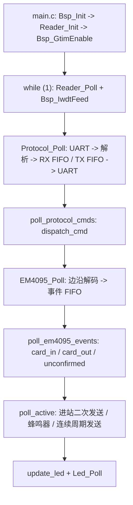

---
领域:
  - 工作
类型:
  - 开发
项目:
  - "[[SR3读卡器]]"
任务:
  - "[[261102SR3读卡器维护]]"
相关任务:
状态: 进行
创建时间: 2026-11-02T11:12:43
截止时间: 2027-10-02T11:12:00
完成时间:
---
<!-- plan-doc:v1 -->

# 261102 SR3读卡器维护

> **一句话**：以 RD0312 为基线，维护 SR3 读卡器固件与 ReaderUpdater 上位机，补齐验证、协议契约和文档一致性。
> **仓库**：`D:\Reader\SR3`｜`D:\Reader\ReaderUpdater`（发布包 `D:\Reader\ReaderUpdaterV2.0`）
> **规则**：改需求先记 C；一功能一机制；执行一次只做一条。

## 待办列表

- [ ] 编码
- [ ] 测试
- [ ] 合并

> 以上为 vault 模板检查项；具体任务见 §1，完成记录见 §5。

## 0. 看板

- **阶段**：基线建立完成，维护需求待录入
- **下一条**：未定；先用 `/splan-req <维护需求>` 登记 R，再拆 T
- **本次范围**：只建立基线 / 机制登记 / 代码索引，不做需求规划、不改代码
- **事实源**：代码 / 测试 > 仓库 README、AGENTS > 本文
- **最后更新**：2026-11-02｜**活跃变更**：—｜**冻结**：—｜**血缘**：前身 —｜后继 —

### 需求登记

| R | 需求 | 来源 | 状态 | 覆盖任务 | 文档 |
|---|---|---|---|---|---|

> 当前无需求。维护需求统一从这张表进入；每条任务必须挂 `需求：R#`。

### 任务总览

| 任务 | 状态 | 出口条件 |
|---|---|---|

> 当前无任务。需求登记后由 `/splan-req` 拆任务。

### 机制登记

| 机制 | 位置 | 用途 | 扩展方式 | 使用者 |
|---|---|---|---|---|
| BSP 板级 | `01_Hardware/bsp/` | 时钟 48MHz、SysTick 1ms、LPUART 收发、GTIM 捕获、Flash 擦写、IWDT、SPSC FIFO | 新增外设走 `bsp_*`，板级参数集中到 `bsp_config.h` | 全部任务 |
| EM4095 解码 | `02_Midware/em4095/` | 三态解码、帧校验、投票、卡跟踪、事件 FIFO | 改阈值 / 加事件类型；不改上层模式逻辑 | 待定 |
| Protocol 协议 | `02_Midware/protocol/` | 0x10 帧解析、指令表驱动、RX/TX FIFO、5ms 帧间隔 | 在 `s_rx_table` 加表项，保持表驱动 | 待定 |
| LED 动画 | `02_Midware/led/` | 帧序列动画、场景表、请求 FIFO、min_hold | 加场景 / 帧数组；`update_led` 是唯一场景入口 | 待定 |
| 读卡器应用 | `03_Application/reader_app.c` | 初始化、模式、卡事件、主动上报、Flash 参数、桌面检测、升级结果 | 扩展现有 `poll_*` / `card_*`，不另起主循环 | 待定 |
| 指令分发 | `03_Application/reader_cmd.c` | 14 条接收指令、发送封装、dispatch | 加表项 + handler；发送统一走 `Protocol_SendCmd` | 待定 |
| Flash 参数 | `03_Application/reader_app.c` 的 `FlashData_t` | 0x4600 扇区读-改-写，magic `0xA55A`，逐字段范围校验 | 加字段必须同步 bootloader 前 6 字节约定 | 待定 |
| IAP 升级 | `reader_app.c` + bootloader + `ReaderUpdater` | 0xA0 0x05 复位、0x55 帧、CRC16、上位机状态机 | 改帧格式必须同时改 App / Bootloader / 上位机三端 | 待定 |
| 投票与固定卡号 | `em4095.c` + `reader_app.c` | 3 帧 2/3 一致、400ms 超时、未确认固定卡号、特殊卡号黄灯 | 参数在 `em4095.c` 常量；阈值改动需真机复测 | 待定 |

### 基线

- **固件仓库**：`D:\Reader\SR3`，分支 `main`，提交 `36f0f76`（2026-08-28，`feat: 升级为RD0312`），工作区干净。
- **固件版本**：`READER_VERSION "RD0312"`，`READER_VER_MAJOR 0x03`，`READER_VER_MINOR 0x12`。
- **MCU / Keil**：HC32F002C4PZ，Cortex-M0+，IROM `0x1C00` 长度 `0x2A00`，IRAM `0x800`；Keil target `SR3`（`00_Project/Keil/SR3.uvprojx`），ARMCLANG V6.24。
- **构建**：Keil MDK 构建 target `SR3`；产物 `00_Project/Keil/Objects/SR3.axf/.hex/.bin`；构建后 `07_Script/copy_output.cmd` 复制到 `05_Output/SR3_<VER>_<YYYYMMDDHHmm>.{hex,bin}`。
- **最近构建记录**：`.embeddedskills/build/SR3-SR3-build.log` 为 2026-08-24 的 RD0311 构建；`Objects` 文件时间为 2026-08-28（RD0312）。下次构建会刷新日志。
- **上位机源码**：`D:\Reader\ReaderUpdater`，分支 `master`，提交 `3619bcb`（2026-08-12）；工作区有 2 个未提交修改（`FirmwareUpdater.cpp` 的 CRC 返回 `crc ^ 0xFFFF`，`ReaderUpdater.cpp` 的指令表与 dataLen）。
- **上位机发布**：`D:\Reader\ReaderUpdaterV2.0`，Qt 6 运行时 + `ReaderUpdater.exe`（2026-08-17），无源码；构建工程为 `ReaderUpdater.vcxproj` / `ReaderUpdater.slnx`。
- **测试**：无自动化单元测试 / CI；现有 Python 串口脚本 `04_Doc/test_protocol.py`、`06_TEST/read_card_interval.py`、`06_TEST/circle_card_check.py`，需真机 + 固定 COM 口；测试数据在 `06_TEST/*.txt`。
- **旧程序**：`D:\Reader\HC32F002_DDL_Rev1.2.0（取消比对）`、`D:\Reader\RFID_STC15_C语言（EM4095收指令发）`，按 D1 不纳入比对，不作为基线。

## 1. 任务池

### R-T-D-C 关联表 / 状态总览

| 任务 | 状态 | 需求 | 决策 | 变更 | 记录 |
|---|---|---|---|---|---|

> 当前无任务。唯一排序源是下面的任务池；下一条 = P0 第一条。

### P0（立即）

> 空。先用 `/splan-req` 登记维护需求。

### P1 / P2

> 空。

### 外部依赖与验收

- [x] **V-1 真机验证环境** → 验收：SR3 读卡器、USB 串口、ReaderUpdaterV2.0、测试衣架 / 卡；具体步骤随首条任务补充。

## 2. 契约 v1（2026-11-02）

- **通信**：LPUART1，19200-8-N-1（桌面模式 9600）；帧头 `0x10`，`TYPE + CMD + DATA`，长度由 `s_rx_table` 约定，不在帧内传 LEN。
- **接收指令**：`0xFF 7A/75/9A/95`、`0xA0 01/02/03/04/05/07/08/09/0B/0C`，共 14 条；应答 TYPE `0xA1`；卡号 `0xFF 05/06`；Fail `0xFF 04 "Fail"`。
- **卡号**：5 字节（厂商 1B + ID 4B 大端）；BCC 为 5 字节异或，使能时用 `0xFF 06`；桌面模式上报 10 位十进制 ASCII + CRLF。
- **模式**：`00` 桌面 / `01` 进站 / `02` 下放 / `03` 连续；默认进站；`0x7A/0x9A` 切进站，`0x75/0x95` 切下放；查询指令切换的模式与 BCC 不写 Flash，`0xA0 02/03` 才写 Flash。
- **间隔**：`0xA0 04` 4 字节小端（有卡在前、无卡在后），范围 1–60000ms；默认有卡 100ms、无卡 500ms。
- **投票**：`0xA0 0B` 55 关 / AA 开，默认开；3 帧中 2 帧一致才确认；400ms 未决产生未确认事件；进站模式上报固定卡号 `00 00 00 00 55`。
- **Flash**：`0x0000` 7KB bootloader；`0x1C00` 10.5KB app；`0x4600` 512B `FlashData_t`（前 6B BootParam + 读卡器参数）；magic `0xA55A`。
- **升级**：`0x55` 帧，`Len` 小端；`PackNo` / `CRC` 按 260804 文档为大端（代码存在差异，见 §7）；CRC-16/USB；XOR 密钥 `"603337"` 由 bootloader 解密。
- **看门狗**：启动阶段 500ms，运行阶段 200ms；Flash 擦写前后喂狗。

## 3. 设计要点

### 3.1 运行链路

### 3.2 模式行为摘要

- **桌面 `0x00`**：新卡 ASCII 透传；蜂鸣器 150ms；9600 波特率；卡离开超时 500ms。
- **进站 `0x01`**：新卡上报两次（间隔 `card_interval_ms`）；轮询只应答 Fail；投票未决时上报固定卡号 `00 00 00 00 55`。
- **下放 `0x02`**：新卡上报一次；轮询时有卡报卡号、无卡报 Fail。
- **连续 `0x03`**：周期上报，有卡用 `card_interval_ms`、无卡用 `nocard_interval_ms`；有卡黄灯。
- **LED**：无卡四模式均为红灯常亮；有卡绿灯；连续模式有卡、特殊卡号 `00 00 00 00 5A` 为黄灯。

### 3.3 维护边界

- 不改 bootloader 前 6 字节布局；不改 `0x55` 三端契约而不记 C。
- 不在 `Reader_Poll` 之外另起主循环或长阻塞延时。
- LED 场景只从 `update_led` 设置，保持入口唯一。
- 新指令必须进 `s_rx_table`，不绕过 Protocol 中间件。
- 一功能一机制；要新建机制先在 §4 立 D。

## 4. 决策与变更

### 决策（D）

| D | 决策 | 结论 | 任务 |
|---|---|---|---|
| D1 | 维护范围 | 只维护 `D:\Reader\SR3` 固件与 `D:\Reader\ReaderUpdater` 上位机；`HC32F002_DDL_Rev1.2.0`、`RFID_STC15_C语言` 不纳入比对 | — |

### 变更（C）

| C | 日期 | 类型 | 需求 | 内容 | 影响 | 处理 | 任务 |
|---|---|---|---|---|---|---|---|

## 5. 实施记录

> 尚无任务。每条完成后按 `- [x] **T#-# 名称** —— 改了什么；验证：…；行为：…；结果：…` 记录。

## 6. 归档

| 任务 | 结果 | 关联 | 提交 |
|---|---|---|---|

## 7. 参考与索引

### 仓库

| 仓库 | 路径 | 角色 | 构建 | 测试 |
|---|---|---|---|---|
| SR3 固件 | `D:\Reader\SR3` | 读卡器固件（HC32F002） | Keil `00_Project/Keil/SR3.uvprojx` target `SR3` | 真机串口 + Python 脚本 |
| ReaderUpdater 源码 | `D:\Reader\ReaderUpdater` | PC 升级 / 指令测试上位机 | VS + Qt 6 `ReaderUpdater.vcxproj` | 手工 + 串口 |
| ReaderUpdater 发布 | `D:\Reader\ReaderUpdaterV2.0` | 发布包（exe + Qt DLL） | 无源码 | 手工 |
| 旧程序（不比对） | `D:\Reader\HC32F002_DDL_Rev1.2.0（取消比对）` | 旧 SR3 参考 | — | 不纳入 |
| 旧程序（不比对） | `D:\Reader\RFID_STC15_C语言（EM4095收指令发）` | 旧 STC15 参考 | — | 不纳入 |

### 关键文件

| 文件 | 作用 |
|---|---|
| `03_Application/main.c` | 入口、主循环、看门狗 |
| `03_Application/reader_app.c` / `.h` | 应用核心：模式、卡事件、主动上报、Flash、IAP、LED |
| `03_Application/reader_cmd.c` | 指令表、发送函数、dispatch |
| `02_Midware/em4095/` | 解码、投票、卡跟踪、事件 |
| `02_Midware/protocol/` | 0x10 帧解析、RX/TX FIFO、帧间隔 |
| `02_Midware/led/` | LED 动画引擎 |
| `01_Hardware/bsp/` | 时钟、UART、GTIM、Flash、IWDT、SPSC FIFO |
| `00_Project/Keil/SR3.uvprojx` | Keil 工程 |
| `04_Doc/test_protocol.py` | 协议测试脚本（旧，见差异） |
| `06_TEST/read_card_interval.py` | 连续读卡、圈检、漏读统计 |
| `06_TEST/circle_card_check.py` | 圈完整性、漏读、重复检测 |
| `07_Script/copy_output.cmd` | 构建后复制 hex/bin 到 `05_Output` |
| `D:\Reader\ReaderUpdater\FirmwareUpdater.cpp` | 0x55 升级状态机、CRC |
| `D:\Reader\ReaderUpdater\ReaderUpdater.cpp` | UI、指令测试、串口 |
| `D:\Reader\ReaderUpdaterV2.0\ReaderUpdater.exe` | 当前发布程序 |

### 文档

- `260804SR3框架整理.md`：参考框架、协议、模式流程；部分数值已被 RD0312 代码覆盖。
- `260802旧SR3读卡器行为.md`：旧版行为基线，仅历史参考。
- `260814读卡器测试.md`：1800 速度、10100 次读卡、漏读 1 的测试记录。
- `260918读卡器固定衣架号沟通.md`：RD0312 固定卡号 `0x00000055`，面板 / 电控处理方案。
- `260802旧SR2读卡器行为.md`、`260804旧SR2SR3整理.md`：历史对比。
- `D:\Reader\SR3\04_Doc\em4095.pdf`、`em4095_ds.pdf`、`em4100.pdf`：芯片与协议资料。

### 参考文档与代码差异（只记录，未定需求）

| 项 | 260804 文档 / 参考 | 当前代码 | 处理 |
|---|---|---|---|
| 版本号 | RD0311 | `READER_VERSION "RD0312"`（0x03 / 0x12） | 以代码为准，文档待更新 |
| LED 无卡 | 桌面红常亮、进站 1Hz、下放 2.5Hz、连续双闪 | 四模式均红常亮（`s_led_scenes`） | 待确认是否回归 |
| 有卡绿灯保持 | 至少 1s | `Led_SetScene(..., 200U)`，注释写 1s | 代码 / 注释不一致 |
| 桌面卡离开超时 | 800ms | `CARD_OUT_MS_DESKTOP 500` | 以代码为准 |
| 投票超时 | 300ms | `VOTE_TIMEOUT_MS 400` | 以代码为准 |
| 未确认固定卡号 | `00 00 00 00 55` | `unknown_id = 00 00 00 00 55` | 一致 |
| 特殊卡号黄灯 | 待办中提出“是否多个 / 可配置” | 硬编码 `00 00 00 00 5A` | 未实现可配置 |
| 蜂鸣器时长 | 150ms | `BUZZER_DURATION 150U`，注释写 500ms | 以代码为准，注释待改 |
| 升级帧字节序 | PackNo / CRC 大端 | App 响应大端；ReaderUpdater `buildFrame` 小端 | 三端需核对后记 C |
| ReaderUpdater CRC | 提交说明为去掉 xorOut | 工作区为 `crc ^ 0xFFFF`，未提交 | 以实际发布二进制为准，待核对 |
| `test_protocol.py` | 文档引用为协议测试入口 | 期望 `RD3.11`、2 字节间隔、`R:` / `S:` 回显；当前为 `RD0312`、4 字节间隔、无回显 | 脚本已过时，需重写或标注 |
| 构建日志 | — | 日志为 RD0311，`Objects` 为 RD0312 | 下次构建刷新 |

### 相关任务

- `[[260804SR3框架整理]]`
- `[[260918读卡器固定衣架号沟通]]`
- `[[260814读卡器测试]]`
- `[[260802旧SR3读卡器行为]]`
