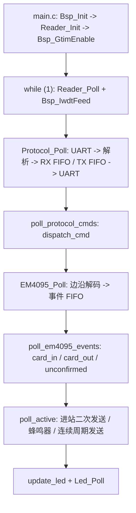

---
领域:
  - 工作
类型:
  - 开发
项目:
  - "[[SR3读卡器]]"
任务:
  - "[[261102SR3读卡器维护]]"
相关任务:
状态: 进行
创建时间: 2026-11-02T11:12:43
截止时间: 2027-10-02T11:12:00
完成时间:
---
<!-- plan-doc:v1 -->

# 261102 SR3读卡器维护

> **一句话**：以 RD0312 为基线，维护 SR3 读卡器固件与 ReaderUpdater 上位机，补齐验证、协议契约和文档一致性。
> **仓库**：`D:\Reader\SR3`｜`D:\Reader\ReaderUpdater`（发布包 `D:\Reader\ReaderUpdaterV2.0`）
> **规则**：改需求先记 C；一功能一机制；执行一次只做一条。

## 0. 看板

- **阶段**：R2 下游查询统计脚本开发
- **下一条**：T2-1 下游查询读卡统计脚本
- **本次范围**：只做 `hangertest/test_store_query.py` + 自测；不改固件 / 上位机；真机验证由用户确认
- **事实源**：代码 / 测试 > 仓库 README、AGENTS > 本文
- **最后更新**：2026-11-02｜**活跃变更**：—｜**冻结**：—｜**血缘**：前身 —｜后继 —

### 需求登记

| R | 需求 | 来源 | 状态 | 覆盖任务 | 文档 |
|---|---|---|---|---|---|
| R1 | 深度审查错误卡号 / 错误上报风险，并同步 260804 框架文档（覆盖全部机制与行为） | 维护 | 交付 | T1-1, T1-2 | — |
| R2 | 下游查询读卡统计测试脚本：300ms 发 `10 FF 75`，统计卡号，每分钟 / 结束时输出，写 `hangertest` | 维护 | 待做 | T2-1 | — |

> 需求统一从这张表进入；每条任务必须挂 `需求：R#`。

### 任务总览

| 任务 | 状态 | 出口条件 |
|---|---|---|
| T1-1 深度代码审查 | done | 问题清单 + 260804 更新差异清单，覆盖 §3.4 全部检查项 |
| T1-2 同步 260804 框架文档 | done | 文档与 RD0312 代码一致，机制 / 行为无遗漏 |
| T2-1 下游查询读卡统计脚本 | todo | 脚本可运行，自测统计正确；真机验证由用户确认 |

### 机制登记

| 机制 | 位置 | 用途 | 扩展方式 | 使用者 |
|---|---|---|---|---|
| BSP 板级 | `01_Hardware/bsp/` | 时钟 48MHz、SysTick 1ms、LPUART 收发、GTIM 捕获、Flash 擦写、IWDT、SPSC FIFO | 新增外设走 `bsp_*`，板级参数集中到 `bsp_config.h` | 全部任务 |
| EM4095 解码 | `02_Midware/em4095/` | 三态解码、帧校验、投票、卡跟踪、事件 FIFO | 改阈值 / 加事件类型；不改上层模式逻辑 | T1-1/T1-2 |
| Protocol 协议 | `02_Midware/protocol/` | 0x10 帧解析、指令表驱动、RX/TX FIFO、5ms 帧间隔 | 在 `s_rx_table` 加表项，保持表驱动 | T1-1/T1-2 |
| LED 动画 | `02_Midware/led/` | 帧序列动画、场景表、请求 FIFO、min_hold | 加场景 / 帧数组；`update_led` 是唯一场景入口 | T1-1/T1-2 |
| 读卡器应用 | `03_Application/reader_app.c` | 初始化、模式、卡事件、主动上报、Flash 参数、桌面检测、升级结果 | 扩展现有 `poll_*` / `card_*`，不另起主循环 | T1-1/T1-2 |
| 指令分发 | `03_Application/reader_cmd.c` | 14 条接收指令、发送封装、dispatch | 加表项 + handler；发送统一走 `Protocol_SendCmd` | T1-1/T1-2 |
| Flash 参数 | `03_Application/reader_app.c` 的 `FlashData_t` | 0x4600 扇区读-改-写，magic `0xA55A`，逐字段范围校验 | 加字段必须同步 bootloader 前 6 字节约定 | T1-1/T1-2 |
| IAP 升级 | `reader_app.c` + bootloader + `ReaderUpdater` | 0xA0 0x05 复位、0x55 帧、CRC16、上位机状态机 | 改帧格式必须同时改 App / Bootloader / 上位机三端 | T1-1/T1-2 |
| 投票与固定卡号 | `em4095.c` + `reader_app.c` | 3 帧 2/3 一致、400ms 超时、未确认固定卡号、特殊卡号黄灯 | 参数在 `em4095.c` 常量；阈值改动需真机复测 | T1-1/T1-2 |
| 下游查询测试脚本 | `D:\Reader\hangertest\test_store_query.py`（T2-1 新建） | 300ms 发 `10 FF 75`，解析卡号 / Fail，分钟统计 + 结束统计，日志落 `hangertest` | 加统计项 / 查询命令；复用现有 Python 串口与日志模式 | T2-1 |

### 基线

- **固件仓库**：`D:\Reader\SR3`，分支 `main`，提交 `36f0f76`（2026-08-28，`feat: 升级为RD0312`），工作区干净。
- **固件版本**：`READER_VERSION "RD0312"`，`READER_VER_MAJOR 0x03`，`READER_VER_MINOR 0x12`。
- **MCU / Keil**：HC32F002C4PZ，Cortex-M0+，IROM `0x1C00` 长度 `0x2A00`，IRAM `0x800`；Keil target `SR3`（`00_Project/Keil/SR3.uvprojx`），ARMCLANG V6.24。
- **构建**：Keil MDK 构建 target `SR3`；产物 `00_Project/Keil/Objects/SR3.axf/.hex/.bin`；构建后 `07_Script/copy_output.cmd` 复制到 `05_Output/SR3_<VER>_<YYYYMMDDHHmm>.{hex,bin}`。
- **最近构建记录**：`.embeddedskills/build/SR3-SR3-build.log` 为 2026-08-24 的 RD0311 构建；`Objects` 文件时间为 2026-08-28（RD0312）。下次构建会刷新日志。
- **上位机源码**：`D:\Reader\ReaderUpdater`，分支 `master`，提交 `3619bcb`（2026-08-12）；工作区有 2 个未提交修改（`FirmwareUpdater.cpp` 的 CRC 返回 `crc ^ 0xFFFF`，`ReaderUpdater.cpp` 的指令表与 dataLen）。
- **上位机发布**：`D:\Reader\ReaderUpdaterV2.0`，Qt 6 运行时 + `ReaderUpdater.exe`（2026-08-17），无源码；构建工程为 `ReaderUpdater.vcxproj` / `ReaderUpdater.slnx`。
- **测试**：无自动化单元测试 / CI；现有 Python 串口脚本 `04_Doc/test_protocol.py`、`06_TEST/read_card_interval.py`、`06_TEST/circle_card_check.py`，需真机 + 固定 COM 口；测试数据在 `06_TEST/*.txt`。
- **测试工具**：`D:\Reader\hangertest`，Python 3.14.2 + pyserial 3.5；非 git 仓库；现有 `test_missed_read.py`、`read_card_interval.py` 等可作串口 / 日志参考。
- **旧程序**：`D:\Reader\HC32F002_DDL_Rev1.2.0（取消比对）`、`D:\Reader\RFID_STC15_C语言（EM4095收指令发）`，按 D1 不纳入比对，不作为基线。

## 1. 任务池

### R-T-D-C 关联表 / 状态总览

| 任务 | 状态 | 需求 | 决策 | 变更 | 记录 |
|---|---|---|---|---|---|
| T1-1 | done | R1 | — | — | §5 |
| T1-2 | done | R1 | — | C1 | §5 |
| T2-1 | todo | R2 | D2 | C2 | — |

> 唯一排序源是下面的任务池；下一条 = P0 第一条。

### P0（立即）

- [ ] **T2-1 下游查询读卡统计脚本** → 需求：R2（← C2）；产出：`D:\Reader\hangertest\test_store_query.py` + 同目录日志；验证手段：`python -m py_compile test_store_query.py` → 0；`python test_store_query.py --selftest` → 统计断言通过；人工：真机 COM12 @ 19200，300ms 查询，1 分钟统计，Ctrl+C 最终统计 → 卡号 / Fail 计数与日志一致；机制：复用现有 Python 串口 / 日志模式（D2）；边界：不改固件 / 上位机，不自动识别 COM，不向控制器发统计

### P1 / P2

> 空。

### 外部依赖与验收

> V-1 真机验证环境已确认，记录见 §5。

## 2. 契约 v2（2026-11-02）

> v2：按 T1-1 审查结果修正 `FlashData_t` 大小与 0x55 字节序（← C1）；T1-2 已同步 260804。

- **通信**：LPUART1，19200-8-N-1（桌面模式 9600）；帧头 `0x10`，`TYPE + CMD + DATA`，长度由 `s_rx_table` 约定，不在帧内传 LEN。
- **接收指令**：`0xFF 7A/75/9A/95`、`0xA0 01/02/03/04/05/07/08/09/0B/0C`，共 14 条；应答 TYPE `0xA1`；卡号 `0xFF 05/06`；Fail `0xFF 04 "Fail"`。
- **卡号**：5 字节（厂商 1B + ID 4B 大端）；BCC 为 5 字节异或，使能时用 `0xFF 06`；桌面模式上报 10 位十进制 ASCII + CRLF。
- **模式**：`00` 桌面 / `01` 进站 / `02` 下放 / `03` 连续；默认进站；`0x7A/0x9A` 切进站，`0x75/0x95` 切下放；查询指令切换的模式与 BCC 不写 Flash，`0xA0 02/03` 才写 Flash。
- **间隔**：`0xA0 04` 4 字节小端（有卡在前、无卡在后），范围 1–60000ms；默认有卡 100ms、无卡 500ms。
- **投票**：`0xA0 0B` 55 关 / AA 开，默认开；3 帧中 2 帧一致才确认；400ms 未决产生未确认事件；进站模式上报固定卡号 `00 00 00 00 55`。
- **Flash**：`0x0000` 7KB bootloader；`0x1C00` 10.5KB app；`0x4600` 512B `FlashData_t`（packed 15B：前 6B BootParam + 9B 参数）；magic `0xA55A`。
- **升级**：`0x55` 帧，`Len` 小端；控制器→设备 `PackNo` / `CRC` 小端；设备→控制器数据 ACK `PackNo` 大端、启动 ACK `PackNo` 小端、`CRC` 大端；App 升级结果 `PackNo=0312`、`CRC` 大端；CRC-16/USB（xorOut 0xFFFF）；XOR 密钥 `"603337"` 由 bootloader 解密；`PACK_MAX=42`，第 42 包 `GetPackFlag[42]` 越界（P1-2，未修复）。
- **IAP 入口**：`10 A0 05` 当前只 `Bsp_IwdtStop + NVIC_SystemReset`，不写 `update_flag=0x00`；bootloader 仅 `0xFF` 跳 app，升级入口存在 P0-1，修复前不要实际升级。
- **看门狗**：启动阶段 500ms，运行阶段 200ms；Flash 擦写前后喂狗。
- **框架文档**：`260804SR3框架整理.md` 已由 T1-2 同步到 RD0312，覆盖全部机制与行为；后续变更必须同步维护该文档，冲突以代码为准。

## 3. 设计要点

### 3.1 运行链路

### 3.2 模式行为摘要

- **桌面 `0x00`**：新卡 ASCII 透传；蜂鸣器 150ms；9600 波特率；卡离开超时 500ms。
- **进站 `0x01`**：新卡上报两次（间隔 `card_interval_ms`）；轮询只应答 Fail；投票未决时上报固定卡号 `00 00 00 00 55`。
- **下放 `0x02`**：新卡上报一次；轮询时有卡报卡号、无卡报 Fail。
- **连续 `0x03`**：周期上报，有卡用 `card_interval_ms`、无卡用 `nocard_interval_ms`；有卡黄灯。
- **LED**：无卡四模式均为红灯常亮；有卡绿灯；连续模式有卡、特殊卡号 `00 00 00 00 5A` 为黄灯。

### 3.3 维护边界

- 不改 bootloader 前 6 字节布局；不改 `0x55` 三端契约而不记 C。
- 不在 `Reader_Poll` 之外另起主循环或长阻塞延时。
- LED 场景只从 `update_led` 设置，保持入口唯一。
- 新指令必须进 `s_rx_table`，不绕过 Protocol 中间件。
- 一功能一机制；要新建机制先在 §4 立 D。

### 3.4 R1 审查与文档同步方案

- **目标**：确认是否存在错误卡号、错误上报、漏报 / 误报、升级异常风险；同时把 `260804SR3框架整理.md` 同步到当前 RD0312 代码，覆盖全部机制与行为。
- **范围**：`D:\Reader\SR3` 固件 + `D:\Reader\ReaderUpdater` 上位机源码；发布包 `ReaderUpdaterV2.0` 仅作对照。旧程序按 D1 不纳入。
- **检查项**：
  1. 解码与卡号：base_us / classify 阈值、前导码、64bit 校验、投票 3 帧 2/3、400ms 超时、card_on / card_off、桌面 500ms / 其他 200ms、特殊卡号 `00 00 00 00 5A`、未确认 `00 00 00 00 55`。
  2. 上报行为：桌面 ASCII、进站二次发送、下放轮询、连续周期、BCC、Fail、模式切换、蜂鸣器。
  3. 协议与缓冲：`s_rx_table` 长度、dispatch 数据长度校验、0x10 头冲突、未知指令、RX/TX FIFO 溢出与丢帧、5ms 帧间隔、UART 中断与主循环并发。
  4. 持久化与 IAP：`FlashData_t` 布局、magic、读-改-写、升级标志、bootloader 前 6 字节、0x55 帧 CRC / 字节序、上位机状态机与超时。
  5. 时序与可靠性：GTIM 边沿 FIFO、看门狗、阻塞延时、Flash 擦写期间喂狗。
  6. 上位机：串口重开、CRC、`parseResponse`、包号、指令表 dataLen、发布包与源码差异。
- **输出**：
  - T1-1：问题清单，每条含严重度 P0/P1/P2、`文件:行号`、触发条件、影响、建议；另附 `260804SR3框架整理.md` 更新差异清单（章节 / 旧值 / 新值 / 依据）。
  - T1-2：按差异清单更新 `260804SR3框架整理.md`，覆盖 Flash 布局、IAP、通信协议、模式与功能、LED、整体框架、工程结构、代码分区、初始化 / Poll 流程、解码方案、机制登记。
- **不做什么**：不改代码、不做真机验证、不做硬件 / EMC / 性能测试、不覆盖旧程序。
- **时盒**：T1-1 1 次会话（≤2h）；T1-2 1 次会话（≤2h）。到点未完成则报告已覆盖范围与缺口，由规划AI 拆后续任务。
- **验收**：T1-1 的问题均有代码证据，能明确回答“是否存在错误卡号 / 错误上报风险”；T1-2 的文档逐节与 RD0312 代码一致，机制与行为无遗漏。

### 3.5 R2 下游查询统计脚本方案

- **目标**：每 300ms 发 `10 FF 75`，统计读卡器返回的卡号 / Fail，每分钟输出统计，Ctrl+C 输出最终统计，日志落 `hangertest`。
- **文件**：`D:\Reader\hangertest\test_store_query.py`；日志 `下游查询统计_YYYYmmdd_HHMMSS.log`；可选 CSV 逐帧记录。
- **串口**：默认 `COM12` @ `19200-8-N-1`；`COM_PORT` / `BAUDRATE` / `QUERY_INTERVAL_S=0.3` / `STAT_INTERVAL_S=60` / `NEW_CARD_GAP_S=1.0` 写在文件顶部。
- **协议**：查询 `10 FF 75`；解析 `10 FF 05`（8B）、`10 FF 06`（9B，校验 BCC）、`10 FF 04 46 61 69 6C`（Fail，7B）；忽略其他 TYPE / CMD 和噪声；按 `0x10` 重新同步。
- **统计**：查询数、响应数、卡号帧数、Fail 数、超时 / 无响应数、唯一卡号数、每卡原始次数、新卡事件数（同卡连续出现超过 `NEW_CARD_GAP_S` 才另计）、读卡率（卡号帧 / 查询数）。
- **输出**：每 60s 打印 / 写日志一次；Ctrl+C 打印最终统计并关闭串口；启动先发一次 `0x75` 同步到下放模式，首帧 Fail 计入统计但标注 startup。
- **自测**：`--selftest` 不打开串口，喂合成帧（0x05 / 0x06 / Fail / 噪声 / 截断）并断言统计结果；`python -m py_compile` 必须通过。
- **不做什么**：不改固件 / 上位机；不自动扫描 COM；不向控制器发送统计帧；不做 CI。
- **机制**：复用现有 Python 串口 / 日志模式；测试工具范围见 D2；不新建固件机制。
- **验收**：自测通过；真机 300ms 查询、1 分钟统计、Ctrl+C 最终统计，卡号 / Fail 计数与日志一致。

## 4. 决策与变更

### 决策（D）

| D | 决策 | 结论 | 任务 |
|---|---|---|---|
| D1 | 维护范围 | 只维护 `D:\Reader\SR3` 固件与 `D:\Reader\ReaderUpdater` 上位机；`HC32F002_DDL_Rev1.2.0`、`RFID_STC15_C语言` 不纳入比对 | — |
| D2 | 测试工具范围 | 将 `D:\Reader\hangertest` 下的 Python 测试脚本纳入维护范围；仅用于 SR3 验证，不属于固件 / 上位机发布物 | T2-1 |

### 变更（C）

| C | 日期 | 类型 | 需求 | 内容 | 影响 | 处理 | 任务 |
|---|---|---|---|---|---|---|---|
| C1 | 2026-11-02 | 修改 | R1 | 按 T1-1 审查结果记录 260804 与 RD0312 的差异，T1-2 已同步 | 契约、文档 | T1-2（完成） | T1-1, T1-2 |
| C2 | 2026-11-02 | 新增 | R2 | 新增下游查询读卡统计测试脚本 | 任务、文档、机制 | T2-1 | T2-1 |

## 5. 实施记录

> 任务完成后按 `- [x] **T#-# 名称** —— 改了什么；验证：…；行为：…；结果：…` 记录；T1-1 / T1-2 均已完成。

- [x] **V-1 真机验证环境** —— 验证：人工确认 SR3 读卡器、USB 串口、ReaderUpdaterV2.0、测试衣架 / 卡可用；行为：具备真机验证条件；结果：通过（用户于 2026-11-02 勾选）
- [x] **T1-1 深度代码审查** —— 产出问题清单 20 项（P0 2/P1 8/P2 10）；验证：人工核对覆盖 §3.4 检查项 → 通过；行为：无代码行为变化，仅形成审查结论；结果：通过；遗留：待真机确认 bootloader 源码/hex、全零卡、Flash 时序、42 包越界、发布 exe CRC/加密。
- [x] **T1-2 同步 260804 框架文档** —— 更新全文；验证：人工逐节核对 §8.3 → 通过；行为：文档与 RD0312 一致；结果：通过；遗留：bootloader 源码/hex、全零卡、42 包越界、发布 exe 待真机。

## 6. 归档

| 任务 | 结果 | 关联 | 提交 |
|---|---|---|---|
| T1-1 | 完成 | — | — |
| T1-2 | 完成 | ← C1 | — |

## 7. 参考与索引

### 仓库

| 仓库 | 路径 | 角色 | 构建 | 测试 |
|---|---|---|---|---|
| SR3 固件 | `D:\Reader\SR3` | 读卡器固件（HC32F002） | Keil `00_Project/Keil/SR3.uvprojx` target `SR3` | 真机串口 + Python 脚本 |
| ReaderUpdater 源码 | `D:\Reader\ReaderUpdater` | PC 升级 / 指令测试上位机 | VS + Qt 6 `ReaderUpdater.vcxproj` | 手工 + 串口 |
| ReaderUpdater 发布 | `D:\Reader\ReaderUpdaterV2.0` | 发布包（exe + Qt DLL） | 无源码 | 手工 |
| 测试脚本 | `D:\Reader\hangertest` | SR3 串口 / 读卡测试（非 git） | Python 3.14 + pyserial 3.5 | 脚本自测 + 真机 |
| 旧程序（不比对） | `D:\Reader\HC32F002_DDL_Rev1.2.0（取消比对）` | 旧 SR3 参考 | — | 不纳入 |
| 旧程序（不比对） | `D:\Reader\RFID_STC15_C语言（EM4095收指令发）` | 旧 STC15 参考 | — | 不纳入 |

### 关键文件

| 文件 | 作用 |
|---|---|
| `03_Application/main.c` | 入口、主循环、看门狗 |
| `03_Application/reader_app.c` / `.h` | 应用核心：模式、卡事件、主动上报、Flash、IAP、LED |
| `03_Application/reader_cmd.c` | 指令表、发送函数、dispatch |
| `02_Midware/em4095/` | 解码、投票、卡跟踪、事件 |
| `02_Midware/protocol/` | 0x10 帧解析、RX/TX FIFO、帧间隔 |
| `02_Midware/led/` | LED 动画引擎 |
| `01_Hardware/bsp/` | 时钟、UART、GTIM、Flash、IWDT、SPSC FIFO |
| `00_Project/Keil/SR3.uvprojx` | Keil 工程 |
| `04_Doc/test_protocol.py` | 协议测试脚本（旧，见差异） |
| `D:\Reader\hangertest\test_store_query.py` | R2 / T2-1 新建：下游查询统计脚本 |
| `D:\Reader\hangertest\test_missed_read.py` | 现有进站漏读统计，串口 / 日志参考 |
| `06_TEST/read_card_interval.py` | 连续读卡、圈检、漏读统计 |
| `06_TEST/circle_card_check.py` | 圈完整性、漏读、重复检测 |
| `07_Script/copy_output.cmd` | 构建后复制 hex/bin 到 `05_Output` |
| `D:\Reader\ReaderUpdater\FirmwareUpdater.cpp` | 0x55 升级状态机、CRC |
| `D:\Reader\ReaderUpdater\ReaderUpdater.cpp` | UI、指令测试、串口 |
| `D:\Reader\ReaderUpdaterV2.0\ReaderUpdater.exe` | 当前发布程序 |

### 文档

- `260804SR3框架整理.md`：参考框架、协议、模式流程；T1-2 已同步到 RD0312，覆盖全部机制与行为。
- `260802旧SR3读卡器行为.md`：旧版行为基线，仅历史参考。
- `260814读卡器测试.md`：1800 速度、10100 次读卡、漏读 1 的测试记录。
- `260918读卡器固定衣架号沟通.md`：RD0312 固定卡号 `0x00000055`，面板 / 电控处理方案。
- `260802旧SR2读卡器行为.md`、`260804旧SR2SR3整理.md`：历史对比。
- `D:\Reader\SR3\04_Doc\em4095.pdf`、`em4095_ds.pdf`、`em4100.pdf`：芯片与协议资料。

### 参考文档与代码差异

> T1-1 审查的差异清单见 §8.3；T1-2 已把 `260804SR3框架整理.md` 同步到 RD0312。历史差异不再单独维护。

### 相关任务

- `[[260804SR3框架整理]]`
- `[[260918读卡器固定衣架号沟通]]`
- `[[260814读卡器测试]]`
- `[[260802旧SR3读卡器行为]]`

## 8. T1-1 审查输出（2026-11-02）

> 只读审查，未改代码；P0/P1 修复需另立需求。这里保留问题清单、260804 更新差异和覆盖边界，供 T1-2 执行。

### 8.1 结论

- **错误卡号**：正常解码路径未发现确定性错误卡号；`verify_frame` 校验停止位、9 位帧头、10 行偶、4 列偶，投票 3 帧 2/3。残余风险为极端帧错位 / 全零 ID，待真机确认。
- **错误上报 / 漏报**：存在。P0 升级入口 / 加密、P1 桌面波特率、协议重同步、TX 丢帧、全零卡号、上位机超时挂起均会造成升级失败、漏报或重复上报。
- **升级异常**：明确存在。P0 两项可导致升级无法开始或写入错误固件；P1 还有第 42 包越界、写失败仍判成功、源码 HEAD CRC 不一致。

### 8.2 问题清单

| ID | 级别 | 位置 | 问题 / 影响 | 建议 |
|---|---|---|---|---|
| P0-1 | P0 | `reader_app.c:285-289` | `10 A0 05` 未写 `update_flag=0x00`；bootloader 仅 `0xFF` 跳 app，升级入口失效 | 复位前写 rNormal 并落盘；端到端升级验证 |
| P0-2 | P0 | `FirmwareUpdater.cpp:50-70,232-248` | 上位机发送明文 bin；bootloader 逐包 XOR 解密，写入垃圾固件 | 上位机加密或只允许加密包；文档写清 |
| P1-1 | P1 | `reader_app.c:99-108` / `bsp_config.h:46-47` / bootloader `Usart.c:19` | 桌面 9600 与 bootloader 19200 冲突，升级握手失败 | 复位前切 19200 或上位机自动切换 |
| P1-2 | P1 | `RemoteUpdate.h:10` / `RemoteUpdate.c:154,176,210` | `GetPackFlag[42]` 下标 1..42 越界，第 42 包写相邻数组 | 扩为 43 或下标改 `PackNo-1` |
| P1-3 | P1 | `RemoteUpdate.c:162-166` | 写 Flash 失败仍回 OK、置完成标志，可能跳 app | 失败立即中止，不回 OK |
| P1-4 | P1 | `protocol.c:100-117,134-149` | 未知 / 截断帧无超时重同步，可能误执行后续字节 | 加帧超时 / 长度 / CRC，受控重同步 |
| P1-5 | P1 | `protocol.c:169-183,58-83` | TX FIFO 满静默丢帧；1ms 间隔不可实现 | 检查 push、背压或限制最小间隔 |
| P1-6 | P1 | `em4095.c:116-124,159-165` | 全零卡号被当无卡哨兵，可能重复 CardIn / 上报 | 改用 `card_present` / valid 标志 |
| P1-7 | P1 | `FirmwareUpdater.cpp:311-314,360-389` | 任意有效 0x55 帧停超时；包号不匹配不重启超时，升级挂起 | 只在期望 cmd / packno 推进，否则重启超时 / 重发 |
| P1-8 | P1 | `FirmwareUpdater.cpp:144` | 工作区 CRC `^0xFFFF`，HEAD 为 `return crc`；干净重建 CRC 不匹配 | 提交修正并固定构建源 |
| P2-1 | P2 | `reader_app.c:75-80,173-176,190-193` | Flash 写失败被忽略；只在擦写前喂狗 | 检查返回、擦写后补喂 / 校验 |
| P2-2 | P2 | `reader_app.c:126-151,159-177` | `flash_update` 不复检已有字段，损坏值会写回 | 写前逐字段校验 |
| P2-3 | P2 | `reader_app.c:481-499` | 桌面检测每次启动写 Flash，增加磨损 / 掉电风险 | 值未变不写 |
| P2-4 | P2 | `reader_app.c:331-334,347-353` | 离卡清 pending；切模式不清 pending，切回可能补发旧卡 | 切模式清 pending |
| P2-5 | P2 | `em4095.c:516-522` | 未确认事件每 400ms 重复发 | 加一次性 / 锁存 |
| P2-6 | P2 | `em4095.c:37` / `bsp_config.h:48-49` / `protocol.h:71-72` | 多级 FIFO 静默丢弃 | 记录丢弃计数 / 背压 |
| P2-7 | P2 | `bsp_uart.c:90-99` / `spsc_fifo.h:190-192` | 波特率切换 TX FIFO flush 并发风险 | 关中断 / 消费者侧 flush |
| P2-8 | P2 | `ReaderUpdater.cpp:368-374,271-327` | 升级中测试控件未禁用；每次发送重开串口；`kCmds.dataLen` 未用 | 禁用测试控件、复用串口、使用 dataLen |
| P2-9 | P2 | `RemoteUpdate.c:52-57` / bootloader `main.c:73-75` | `rUpdated` 掉电停在 bootloader；bootloader 无看门狗 | 恢复路径 / 看门狗 |
| P2-10 | P2 | `bsp_gtim.c:170-174` | 注释 16383 tick≈10.9ms，实际钳位 0x7FFE≈21.8ms | 统一注释 / 文档 |

### 8.3 260804 更新差异清单

| 章节 | 旧值 | 新值（RD0312 实测） | 依据 |
|---|---|---|---|
| Flash 布局 | `0x4600` 16B | `sizeof(FlashData_t)=15B`（packed）；字段：packed_num 2 + target/sector/update_flag/update_res 各1 + magic2 + mode/bcc各1 + card/nocard各2 + vote1 | `reader_app.h:74-90` |
| Flash 参数 | “升级后参数变 0xFF，app 用默认值（不可避免）” | 保留该说明；补充：默认值只在 RAM，未写回；模式默认进站；`detect_desktop` 可能再次改写 | `reader_app.c:126-154,470-499`；bootloader `RemoteUpdate.c:110-111` |
| IAP 入口流程 | app 改 `update_flag=rNormal` 后复位 | **RD0312 实际未清标志**：仅停 IWDG + `NVIC_SystemReset()`；标志保持 `0xFF`，bootloader 直接跳 app，`10 A0 05` 进不了 boot | `reader_app.c:285-289`；bootloader `main.c:73-75` |
| IAP 加密 | 流程只写“bootloader 解密 XOR 603337” | ReaderUpdater 不加密；必须使用“每 256B 重置 key”的加密 bin；普通 `SR3.bin` 会写入垃圾 | `FirmwareUpdater.cpp:50-70,232-248`；`RemoteUpdate.c:8,161`；`05_Output` 实测 |
| IAP 波特率 | 桌面 9600 / 其他 19200 | 补：bootloader 固定 19200；桌面 app 9600 时无法同一波特率完成升级 | `reader_app.c:99-108`；`bsp_config.h:46-47`；bootloader `Usart.c:19` |
| 0x55 帧字节序 | PackNo / CRC 大端 | Len 小端；**控制器→设备 PackNo / CRC 小端**；**设备→控制器数据 ACK PackNo 大端、启动 ACK 小端、CRC 大端**；App 升级结果 PackNo=`03 12`、CRC 大端 | `FirmwareUpdater.cpp:147-169,189-200`；bootloader `CmdProtocol.c:50-52`；`reader_app.c:239-240` |
| 升级标志 | 0xFF / 0x00 / 0x03 | 补 0x01/0x02/0x04/0x05；bootloader 对非 0/FF 发 `0x55 03` 失败并停留；`rUpdated` 掉电后也走失败 | `RemoteUpdate.c:52-57,227-234`；`main.c:73-75` |
| 升级 ACK | 控制器发 `55 83`，读卡器清标志 | app 只解析 `0x10` 帧，不接收/不等待 `0x55 83`；发完结果立即清标志，ACK 实际被忽略 | `reader_app.c:257-278`；`protocol.c` 仅 `0x10` |
| 升级包数 | 未写 | `PACK_MAX=42`；`SR3.bin` 10744B=42 包，`05_Output` 版 10752B（42×256，末包补齐）；第 42 包索引越界（见 P1-2） | `RemoteUpdate.h:10`；`RemoteUpdate.c:154,176,210`；产物大小 |
| 版本 | RD0311（`52 44 30 33 31 31`） | RD0312（`52 44 30 33 31 32`）；版本号 0x03/0x12 | `reader_app.h:44-46`；`reader_cmd.c:92-102` |
| 接收指令表 | 14 条 | 仍 14 条；补 `0xA0 0B` 投票设置、`0xA0 0C` 查询及 dataLen（1） | `reader_cmd.c:10-28`；`reader_app.h:135-137` |
| 协议解析 | 长度由 `s_rx_table` 约定 | 未知 TYPE/CMD 直接回 Idle；无帧超时/CRC；截断帧会吞下一帧 `0x10`；DATA 内 `0x10` 靠固定长度正常吞掉 | `protocol.c:100-149` |
| 缓冲 | 收发各一个 SPSC FIFO | 协议 RX/TX 各 8；UART RX/TX 各 128；EM4095 事件 8；GTIM 边沿 256；满时静默丢弃 | `protocol.h:71-72`；`bsp_config.h:48-53`；`em4095.c:37` |
| 帧间隔 | 5ms | 5ms 为“写 UART FIFO 起始到下一帧起始”；长帧/9600 ASCII 实际帧间可能为 0；连续间隔 1ms 实际约 200Hz 上限 | `protocol.c:58-83`；`protocol.h:43`；`reader_app.h:54-55` |
| 默认参数 | 未集中写 | 模式进站；BCC `0x55`（不带）；有卡 100ms；无卡 500ms；投票 `0xAA`（开） | `reader_app.h:48-52` |
| 桌面离卡 | 800ms | 500ms | `reader_app.c:59,103` |
| 其他离卡 | 200ms | 200ms（不变） | `em4095.c:33` |
| 投票超时 | 300ms | 400ms | `em4095.c:35` |
| 分类阈值 | 55/148/164/273% | 50/150/165/275%；`RECEIVE_ERROR_MAX` 1→3，DEBRIS/AMBIG 共用预算，>3 才 reset | `em4095.c:20-24,32,292-324`；旧 HTML 附件 |
| 投票缓冲 | `buf[0]` 最新 | 代码实际 `vote_buf[0]` 最旧，新帧追加到尾部并左移；仍是 3 帧滑窗 | `em4095.c:414-423` |
| 前导码/64bit 校验 | verify 检查 9 位帧头全 1 | `seek_process` 直接预置 9 位帧头（`bit_count=9`）；`verify_frame` 实际有效的是停止位+行偶+列偶；base 默认 256，范围 200–312，交替 SHORT≥16 | `em4095.c:246-262,343-402` |
| 卡事件 | 3 种事件；未确认 ID 全零 | 同；事件 FIFO 8；app 仅进站把未确认映射为 `00 00 00 00 55`；全零 ID 还是“无卡”哨兵风险 | `em4095.c:137-152,516-522`；`reader_app.c:390-395` |
| LED 无卡 | 桌面红常亮；进站 1Hz；下放 2.5Hz；连续双闪 | 四种模式全部红灯常亮 | `reader_app.c:30-41,514-549` |
| LED 有卡 | 绿灯至少 1s；连续绿灯 | 绿灯 `min_hold=200ms`；连续模式有卡黄灯；特殊卡 `00 00 00 00 5A` 所有模式黄灯 | `reader_app.c:515-523`；`reader_app.h:94-100` |
| 特殊卡号 | “是否多个/可配置”（待办） | 硬编码 `00 00 00 00 5A`；黄灯；无配置指令 | `reader_app.c:295-304,517-519` |
| 进站 | 新卡两次上报；未确认固定 ID | 同；离卡会清 pending，二次上报可能被取消；新卡会覆盖旧 pending | `reader_app.c:306-334,347-353` |
| 下放 | 新卡一次；轮询实际卡/Fail | 同 | `reader_cmd.c:146-155` |
| 连续 | 有卡 100/无卡 500 | 同；有卡黄灯；实际发送受 5ms 帧间隔约束 | `reader_app.c:364-377` |
| 桌面 | ASCII 10 位+CRLF；蜂鸣器 150ms；9600；离卡 800ms | 同 ASCII/150ms/9600；离卡 500ms；升级结果在 `flash_init` 前仍以 19200 发送 | `reader_app.c:15,77-89,313-328,587-591` |
| 0xFF 查询 | 首次切模式+Fail，后续按模式应答 | 按“当前模式+BCC 是否匹配”决定：匹配则轮询（进站 Fail；下放卡号/Fail），不匹配则切换+Fail；均不写 Flash | `reader_cmd.c:136-161` |
| 0xA0 设置 | 存 Flash，范围校验 | 同；0xA0 04 四字节小端；0xA0 0B 投票默认 AA；非法值静默忽略 | `reader_cmd.c:169-213` |
| 上位机 | 文档未描述 | 增加 ReaderUpdater/FirmwareUpdater 章节：14 条指令表、`dataLen` 未使用、升级中测试控件未禁用、串口重开、超时/包号逻辑、发布 exe 含 0x0B 但源码 HEAD 不一致 | `ReaderUpdater.cpp:271-327,368-374`；`FirmwareUpdater.cpp:267-320` |
| 工程结构 | 仅 SR3 固件目录 | 补 bootloader（0x0000 7KB，App 0x1C00/0x2A00）、ReaderUpdater 源码、`Boot+RD0312.hex`、编译产物 10744B/42 包 | `SR3.uvprojx`；bootloader；`Objects/SR3.bin` |
| 测试脚本 | `04_Doc/test_protocol.py` 为入口 | 实际仍按 RD3.11、2 字节间隔、`R:`/`S:` 回显；与 RD0312 的 6 字节版本、4 字节间隔、无回显不符 | `test_protocol.py:158,177-190,472-473` |
| 初始化/Poll | 现有流程图 | 基本正确；补 `check_update_result` 在 `flash_init` 前、`detect_desktop` 会写 Flash、LED 200ms/红色/黄色、Flash 擦写阻塞期间边沿/事件可能丢 | `reader_app.c:587-616` |

### 8.4 覆盖与边界

- **已覆盖**：SR3 固件、ReaderUpdater 源码、bootloader（IAP 必需，非 D1 旧程序）、260804 全文及 3 个 HTML 附件、相关笔记与 `test_protocol.py` 关键段。
- **未覆盖**：未跑真机、未构建、未烧录；全零 ID、Flash 擦写耗时、第 42 包别名行为、bootloader 源码与 `Boot+RD0312.hex` 一致性待真机 / 实物确认；未逐行审查 DDL 驱动、启动文件、硬件 / EMC / 性能；发布 exe 仅做字符串 / 哈希对照。
- **工作区**：SR3 干净；ReaderUpdater 保留 2 个基线未提交修改；vault 由 Obsidian Git 自动同步。
