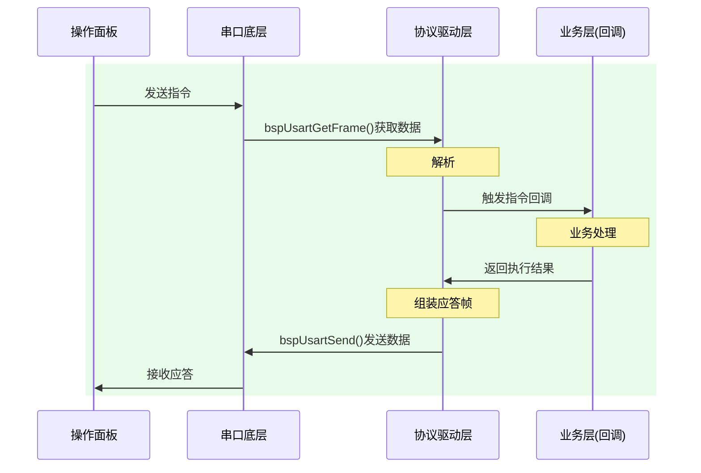

---
领域:
  - 工作
类型:
  - 开发
项目:
  - "[[分拣操作面板]]"
任务:
  - "[[260401S3分拣面板]]"
状态: 进行
相关任务:
创建时间: 2026-04-01T12:59:00
截止时间: 2026-08-16T04:59:00
完成时间:
---

## 待办列表
- [x] 编码
- [ ] 测试
- [ ] 合并
### 1.通信协议
#### 协议格式：
大端模式，

| 名称       | 长度    | 内容      | 备注                         |
| -------- | ----- | ------- | -------------------------- |
| 字段       | 字节数   | 取值/规则   | 说明                         |
| HEAD 帧头  | 1     | 0x55    | 固定帧起始魔术字                   |
| LEN 帧总长  | 2     | 整帧字节总数  | 包含 HEAD~TAIL 全部字段，**大端模式** |
| VER 版本   | 1     | 0x01    | 当前协议唯一版本                   |
| CFG 配置位  | 1     | 位图控制    | 通信属性配置位                    |
| SEQ 序列号  | 2     | 0~65535 | 分片/事务序号，**大端模式**           |
| CMD 指令码  | 2     | 自定义指令   | 业务功能码，**大端模式**             |
| DATA 数据域 | LEN-9 | 业务数据    | 最小0字节，最大245字节              |
| CHECK 校验 | 1     | CRC8    | 校验范围：LEN ~ DATA            |
| TAIL 帧尾  | 1     | 0xAA    | 固定帧结束魔术字                   |

###  1.通信流程



### 2026/4/17面板功能会议

 -  不兼容升级，只烧录定制版本，分阶段，后续进行开发
 -  [ ] 支持中/英文；
 -  [ ] IP/端口设置界面：支持四段IP设置，端口选择
 - [x] 模块开关界面：
 - [x] 参数设置界面：
 - [x] 通道/模块

---

# 任务1规划：JSON 自适应参数界面 + 中文字库显示（2026-10）

> **本文是给实现者（含 AI 模型）的施工规范。** 按 §10 的 T0~T8 顺序逐步实现，每步有明确验收标准；未写明的设计细节以本文档为准，本文档未覆盖的以 `Panel_RTOS/AGENTS.md`、`Panel_RTOS/02_Middleware/GUI/AGENTS.md`、`Panel_RTOS/panel-control.md` 的既有约定为准。
>
> 涉及仓库：
> - 面板（主战场）：`D:\Screen\Projects\Panel_RTOS`（HC32F460KETA，EIDE + Keil 双工程）
> - 控制器（本期**零改动**，仅作数据契约参考）：`D:\Sort\Sorting_Controller`
> - 旧面板（仅作字库 Flash 格式参考，**不改**）：`D:\Screen\Projects\Operation_Panel`
> - 官方 LL 库例程参考：`D:\Resource\ARM_MCU\HC32\F460\PROJECT\HC32F460_DDL_Rev3.3.0\projects\ev_hc32f460_lqfp100_v2\examples`（重点 `spi/`）

## 1. 目标与范围

**总目标**：面板作为控制器的通用调试工具。面板开机从控制器拉取参数定义 JSON（自适应：控制器加参数只改控制器 `param_def.h`，面板零改动），解析后生成参数浏览/编辑界面，中文显示（字模在板载 W25Qxx SPI Flash 中）。

**任务1范围（本期）**：
1. JSON 拉取（已完成，复用）→ **解析** → 生成模块/参数数据模型。
2. **中文字库驱动**：W25Qxx + unifont 字模读取 + GUI 字体钩子（UTF-8 文本渲染）。
3. **参数界面交互**：模块列表页 → 模块参数页（通道切换、参数列表、数字编辑、本地保存），全部中文显示（remark 本期不显示）。
4. 参数值本期用 JSON 的 `defaultValue` 填充（mock 数据源），但**架构上必须预留**"从控制器读值/写值走指令"的接口（见 §8）。

**不在本期**：READ/WRITE 参数值协议实现（任务2）、使能开关协议、运行开关、IP 设置专用界面、中英文切换。

## 2. 现状盘点（已核实的事实，实现前必读）

### 2.1 面板工程 Panel_RTOS
| 项 | 事实 | 出处 |
|---|---|---|
| MCU | HC32F460KETA（512KB Flash / 192KB SRAM），新架构：LL 库 + 分层（bsp/adapt/component/middleware/app） | `AGENTS.md` |
| LCD | ST75256 240×160 单色 1bpp，帧缓冲+脏矩形刷新，bit-bang SPI（PA8=CS, PC6=SCK, PC7=MOSI, PC8=DC, PC9=RES） | `01_Hardware/component/st75256/my_st75256.h`、`01_Hardware/adapt/st75256/st75256_hc32_adapter.c:13-22` |
| 键盘 | 5×6=30 键矩阵 + ZenButton 消抖；已映射：OK→Enter、Cancel/Esc→Cancel、方向键、NO0~NO9→eKey0~9；**空闲键**：F1/F2/F3、Login、Query、Product、Debug、Call、Light、AutoOut、QCPass、QCFail、NUM（Pause=复位勿动） | `04_Application/app/app_key.h:18-55`、`app_key.c:24-43` |
| 通信 | USART1(PC11/PC12, 115200) + `my_protocol`（二进制分帧/ACK/重传，`PROTOCOL_DATALEN_MAX`=帧内数据上限，JSON 片=254B） | `01_Hardware/bsp/bsp_config.h:51-64`、`04_Application/app/panel_cmd.h` |
| JSON 拉取 | **已实现**：`PANEL_CMD_JSON(0x0002)` 逐片申请，控制器回 `[seq][total][data...]`，空应答=发完；收齐置 `s_json_ready`，缓冲 `s_json_rx[40KB]`；对外 `App_PanelJsonReady/App_PanelGetJson/App_PanelJsonProgress` | `04_Application/app/app_panel.c:46-51,115-172,204-225` |
| 心跳 | `PANEL_CMD_HEARTBEAT(0x0001)` 每 1s，回版本串 → `controler_lined` 在线标志 | `app_panel.c:66-113` |
| GUI | 自研静态框架（无 malloc），组件：Text/Button/TabBar/List/Param/Popup；**内置字体仅 ASCII 5×7 按 font_size/8 倍放大**，不支持多字节 → 中文必须新增字体钩子（§5） | `02_Middleware/GUI/AGENTS.md`、`src/ui_canvas.c:245-280` |
| 页面 | `home_page`（标题+JSON 进度状态行+Version 按钮）、`version_page`；`ui_pages/` 下无 module/param 页（旧 module_page 已随旧协议方案删除） | `04_Application/ui_pages/` |
| 抓取工具 | `tools/fetch_ui_json.py`：pyOCD 读 RAM 符号 `s_json_rx/s_json_len/s_json_ready` 或 RTT 日志重组，产出仓库根 `UI.JSON` | `tools/fetch_ui_json.py` |
| 模拟器 | GUI 仓库 CMake+MinGW：`cmake -B build && cmake --build build`，`./build/test/gui_lcd_test.exe`；键映射含方向/Enter/Esc/0-9/`.`/`,`/`;` | `02_Middleware/GUI/AGENTS.md` |
| 构建 | EIDE 工程 `00_Project/EIDE/.eide/eide.yml`（virtualFolder 手工文件清单）+ Keil `00_Project/MDK/Panel.uvprojx`；**新增 .c 文件必须同时登记到两个工程**（EIDE 可用 eide MCP 工具） | `00_Project/` |

### 2.2 控制器 Sorting_Controller（数据契约来源，本期不改）
- JSON 生成：`APP/src/param_json.c` 由 `APP/inc/param_def.h`（X-macro 唯一维护点）展开生成，UTF-8，静态缓冲 40KB，运行期构建一次缓存。
- 下发：`APP/panel/panel.c` `cbJsonReq`（0x0002）按 `[seq]` 切片回复；双面板 A/B 两路串口共用同一 JSON。
- 参数元数据：`APP/inc/param_mgr.h`（`param_type_e`：INPUT=输入口 / OUTPUT_DC/VC=输出口 / UART=读卡器 / TIME、CONFIG=配置项；每模块注册表 `param_module_reg_t`）。
- 模块号：0(系统),1(分拣仓),2(鸟钩桥接),3(缓冲桥接),4(主轨道),5(提升臂桥接),6(出站缓冲),7(报警灯),8(端口检测),9(RFID出站),10(吊挂提升机),11(多级缓冲),12(消防断轨),14(缓冲确认),15(环形仓)。**13 不存在**。
- 通道规则：模块 4(主轨)、15(环形仓) 单通道（`max_size=1`），其余 2 通道（`param_json.c:133`）。
- **任务2预留**：参数值读写 API 控制器侧已具备（`paramModuleReg/paramModuleVal/paramCheckModuleUnique/paramFlush`），面板协议指令未定义。

### 2.3 旧面板 Operation_Panel（字库 Flash 格式权威参考，硬件同款）
- 字库芯片：W25Qxx 挂 **SPI3**：SCK=PB4(Func_Spi3_Sck)、MOSI=PB3(Func_Spi3_Mosi)、MISO=PB6(Func_Spi3_Miso)、CS=PB7(GPIO 软件控制)、WP=PB5(拉高禁用)；读指令 0x03、JEDEC ID 0x9F、`FLASH_MAX_ADDR=0x800000`(8MB)。出处：`midware/ziflash.h:38-84`、`midware/ziflash.c:165`（`SpiFlash_ReadData`）。
- Flash 地址 0 处为字库信息头 `_font_info{ uint8 fontok(==0xAA 有效); uint32 ugbkaddr; uint32 ugbksize; }`（`midware/fonts.h`、`fonts.c:34,299`）。
- **字模格式（unifont，Unicode 直接索引）**：
  - 取模偏移：`offset = unicode × size × 3`；每字模槽位 `size×3` 字节（`midware/Dispaly.c:5569`：`offset = char_uni * size * 3`）。
  - 旧固件菜单统一用 **size=20**（`OLED_ShowString(x,y,str,20)`，槽位 60B/字）。
  - 点阵排布：**列行式**——对第 x 列（x=0..size-1）有 3 字节 `buf[3x+0..2]`，每字节 8 个纵向像素、**MSB 在上**；超过 size 行的位忽略（`Dispaly.c:2068-2113` `OLED_ShowCHinese`）。
  - 宽度规则：`unicode < 0x2000` 半宽（advance=size/2，ASCII/数字），`≥0x2000` 全宽（advance=size，汉字/全角）（`Dispaly.c:5560-5585`）。
  - 全角标点疑点（已基本排除，且不影响本期）：`ziflash.h:86-87` 注释称"汉字区 0x000000~0x16f6af、全角区 0x16f6b0~0x1711f7"，与 `uni×60` 直接索引公式对全角区不一致。但 T1 实测字库头 `ugbksize≈0x003F4D94`（4.15MB）> U+FF5E×60≈0x3BE4E8，说明**字模很可能就是全 Unicode 直索引、全角区无独立起始地址**（T2 渲染确认即可）。另外**面板本期不显示 remark**，参数名/模块名均为纯汉字、值与标签为数字/ASCII/纯汉字，因此**不需要全角标点字模**。将来若要在界面显示全角标点，再按 T2 实测结论处理。

## 3. UI.JSON 数据契约（面板解析的唯一输入）

实测样本：仓库根 `UI.JSON`（33,577B，UTF-8 无 BOM，单行紧凑格式）。生成器保证：**字符串内无转义字符**（`\"`、`\\` 不会出现；解析器遇到 `\` 判为格式错误并记录日志，不做反转义）。

```jsonc
{"low_com_configs":[                     // 模块数组，按 code 升序，13 缺席
  {
    "name":"分拣仓模块设置",               // 模块中文名（UTF-8）
    "code":1,                            // 模块号 0..15
    "max_size":2,                        // 通道数：1 或 2（模块 4/15 为 1）
    "items":[
      // ── 前 3 项固定为"协议帧项"，type=="" ，非实参，面板必须跳过 ──
      {"key":"命令",  "length":1,"defaultValue":0,"remark":"","type":"","min":0,"max":2},
      {"key":"模块号","length":1,"defaultValue":0,"remark":"","type":"","min":0,"max":0},
      {"key":"通道号","length":1,"defaultValue":0,"remark":"","type":"","min":1,"max":2},
      // ── 实参项 ──
      {"key":"进站读卡器","length":1,"defaultValue":0,"remark":"",
       "type":"读卡器","min":0,"max":13},
      {"key":"库区电机运行时间","length":2,"defaultValue":180,"remark":"单位：s",
       "type":"配置项","min":0,"max":65535}
      // ...
    ]
  },
  // ... 共 15 个模块
]}
```

解析规则（规范性）：
1. **帧项判定**：`type` 为空串 → 跳过，不计入参数表（不要按 key 名字判定）。
2. `type` 映射枚举：`输入口`→INPUT、`输出口`→OUTPUT、`读卡器`→READER、`配置项`→CONFIG；未知值 → CONFIG 并记日志。
3. 数值字段：`code/max_size/length/min/max/defaultValue` 均为非负整数，`length∈{1,2}`、`max_size∈{1,2}`；越界 → 该项/该模块判错。
4. 参数顺序 = JSON items 顺序（**与控制器结构体字段序一致，任务2 线上读写按此序**），面板不得重排。
5. 容量规划（当前 15 模块/245 实参，留增长余量）：模块 ≤16、实参总数 ≤320、单模块实参 ≤48。
6. 解析失败（结构错/超容量/含 `\`）：记录错误原因字符串（ASCII，日志用）+ 首页状态行显示"JSON 解析失败"，界面不进模块列表；**不得崩溃、不得越界**（所有解析函数带边界检查，输入截断也能安全报错）。

## 4. 总体架构与数据流

```
控制器                      面板固件
──────                     ─────────────────────────────────────────────
param_def.h ──paramJsonBuild→ JSON 分片(0x0002)
                              │ app_panel.c(已有): s_json_rx[40KB] + s_json_ready
                              ▼
                       [panel_model] JSON 解析器(零拷贝 span)      ← 新增 02_Middleware/panel_model/
                              ▼
                       ParamModel: 模块表+参数表(静态池)
                              ▼
                       param_store: 值池[参数][通道]+dirty        ← 新增
                              ▲ (本期 mock=default; 任务2 换协议源)
                       param_source 抽象接口                       ← 新增
                              ▼
                       ui_pages: home_page(模块列表) / module_page(参数页) ← 重构/新增
                              ▼
                       GUI(my_ui) ── UI_FontOps_t 字体钩子         ← GUI 扩展
                              ▼                    ▲
                       ST75256(LCD)        app_font.c(固件: W25Qxx unifont) ← 新增
                                           font_file.c(模拟器: unifont20.bin) ← 新增
                                                   ▲
                                           my_w25qxx(component) + w25qxx_hc32_adapter(SPI3 LL) ← 新增
```

分层纪律（沿用 AGENTS.md）：硬件访问只出现在 `adapt/`；`component/`、`02_Middleware/` 硬件无关、可在模拟器/主机编译；GUI 不 include 任何 bsp 头。

## 5. 中文字库方案（W25Qxx + unifont）

### 5.1 决策
- **统一字号 20px**：汉字 20×20（全宽），ASCII/数字 10×20（半宽）。240×160 屏 → 每行 24 半宽字符（12 汉字），行距 22px（20+2）→ 正文约 6~7 行。与旧面板观感一致，字库现成。
- 内置 5×7 ASCII 字体保留为**回退**（钩子未安装 / 取模失败时画空心矩形），现有模拟器与旧页面不回归。
- 字模读取：SPI3 硬件 SPI（LL 库，参考官方 `examples/spi`），轮询阻塞式即可（本期不做 DMA/中断）。

### 5.2 新增驱动（三层，仿 st75256 模式）
1. `01_Hardware/component/w25qxx/w25qxx.c/h` — 复用官方 `drivers/bsp/components/w25qxx`（XHSC，LL 函数表，保留 license）：
   ```c
   typedef struct {
       void    (*Delay)(uint32_t);
       void    (*Init)(void);
       void    (*DeInit)(void);
       void    (*Active)(void);                            /* CS 低 */
       void    (*Inactive)(void);                          /* CS 高 */
       int32_t (*Trans)(const uint8_t* tx, uint32_t len);
       int32_t (*Receive)(uint8_t* rx, uint32_t len);
   } stc_w25qxx_ll_t;
   ```
   官方 API：`W25QXX_Init/DeInit/GetManDeviceId(0x90)/GetUniqueId/ReadStatus/.../ReadData/PageProgram/EraseSector/EraseChip`；另加 `W25QXX_GetJedecId(0x9F)` 便于读 `0xEF4018`。本期应用只读；写/擦除已具备，供后续字库更新。
2. `01_Hardware/adapt/w25qxx/w25qxx_hc32_adapter.c/h` — HC32 SPI3 适配（唯一碰寄存器处，仿官方 `ev_hc32f460_lqfp100_v2_w25qxx.c`）：
   - 引脚：PB4=SCK、PB3=MOSI、PB6=MISO 复用为 SPI3（`GPIO_FUNC_43/40/41`）；PB7=CS 推挽输出（软件控制，初值高）；PB5=WP 推挽输出恒高。PB3/PB4 需先关闭 JTAG 的 TDO/TRST 复用（`GPIO_SetDebugPort`，保留 SWD/RTT）。
   - SPI 配置：**`SPI_3_WIRE`（软件 CS）** + `SPI_DelayTimeConfig`（interval 8SCK、release 8SCK、setup 1SCK）；Mode0、8bit、MSB first、主机、PCLK1/8 = 12.5MHz（PCLK1=100MHz）。**`04_Application/hc32f4xx_conf.h` 的 `LL_SPI_ENABLE` 必须为 `DDL_ON`**。
   - `Trans/Receive` 直接走 LL 批量 `SPI_Trans/SPI_Receive`（带超时），不再逐字节轮询。
   - 对外只暴露 BSP 方便函数（`s_ll` 保持 static）：`W25Qxx_HC32Init/DeInit/Read/Write/EraseSector/EraseChip/GetIds/MaxAddr`；应用不再接触 `stc_w25qxx_ll_t`。写/擦已实现，本期只读应用不调用。
3. `04_Application/app/app_font.c/h` — 字体服务（实现 GUI 的 `UI_FontOps_t`，见 §6）：
   - `App_FontInit()`：W25Qxx_Init → 读 ID（记日志）→ 读地址 0 的 `fontok`（==0xAA 记日志，非 0xAA 仍继续，只告警）→ `UI_SetFontOps(&s_font_ops)`。
   - 取模（T2 已实测确认）：`offset = uni × 60`；每字 60B = 20 列 × 3B/列，列优先、MSB first，每列只取前 20 位（第 3 字节高 4 位有效，低 4 位填充）。ASCII 取前 10 列、advance=10；CJK 取 20 列、advance=20。统一走 `app_font.c` 内静态函数 `font_offset(uni)`（当前即直索引；将来若需全角标点特例，只改此函数）。
   - 半宽判定：**`uni < 0x80` → advance=10，只画前 10 列；否则 advance=20**（T2 实测；不要用 `uni < 0x2000`，否则 U+00A0~U+1FFF 会被误当半宽）。
   - 字库头部：地址 0 的 12B 是 `fontok/ugbkaddr/ugbksize` 信息头（`ugbksize=0x3F4D94`），覆盖了 U+0000 的字模；实际使用从 U+0020 起，不受影响。`unifont20.bin` 转储时把这 12B 置 0，与原始字库文件一致。
   - **字模缓存**：直接映射 16 槽（key=uni，LRU 近似：命中比较 16 个 key 即可），减少 SPI 反复读（列表滚动/marquee 时同字反复出现）。缓存失效无需处理（字库只读）。
   - 缺字（读回全 0xFF/全 0x00 或 uni 超 0xFFFF）：返回失败 → GUI 画 20×20 空心框。

### 5.3 字库验证与转储（T2，硬件实测，先于一切 UI 工作）
1. 读 JEDEC ID 并 RTT 打印（T1 已实测 `0xEF4018` = W25Q128，16MB）。
2. 读 addr0 前 16B 打印（T1 已确认 `fontok=0xAA`；实测 `AA B6 0F 00 00 00 00 00 94 4D 3F 00`，按对齐结构解码 `ugbkaddr=0`、`ugbksize=0x3F4D94≈4.15MB`）。
3. ✅ 用临时测试页在 LCD 上渲染采样字符串：**"系统参数 分拣仓 / 0123456789 . , ; / 系 统 参 数 / 分 拣 仓 / A-Z"**，覆盖 U+7CFB(系)、U+7EDF(统)、U+53C2(参)、U+6570(数)、模块名常用字、ASCII 数字/标点。实测确认汉字按 `uni×60` 取模正确；用 pyOCD 读回 LCD 帧缓冲 `s_default_framebuffer`，与 `unifont20.bin` 同布局渲染结果**逐像素 0 差异**。
4. 转储字库到 PC 供模拟器用（T5 需要）。**范围修正**：原计划的 `0x000000~0x17FFFF`（1.5MB）**不够**——系 U+7CFB 的偏移是 `0x1D4AD4`、统 U+7EDF 是 `0x1DBC44`，均已超出 1.5MB；完整字库大小 `ugbksize=0x3F4D94`（4,148,628B）。已实现 `tools/dump_font.py`（RTT 默认 / USART1 可选；帧 `A5 5A | type | seq | len | payload | CRC16`；首 12B 信息头置 0）。本机 CMSIS-DAP 在 RTT 持续读取约 240~430KB 后卡死，全量 RTT 转储未完成；`unifont20.bin` 采用与 flash `ugbksize` 完全一致的参考字库 `D:\Screen\Projects\ShapeLib\unifont.BIN` 生成（SHA256 `CC25FD0E...379ACD`），并由上述帧缓冲比对确认与硬件显示一致。若后续要真实全量转储，按 UART 路径接线重跑（约 90s@460800 / 6min@115200）。
5. 产物：`02_Middleware/GUI/test/unifont20.bin`（4,148,628B，`*.bin` 已 gitignore）+ 本节结论。**硬件 LCD 验收通过；模拟器与硬件同串对比留到 T5。**

## 6. GUI 字体钩子扩展（改 `02_Middleware/GUI`，唯一允许的框架改动）

### 6.1 新增 `inc/ui_font.h` + `src/ui_font.c`
```c
/* 字形输出：列行式位图，每列 col_bytes 字节，字节内 MSB 在最上像素（与 unifont 原生一致，零转换） */
typedef struct {
    uint8_t        w;          /* 位图宽(px)：全宽=size，半宽=size/2 */
    uint8_t        h;          /* 位图高(px)=字号 */
    uint8_t        advance;    /* 光标推进(px) */
    uint8_t        col_bytes;  /* 每列字节数 = ceil(h/8)，20px→3 */
    const uint8_t* bitmap;     /* w*col_bytes 字节，列优先 */
} UI_Glyph_t;

typedef struct {
    /* 取字形：成功返回1并填 out（out->bitmap 指向提供方可复用的静态槽，
       调用方必须在下次 fetch 前用完——GUI 逐字取模立即绘制，满足此约束） */
    uint8_t (*fetch)(uint32_t uni, uint8_t px, UI_Glyph_t* out);
} UI_FontOps_t;

void    UI_SetFontOps(const UI_FontOps_t* ops);   /* NULL=回退内置 5×7 */
uint8_t UI_FontUtf8Decode(const char* s, uint32_t* uni); /* 返回该字符 UTF-8 字节数(1/2/3)，非法字节返回1并 uni=0xFFFD */
uint8_t UI_FontActive(void);                       /* 钩子是否已安装 */
```

### 6.2 文本路径改造（`src/ui_canvas.c`）
- `UI_DrawTextClipped / UI_DrawTextNClipped / UI_DrawTextHScrollClipped / UI_GetTextWidth(N) / UI_GetTextHeight / UI_GetLineHeight`：
  - 钩子已安装 → 走 UTF-8 循环：`UI_FontUtf8Decode` → `fetch(uni, font_size)` → 逐列逐位 `UI_DrawPixelClipped`（前景色画点；**背景不画**，沿用现有"只画亮点"风格，反白由组件 FillRect 实现）→ `cursor_x += advance`；`\n` 换行推进 `UI_GetLineHeight`；fetch 失败画 `w×h` 空心矩形。
  - 钩子未安装 → 现有 5×7 路径**原样保留**（模拟器默认、旧页面回归安全）。
  - `font_size` 语义：钩子模式下 = 像素高（面板全局用 20，标题可用 20；内置模式仍为 8 的倍数放大，两种模式不混用于同一页面）。
- 行高：钩子模式 `UI_GetLineHeight(px) = px + 2`；`UI_GetTextHeight(px) = px`。
- 组件层（ui_text/ui_param/ui_popup/ui_list/ui_button/ui_tabbar）**不改绘制逻辑**，只因其调用 canvas 文本函数而自动获得中文能力；但需排查两处按"字节=字符"假设的代码并改为按 UTF-8 字符计数：
  1. `ui_popup.c` 自动换行/滚动（按 `UI_GetTextWidthN` 逐字符推进，截断点必须落在字符边界）；
  2. `ui_text.c` marquee 与 `ui_param.c` 名字截断（同上）。
- `ui_param.c` 的 value/edit_buf 仍限 ASCII 数字编辑（本期参数全是数值），不改。

### 6.3 模拟器字体提供者 `test/font_file.c`
- 实现同一 `UI_FontOps_t`：启动时把 `test/unifont20.bin`（§5.3 产物，含 dump 起始地址信息→偏移公式同固件）一次性读入 malloc 的宿主内存（**仅模拟器允许 malloc**），`fetch` 直接切片。
- `test/main.c`：若 bin 文件存在则 `UI_SetFontOps(file_font_ops)`，并加载 `--json <path>`（默认找仓库根 `UI.JSON`）喂给 panel_model（§7），把模拟器变成完整面板仿真；文件不存在则保持现状（内置字体+旧 demo），保证 CI 式回归。

## 7. 数据模型层 `02_Middleware/panel_model/`（新增，硬件无关，主机可测）

### 7.1 文件
```
02_Middleware/panel_model/
├── inc/ json_parse.h  param_model.h  param_store.h  param_source.h
├── src/ json_parse.c  param_model.c  param_store.c  param_source_mock.c
├── test/test_model.c        /* 主机单测：解析仓库根 UI.JSON + 截断/畸形样本 */
└── CMakeLists.txt           /* 主机测试工程（独立于 GUI 仓库） */
```
固件侧（EIDE/Keil）把 `src/*.c`（除 mock 可编入用于本期）登记进工程；GUI 模拟器 CMake 把 `src/*.c` 编入 `gui_lcd_test`。

### 7.2 JSON 解析器（零拷贝 span，**不原地改写 s_json_rx**）
> 决策：不做"原地 NUL 终止"（会破坏 `fetch_ui_json.py --no-reset` 的 RAM 转储，且不可重解析）。span 记录 `(const char* ptr, uint16_t len)`，显示时再物化到小缓冲（§9 页面行池）。
```c
typedef struct { const char* p; uint16_t len; } JsonSpan_t;   /* 非 NUL 终止 */

/* 递归下降单遍扫描；只识别本契约用到的子集：object/array/string/number/true/false/null；
   字符串内遇 '\' 返回错误(契约保证无转义)；所有游标带 end 边界检查。 */
typedef enum { JSON_OK=0, JSON_ERR_SYNTAX, JSON_ERR_TRUNCATED, JSON_ERR_CAPACITY, JSON_ERR_ESCAPE } JsonErr_t;
JsonErr_t JsonParse_Model(const char* json, uint16_t len, ParamModel_t* out, const char** err_msg);
```

### 7.3 参数模型（静态池，容量见 §3 规则5）
```c
#define PMOD_MAX_MODULES 16
#define PMOD_MAX_PARAMS  320
#define PMOD_MAX_PER_MOD 48

typedef enum { PTYPE_CONFIG=0, PTYPE_INPUT, PTYPE_OUTPUT, PTYPE_READER } PModType_t;

typedef struct {
    JsonSpan_t key;        /* 参数中文名(指向 JSON 缓冲内) */
    JsonSpan_t remark;     /* 备注(保留解析, 本期不显示; 为将来留用) */
    uint8_t    type;       /* PModType_t */
    uint8_t    length;     /* 1|2 字节(任务2 线宽) */
    uint16_t   min, max, def;
} PModParam_t;             /* 16B */

typedef struct {
    JsonSpan_t name;       /* 模块中文名 */
    uint8_t    code;       /* 模块号 */
    uint8_t    ch_cnt;     /* max_size: 1|2 */
    uint16_t   param_cnt;
    uint16_t   param_ofs;  /* 在 params 平坦池中的起始下标 */
} PModModule_t;            /* 12B */

typedef struct {
    PModModule_t modules[PMOD_MAX_MODULES];
    PModParam_t  params[PMOD_MAX_PARAMS];    /* 平坦池 */
    uint16_t     module_cnt, param_cnt;
    uint8_t      parsed;                     /* 1=解析成功 */
} ParamModel_t;                              /* ≈5.4KB 静态 */

const ParamModel_t* ParamModel_Get(void);            /* 全局单例(固件内静态) */
const PModModule_t* ParamModel_FindByCode(uint8_t code);
uint8_t  ParamModel_ParseFromPanel(void);            /* 便捷入口: 取 App_PanelGetJson→JsonParse_Model；
                                                        面板固件用；主机测试直接用 JsonParse_Model */
```
> RAM 预算：模型 5.4KB + JSON 缓冲 40KB（常驻，字符串被 span 引用，**解析后不得复用/清零**）+ 值池(§7.4) ≈ 1.5KB + 页面行池(§9) ≈ 3KB。合计新增 ≈ 50KB / 192KB，安全。

### 7.4 值池 param_store（本期 mock，任务2 换协议源）
```c
/* 值按 [参数平坦下标][通道0/1] 存放；u16 统一存(任务2 线上传输按 length 截断)。
   初始化 = JSON defaultValue；编辑提交写这里 + dirty 置位。 */
void     ParamStore_Init(void);                       /* 依模型填默认值、清 dirty */
uint16_t ParamStore_Get(uint16_t param_idx, uint8_t ch);
uint8_t  ParamStore_Set(uint16_t param_idx, uint8_t ch, uint16_t v); /* 带 min/max 校验: 0=OK 1=超范围 */
uint8_t  ParamStore_IsDirty(uint16_t param_idx, uint8_t ch);
void     ParamStore_ClearDirty(uint8_t ch_or_all /*0xFF=全部*/);
uint16_t ParamStore_DirtyCount(uint8_t ch);
```

### 7.5 param_source 抽象（任务2 的插槽，本期只留接口+mock）
```c
typedef enum { PS_IDLE, PS_LOADING, PS_READY, PS_ERROR, PS_SAVING } PS_State_t;
typedef struct {
    void (*LoadModule)(uint8_t mod_code, uint8_t ch);       /* 异步拉整模块值→写 ParamStore */
    void (*SaveModule)(uint8_t mod_code, uint8_t ch);       /* 异步提交 dirty 值 */
    PS_State_t (*Poll)(void);                                /* 状态机(参照 panel-control.md §8.1) */
    const char* (*LastError)(void);                          /* ASCII 原因 */
} ParamSource_t;
extern const ParamSource_t g_ps_mock;    /* 本期: Load 立即 READY(值=default)，Save 立即 READY+清 dirty */
/* 任务2 增加 g_ps_protocol: PANEL_CMD_READ_VALS(0x0003)/WRITE_VALS(0x0004)，
   载荷=[mod][ch]+按 JSON 序的 length 字节大端值数组；控制器全权校验并回 ASCII 原因。
   指令码/载荷届时在 panel_cmd.h 两端同步定义，本文档只锁定"值序=JSON items 序"这一契约。 */
```

## 8. UI 设计（240×160，字号 20，行距 22）

### 8.1 页面树
```
home_page(重构)
 ├─ 模块列表(UI_List 动态, 15 模块中文名 + 尾部"版本信息"项)
 │    └─Enter→ module_page(新增, 按选中模块 code 进入)
 └─ 状态栏(拉取进度/解析结果/离线提示)
version_page(保留, 显示控制器版本串)
```

### 8.2 home_page（重构）
| 区域 | 坐标 | 内容 |
|---|---|---|
| 标题栏 | y0..21 | 左"调试工具"(20px)，右在线状态点/文本("在线"/"离线") |
| 模块列表 | y22..137 | UI_List 动态：行高 23，可见 5 行；行文本=`模块名`（超宽 marquee/截断），右侧灰显 `code`；焦点行反白；滚动条 auto |
| 状态栏 | y138..159 | 未收齐:"下载界面 x/y"；收齐:"解析完成 15模块/245参数"；失败:"JSON解析失败"；离线且无缓存:"等待控制器..." |
- JSON `s_json_ready` 置位后（且未解析过）→ 调 `ParamModel_ParseFromPanel()` 一次，结果驱动状态栏与列表填充（解析失败列表显示 empty_text）。
- 按键：↑/↓ 选行（列表滚动），Enter 进 module_page / version_page，Cancel 吃掉（栈底）。

### 8.3 module_page（新增，核心页面）
| 区域 | 坐标 | 内容 |
|---|---|---|
| 标题栏 | y0..21 | 左 `<`+模块名(超宽 marquee)+`>`；右 `ch_cnt>1` 时无内容(通道在 TabBar) |
| 通道 TabBar | y22..43 | 仅 `max_size==2` 时存在：["通道1","通道2"]；单通道模块隐藏(列表上移到 y22) |
| 参数列表 | y44..137（单通道 y22..137） | UI_List 动态，行高 23，可见 4~5 行；行=UI_Param：name=参数中文名(借用行池物化缓冲)，value=右对齐数值文本(含 dirty 标记 `*` 后缀，如 `180*`) |
| 底栏 | y138..159 | 一个按钮：[保存 F2]（按钮文本中文，Enter 触发；F2 物理键等效直达） |

焦点环：通道 TabBar → 参数 List → 保存按钮 →（循环）。

**按键交互表**：
| 焦点/状态 | 键 | 行为 |
|---|---|---|
| 通道 TabBar | ←/→ | 切通道 → 重载该通道值(ParamStore 按 ch 取)刷新列表；dirty 未保存时弹确认"切换通道将丢弃未保存修改?"(OK=丢弃切换/Cancel=留在原通道) |
| 参数 List(非编辑态) | ↑/↓ | 滚动选行 |
| 参数 List | Enter | 当前行 UI_Param 进编辑态（现有 list 操作态机制） |
| UI_Param 编辑态 | 0-9 | 追加数字；← 退格；Enter 提交：`strtoul` → `ParamStore_Set`(min/max 面板预校验) → 超范围 alert `"超出范围 min~max"`(数值用 ASCII 拼)；成功→写值池+dirty+行文本刷新+退编辑态；Cancel 放弃还原 |
| 任意(非编辑态) | F2 | 保存：`ParamSource.SaveModule(code,ch)` → 本期 mock 立即成功：toast"已保存(本地)" + 清 dirty；任务2 换协议后此路径自动变为 Progress 弹窗+结果分流 |
| 任意(非编辑态) | Cancel | 有 dirty → 确认弹窗"有未保存修改,退出?"；无 dirty / 确认放弃 → `UI_PagePop` 回 home |

**新增事件码**（`ui_event.h`，插在 `eKeySemicolon` 之后、`eEvtToast` 之前）：`eKeyF1, eKeyF2, eKeyF3`（F1/F3 预留，F2=保存）。`app_key.c` 映射表补 `{KEY_F1,eKeyF1},{KEY_F2,eKeyF2},{KEY_F3,eKeyF3}`。

**弹窗清单**：
| 场景 | 类型 | 文案 | 关闭 |
|---|---|---|---|
| 值超范围 | Alert(OK) | "超出范围 %u~%u"(ASCII 数字) | Enter/Cancel |
| 保存成功(本期) | Toast | "已保存(本地)" | 1s 自动 |
| 切通道有 dirty | Confirm(OK/Cancel) | "丢弃未保存修改?" | OK=切/Cancel=留 |
| 退出有 dirty | Confirm(OK/Cancel) | "有未保存修改,退出?" | OK=退/Cancel=留 |
> 所有动态文案先 snprintf 进**静态缓冲**再传弹窗（弹窗 text/title 是借用指针，严禁栈缓冲——panel-control.md §13.8 已知坑）。

### 8.4 页面行池（module_page 静态资源）
```c
#define MROW_MAX 48                       /* ≥ 最大单模块参数数(环形仓41) */
static UI_Param_t        s_rows[MROW_MAX];        /* DEFAULT_LIST_PARAM_CONFIG */
static UI_ListItem_t     s_items[MROW_MAX];
static char s_name_buf[MROW_MAX][40];     /* 参数名物化(UTF-8 NUL 终止, 40B≥13汉字) */
static char s_val_buf[MROW_MAX][8];       /* "65535*" */
static char s_title_buf[40];              /* 模块名物化 */
```
进入页面/切通道时按当前模块重建行池：span 拷贝物化 → `UI_Param.name/value` 指向行池 → `UI_ListSetCount`。

## 9. 文件清单（新增/修改）

**新增**：
| 文件 | 内容 |
|---|---|
| `01_Hardware/component/w25qxx/my_w25qxx.c/h` | W25Qxx 芯片逻辑(ops 表, 只读) |
| `01_Hardware/adapt/w25qxx/w25qxx_hc32_adapter.c/h` | SPI3 LL 适配(PB3/4/5/6/7) |
| `02_Middleware/panel_model/inc|src|test|CMakeLists` | json_parse / param_model / param_store / param_source(mock) / 主机单测 |
| `04_Application/app/app_font.c/h` | UI_FontOps_t 固件提供者(unifont20 + 16 槽缓存) |
| `04_Application/ui_pages/module_page.c/h` | 参数页(§8.3) |
| `02_Middleware/GUI/inc/ui_font.h` + `src/ui_font.c` | 字体钩子 + UTF-8 解码 |
| `02_Middleware/GUI/test/font_file.c` | 模拟器文件字体提供者 |
| `tools/dump_font.py` | 字库转储接收脚本(→ `02_Middleware/GUI/test/unifont20.bin`, bin 加入 .gitignore, 转储步骤写入 README/本文档) |

**修改**：
| 文件 | 改动 |
|---|---|
| `02_Middleware/GUI/src/ui_canvas.c` | 文本绘制/测宽/行高接入字体钩子(§6.2) |
| `02_Middleware/GUI/src/ui_popup.c`、`ui_text.c`、`ui_param.c` | 换行/截断改 UTF-8 字符边界(§6.2) |
| `02_Middleware/GUI/inc/ui_event.h` | +eKeyF1/F2/F3 |
| `02_Middleware/GUI/CMakeLists.txt`、`test/CMakeLists.txt`、`test/main.c` | 编入 ui_font.c/panel_model/页面 + `--json` 加载 + 文件字体 |
| `04_Application/ui_pages/home_page.c` | 重构为模块列表页(§8.2) |
| `04_Application/app/app_key.c` | F1/F2/F3 映射 |
| `04_Application/main.c` | HardwareInit 增 W25Qxx/App_FontInit；App_PanelInit 后 ParamStore 初始化挂到解析完成时机 |
| `04_Application/app/app_panel.c` | 不改逻辑；如需在 ready 时回调通知可加 `App_PanelSetJsonCallback`(可选) |
| `00_Project/EIDE/.eide/eide.yml`、`00_Project/MDK/Panel.uvprojx` | 登记全部新 .c(两个工程都要！) |
| `panel-control.md` | 追加"JSON 自适应方案"章节链接本文档；旧文本 kv 方案标记为已废弃 |

## 10. 实施步骤（按序执行，每步独立可验收）

- [x] **T0 准备**：通读本文档 + `Panel_RTOS/AGENTS.md` + `GUI/AGENTS.md`；确认 EIDE 工程可编译烧录基线（`eide_build`），模拟器可编译基线（cmake）。
- [x] **T1 W25Qxx 驱动**：component + adapt(SPI3 LL, 参考官方 `examples/spi`)；临时测试代码在 `main` 中读 JEDEC ID 与 addr0 前 16B，RTT/USART1 打印。**验收：ID 厂商=0xEF、容量=0x18（W25Q128，`0x9F` JEDEC 实测 0xEF4018；旧 `0x90` ID 才是 0xEF1x 风格），fontok 字节=0xAA**（硬件）。
- [x] **T2 字库验证+转储**：按 §5.3 渲染采样串、确认偏移公式、生成 `unifont20.bin` 与 `tools/dump_font.py`。**验收：LCD 正确显示"系统参数 分拣仓 0123456789"**（硬件帧缓冲与字库渲染逐像素 0 差异）。全量 RTT 转储因探针不稳定未完成，产物由同尺寸参考字库生成，详见 §5.3/T2 实施记录。
- [x] **T3 GUI 字体钩子**：ui_font.c + canvas/popup/text/param 改造（§6）。**验收：模拟器无提供者时旧 demo 与既有页面像素级不回归；编译零警告**。
- [x] **T4 app_font 固件提供者**：§5.2 实现 + 缓存；临时测试页渲染采样串。**验收：硬件 LCD 中文/ASCII/数字正确、滚动列表无明显拖慢（全屏重绘 <80ms，实测首帧全屏 44ms、滚动稳态 max 38ms）**。
- [ ] **T5 模拟器提供者**：font_file.c + test/main.c 装载。**验收：模拟器渲染同一字符串与硬件一致**。
- [ ] **T6 panel_model**：解析器/模型/值池/mock 源 + 主机单测（§7；单测样本：仓库 UI.JSON、逐字节截断系列、`"type":"x\"y"` 转义样本、超容量样本）。**验收：`cmake --build && ctest` 通过——15 模块/245 参数/帧项全跳过/环形仓 41 参数/min-max-def 抽查 5 项一致/所有畸形样本安全报错不崩溃**。
- [ ] **T7 UI 页面**：home 重构 + module_page + 事件码/按键映射（§8）；模拟器接入 panel_model 走完整流程（`--json`）。**验收（模拟器+硬件同场景）：开机→拉取进度→解析完成→模块列表→进"分拣仓模块设置"→切通道2→编辑"库区电机运行时间"=200 提交→切"进站模式配置"输 5 弹超范围→F2 保存 toast→退出确认→重进值保留、dirty 标记正确**。
- [ ] **T8 收尾**：删除临时测试代码；EIDE+Keil 双工程登记核对并各自全量编译通过；`panel-control.md`/`AGENTS.md` 补记；按仓库规范提交（Conventional Commits 中文，如 `feat(font): W25Qxx unifont 中文字库接入`、`feat(panel_model): JSON 参数模型解析`、`feat(ui): 模块参数页`）。

### T1 实施记录（2026-10-23）

**新增文件**
- `01_Hardware/component/w25qxx/w25qxx.{c,h}`：复用官方 XHSC `drivers/bsp/components/w25qxx`（LL `stc_w25qxx_ll_t` 函数表，保留 license），提供 `W25QXX_Init/DeInit/GetManDeviceId(0x90)/GetUniqueId/ReadStatus/ReadData/PageProgram/EraseSector/EraseChip`；另加 `W25QXX_GetJedecId(0x9F)`。应用本期只读，写/擦除供后续字库更新。
- `01_Hardware/adapt/w25qxx/w25qxx_hc32_adapter.{c,h}`：仿官方 `ev_hc32f460_lqfp100_v2_w25qxx.c`，内部持有 `stc_w25qxx_ll_t`，对外给 BSP 函数 `W25Qxx_HC32Init/DeInit/Read/Write/EraseSector/EraseChip/GetIds/MaxAddr`；PB4=SCK(43)、PB3=MOSI(40)、PB6=MISO(41)、PB7=CS、PB5=WP；关闭 JTAG TDO/TRST；SPI3 用 `SPI_3_WIRE` + `SPI_DelayTimeConfig(8/8/1 SCK)`，PCLK1/8=12.5MHz；`Trans/Receive` 走 LL 批量 `SPI_Trans/SPI_Receive`（带超时）。写/擦 wrapper 仅编译验证，未在字库区实测。

**修改文件**
- `04_Application/hc32f4xx_conf.h`：`LL_SPI_ENABLE` 由 `DDL_OFF` 改为 `DDL_ON`（否则 LL SPI 头/源被整体裁掉，`SPI_Init` 等不可用）。
- `04_Application/main.c`：`HardwareInit()` 增加 `W25Qxx_HC32Init()`；临时自检已删除，仅保留初始化。
- `00_Project/EIDE/.eide/eide.yml`：两个新目录加入 `srcDirs`，incList 加入 `component/w25qxx`、`adapt/w25qxx`。
- `00_Project/MDK/Panel.uvprojx`：Component/Adapt 组登记新 `.c`，IncludePath 同步新增。

**验证结果**
- EIDE build：成功（0 error，新增文件零 warning）。
- Keil build：成功（0 error；全量构建仅既有 GUI/my_protocol warning，增量 0 warning）。
- 硬件（官方组件 + BSP 封装后，自检只走 `W25Qxx_HC32GetIds/Read`，pyOCD 烧录 + RTT）：
  ```
  [I][W25QXX] man id=0xEF17 jedec=0xEF4018
  [I][W25QXX] addr0[16]=AA B6 0F 00 00 00 00 00 94 4D 3F 00 07 00 00 00
  [I][W25QXX] fontok=0xAA (OK)
  [I][W25QXX] glyph hash=0xFA8E09D2
  ```
  `man id=0xEF17` 是官方 `GetManDeviceId(0x90)` 口径（W25Q128）；`jedec=0xEF4018` 是新增 0x9F 口径，两者一致指向 W25Q128（16MB）。7 个采样汉字（系统参数分拣仓）的 60B 字模哈希与 `unifont20.bin` 同算法结果 `0xFA8E09D2` 完全一致，**T1 重构验收通过**。
  附带信息：`fontok@0`、`ugbkaddr@4`、`ugbksize@8`；读出 `ugbkaddr=0`、`ugbksize=0x003F4D94`（约 4.15MB）。
- 初版自研 `my_w25qxx` 的 JEDEC/addr0/fontok 测试同样通过；后续按官方组件 + BSP 封装重构，已提交 `784c4a2 refactor(spi): 复用官方 W25QXX 组件并封装 BSP 接口`。

**复测命令（已验证可用）**
```powershell
pyocd flash -t hc32f460xe 00_Project/EIDE/build/Target_1/Panel.axf
# RTT 读取：用 pyOCD Python API 打开会话，按 map 中 _SEGGER_RTT 地址解析
#   CB=acID[16]+maxUp/maxDown+ aUp[n]{sName,pBuffer,size,WrOff,RdOff,flags}
#   读 pBuffer[RdOff..WrOff) 环形区间后干净关闭会话（本次用临时脚本完成，未入库）
```
> 注意：`pyocd rtt` 在 Windows 下被强杀可能使 CMSIS-DAP 假死，需重新插拔；建议用脚本直接读 `_SEGGER_RTT` 结构后干净退出。

### T2 实施记录（2026-10-23）

**新增/修改（临时测试代码已在 T2 验收后删除）**
- `04_Application/app/app_font_test.c/h`：直读 W25Qxx 的 UTF-8 测试页 + 字库帧转储（**已删除**）。
  - 测试页：边框 + "系统参数 分拣仓"、数字/半角标点、单字间隔、A-Z；`ST75256_Refresh()` 一次。
  - 字模：`offset=uni*60`，20 列×3B/列，列优先 MSB first，每列只取前 20 行；ASCII 10 列/10px，CJK 20 列/20px。
  - 转储帧：`A5 5A | type(1) | seq(2 LE) | len(2 LE) | payload | CRC16(2 LE)`，type=1 数据/2 结束；payload 1024B；结束帧带总长度与帧数；首 12B 由 PC 端置 0。
  - 触发：RTT 自动或 KEY_Debug 长按走 USART1（临时，已删除）；`g_font_dump_limit` 可经 pyOCD 写 RAM 限长。
- `04_Application/main.c`：测试模式分支（**已恢复原 UI 流程**）。
- `04_Application/app/app_key.c`：KEY_Debug 长按触发（**已恢复**）。
- `00_Project/EIDE/.eide/eide.yml`、`00_Project/MDK/Panel.uvprojx`：`app_font_test.c/h` 登记（**已移除**）。
- `tools/dump_font.py`：RTT（pyOCD）/USART1（pyserial）双通道；CRC 校验、缺帧检查、首 12B 置 0、`--compare`、`--preview`（PNG/BMP）、`--limit` 小样本。**保留**。
- `02_Middleware/GUI/test/unifont20.bin`：4,148,628B，SHA256 `CC25FD0E12077F488C490E008DD24AC1767B6B491CF4BF1E70F074088A379ACD`（`*.bin` 已 gitignore）。
- 提交：T1 `fcf38af feat(spi): 新增 W25Qxx 字库 Flash 驱动` + `784c4a2 refactor(spi): 复用官方 W25QXX 组件并封装 BSP 接口`；T2 `2b9875d feat(tools): 新增 unifont 字库转储脚本`；GUI 子模块 `.gitignore` `1fe1cf7 chore(gitignore): 忽略 test 目录字库转储文件`。

**实测结果**
- 采样串硬件显示正确；pyOCD 读回 `s_default_framebuffer`（`0x1FFF9C8A`，4800B），与 `unifont20.bin` 同布局渲染**逐像素 0 差异**。
- `fontok=0xAA`、`ugbkaddr=0`、`ugbksize=0x3F4D94`；确认直索引与 60B 字形格式。
- 全量 RTT 转储：本机 CMSIS-DAP 在约 240~430KB 后卡死（两次，需拔插 USB），未完成；RTT 缓冲临时改 16KB/1KB 帧仍复现，已恢复 1KB。USART1 路径已实现但未接线实测。
- EIDE/Keil 均编译通过；EIDE 全量构建时 `SEGGER_RTT.c` 有 83 条 vendor 警告（未改 vendor 代码），应用新增文件零警告；Keil 0 error。
- 板上当前为 T2 后清理版固件（官方 W25QXX 组件 + BSP 封装、正常 UI、无测试代码、1KB RTT）；RTT 实测 `UI ready`、JSON 33577B 正常。

**结论**
- `uni×60` 与 ASCII 10px/CJK 20px 规则成立；模拟器所需 `unifont20.bin` 已就绪（同尺寸参考字库 + 硬件显示逐像素验证）。
- 若必须从硬件全量转储：需临时恢复转储固件/触发（参考本记录），断开控制器，USB-TTL RX 接面板 USART1_TX(PC11)、GND 共地，运行 `python tools/dump_font.py --transport serial --port COMx --timeout 600`。

### T3 实施记录（2026-10-23）

**新增**
- `02_Middleware/GUI/inc/ui_font.h`：`UI_Glyph_t`（w/h/advance/col_bytes/bitmap，列优先 MSB 在上）+ `UI_FontOps_t`（单 `fetch` 钩子）。
- `02_Middleware/GUI/src/ui_font.c`：钩子安装/查询、`UI_FontUtf8Decode`（1~4B，非法/截断/过长编码只消费首字节并回 U+FFFD）、`UI_FontFetch` 包装。

**修改**
- `src/ui_canvas.c`：新增钩子绘制路径——逐 UTF-8 字符 `fetch` 后按列逐位经 `UI_DrawPixelClipped` 画点（背景不画）；缺字画空心框（ASCII 半宽/其余全宽）；`\n` 按 `UI_GetLineHeight` 推进。`UI_GetTextWidth(N)` 钩子模式按字符 advance 求和（N 的 len 语义为字节，且不拆分多字节字符）；`UI_GetTextHeight(px)=px`、`UI_GetLineHeight(px)=px+2`；新增 `UI_GetCharAdvance()` 供换行器按字符推进。未装钩子时全部原路径保留。
- `src/ui_popup.c`：`popup_count_lines`/`popup_draw_wrapped` 的空格宽、词间距、硬断累加全部改为 `UI_GetCharAdvance` 逐字符推进，硬断段边界落在 UTF-8 字符边界（并加"单字放不下也强制消费"防死循环）。
- `src/ui_param.c`：光标块宽度/名字区半字距改用 `UI_GetCharAdvance("0")`，不再直接套内置字体 6px 公式。
- `src/ui_text.c`：核对后无需改动（marquee 走 `UI_GetTextWidth` + 整串重绘，无字节截断点）。
- `CMakeLists.txt`：`my_ui` 编入 `src/ui_font.c`。
- 双工程登记：`00_Project/EIDE/.eide/eide.yml`、`00_Project/MDK/Panel.uvprojx` 均已加入 `ui_font.c`（EIDE MCP 会话不可用，直接改工程文件，T8 再整体核对）。

**验证结果**
- 模拟器构建（CMake+MinGW，C11）：成功，零警告；`gui_lcd_test.exe` 重新链接。
- `gcc -Wall -Wextra` 全量编译 `src/*.c` + 模拟器页面：零警告。
- **无提供者回归**：临时主机像素夹具（240×160 帧缓冲 + FNV-1a，覆盖主页/版本页/模块页加载/列表滚动/编辑提交/保存 toast/Confirm/Alert/Toast/Progress/转圈/Titled/长文本换行等 28 个场景，固定时基）对比 T3 前后帧缓冲哈希**全部一致**。
- **钩子模式自测**（伪 20px 字库）：UTF-8 2/3 字节/非法/截断解码、ASCII 半宽=10px 与 CJK 全宽=20px 推进、`UI_GetTextWidthN` 字节上限、`UI_GetTextHeight/LineHeight`=20/22、列优先 MSB 位图落点像素数、缺字 20×20 空心框、长中文 toast 换行不挂死，全部通过。
- 未做：真实字库提供者与硬件渲染（T4/T5）；`test/main.c` 接入（T5）。

### T4 实施记录（2026-10-23）

**新增**
- `04_Application/app/app_font.c/h`：`UI_FontOps_t` 固件提供者。`App_FontInit()` 读 `0x90`/`0x9F` ID、解析地址 0 的 12B 头（`fontok/ugbkaddr/ugbksize`，对齐结构：`[0]=fontok`、`[4..7]=ugbkaddr`、`[8..11]=ugbksize`），校验失败时回退 base=0/size=0x3F4D94；`fontok!=0xAA` 仅告警继续；最后 `UI_SetFontOps`。
- `04_Application/ui_pages/font_test_page.c/h`：**T4 临时页**（T8 删除）。顶部三行采样串（汉字/数字/标点/A-Z），下方 24 项 20px 列表每 250ms 自动滚动。

**关键实现**
- 取模：`offset = ugbkaddr + uni×60`；ASCII(`uni<0x80`) 取前 10 列、advance=10，其余 20 列/advance=20；`uni>0xFFFF`、越界、读取失败、全 `0xFF`（擦除态）→ 返回失败，GUI 画空心框。
- **全 `0x00` 视为合法空白**（空格/U+3000），不按缺字处理——否则源串空格会显示成空心框；这是对 §5.2 原“全 0x00 也失败”的修正，已由硬件采样串验证。
- 字模缓存：16 槽直接映射 + age 近似 LRU（命中更新 age，未命中取空槽/最旧槽），每槽 60B，RAM 约 1.1KB；字库只读，无失效逻辑。
- 提供者**固定 20px，忽略请求的 px**（§5.1 统一字号）；现有 16/24 字号页面会按 20px 字模显示，待 T7 统一改为 20。T5 模拟器提供者应保持同一行为。
- `main.c`：`App_LogInit → App_UIInit → App_FontInit → App_KeyInit → App_PanelInit`，随后临时 `UI_PageSwitch(&font_test_page)`；主循环临时改为 `T4_UiLoopStats()`（每秒 RTT 输出帧数/均值/最大值，T8 删除）。
- 工程登记：`Panel.uvprojx`、`eide.yml` 均已加入 `app_font.c/h` 与 `font_test_page.c/h`（EIDE 文件列表无对应 MCP 工具，需手工改后 `eide_reload`）。

**验证结果**
- Keil AC6 全量构建：`0 Error(s), 0 Warning(s)`；`Panel.hex` 已用 pyOCD 烧录（CMSIS-DAP，`hc32f460`）。
- RTT：`flash man=0xEF17 jedec=0xEF4018`、`unifont ready base=0x000000 size=4148628`、`UI ready`；期间 JSON 仍正常 `json ready len=33577`。
- **LCD 逐像素比对**：pyOCD 暂停 CPU 后读 `s_default_framebuffer`（240×160，页式 1bpp），用 `unifont20.bin` 按同一钩子规则渲染采样串，**顶部 3 行（0..65px）0 像素差异**；截图人工确认中文/数字/标点/大写字母全部正确，空格为空白。
- **帧耗时（RTT，连续 30s）**：首帧全屏刷新 44ms；列表滚动稳态 `max=36~38ms`（均值按 1ms 分辨率显示 0ms），`约 1.4 万次 UI_Loop/s`；均低于 80ms 验收线。
- 未做：EIDE 构建/烧录复核（本会话未暴露 EIDE MCP 工具，`eide.yml` 已手工登记，待 MCP 可用后 `eide_reload` + `eide_build`）；T5 模拟器同串对比。

---

## 11. 任务2 预留（本期不实现，仅锁定契约）

1. **值序契约**：读写值数组顺序 = JSON items 实参序（帧项除外），每项线宽 = 该 item 的 `length`（1/2B，大端）。两端都由 `param_def.h`→JSON 单一来源派生，天然对齐。
2. 指令码预留：`PANEL_CMD_READ_VALS 0x0003`、`PANEL_CMD_WRITE_VALS 0x0004`（届时写入两端 `panel_cmd.h`，逐字节一致）。
3. 载荷草案：READ 请求 `[mod][ch]` → 回复 `[status][values...]`；WRITE 请求 `[mod][ch][values...]`（仅 dirty 全量提交，模块值数组最大 41×2=82B < 254B 单帧上限）→ 回复 `[status]` 或 `[0][idx][ASCII 原因]`（控制器全权校验：端口唯一性/有效域/Flash 结果，面板原样显示原因——沿用 panel-control.md §3 语义化原则）。
4. `ParamSource_t` 换绑 `g_ps_protocol` 后，module_page 的 Load/Save 路径自动获得 Loading/Progress 弹窗与错误分流，页面代码不改。
5. 系统参数模块(code=0) 的 IP/端口项未来做专用编辑界面（四段 IP），本期按普通数值参数编辑（字节含义见控制器 `param_def.h` 注释，面板不显示备注）。

## 12. 风险与对策
| # | 风险 | 对策 |
|---|---|---|
| 1 | 字库实际布局与代码公式不符（全角区注释矛盾） | 本期只用汉字/ASCII/数字（不显示 remark），直索引公式适用面最大；T2 硬件实测确认，偏移集中在 `app_font.c:font_offset()` 一处可改 |
| 2 | 字库覆盖不全（生僻字缺字模） | 缺字画空心框不崩溃；JSON 参数名/模块名均为常用字，风险低 |
| 3 | SPI 读速拖慢 UI（全屏 ~90 字模×60B） | 硬件 SPI ≥10MHz + 16 槽字模缓存 + LCD 脏矩形刷新已有；T4 验收含帧时测量 |
| 4 | GUI 文本路径改动引发既有组件回归 | 钩子未安装时旧路径原样保留；T3 模拟器回归；改动集中在 canvas 一处，组件只改字符边界计数 |
| 5 | s_json_rx 被 span 引用后遭复用 | 文档+代码注释双重声明：解析后 40KB 缓冲只读常驻；任何复位重拉逻辑必须先 `ParamModel_Reset` |
| 6 | 弹窗借用指针悬空（历史坑） | 全部动态文案走静态缓冲（§8.4 行池），代码评审检查项 |
| 7 | 双工程(EIDE/Keil)漏登记新文件 | T8 专项核对；优先用 eide MCP 工具管理 EIDE 侧 |
| 8 | 控制器 JSON 未来超 40KB | 两端缓冲同为 40KB 契约已对齐（`param_json.c:20` / `app_panel.c:32`）；超限表现为构建失败/收不满，届时同步扩 |

## 13. 参考索引
- 面板：`Panel_RTOS/AGENTS.md`、`GUI/AGENTS.md`、`panel-control.md`（旧文本 kv 方案，背景参考）、`app_panel.c`、`tools/fetch_ui_json.py`、仓库根 `UI.JSON`
- 控制器：`Sorting_Controller/APP/inc/param_def.h`（参数唯一维护点）、`param_json.c`（JSON 生成规则）、`param_mgr.h`（类型/校验 API）、`APP/panel/panel.c`（下发）
- 旧面板字库：`Operation_Panel/midware/ziflash.h:38-97`（引脚/指令）、`ziflash.c:165`（读）、`fonts.h`（ftinfo）、`Dispaly.c:2068`（字模排布）、`Dispaly.c:5539-5585`（偏移公式/宽度规则）
- 官方例程：`...\ev_hc32f460_lqfp100_v2\examples\spi\`（LL SPI 主机轮询收发）
