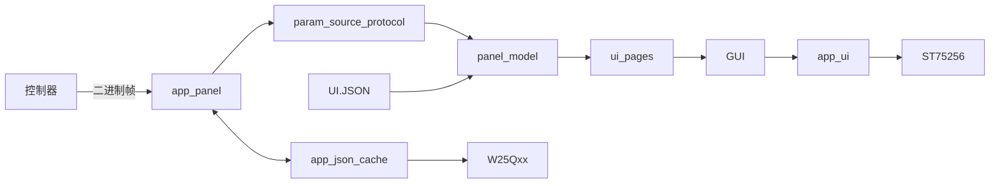

---
领域:
  - 工作
类型:
  - 方案
项目:
  - "[[分拣操作面板]]"
任务:
  - "[[260401S3分拣面板]]"
相关任务:
状态: 进行
创建时间: 2026-08-01T22:57:22
截止时间:
完成时间:
---
<!-- plan-doc:v1 -->

# 分拣操作面板规划

> **一句话**：HC32F460 分拣面板固件——JSON 驱动 UI，按控制器二进制协议完成参数读写、网络配置、IO 调试与运行开关。
> **仓库**：`D:\Screen\Panel_RTOS`（面板固件）｜`D:\Sort\Sorting_Controller`（控制器对端）
> **事实源**：代码与测试 > `AGENTS.md`、`README.md` > 本文
> **规则**：改需求先记 C；一功能一机制；一次只做一条；push 禁止。

## 0. 看板

- **阶段**：R3 进行中（T3-1 面板侧完成，等控制器 T3-2）；R2 等真机 V-4；R1/R4 已交付
- **下一条**：T3-2 控制器参数重置回调桩
- **未登记备选**（旧文档遗留，需走 `/splan req` 才进任务）：面板主动推送、长按重复导航、卡片容量自适应、6 路读卡器、发布项
- **最后更新**：2026-11-23｜**活跃变更**：C2/C3/C4

### 需求登记

| R | 需求 | 来源 | 状态 | 覆盖任务 |
|---|---|---|---|---|
| R1 | 模块参数页「照明」键弹出当前参数 JSON `remark` | 用户 | 交付 | 见 §5 |
| R2 | 调试状态改由心跳周期同步，面板断链不退出控制器调试 | 用户 | 待做 | V-4 |
| R3 | 主页高级设置页 + 控制器参数重置按钮，二次确认 | 用户 | 待做 | T3-2/V-5 |
| R4 | 三个独立库用 submodule 钉版本，`clone --recursive` 即可构建 | 用户 | 交付 | 见 §6 |

### 机制登记

| 机制 | 位置 | 用途 | 扩展 |
|---|---|---|---|
| 面板协议 | `04_Application/app/app_panel.c`、`panel_cmd.h` | 心跳/JSON/读写/使能/网络/调试/开关请求-回复 | 加命令号与分支，不改帧格式 |
| 二进制帧 | `02_Middleware/my_protocol` | 组帧/校验/分片/ACK/在途请求 | 扩命令表，不改状态机 |
| JSON 模型与值池 | `02_Middleware/panel_model` | JSON 解析、参数模型、UI 元数据、值池、值源 | 加字段与容量，不改页面接口 |
| JSON A/B 缓存 | `04_Application/app/app_json_cache.c` | 落盘、CRC32、A/B 槽切换 | 加校验/版本，不改槽位 |
| GUI 框架 | `02_Middleware/GUI` | 无 malloc 页面/列表/弹窗/焦点 | 加控件与配置，不改事件路由 |
| 页面状态契约 | `04_Application/ui_pages/page_state.h` | `SELECTED`、`focused_index`、滚动窗口 | 加 helper，不各页私存 |
| 调试状态心跳同步 | `04_Application/app/app_panel.c` + 控制器 `APP/panel/panel.c` | 心跳回复携带 `active`；面板缓存、控制器不兜底 | 扩现有心跳回复，不新增推送命令 |
| 硬件驱动与适配 | `01_Hardware/{bsp,component,adapt}`、`04_Application/app/app_ui.c` | 时基/USART/LCD/Flash 与 `UI_Ops_t` 接线 | 走 ops 表，不直连寄存器 |
| 依赖仓库 submodule | `.gitmodules`、`.git/modules` | GUI/ZenButton/my_protocol 钉 commit | 加子模块条目，不搬工作树 |
| EIDE 命令行构建 | `<vscode扩展>/res/tools/win32/unify_builder/unify_builder.exe -p build/Debug/builder.params` | 不开 VS Code 构建/验证控制器工程 | 加 `--rebuild` 全量；`builder.params` 是 EIDE 生成的快照，改 `eide.yml` 后要在 VS Code 构建一次刷新，或用改好的副本 |

**基线**（不记分支与提交）

- **仓库**：面板固件 `D:\Screen\Panel_RTOS`（`02_Middleware/GUI`、`02_Middleware/my_protocol` 为嵌套仓）；控制器 `D:\Sort\Sorting_Controller`
- **构建**：Keil `00_Project/MDK/Panel.uvprojx`（Target_1，AC6）／EIDE `00_Project/EIDE`（Target_1，工程 uid `9dc4459a667b72f8c233969882658b8a`），产物 `05_Output/Keil/`；控制器用 EIDE（无 Keil 工程），可用上述 `unify_builder` 命令行构建；GUI `cmake -G "MinGW Makefiles" -S 02_Middleware/GUI -B 02_Middleware/GUI/build`
- **测试（2026-11-23 实跑）**：GUI `ctest --test-dir 02_Middleware/GUI/build` → **70/74**（`ui_core` 42/42、`panel_ui` 28/32；失败 `panel_ui_module_list` / `panel_ui_module_state` / `panel_ui_channel_list` / `panel_ui_module_single_state` 为已知偏差：工作区未提交的 `module_page.c` / `module_list_page.c` 改成名称区反白，`panel_ui_test.row_highlighted()` 仍按行右端像素断言；新增 `panel_ui_advanced` 通过）；`02_Middleware/panel_model` → 1/1；`04_Application/test` → 3/3（`panel_cmd` / `app_panel_vals` / `app_json_cache`）
- **干净克隆（2026-11-20）**：`git clone --recursive` 到临时目录 → GUI **73/73**（克隆不含工作区那行未提交改动）、panel_model 1/1、应用 3/3；三个 submodule 均按 pin 检出
- **固件构建（2026-11-23 全量重建）**：`UV4.exe -r 00_Project/MDK/Panel.uvprojx -t Target_1` → **0 error / 4 warning**（2 条 vendor `hc32_ll_utility.c`、2 条 `my_protocol.c`，均非应用层），`advanced_page.c` 已参与编译；EIDE 工程用 `srcDirs` 自动收录 `ui_pages`，`compile_commands.json` 已含新页
- **控制器构建（2026-11-20）**：`unify_builder -p build/Debug/builder.params.fixed --rebuild` → exit 0、0 error，产出 `Sorting_Controller.elf`（1.45MB）与 `.hex`；本机 `.eide/eide.yml`（未跟踪文件）已移除死文件 `oc_multibuffer.c`、补入漏登记的 `ao_alarmlight.c` / `card_reader.c`

## 1. 任务池

### P0（立即）

- [ ] **T3-2 控制器参数重置回调桩** → 需求：R3（← C4）；依赖 T3-1；产出：控制器 `panel.c` 注册 `cbParamReset`、空载荷校验、回「未实现」；验证：`unify_builder` 构建 0 error + 双端头文件逐字节一致；机制：复用命令注册（D4）；边界：不写默认值/Flash

### P1

- [ ] **V-4 真机断链/重连验收** → 需求：R2（← C2）；验证：人工（需真机、双端同版烧录）：进调试 → 断串口或重启面板 >3s → 控制器仍调试且输出全停 → 恢复后 1s 内显示「调试中」→ 面板退出/再进入；机制：T2-1/T2-2；边界：不替代主机测试
- [ ] **V-5 参数重置真机验收** → 需求：R3（← C4）；依赖 T3-2；验证：人工：主页 → 高级设置 → 重置 → 取消不发包 / 确认发 `0x000C` → 桩回「未实现」可见；机制：T3-1/T3-2；边界：真实重置依赖同事实现

### P2

- [ ] **T2-6 清理控制器死文件** → 需求：运维；产出：确认无引用后删除 `APP/src/oc_multibuffer.c` 与 `APP/inc/oc_multibuffer.h`（或注明保留原因）；验证：`git grep -n "ocMultiBufferCtor" -- APP` → 0 命中 + `unify_builder` 构建 0 error；机制：复用现有构建；边界：不动其他业务代码

## 2. 契约

- **分层与硬件访问**：硬件只经 ops 表（`ST75256_Ops_t` / `W25Qxx_*` / `UI_Ops_t`），寄存器只出现在 `st75256_hc32_adapter.c`、`app_ui.c`。
- **通道基准**：页面与 `ParamStore` 0-based，协议 1-based（`ch+1`）。
- **值编码**：按 JSON 实参顺序，`length=1/2B`，u16 大端；JSON 缓冲借用面板 RX 缓冲，解析后只读。
- **失败格式**：`[0x00][idx][reason]`，字段级 `idx` 1-based、其它 0；reason UTF-8 ≤64B，面板原样显示。
- **协议头**：`04_Application/app/panel_cmd.h` 与控制器 `APP/panel/panel_cmd.h` 逐字节一致，由 `panel_cmd` 测试校验。
- **心跳与调试状态**：回复 `[0x01][ver_len][ver][active]`（`ver_len<=31`），面板只认结构化回复；调试态以心跳为源，`DEBUG_GET/SET` 只做即时回包，断链不清缓存、不自动退出。
- **UI 事件码**：`eKeyLight` 只由模块页消费，显示当前参数 `remark`（← C1）。
- **Flash 分区**：JSON A/B 槽 `0x00F00000` / `0x00F10000`，自检扇区 `0x00F9F000`，字体区 < `0x00F00000`。
- **时基与循环**：`Bsp_GetTickMs()` 为唯一 1ms 时基，`Bsp_SysTickInit()` 在 `Bsp_ClkInit()` 之后；主循环各 `*Loop` 不得阻塞。
- **依赖与构建入口**：GUI/ZenButton/my_protocol 以 submodule 钉 commit（克隆加 `--recursive`，不再复制副本）；固件走 Keil/EIDE 双工程，EIDE 优先 MCP `eide_build` / `eide_flash`，不手改 `.eide/eide.yml`（必改先 `eide_reload`），新增源文件双登记。

## 3. 方案

### 3.1 分层与主循环

- 主循环：`App_KeyProcess` → `App_PanelLoop`（心跳/JSON/分片/命令）→ `App_ParamLoop`（JSON ready 后解析一次）→ `App_LogLoop` → `UI_Loop`。
- 页面只读模型/值池，写经 `ParamSource`，不直接拼协议字节；焦点契约集中在 `page_state.h`，模块页每通道独立行号、单通道忽略左右、编辑中左右归编辑器。

### 3.2 调试状态心跳同步（R2）

- 目标：控制器调试状态由心跳周期带回面板；面板断链/重启后 1s 内恢复；断链不改变控制器调试状态。
- 面板（已改）：`on_heartbeat_ack` 校验 magic / `ver_len` / 长度后取 `active` → `debug_cache_update()`，仅变化置 dirty，`active=0` 清输入快照；超时只置离线、保留缓存；不再消费 `0x0018`。
- 控制器（已改）：`cbHeartbeat` 回 `[0x01][ver_len][ver][active]`；删 `s_panel_debug_mode` / `s_panel_hb_*` / 3s 兜底；删 `DEBUG_STATE_EVT` 广播与宏。
- 兼容：新旧不兼容——旧控制器回原始版本串，新面板只置在线、拿不到调试态；升级必须双端同版烧录。
- 风险：断链后控制器保持调试（输出全停），需面板重连或 UDP / 复位退出；这是需求取舍。
- 验证：`panel_cmd` 常量与双端头文件、`app_panel_vals` 覆盖结构化/非结构化/仅变化置 dirty/超时保留；真机 V-4。

### 3.3 高级设置与参数重置（R3，面板侧完成）

- 入口：主页第 5 行 `高级设置` → `advanced_page`，页内一行「重置控制器参数」；主页 4 行改 5 行（列表 h=138、行高 20+3，可容纳）。
- 确认：OK/Cancel 弹窗「重置控制器参数？将恢复默认参数」；取消不发包，确认后发 `0x000C`（空载荷）。
- 面板：`App_PanelParamReset()` / Poll / Result 按现有请求-回复；成功 toast「参数已重置」，失败显示控制器 reason；不改本地 `ParamStore`，回模块页重新读取。
- 控制器：双端 `panel_cmd.h` 增 `PANEL_CMD_PARAM_RESET 0x000C`；`panel.c` 注册 `cbParamReset` 桩，校验空载荷后回「未实现」；真实重置由同事实现。
- 验证：`panel_cmd` 常量、`app_panel_vals` 成功/失败/超时/离线/忙、GUI `home_state` 4→5 与 advanced 场景、真机 V-5。
- 边界：不定义重置范围；不改网络页、调试页、UDP；不自动写面板值池。

## 4. 决策与变更

| D | 决策 | 结论 | 任务 |
|---|---|---|---|
| D1 | 规划文档重建 | 以代码/测试为准重建基线，旧版已完成内容不迁移 | — |
| D2 | 照明键复用 | 不新增按键/页面；模块页聚焦行常驻提示，空备注 toast；仅模块页 | T1-1 |
| D3 | 调试状态同步 | 心跳回复携带 `active`；删 `DEBUG_STATE_EVT`；断链不自动退出 | T2-1/T2-2 |
| D4 | 参数重置入口 | 主页第 5 行 → 页内单行；一次确认；控制器只留桩 | T3-1/T3-2 |
| D5 | 页面高亮方式 | `module_page.c` / `module_list_page.c` 的 `reverse_mode=eParamReverseName`（名称区反白）是用户有意改动，保留；GUI 4 个 `row_highlighted()` 用例因此红，断言何时跟进另议 | — |

| C | 日期 | 类型 | 需求 | 内容 | 影响 | 处理 |
|---|---|---|---|---|---|---|
| C1 | 2026-10-30 | 新增 | R1 | 新增 `eKeyLight` 与照明键映射，模块页显示 `remark` | 任务/契约/测试/文档/机制 | T1-1 完成 |
| C2 | 2026-11-02 | 修改 | R2 | 调试状态改心跳同步；删 `DEBUG_STATE_EVT 0x0018`；断链不退出 | 任务/契约/测试/文档/机制 | T2-1/T2-2 |
| C3 | 2026-11-02 | 修改 | R2 | 取消旧原始版本串兼容，心跳只认结构化回复 | 契约/测试/文档 | T2-1 |
| C4 | 2026-11-02 | 新增 | R3 | 主页高级设置页与参数重置按钮，新增 `0x000C` | 任务/契约/测试/文档 | T3-1/T3-2 |
| C6 | 2026-11-20 | 修改 | R2 | T2-1 构建验收由「EIDE Target_1」改为「Keil 全量重建 0 error + 确认无新增源文件」（EIDE 无 CLI、MCP 不可达） | 任务/文档 | T2-1 完成 |
| C7 | 2026-11-20 | 修改 | R2 | T2-2 验收由「控制器全量构建 0 error」改为「`panel.c` 单文件编译 0 error + 双端 `panel_cmd` IDENTICAL」；控制器全量构建被既有问题阻塞（另立 T2-5） | 任务/测试/文档 | T2-2 完成 |

## 5. 实施记录

- [x] **T1-1 照明键参数提示** —— 新增 `eKeyLight` / `KEY_Light`（F4）映射；模块页有备注常驻弹窗、空备注 800ms toast、编辑态不弹、Cancel 关闭；验证：GUI ctest 73/73、应用 3/3、panel_model 1/1、Keil/EIDE 0 error；行为：模块页按「照明」显示当前参数名与备注；结果：通过
- [x] **V-1~V-3 验收** —— 验证：主机回归 GUI 73/73 + panel_model 1/1 + 应用 3/3；双工程 Target_1 0 error；真机五步（常驻、长备注换行、空备注 toast、编辑态不弹、Cancel 关闭）用户确认；行为：真机「照明」键显示备注；结果：通过
- [x] **T2-1 协议与面板侧心跳同步** —— 结构化心跳解析（`magic`/`ver_len`/长度）、`debug_cache_update()`、停用 `0x0018`、双端 `panel_cmd.h` 心跳常量；验证：应用测试 3/3、`panel_cmd` IDENTICAL、Keil 全量重建 0 error（4 warning 全在 vendor 与 `my_protocol`）；行为：面板按心跳 `active` 同步调试态，断链保留缓存不清空；结果：通过（已提交）
- [x] **T2-2 控制器侧心跳回包与去兜底** —— `cbHeartbeat` 回 `[0x01][ver_len][ver][active]`（`s_active->reply_buf`，34B/501B）；删 3s 兜底、`DEBUG_STATE_EVT` 广播与 5 个静态量；双端 `panel_cmd.h` 同步删 `0x0018`（11178B 一致）；验证：`panel.c` 单文件编译 exit 0、面板应用测试 3/3（`panel_cmd` IDENTICAL）；行为：调试态只由心跳带回，控制器不再因心跳丢失退出调试；结果：通过（已提交）
- [x] **T2-5 修复控制器构建失败** —— 真因不是重定位：本机 `.eide/eide.yml`（未跟踪）陈旧——仍列死文件 `oc_multibuffer.c`、漏登 `ao_alarmlight.c` / `card_reader.c`，6 处 undefined reference 引发 ld 的 `dangerous relocation` 级联报错，`udp_comm.c` 未改；验证：`unify_builder -p builder.params.fixed --rebuild` → exit 0、0 error、166C+1asm、产出 `Sorting_Controller.elf`（1.45MB）与 `.hex`；行为：控制器恢复可构建（源码零改动）；结果：通过（`eide.yml` 未跟踪，修复仅本机生效；`builder.params` 需在 VS Code 重建刷新）
- [x] **T2-4 同步 README/AGENTS** —— README §1/§6.1/§13.8/§14.6/§17 与 AGENTS 调试/架构段改为结构化心跳、删 0x0018 推送与 3s 兜底说明；验证：`Select-String … "DEBUG_STATE_EVT|0x0018|心跳丢失 3s"` → 0 命中；行为：文档与新心跳行为一致；结果：通过
- [ ] **T2-3 处置 module_page 无关改动** —— 取消（2026-11-20）：用户确认 `reverse_mode=1U` 是本人有意改动，不还原；GUI 三个用例的红改为已知偏差，记在 D5 与基线
- [x] **T4-1 推送 GUI 27 个提交** —— `origin/main` 由 `c9777a9` 前进到 `0f54241`；验证：`git branch -r --contains 0f54241` → `origin/main`；行为：pin 的提交远端可取，别人能克隆；结果：通过
- [x] **T4-2 补全 submodule 声明** —— 面板仓补 `.gitmodules`（GUI/ZenButton），`my_protocol` 由裸目录转 submodule 并 `absorbgitdirs`；控制器仓补 `.gitmodules`；顺带删除重复克隆 `D:\Projects\my_protocol`（同 tree `71948f0`、同 commit `8fa3cbf`、无未推提交）；验证：`git submodule status` → 3 条无 fatal、`git submodule update --init` → exit 0；行为：干净克隆 `--recursive` 可拿到三个库；结果：通过（已提交）
- [x] **T4-4 干净克隆验证与构建文档** —— 补 `git clone --recursive` 说明；验证：临时目录 `git clone --recursive` → 三套测试 73/73 + 1/1 + 3/3、submodule 均按 pin 检出；行为：干净克隆开箱即可构建与测试；结果：通过（临时目录已清理）
- [x] **T4-3 补验控制器构建** —— 控制器 `.gitmodules` 与 gitlink 已提交（`6f4da0e`，160000 @ `8fa3cbf`）；验证：`unify_builder --rebuild` → 0 error，两端 `my_protocol` HEAD 同为 `8fa3cbf`；行为：控制器侧协议库与面板钉同一提交；结果：通过
- [x] **T3-1 高级设置页与参数重置按钮** —— 主页 5 行菜单 + 新页 `advanced_page`（1 行「重置控制器参数」+ OK/Cancel 确认）；面板 `App_PanelParamReset/Poll/GetResult` 复用 `Protocol_SendCmd` 在途槽，成功判 `[0xAA]`、失败解析 reason、离线直拒；双端 `panel_cmd.h` 加 `PANEL_CMD_PARAM_RESET 0x000C`（SHA256 一致）；Keil/EIDE/CMake 登记；验证：应用 3/3（`panel_cmd` IDENTICAL）、GUI 74 用例中除 4 个已知偏差外全绿（含新 `panel_ui_advanced`）、Keil 全量重建 0 error；行为：主页第 5 行「高级设置」→ 确认发 `0x000C`、取消不发包、成功 toast「参数已重置」；结果：通过（控制器侧回调待 T3-2）

## 6. 归档

| R | 结果 | 一句话 | 归档到 |
|---|---|---|---|
| R1 | 交付 | 照明键显示参数备注（T1-1 + V-1~V-3） | 就地压缩（见 §5） |
| R4 | 交付 | 三个独立库 submodule 化，干净克隆 `--recursive` 即可构建 | 就地压缩（见 §5） |
