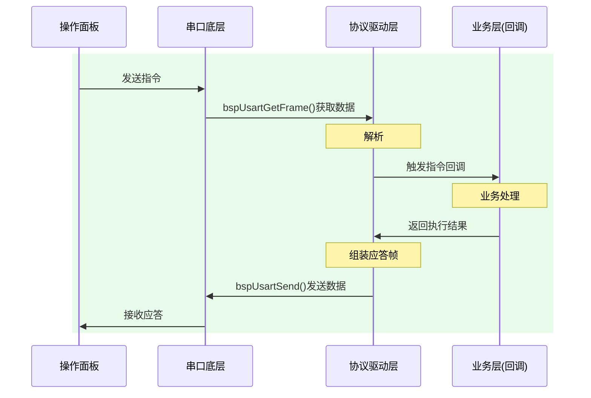
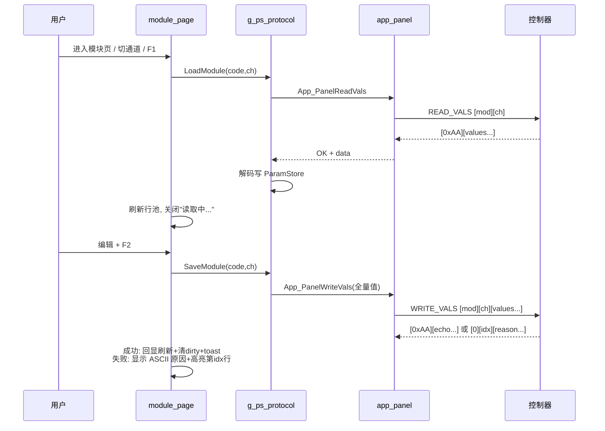

---
领域:
  - 工作
类型:
  - 开发
项目:
  - "[[分拣操作面板]]"
任务:
  - "[[260401S3分拣面板]]"
状态: 进行
相关任务:
创建时间: 2026-04-01T12:59:00
截止时间: 2026-08-16T04:59:00
完成时间:
---
# S3 分拣操作面板（控制器调试工具）

> **一句话**：面板开机从控制器拉取参数定义 JSON（自适应，控制器加参数面板零改动），解析生成中文参数界面；参数值/修改将全部走协议（任务2）。
>
> **仓库**：面板 `D:\Screen\Projects\Panel_RTOS`（HC32F460KETA）｜控制器 `D:\Sort\Sorting_Controller`（GD32F470）｜旧面板字库参考 `D:\Screen\Projects\Operation_Panel`

## 0. 项目目的与任务全景

**项目目的**：把面板做成分拣控制器的**通用调试/操作终端**。控制器是唯一数据权威（参数定义、当前值、合法性校验、落盘），面板负责自适应显示与操作；以后控制器新增参数/模块，面板零改动。

| 任务 | 一句话目标 | 主要内容 | 状态 |
|---|---|---|---|
| **任务1** | 参数界面自适应 | 拉取/解析 UI.JSON，生成中文模块/参数界面，本地编辑/校验/dirty/保存（值源 mock），中文字库 | ✅ 2026-10-24 完成 |
| **任务2** | 参数值真正读写 | `READ_VALS`/`WRITE_VALS` 协议；控制器校验并回 ASCII 原因；面板读取中/保存中/成功/失败处理 | ⬜ **下一步** |
| **任务3** | 调试操作增强 | 系统参数专用页（IP/端口四段、使能开关可视化）、运行开关、在线状态/失败重试 | ⬜ 待排期 |
| **任务4** | 体验与发布 | 参数备注/帮助、中英文、离线缓存、掉线/重连/双面板与长时间跑机验证、现场发布 | ⬜ 待排期 |

### 待办列表
- [x] 任务1 编码 / 模拟器+硬件测试 / 提交（develop）
- [x] 任务2 协议评审：**失败原因=控制器回 ASCII 文本**；**不做 udp_comm 公共助手重构**（控制器侧决定）
- [x] 任务2 控制器侧实现（§4.3）✅ 2026-10-25
- [ ] 任务2 面板侧实现（§4.4）
- [ ] 任务2 联调（真控制器 + 模拟器桩）
- [ ] 任务3 / 任务4（待排期）

> 任务1各阶段原始记录见 **附录A**；路径与文件索引见 **附录B**。

---

## 1. 通信协议基础（现行 `my_protocol`）

> 面板与控制器共用 `02_Middleware/my_protocol`（控制器侧 `APP/panel/my_protocol` 同版本），二进制分帧、请求-回复、库内分片/ACK/重传。以下帧格式为现行实现。

| 名称       | 长度    | 内容      | 备注                         |
| -------- | ----- | ------- | -------------------------- |
| 字段       | 字节数   | 取值/规则   | 说明                         |
| HEAD 帧头  | 1     | 0x55    | 固定帧起始魔术字                   |
| LEN 帧总长  | 2     | 整帧字节总数  | 包含 HEAD~TAIL 全部字段，**大端模式** |
| VER 版本   | 1     | 0x01    | 当前协议唯一版本                   |
| CFG 配置位  | 1     | 位图控制    | 通信属性配置位                    |
| SEQ 序列号  | 2     | 0~65535 | 分片/事务序号，**大端模式**           |
| CMD 指令码  | 2     | 自定义指令   | 业务功能码，**大端模式**             |
| DATA 数据域 | LEN-9 | 业务数据    | 最小0字节，当前配置上限501字节（`PROTOCOL_FRAME_MAXLEN=512`） |
| CHECK 校验 | 1     | CRC8    | 校验范围：LEN ~ DATA            |
| TAIL 帧尾  | 1     | 0xAA    | 固定帧结束魔术字                   |

> 实测配置：`PROTOCOL_FRAME_MAXLEN=512` → 单帧载荷上限 501B；JSON 每片 499B。



**现行指令**（两端 `panel_cmd.h` 必须逐字节一致）：
| CMD | 名称 | 方向 | 说明 |
|---|---|---|---|
| `0x0001` | HEARTBEAT | 面板→控制器 | 控制器回版本串；面板判定在线 |
| `0x0002` | JSON | 面板→控制器 | 面板按 `[seq]` 逐片申请；控制器回 `[seq][total][data...]`，空应答=发完 |
| `0x0003` | READ_VALS | 面板→控制器 | **任务2 新增**（§4.2） |
| `0x0004` | WRITE_VALS | 面板→控制器 | **任务2 新增**（§4.2） |

### 历史会议记录（2026/4/17，保留）
- 不兼容升级，只烧录定制版本，分阶段，后续进行开发
- [ ] 支持中/英文
- [ ] IP/端口设置界面：支持四段IP设置，端口选择
- [x] 模块开关界面
- [x] 参数设置界面
- [x] 通道/模块

---

## 2. 任务1总结（已完成）

### 2.1 目标回顾
面板从控制器拉取 `UI.JSON`（15 模块 / 245 实参，UTF-8 中文），零硬编码地生成模块列表与参数页；中文显示（板载 W25Qxx unifont 字库）；参数可本地编辑/校验/保存（本期值源为 JSON 默认值 mock，为任务2协议读写预留接口）。

### 2.2 已实现功能
- **JSON 链路**：逐片拉取（68 片）→ 收齐 → 解析一次 → 模型/值池初始化；首页显示下载进度/解析结果。
- **中文字库**：W25Qxx（SPI3）→ unifont 20px → GUI 字体钩子；汉字 20×20、ASCII 10×20；16 槽字模缓存；缺字空心框；未装钩子时旧 5×7 路径原样保留。
- **模块列表页**：15 模块中文名 + code，尾部"版本信息"；↑/↓ 选择、Enter 进入；在线状态/状态栏。
- **模块参数页**：模块名标题、通道 TabBar（模块 4/15 单通道自动隐藏）、参数列表（名称/值/dirty `*`）、数字编辑、min/max 预校验、超范围 alert、切通道/退出 dirty 确认、保存按钮 + F2、保存 toast。
- **数据层**：`panel_model`（零拷贝 JSON 解析、模型、值池、dirty 位图、`ParamSource_t` 抽象 + mock）。
- **模拟器**：`gui_lcd_test.exe --json <path>` 直接跑固件页面 + 文件字库（`unifont20.bin`），与硬件逐像素一致。
- **工程**：EIDE + Keil 双工程登记；`panel-control.md §14`、根 `AGENTS.md`、`GUI/AGENTS.md` 已更新。

### 2.3 交付物（关键文件）

| 层 | 文件 | 说明 |
|---|---|---|
| 字库 Flash | `01_Hardware/component/w25qxx/w25qxx.{c,h}` | 官方 XHSC W25QXX 组件（LL 函数表，含写/擦备用）；`W25QXX_GetJedecId` |
| 字库适配 | `01_Hardware/adapt/w25qxx/w25qxx_hc32_adapter.{c,h}` | SPI3 LL（PB4=SCK/PB3=MOSI/PB6=MISO/PB7=CS/PB5=WP），12.5MHz |
| 字体服务 | `04_Application/app/app_font.c/h` | unifont 20px 提供者（`offset=ugbkaddr+uni×60`，缓存） |
| 字库工具 | `tools/dump_font.py` | RTT/USART1 双通道转储、CRC、预览、比对 |
| GUI | `02_Middleware/GUI/inc/ui_font.h`、`src/ui_font.c` | `UI_Glyph_t`/`UI_FontOps_t`、UTF-8 解码 |
| GUI 改造 | `src/ui_canvas.c`、`ui_popup.c`、`ui_param.c` | 钩子绘制/测宽/换行按 UTF-8 字符边界 |
| 模拟器 | `test/font_file.c/h`、`test/panel_app_stub.c/h`、`test/main.c` | 文件字库 + `--json` + `PANEL_SIM_APP` 复用固件页 |
| 模型 | `02_Middleware/panel_model/{inc,src,test}` | `json_parse`/`param_model`/`param_store`/`param_source(_mock)` + CTest |
| 应用 | `04_Application/app/app_param.c/h` | JSON ready 后解析一次 + 值池初始化 |
| 页面 | `04_Application/ui_pages/home_page.c`、`module_page.c/h`、`version_page.c` | 模块列表 / 参数页 / 版本信息 |
| 配置 | `ui_event.h`、`ui_user_def.h`、`app_key.c`、`main.c`、双工程 | F1/F2/F3 事件、字号 20、按键映射、初始化顺序 |

**提交**（develop）：`fcf38af`/`784c4a2`（W25Qxx）、`2b9875d`（dump 工具）、`41bf420`（panel_model）、`4143430`（字库+参数页）、`e55aec4`（工程+文档）；GUI 子模块 `b85f3f4`。

### 2.4 验收证据（汇总）

| 项 | 结果 |
|---|---|
| 字库实测 | JEDEC `0xEF4018`=W25Q128；`fontok=0xAA`；`ugbkaddr=0`、`ugbksize=0x3F4D94`；7 个采样字模哈希与 `unifont20.bin` 一致 `0xFA8E09D2` |
| 字体渲染 | 硬件读回 `s_default_framebuffer` 与 `unifont20.bin` 同规则渲染**逐像素 0 差异**；模拟器与硬件整帧 **0 差异** |
| 帧耗时 | 首帧全屏 44ms；列表滚动稳态 max 36~38ms（验收线 80ms） |
| JSON 模型 | CTest 通过：15 模块/245 实参/环形仓 41 参数/类型计数 127/72/40/6；**UI.JSON 全部 33,577 个前缀逐一解析均安全拒绝**；容量/畸形样本全通过 |
| UI 全流程 | 模拟器断言 + 硬件同场景 **10 个场景逐像素 0 差异**（home/module/编辑/确认/alert/save/重进等） |
| 固件构建 | Keil AC6 0 error（新增 0 warning）；EIDE `Succeed`（86 C + 1 asm）；flash 94232B / RAM 160096B |
| 实机 | RTT `[Param] parsed modules=15 params=245 unknown=0`；编辑 200→dirty→F2→200/0→重进保留；进度页"下载界面 26/68" |

### 2.5 关键决策（后续必须遵守）
1. **值序契约**：参数值数组顺序 = JSON items 实参序（跳过 `type==""` 帧项），线宽 = 该 item 的 `length`（1/2B，大端）。
2. **JSON 零拷贝**：`JsonSpan_t` 指向 `s_json_rx`；解析后该 40KB 缓冲**只读常驻**，任何重拉前必须先复位模型。
3. **统一字号 20px**：全工程 `USER_DEFAULT_FONT_SIZE=20`；字库固定 20px，提供者忽略请求 px。
4. **字体钩子向后兼容**：未安装 `UI_FontOps_t` 时旧 5×7 路径不变（模拟器无字库可回退）。
5. **值源抽象**：页面只经 `ParamSource_Get()`；任务2 注册协议源即可，页面不改。
6. **控制器权威**：合法性最终由控制器判定（面板仅 min/max 预校验）；失败原因由控制器回 **ASCII 文本**，面板原样显示，不维护错误码表（§4.2）。
7. **单通道规则**：模块 4（主轨）/15（环形仓）`max_size=1`，面板不显示 CH2。
8. **启用/使能即参数**：`分拣仓使能` 等 `en_*` 属于系统参数模块（code=0），无需单独使能指令。
9. **模拟器复用固件页**：`PANEL_SIM_APP` 条件编译，主仓库 CMake 注入固件页面 + panel_model；GUI 子模块单独构建仍走 demo。
10. **双工程登记**：新增 `.c` 必须同时进 `Panel.uvprojx` 与 EIDE；EIDE 优先用 MCP，不手改 yml。

### 2.6 已知限制（任务2/3 处理）
- 值源为 **mock**：显示 JSON 默认值，重启恢复默认；**不从控制器读、不向控制器写**（任务2）。
- 保存仅清 dirty（本地），控制器侧无任何变更（任务2）。
- `remark` 不显示（已解析保留，将来可用）。
- F1/F3 事件已预留未使用（任务2 建议 F1=重新读取）。
- 字库全量硬件转储未完成（RTT 在 240~430KB 卡死）；模拟器 `unifont20.bin` 由同尺寸参考字库 + 硬件逐像素验证。
- 无 IP/端口四段专用编辑页；无中英文切换；无离线缓存（重启丢编辑）。
- 未做真控制器联调（当前只验到 JSON/UI）。

### 2.7 数据契约与字库格式速查

**JSON 结构**（UTF-8、紧凑、无转义）：
```jsonc
{"low_com_configs":[
  {"name":"分拣仓模块设置","code":1,"max_size":2,"items":[
    {"key":"命令","length":1,"defaultValue":0,"remark":"","type":"","min":0,"max":2},
    {"key":"模块号","length":1,...,"type":"","min":0,"max":0},      // 前3项=帧项，type==""，解析时跳过
    {"key":"通道号","length":1,...,"type":"","min":1,"max":2},
    {"key":"库区电机运行时间","length":2,"defaultValue":180,"remark":"单位：s",
     "type":"配置项","min":0,"max":65535}
  ]}, ...]}
```
- `type`：`配置项|输入口|输出口|读卡器`（未知→配置项并计数）。
- 容量：模块 ≤16、参数 ≤320、单模块 ≤48；模块号 0–12/14/15（13 缺席）。
- 生成端：控制器 `APP/src/param_json.c` ← `APP/inc/param_def.h`（唯一维护点）。

**字库格式**（W25Qxx，地址 0 起）：
- 头 12B：`fontok(0xAA) | pad | ugbkaddr(u32 LE) | ugbksize(u32 LE)`。
- 字模：`offset = ugbkaddr + unicode×60`（20px，槽 60B）；**列优先**：第 x 列 3 字节，每字节 8 像素 MSB 在上，仅前 20 行有效。
- 宽度：`uni<0x80` 半宽（10 列/advance 10），其余全宽（20 列/20）；全 `0x00` = 合法空白，全 `0xFF`/越界 = 缺字。

### 2.8 踩坑记录（务必保留）
1. 直接 `UI_PopupShow` 后必须 `UI_PopupRelayout()`（便捷封装内部已做），否则 `w/h=0` 不可见。
2. 目标工程 `-fshort-enums`：`UI_Event_t` = **5B**（pyOCD 注入事件按 5B 步长）。
3. `pyocd rtt` 强杀会使 CMSIS-DAP 假死 → 用脚本读 `_SEGGER_RTT` 后干净退出。
4. `eide_set_inc_dirs` **不要**回写 `ARMCLANG/include`、`libcxx`（会遮蔽 newlib）。
5. SPI3 需关闭 JTAG TDO/TRST 释放 PB3/PB4；MISO 内部上拉。
6. 字模全 `0x00` 视为空格，不按缺字处理。
7. 列表顶部再↑/底部再↓ 必须 `return 0`，把焦点交还页面导航（否则无法切通道）。
8. `UI_Obj_t` 为 `#pragma pack(1)`，32 位目标 `fresh_interval` 偏移 +17。
9. 模块列表只在解析完成时建一次，禁止每帧重建。
10. EIDE `srcDirs` 与 `virtualFolder` 同名文件会重复编译 → 去重。
11. RTT 大流量（全量字库 4MB）不稳定，长传输走 USART1 或分块。
12. 面板首次拉 JSON 需 11~20s（68 片逐片请求），等待期 UI 必须有进度。

---

## 3. 当前架构（现状）

### 3.1 目录职责
| 目录 | 职责 |
|---|---|
| `01_Hardware/bsp` | 时钟/SysTick/USART/SPI 基础；`Bsp_GetTickMs` 全局时基 |
| `01_Hardware/component/st75256`、`w25qxx` | LCD / 字库 Flash 芯片逻辑（ops 表，硬件无关） |
| `01_Hardware/adapt/st75256`、`w25qxx`、`keypad` | HC32 LL/GPIO 适配（唯一碰寄存器处） |
| `02_Middleware/GUI` | 静态 GUI 框架 + `UI_FontOps_t` 字体钩子；Win32 模拟器 |
| `02_Middleware/panel_model` | JSON 解析/模型/值池/值源抽象（主机 CTest） |
| `02_Middleware/my_protocol` | 串口协议库（两端同版本，独立 git 仓库） |
| `04_Application/app` | `app_ui/app_key/app_panel/app_font/app_param/app_log` |
| `04_Application/ui_pages` | `home_page/module_page/version_page` |
| `00_Project` | EIDE + Keil 工程（新文件双登记） |

### 3.2 启动与运行数据流
```
HardwareInit: Clk → SysTick → LED → USART1 → ST75256 → W25Qxx
App_LogInit → App_UIInit(主页) → App_FontInit(字库钩子) → App_KeyInit → App_PanelInit
主循环: App_KeyProcess → App_PanelLoop(心跳/JSON 逐片) → App_ParamLoop(ready 后解析一次+值池初始化) → App_LogLoop → UI_Loop
进入模块页: ParamSource_Get()->LoadModule(code,ch) → ParamStore → 行池物化 → UI_List
保存: ParamSource_Get()->SaveModule(code,ch) → 清 dirty（本期 mock）
```

### 3.3 关键接口速查
| 模块 | API |
|---|---|
| `app_panel` | `App_PanelInit/Loop`、`App_PanelIsOnline`、`App_PanelGetControllerVersion`、`App_PanelJsonReady/GetJson/JsonProgress` |
| `app_param` | `App_ParamInit/Loop/Poll/State`（`WAITING/READY/FAILED`） |
| `param_model` | `ParamModel_Get/Parse/FindByCode`；`PModModule_t`/`PModParam_t` |
| `param_store` | `ParamStore_Init/Get/Set/IsDirty/ClearDirty/DirtyCount`（`[320][2]` u16 + dirty 位图） |
| `param_source` | `g_ps_mock`、`ParamSource_Set/Get`、`PS_State_t{IDLE,LOADING,READY,ERROR,SAVING}` |
| `ui_font` | `UI_SetFontOps`、`UI_FontUtf8Decode`、`UI_FontFetch`、`UI_Glyph_t{w,h,advance,col_bytes,bitmap}` |
| `w25qxx` | `W25Qxx_HC32Init/DeInit/Read/Write/EraseSector/EraseChip/GetIds/MaxAddr` |
| 页面 | `ModulePage_Open(module)`、`home_page`、`version_page` |

### 3.4 页面 / 按键（现状）
```
home_page: 标题"调试工具" + 在线状态 + 16 行动态列表(15 模块 + 版本信息) + 状态栏
module_page: 标题(模块名) + 通道 TabBar(可选) + 参数 List(48×UI_Param) + [保存 F2]
version_page: 版本信息（控制器版本串）
```
| 位置 | 按键 | 行为 |
|---|---|---|
| home 列表 | ↑/↓/Enter | 选模块 / 进入（版本信息→version_page） |
| module 通道 | ←/→ | 切通道（dirty 先确认；OK 恢复默认并清 dirty） |
| module 列表 | ↑/↓ | 滚动；到边界交还焦点 |
| module 列表 | Enter | 进 UI_Param 编辑（数字/←/Enter 提交/Cancel 还原） |
| module 任意 | F2 | 保存（本期 mock：toast"已保存(本地)"+清 dirty） |
| module 任意 | Cancel | 有 dirty 先确认，再返回 home |

### 3.5 构建 / 测试 / 烧录
```powershell
# 固件（EIDE，MCP 可用时）
eide_reload <uid>; eide_build <uid>      # 产物 00_Project/EIDE/build/Target_1/Panel.axf
# 固件（Keil）打开 00_Project/MDK/Panel.uvprojx → Target_1
# 烧录（CLI 直烧，已验证；面板 EIDE 的下载配置也是 pyocd）
pyocd flash -u LU_2022_8888 -t hc32f460xe 00_Project/EIDE/build/Target_1/Panel.axf

# 模型单测
cmake -G "MinGW Makefiles" -S 02_Middleware/panel_model -B 02_Middleware/panel_model/build
cmake --build 02_Middleware/panel_model/build; ctest --test-dir 02_Middleware/panel_model/build --output-on-failure

# 模拟器（主仓库）
cmake -S 02_Middleware/GUI -B 02_Middleware/GUI/build
cmake --build 02_Middleware/GUI/build --config Debug
./02_Middleware/GUI/build/test/gui_lcd_test.exe --json UI.JSON
```
> RTT 用脚本读 `_SEGGER_RTT`（勿用 `pyocd rtt` 强杀）；事件注入注意 `UI_Event_t`=5B。

#### 3.5.1 调试探针 / DAP 速查（两工程同时连接）

| 工程 | 探针 | pyocd 选择 | 目标 MCU | pyocd 目标参数 | 串口 |
|---|---|---|---|---|---|
| 面板 `Panel_RTOS` | jixin.pro CMSIS-DAP_LU (C251:F001) | `-u LU_2022_8888` | HC32F460KETA | `-t hc32f460xe` | COM8 |
| 控制器 `Sorting_Controller` | Arm DAPLink CMSIS-DAP (0D28:0204) | `-u 000000800672ff`（全 UID `000000800672ff303937504d43095549a5a5a5a597969908`，可只写前 14 位） | GD32F470ZI | `-t gd32f470zi` | COM7 |

- 两个探针可同时在线：**每个 pyocd 进程必须带不同 `-u`**，不要两个进程抢同一个探针。
- **EIDE 下载器是项目配置，不自动选择**（由各项目 `.eide/eide.yml` 的 `uploader` 字段决定；GUI 下载与 MCP `eide_flash` 都按它执行）：
  - 面板 `Panel_RTOS/00_Project/EIDE/.eide/eide.yml` → `uploader: pyOCD`（`targetName: hc32f460`，speed 1M，探针 jixin）
  - 控制器 `Sorting_Controller/.eide/eide.yml` → `uploader: OpenOCD`（`interface: cmsis-dap`，`target: stm32f4x`，探针 DAPLink）
  - EIDE 配置未绑定探针 UID；同时插多个 CMSIS-DAP 时若下载选错目标，临时只插目标探针最稳。
- 单独跑 CLI pyocd 可用 `-u` 精确选探针（见上表），用于读取/验证；直烧也已验证（见上）。
- 重新插拔后 COM 号可能变，以 `pyocd list` + VID 为准。

```powershell
pyocd list                                                              # 确认探针/UID/VID
# 面板（jixin）只读验证
pyocd commander -u LU_2022_8888 -t hc32f460xe -c "read32 0xE000ED00" -c "read32 0x40010450"
# 控制器（DAPLink）只读验证
pyocd commander -u 000000800672ff -t gd32f470zi -c "read32 0xE000ED00" -c "read32 0xE0042000"
```

**识别校验**：
- GD32F470ZI：CPUID `0x410FC241`（Cortex-M4），DBG ID@`0xE0042000`=`0x22020419`；连接时出现 `Invalid coresight component cidr=0x0` 警告可忽略。
- HC32F460KETA：CPUID `0x410FC241`，EFM UQID@`0x40010450`=`0x48433133`（"HC13…"）。

### 3.6 资源占用
- Keil：Flash 94,232B；RAM 160,096B（含 GUI/模型/40KB JSON/帧缓冲，192KB 内）。
- 帧耗时：首帧 44ms；列表滚动 max 36~38ms。

---

## 4. 任务2规划：参数值读写（下一步）

### 4.1 目标与范围
**目标**：模块页进入/切通道时从控制器读取该模块该通道全部实参值；编辑保存时写回控制器，控制器校验/落盘/应用，面板用回显刷新。全过程有读取中/保存中/失败提示。

**范围内**：READ_VALS/WRITE_VALS 指令（两端）、控制器 `panel.c` 独立读写回调（**不改 `udp_comm.c`/`param_mgr.c`**）、面板异步值源、页面状态机、F1 重读、联调与回归。
**不在范围**：模块使能独立界面（`en_*` 已属系统参数）、运行开关、IP 专用页、参数值离线持久化、双面板并发冲突处理。

### 4.2 协议定稿

```text
0x0003 READ_VALS
  请求: [mod:1][ch:1]                      ch=1..max_size（面板按 JSON 保证合法）
  成功: [0xAA][values...]                  按 JSON 实参序，每项 length 字节，u16 大端
  失败: [0x00][idx:1][reason_ascii...]     idx=出错实参(1-based)，0=通用；reason 无结尾符，长度=帧数据-2

0x0004 WRITE_VALS
  请求: [mod][ch][values...]               长度必须 = Σlength（面板按 JSON 生成）
  成功: [0xAA][echo values...]             控制器回显生效值（面板直接覆盖本地值池）
  失败: [0x00][idx][reason_ascii...]
```

**失败原因（控制器回 ASCII 文本，面板原样显示，不维护错误码表）**：
| 场景 | idx | reason（ASCII） | 面板展示 |
|---|---|---|---|
| 模块不存在 | 0 | `bad module` | Alert 标题"读取/保存失败"，正文原样 |
| 通道号非法 | 0 | `bad channel` | 同上 |
| 载荷长度不符 | 0 | `bad length` | 同上 |
| 字段值越界 | i（1-based） | `param invalid` | Alert 正文 + 高亮第 i 行 |
| 独占端口被其他模块占用 | 0 | `port conflict` | Alert 正文 |
| SYS 立即落盘失败 | 0 | `flash write failed` | Alert 正文 |
| 超时（无回复） | — | — | 面板本地提示"控制器无响应" |

> 原因文本必须 ASCII（控制器 `param_def.h` 里中文名不参与）；面板把回复中的 reason 拷进静态缓冲再用——协议缓冲回调返回后即失效。

**约束核算**：模型容量单模块 ≤48 实参 × 2B = 96B；WRITE 请求 ≤98B、READ/WRITE 成功回显 ≤97B、失败 ≤26B，均远小于单帧 501B，无分片。当前 `UI.JSON` 最坏模块 15 为 41 实参/56B（WRITE 58B、回显 57B）。
**语义**（控制器侧，与 `udp_comm.c` 0x0A/0x0B 行为一致）：
- 读：`paramModuleReg(mod)` → `paramModuleVal(reg, ch-1)`，`length==2` 转大端。
- 写：校验长度 → 逐项 `paramValInRange` → `paramCheckModuleUnique` → 写入 → **模块0**镜像前 6 个网络字段到另一通道并 `paramFlush()`；其他模块 `paramMarkDirty()`（10s 防抖落盘）→ 成功后 `moduleClaimAllEnabled()` + `moduleParamChangedNotify(mod, ch-1)`。
- 失败不改任何值（面板收到失败后保持原显示）。

### 4.3 控制器侧改动（Sorting_Controller，**不重构 udp_comm/param_mgr**）

> 控制器负责人决定：不抽公共助手、不改 `udp_comm.c`。代价是两处逻辑并存，靠"交叉注释 + 对照清单"控制分叉。

1. `APP/panel/panel_cmd.h`：新增 `PANEL_CMD_READ_VALS 0x0003U`、`PANEL_CMD_WRITE_VALS 0x0004U`（与面板逐字节一致）；容量宏 `PANEL_VALS_*` 已随 T2-1 落地，直接复用。
2. `APP/panel/panel.c` 内**直接实现**（逻辑参照 `udp_comm.c` 0x0A/0x0B）：
   - `PANEL_LINK_t` 增加 `uint8_t vals_buf[PANEL_VALS_OK_REPLY_MAX]`（与 JSON 回复缓冲分离）。
   - 新增 `cbReadVals`/`cbWriteVals` 与错误回复 helper（`[0x00][idx][reason_ascii]`）。
   - `panelLinkInit` 注册两条新回调（A/B 链路共用）。
   - 新增 include：`param_mgr.h`、`srv_modulemgr.h`、`ao_param.h`。
   - 在 `panel.c` 与 `udp_comm.c` 对应 case 互相加注释：**"此处逻辑需与 udp_comm.c 0x0A/0x0B 保持同步"**。
3. 实现要点（与 UDP 版逐项对齐）：
   - 长度期望 = `2 + Σmeta.length`；逐项 `paramValInRange`（失败回 idx=i+1 + `param invalid`）。
   - 唯一性 `paramCheckModuleUnique`（失败回 idx=0 + `port conflict`）。
   - 写入后：模块 0 镜像前 6 项网络参数到另一通道 + `paramFlush()`；其他模块 `paramMarkDirty()`；然后 `moduleClaimAllEnabled()` + `moduleParamChangedNotify(mod, ch-1)`。
   - 成功回显：按 `length` 逐项转大端（u16 高字节在前，u8 原样）。
4. 验证：EIDE 构建成功；UDP 0x0A/0x0B 抽样回归（本次未改 UDP，仅确认未受影响）；真控制器烧录走控制器 EIDE（其 `uploader` 配置=OpenOCD），CLI pyocd 用 `-u 000000800672ff` 读验证或直烧（§3.5.1）。

### 4.4 面板侧改动（Panel_RTOS）
1. `04_Application/app/panel_cmd.h`：同步两条指令（与控制器逐字节一致）。
2. `04_Application/app/app_panel.c/h`：
   - 新增 `s_vals_buf[PANEL_VALS_OK_REPLY_MAX]` 专用于读写回复（现有 `s_reply_buf[64]` 不够）。
   - 新增异步接口：
     ```c
     uint8_t App_PanelReadVals(uint8_t mod, uint8_t ch);
     uint8_t App_PanelWriteVals(uint8_t mod, uint8_t ch, const uint8_t *vals, uint16_t len);
     uint8_t App_PanelValsBusy(void);
     uint8_t App_PanelValsResult(uint8_t *status, uint8_t *idx,
                                 char *reason, uint16_t reason_max,
                                 const uint8_t **data, uint16_t *len);
     ```
   - 读/写共用一条在途流（`s_vals_busy`），超时 2s、retry 1；回调解析 `status/idx/reason`（reason **拷进静态缓冲**，协议缓冲回调后失效），成功数据指向 `s_vals_buf`。
3. 新增 `04_Application/app/param_source_protocol.c/h`：实现 `ParamSource_t`
   - `LoadModule`：`App_PanelReadVals`；`Poll` 在 OK 时按 `length` 大端解码写入 `ParamStore`，并**清该模块该通道 dirty**（读=以控制器为准）。
   - `SaveModule`：把该模块该通道全部值按 `length` 打包（完整模块数组），`App_PanelWriteVals`；OK 时用回显覆盖值池并清 dirty。
   - `LastError`：返回**控制器 ASCII 原因**的静态拷贝（无映射表）；`Poll` 映射 `PS_LOADING/READY/ERROR/SAVING`。
4. `app_param.c`：解析成功且 `App_PanelIsOnline()` 后 `ParamSource_Set(&g_ps_protocol)`；离线保持 `g_ps_mock`。或**始终注册协议源**、离线时 Load 直接 ERROR(`controller offline`)，页面显示缓存/默认值并提示（二选一，实现时记录；推荐始终注册，行为一致）。
5. `module_page.c`：
   - 进入/切通道：`LoadModule` → Progress "读取中..." → READY 刷新行池；ERROR alert：标题中文"读取失败"，正文=ASCII 原因 + 保留现值。
   - 保存：`SaveModule` → Progress "保存中..." → OK toast "已保存"（回显刷新）+ 清 dirty；ERROR alert：标题"保存失败"，正文=ASCII 原因（`idx≠0` 时 `UI_ListSelectIndex(idx-1)` 高亮该行）。
   - F1 → 重新读取当前模块/通道（有 dirty 先确认"丢弃未保存修改并重新读取?"）。
   - 读取/保存期间禁用编辑与保存，重复按键忽略；超时提示"控制器无响应"。
6. `app_key.c` 无需改（F1/F2 已映射）；`ui_event.h` 已含 eKeyF1。
7. 模拟器：`test/panel_app_stub.c` 增加读写模拟（回显 + 可注入 `status/idx/reason` + 可配置延迟），供页面状态机主机回归；`--json` 流程保持可用。
8. 工程：`param_source_protocol.c/h` 登记 EIDE + Keil；`app_panel.h` 变更不影响其他模块。

### 4.5 交互与时序


### 4.6 实施步骤与验收

- [x] **T2-1 协议同步**：两端 `panel_cmd.h` 落码 + 注释表（含 ASCII 原因约定）；主机桩按帧解析验证长度/字节序。**验收：两端常量逐字节一致；最大载荷核算 ≤501B**。✅ 2026-10-25
- [x] **T2-2 控制器 panel 独立实现**：`cbReadVals`/`cbWriteVals` + 注册 + `vals_buf`；**不改 `udp_comm.c`/`param_mgr.c`**，按 §4.3 对照清单逐项与 UDP 0x0A/0x0B 对齐。**验收：EIDE 构建成功；串口测试桩发 READ/WRITE 回包正确（值大端/回显/ASCII 原因/idx）；SYS 写后两通道镜像；非 SYS 写后 10s 落盘；UDP 0x0A/0x0B 抽样回归不变**。✅ 2026-10-25：真机 READ/WRITE/SYS 镜像/立即+10s 落盘全过；**UDP 0x0A/0x0B 抽样待补**；参数区临时迁到 bank0（原 bank1 被 WP），升级固件会擦参数，根治需解 sector 20 WP。**面板 UI 编辑仍是 mock（T2-4 前），不能作为 T2-2 验收**。
- [x] **T2-3 面板 app_panel 读写流**：接口/回调/超时/结果结构 + `s_vals_buf`。**验收：模拟器桩下 READ 数据进入结果结构；超时置 ERROR；`status/idx/reason` 正确透传且 reason 已拷贝**。✅ 2026-10-25：主机 mock 测试 2/2 通过；EIDE 构建成功。面板 UI 仍 mock，T2-4 接入。
- [x] **T2-4 协议值源 + 页面状态机**：`param_source_protocol` + module_page 读取中/保存中/错误高亮/F1；工程登记。**验收（模拟器）：进入→读取中→值刷新；编辑→保存→回显刷新/清 dirty；注入 `port conflict`→提示+高亮；超时→无响应；离线→读取失败提示且不崩溃**。✅ 2026-10-25：模拟器场景通过；T2-5 自动化夹具待补。
- [ ] **T2-5 模拟器桩 + 主机回归**：`panel_app_stub` 读写模拟（延迟/注入失败），页面场景断言。**验收：主机夹具覆盖读取成功/超时/字段错/端口冲突/保存成功/离线，全部通过**。
- [ ] **T2-6 真机联调 + 收尾**：面板接真控制器。**验收：①读取值与上位机/UDP 一致；②改 3 个字段保存→控制器上位机可见、重启控制器后保留（SYS 立即/业务 10s 后）；③冲突端口被拒并高亮；④单通道模块无 CH2 请求；⑤断线重连可继续读取；⑥记录提交**。

#### T2-1 实施记录（2026-10-25）

**两端 `panel_cmd.h`（逐字节一致，SHA256 `081B2876…201B95D`）**
- 新增 `PANEL_CMD_READ_VALS 0x0003U`、`PANEL_CMD_WRITE_VALS 0x0004U`。
- 注释表补齐：READ/WRITE 请求/成功/失败载荷、`[0x00][idx][reason_ascii]`、ASCII 原因清单（`bad module`/`bad channel`/`bad length`/`param invalid`/`port conflict`/`flash write failed`）、idx 1-based。
- 新增容量宏：`PANEL_VALS_VALUES_MAX=96`（48×2B）、`PANEL_VALS_HEAD_LEN=2`、`PANEL_VALS_WRITE_REQ_MAX=98`、`PANEL_VALS_OK_REPLY_MAX=97`、`PANEL_VALS_REASON_MAX=24`、`PANEL_VALS_ERR_REPLY_MAX=26`。

**主机桩**
- 新增 `04_Application/test/{CMakeLists.txt,test_panel_cmd.c,.gitignore}`；用真实 `my_protocol` 内存回环模拟面板/控制器。
- 覆盖：READ/WRITE 请求帧（LEN/CMD 小端、CRC8 HEAD~DATA、帧尾）、`[mod][ch]`、values u16 大端、成功 `[0xAA][values...]`、失败 `[0x00][idx][reason]`（`param invalid` idx=7、`port conflict` idx=0）、无回复超时、双端头文件逐字节一致。
- 命令：`cmake -G "MinGW Makefiles" -S 04_Application/test -B 04_Application/test/build` → `cmake --build 04_Application/test/build` → `ctest --test-dir 04_Application/test/build --output-on-failure`；结果 `1/1 passed`，零 warning。

**载荷核算**
- 模型容量 48 实参 × 2B = 96B → WRITE 请求 98B / OK 回显 97B / 失败 26B，均 ≤ `PROTOCOL_DATALEN_MAX=501B`。
- 当前 `UI.JSON` 最坏模块 15（41 实参、values 56B）→ WRITE 58B / 回显 57B。

**未做**
- 未改 `my_protocol`、未烧录；控制器 `cbReadVals/cbWriteVals` 留 T2-2。

#### T2-2 实施记录（2026-10-25）

**改动（仅 `APP/panel/panel.c/h`，未动 `udp_comm.c`/`param_mgr.c`）**
- `PANEL_LINK_t` 增加 `vals_buf[PANEL_VALS_OK_REPLY_MAX]`（97B，与 JSON 缓冲分离）。
- 新增 `panelReplyValsError()`：`[0x00][idx][reason_ascii]`，原因截断 ≤24B。
- 新增 `panelPackVals()`：按实参序打包，`length=2` 时 u16 大端，否则 1B。
- `cbReadVals`：校验长度/模块/通道 → `[0xAA][values...]`。
- `cbWriteVals`：校验长度/模块/通道 → 逐项范围校验（`param invalid`，idx=i+1）→ `paramCheckModuleUnique`（`port conflict`）→ 写入；SYS 前 6 项镜像另一通道并 `paramFlush()`，业务模块 `paramMarkDirty()`（10s 防抖）→ `moduleClaimAllEnabled()` + `moduleParamChangedNotify()` → 回显重建后的生效值。
- A/B 两条链路均注册 READ/WRITE；`panel.h` 协议说明更新。
- 交叉注释：`panel.c` 标注与 `udp_comm.c` 0x0A/0x0B 同步；未改 UDP 文件。

**验证**
- EIDE 构建：面板 `Panel`（`00_Project/EIDE`）**Succeed**（仅 `app_panel.c`，`my_protocol.h` 既存 `-Wpadded` 告警）；控制器 `Sorting_Controller` **Succeed**（无改动，链接通过）。
- 控制器全量 rebuild：**Succeed**（164 C + 1 asm，FLASH 268548B / RAM 420056B）；`panel.c` 0 warning；仅既有 `my_protocol` 未用变量与 newlib 链接告警。
- 主机串口桩（临时，未入库）：真实 `panel.c` + `my_protocol` + 内存链路，假参数/模块表；覆盖 READ 成功/坏模块/坏通道/坏长度、WRITE 成功回显、SYS 镜像、范围错误 idx=2、端口冲突、坏长度、占用表清 0 后回显生效值；全部通过。
- UDP 0x0A/0x0B 未改，回归风险为零（尚未抽样实测）。
- 2026-10-25 已烧录面板与控制器（EIDE 自动选探针会选错，需手动指定：面板 jixin `LU_2022_8888` + pyOCD `hc32f460`；控制器 Arm DAPLink `000000800672…` + OpenOCD `stm32f4x`，verify OK）；真机 READ/WRITE 协议验收已执行（见下）。
- 测试注意：`local_port` 仅接受 8090/7090，其他值 lwip 初始化只回退 RAM（不改存储）；控制器侧 local_port 持久化已验证，但面板 UI 在 T2-4 前仍是 mock 值源，面板上改参数不会写控制器，重启回 JSON 默认属预期。

**真机串口测试（2026-10-25，COM12）**
- READ 0/1、0/2、4/1、15/1 全通过；WRITE 4/1 回显一致；模块1 越界 idx=3、bad module/channel/length 全通过。
- 发现 `remote_ip23` 默认 0xFEFE > max 0xFEFD，SYS 整包写被 `param invalid` idx=4 拒绝（local_port 也因此写不进去）；已将 `APP/inc/param_def.h` 的 `remote_ip23` max 改为 0xFEFE，重烧后 SYS WRITE 通过。**上位机 appsettings.json 需同步 max=65278**。
- 原参数页 `0x08180000`（`bspGetSector` = sector 20，bank1）被 option bytes 写保护：`FMC_STAT=0x10 (WPERR)`，`paramFlush()` 静默失败。已临时把参数区迁到 **bank0 升级缓冲末两页**：`0x080FE000/0x080FF000`（`BSP/inc/flash_layout.h`），页擦写成功、`FMC_STAT=0`。
- 持久化复测通过：`sys_rsv1` 写 `0x5A5A` → 复位 → 读回 `0x5A5A`；`local_port` 8090→7090 → 复位 → 读回 7090 → 恢复 8090；模块1 `in_mode` 1→0 → 等待 >10s → 复位 → 读回 0 → 恢复 1。
- 代价：升级固件会擦 512KB 升级缓冲，参数区在缓冲末 8KB，升级后参数丢失；根治需用 GD-Link/GD32 Programmer 解除 **sector 20** WP 后把参数区迁回 `0x08180000`。**不要用 OpenOCD/STM32 工具改 GD32 option bytes**。

#### T2-3 实施记录（2026-10-25）

**改动（`04_Application/app/app_panel.c/h`）**
- 新增 `App_PanelValsRead` / `App_PanelValsWrite`：单请求在途；离线、忙、本地长度非法、发送失败直接置错误。
- 新增 `App_PanelValsPoll` / `App_PanelValsGetResult`；结果含 `state/module/channel/data_len/data[96]/error_idx/reason[25]`。
- 成功回复 `0xAA + values` 原样进 `data`（T2-4 按模型 length 解包，u16 大端）；失败 `0x00 + idx + ASCII reason` 拷贝并 NUL 结尾；坏回复/超长/超时分别置 `bad reply`/`bad length`/`no response`。
- READ 单帧 ACK 超时 500ms、业务回复 1500ms、允许重发 1 次；WRITE 允许重发 0 次，避免重复落盘/通知。
- `App_PanelInit` 复位读写状态；`s_vals_buf[97]` 作为协议回复缓冲。

**验证**
- 新增 `04_Application/test/test_app_panel_vals.c` + `stubs/`，mock `Protocol_SendCmd` 捕获请求并注入回复/超时；覆盖 READ/WRITE 成功、失败原因+idx 拷贝、超时、忙拒绝、离线、坏回复、超长写。
- `ctest`：`panel_cmd` + `app_panel_vals` **2/2 通过**。
- EIDE 面板构建 **Succeed**（ROM 89100B / RAM 156.5KB）；`app_panel.c` 仅既有 `my_protocol` `-Wpadded` 告警，本模块无新增告警。
- 未烧录；面板 UI 仍 mock，T2-4 接 `param_source_protocol` 后才有页面读写。

#### T2-4 实施记录（2026-10-25）

**改动**
- 新增 `04_Application/app/param_source_protocol.c/h`：`ParamSource_t` 异步包装 READ/WRITE；按模型 length 打包/解包，成功回显写回 `ParamStore` 并清 dirty；失败保存 ASCII reason + idx。
- `param_source.h` 增加 `LastErrorIndex`（1-based，0=通用）；mock/protocol 均已实现。
- `app_param.c` 的 `App_ParamInit` 注册 `g_ps_protocol`；模拟器 `PanelAppStub_Init` 同样注册。
- `module_page.c`：读取/保存 Progress；加载失败恢复默认值并提示“读取失败”；保存失败提示“保存失败”；`idx>0` 选中并反色高亮该行，`port conflict` 加粗列表边框；读写期间冻结编辑/保存；F1 重读（dirty 先确认）。
- `panel_app_stub.c`：300ms 异步读/写模拟，读从 `ParamStore` 打包，写回显请求；`PANEL_SIM_VALS_FAIL` 注入 `timeout/read-timeout/save-timeout/port/save-port/invalid/save-invalid/offline/read-offline/save-offline`。
- 工程登记：EIDE 源目录自动收录；Keil `Panel.uvprojx` 已加 `param_source_protocol.c/h`。

**验证**
- EIDE 面板构建 **Succeed**（ROM 93196B / RAM 156.8KB）；仅既有 `my_protocol`/`param_model` `-Wpadded` 告警。
- GUI 模拟器构建 **Succeed**。
- 模拟器实测：模块4 进入→读取→值刷新；编辑后 `0*`→F2→toast“已保存”且 `*` 清除；`save-port`→“保存失败: port conflict”；`save-timeout`→“保存失败: no response”；`read-offline`→“读取失败”且不崩溃；`save-invalid`（idx=1）→关闭弹窗后第1行反色高亮。
- T2-5 的自动化 CTest 夹具尚未补；当前为手工模拟器场景验收。

### 4.7 风险与回退
| 风险 | 对策 |
|---|---|
| **双份读写逻辑分叉**（不改 udp_comm 的代价） | `panel.c` 已标注与 `udp_comm.c` 0x0A/0x0B 同步；T2-2 按 §4.3 清单逐项对照（长度/范围/唯一性/SYS镜像/防抖/通知/大端）；未改 UDP 文件，后续统一由控制器负责人决定 |
| 面板 64B 回复缓冲不足 | 新增 `s_vals_buf[PANEL_VALS_OK_REPLY_MAX]`（97B），保留原缓冲给心跳/JSON 短回复 |
| 读取与 JSON 拉取/心跳并发 | 协议库 4 个 pending 槽；读写在模块页（JSON 已就绪），仍加独立 busy 标志 |
| 读取覆盖未保存编辑 | 进入/切通道本身已有 dirty 确认；F1 重读前 if dirty 先确认"丢弃未保存修改并重新读取?"；读成功清 dirty |
| SYS 网络参数双通道镜像 | 面板写 SYS 成功后同步本地另一通道前 6 项（与控制器一致），避免显示不一致 |
| 控制器不落盘即回 0xAA（业务 10s 防抖） | 提示文案用"已保存"而非"已写入Flash"；文档注明防抖语义 |
| ASCII reason 被截断/缓冲复用 | 控制器 reason 常量 ≤24B；面板回调内**立即拷贝**到静态缓冲；超长截断并保证 NUL |
| 真机响应慢 | 超时 2s + retry 1；Progress 期间禁止编辑；失败保留原值 |

---

## 5. 任务3 / 任务4 候选内容（未排期）

**任务3 调试操作增强**
- 系统参数专用页：IP 四段/端口选择、使能开关（`en_*`）可视化切换。
- 运行开关：`SET_SWITCH`/`READ_SWITCH`（旧 panel-control.md 二期待办）。
- 在线状态与失败重试：断线提示、自动重连、读取失败一键重试。

**任务4 体验与发布**
- 参数备注（remark）显示：字库全角标点需先渲染确认（`ugbksize` 已初步支持直索引）。
- 开机自动读取常用模块 / 离线缓存（面板 Flash 保存上次值）。
- 中英文切换、主题字号、错误日志页。
- 双面板 A/B 并发写入冲突提示。
- 长时间跑机、掉线/重连/异常帧压力测试、现场发布。

---

## 附录A：任务1 实施记录（T1–T8，归档）

> 以下为各阶段原始记录，保留用于维护追溯；结论已提炼至 §2。

### T1 实施记录（2026-10-23）

**新增文件**
- `01_Hardware/component/w25qxx/w25qxx.{c,h}`：复用官方 XHSC `drivers/bsp/components/w25qxx`（LL `stc_w25qxx_ll_t` 函数表，保留 license），提供 `W25QXX_Init/DeInit/GetManDeviceId(0x90)/GetUniqueId/ReadStatus/ReadData/PageProgram/EraseSector/EraseChip`；另加 `W25QXX_GetJedecId(0x9F)`。应用本期只读，写/擦除供后续字库更新。
- `01_Hardware/adapt/w25qxx/w25qxx_hc32_adapter.{c,h}`：仿官方 `ev_hc32f460_lqfp100_v2_w25qxx.c`，内部持有 `stc_w25qxx_ll_t`，对外给 BSP 函数 `W25Qxx_HC32Init/DeInit/Read/Write/EraseSector/EraseChip/GetIds/MaxAddr`；PB4=SCK(43)、PB3=MOSI(40)、PB6=MISO(41)、PB7=CS、PB5=WP；关闭 JTAG TDO/TRST；SPI3 用 `SPI_3_WIRE` + `SPI_DelayTimeConfig(8/8/1 SCK)`，PCLK1/8=12.5MHz；`Trans/Receive` 走 LL 批量 `SPI_Trans/SPI_Receive`（带超时）。写/擦 wrapper 仅编译验证，未在字库区实测。

**修改文件**
- `04_Application/hc32f4xx_conf.h`：`LL_SPI_ENABLE` 由 `DDL_OFF` 改为 `DDL_ON`（否则 LL SPI 头/源被整体裁掉，`SPI_Init` 等不可用）。
- `04_Application/main.c`：`HardwareInit()` 增加 `W25Qxx_HC32Init()`；临时自检已删除，仅保留初始化。
- `00_Project/EIDE/.eide/eide.yml`：两个新目录加入 `srcDirs`，incList 加入 `component/w25qxx`、`adapt/w25qxx`。
- `00_Project/MDK/Panel.uvprojx`：Component/Adapt 组登记新 `.c`，IncludePath 同步新增。

**验证结果**
- EIDE build：成功（0 error，新增文件零 warning）。
- Keil build：成功（0 error；全量构建仅既有 GUI/my_protocol warning，增量 0 warning）。
- 硬件（官方组件 + BSP 封装后，自检只走 `W25Qxx_HC32GetIds/Read`，pyOCD 烧录 + RTT）：
  ```
  [I][W25QXX] man id=0xEF17 jedec=0xEF4018
  [I][W25QXX] addr0[16]=AA B6 0F 00 00 00 00 00 94 4D 3F 00 07 00 00 00
  [I][W25QXX] fontok=0xAA (OK)
  [I][W25QXX] glyph hash=0xFA8E09D2
  ```
  `man id=0xEF17` 是官方 `GetManDeviceId(0x90)` 口径（W25Q128）；`jedec=0xEF4018` 是新增 0x9F 口径，两者一致指向 W25Q128（16MB）。7 个采样汉字（系统参数分拣仓）的 60B 字模哈希与 `unifont20.bin` 同算法结果 `0xFA8E09D2` 完全一致，**T1 重构验收通过**。
  附带信息：`fontok@0`、`ugbkaddr@4`、`ugbksize@8`；读出 `ugbkaddr=0`、`ugbksize=0x003F4D94`（约 4.15MB）。
- 初版自研 `my_w25qxx` 的 JEDEC/addr0/fontok 测试同样通过；后续按官方组件 + BSP 封装重构，已提交 `784c4a2 refactor(spi): 复用官方 W25QXX 组件并封装 BSP 接口`。

**复测命令（已验证可用）**
```powershell
pyocd flash -t hc32f460xe 00_Project/EIDE/build/Target_1/Panel.axf
# RTT 读取：用 pyOCD Python API 打开会话，按 map 中 _SEGGER_RTT 地址解析
#   CB=acID[16]+maxUp/maxDown+ aUp[n]{sName,pBuffer,size,WrOff,RdOff,flags}
#   读 pBuffer[RdOff..WrOff) 环形区间后干净关闭会话（本次用临时脚本完成，未入库）
```
> 注意：`pyocd rtt` 在 Windows 下被强杀可能使 CMSIS-DAP 假死，需重新插拔；建议用脚本直接读 `_SEGGER_RTT` 结构后干净退出。

### T2 实施记录（2026-10-23）

**新增/修改（临时测试代码已在 T2 验收后删除）**
- `04_Application/app/app_font_test.c/h`：直读 W25Qxx 的 UTF-8 测试页 + 字库帧转储（**已删除**）。
  - 测试页：边框 + "系统参数 分拣仓"、数字/半角标点、单字间隔、A-Z；`ST75256_Refresh()` 一次。
  - 字模：`offset=uni*60`，20 列×3B/列，列优先 MSB first，每列只取前 20 行；ASCII 10 列/10px，CJK 20 列/20px。
  - 转储帧：`A5 5A | type(1) | seq(2 LE) | len(2 LE) | payload | CRC16(2 LE)`，type=1 数据/2 结束；payload 1024B；结束帧带总长度与帧数；首 12B 由 PC 端置 0。
  - 触发：RTT 自动或 KEY_Debug 长按走 USART1（临时，已删除）；`g_font_dump_limit` 可经 pyOCD 写 RAM 限长。
- `04_Application/main.c`：测试模式分支（**已恢复原 UI 流程**）。
- `04_Application/app/app_key.c`：KEY_Debug 长按触发（**已恢复**）。
- `00_Project/EIDE/.eide/eide.yml`、`00_Project/MDK/Panel.uvprojx`：`app_font_test.c/h` 登记（**已移除**）。
- `tools/dump_font.py`：RTT（pyOCD）/USART1（pyserial）双通道；CRC 校验、缺帧检查、首 12B 置 0、`--compare`、`--preview`（PNG/BMP）、`--limit` 小样本。**保留**。
- `02_Middleware/GUI/test/unifont20.bin`：4,148,628B，SHA256 `CC25FD0E12077F488C490E008DD24AC1767B6B491CF4BF1E70F074088A379ACD`（`*.bin` 已 gitignore）。
- 提交：T1 `fcf38af feat(spi): 新增 W25Qxx 字库 Flash 驱动` + `784c4a2 refactor(spi): 复用官方 W25QXX 组件并封装 BSP 接口`；T2 `2b9875d feat(tools): 新增 unifont 字库转储脚本`；GUI 子模块 `.gitignore` `1fe1cf7 chore(gitignore): 忽略 test 目录字库转储文件`。

**实测结果**
- 采样串硬件显示正确；pyOCD 读回 `s_default_framebuffer`（`0x1FFF9C8A`，4800B），与 `unifont20.bin` 同布局渲染**逐像素 0 差异**。
- `fontok=0xAA`、`ugbkaddr=0`、`ugbksize=0x3F4D94`；确认直索引与 60B 字形格式。
- 全量 RTT 转储：本机 CMSIS-DAP 在约 240~430KB 后卡死（两次，需拔插 USB），未完成；RTT 缓冲临时改 16KB/1KB 帧仍复现，已恢复 1KB。USART1 路径已实现但未接线实测。
- EIDE/Keil 均编译通过；EIDE 全量构建时 `SEGGER_RTT.c` 有 83 条 vendor 警告（未改 vendor 代码），应用新增文件零警告；Keil 0 error。
- 板上当前为 T2 后清理版固件（官方 W25QXX 组件 + BSP 封装、正常 UI、无测试代码、1KB RTT）；RTT 实测 `UI ready`、JSON 33577B 正常。

**结论**
- `uni×60` 与 ASCII 10px/CJK 20px 规则成立；模拟器所需 `unifont20.bin` 已就绪（同尺寸参考字库 + 硬件显示逐像素验证）。
- 若必须从硬件全量转储：需临时恢复转储固件/触发（参考本记录），断开控制器，USB-TTL RX 接面板 USART1_TX(PC11)、GND 共地，运行 `python tools/dump_font.py --transport serial --port COMx --timeout 600`。

### T3 实施记录（2026-10-23）

**新增**
- `02_Middleware/GUI/inc/ui_font.h`：`UI_Glyph_t`（w/h/advance/col_bytes/bitmap，列优先 MSB 在上）+ `UI_FontOps_t`（单 `fetch` 钩子）。
- `02_Middleware/GUI/src/ui_font.c`：钩子安装/查询、`UI_FontUtf8Decode`（1~4B，非法/截断/过长编码只消费首字节并回 U+FFFD）、`UI_FontFetch` 包装。

**修改**
- `src/ui_canvas.c`：新增钩子绘制路径——逐 UTF-8 字符 `fetch` 后按列逐位经 `UI_DrawPixelClipped` 画点（背景不画）；缺字画空心框（ASCII 半宽/其余全宽）；`\n` 按 `UI_GetLineHeight` 推进。`UI_GetTextWidth(N)` 钩子模式按字符 advance 求和（N 的 len 语义为字节，且不拆分多字节字符）；`UI_GetTextHeight(px)=px`、`UI_GetLineHeight(px)=px+2`；新增 `UI_GetCharAdvance()` 供换行器按字符推进。未装钩子时全部原路径保留。
- `src/ui_popup.c`：`popup_count_lines`/`popup_draw_wrapped` 的空格宽、词间距、硬断累加全部改为 `UI_GetCharAdvance` 逐字符推进，硬断段边界落在 UTF-8 字符边界（并加"单字放不下也强制消费"防死循环）。
- `src/ui_param.c`：光标块宽度/名字区半字距改用 `UI_GetCharAdvance("0")`，不再直接套内置字体 6px 公式。
- `src/ui_text.c`：核对后无需改动（marquee 走 `UI_GetTextWidth` + 整串重绘，无字节截断点）。
- `CMakeLists.txt`：`my_ui` 编入 `src/ui_font.c`。
- 双工程登记：`00_Project/EIDE/.eide/eide.yml`、`00_Project/MDK/Panel.uvprojx` 均已加入 `ui_font.c`（EIDE MCP 会话不可用，直接改工程文件，T8 再整体核对）。

**验证结果**
- 模拟器构建（CMake+MinGW，C11）：成功，零警告；`gui_lcd_test.exe` 重新链接。
- `gcc -Wall -Wextra` 全量编译 `src/*.c` + 模拟器页面：零警告。
- **无提供者回归**：临时主机像素夹具（240×160 帧缓冲 + FNV-1a，覆盖主页/版本页/模块页加载/列表滚动/编辑提交/保存 toast/Confirm/Alert/Toast/Progress/转圈/Titled/长文本换行等 28 个场景，固定时基）对比 T3 前后帧缓冲哈希**全部一致**。
- **钩子模式自测**（伪 20px 字库）：UTF-8 2/3 字节/非法/截断解码、ASCII 半宽=10px 与 CJK 全宽=20px 推进、`UI_GetTextWidthN` 字节上限、`UI_GetTextHeight/LineHeight`=20/22、列优先 MSB 位图落点像素数、缺字 20×20 空心框、长中文 toast 换行不挂死，全部通过。
- 未做：真实字库提供者与硬件渲染（T4/T5）；`test/main.c` 接入（T5）。

### T4 实施记录（2026-10-23）

**新增**
- `04_Application/app/app_font.c/h`：`UI_FontOps_t` 固件提供者。`App_FontInit()` 读 `0x90`/`0x9F` ID、解析地址 0 的 12B 头（`fontok/ugbkaddr/ugbksize`，对齐结构：`[0]=fontok`、`[4..7]=ugbkaddr`、`[8..11]=ugbksize`），校验失败时回退 base=0/size=0x3F4D94；`fontok!=0xAA` 仅告警继续；最后 `UI_SetFontOps`。
- `04_Application/ui_pages/font_test_page.c/h`：**T4 临时页**（T8 删除）。顶部三行采样串（汉字/数字/标点/A-Z），下方 24 项 20px 列表每 250ms 自动滚动。

**关键实现**
- 取模：`offset = ugbkaddr + uni×60`；ASCII(`uni<0x80`) 取前 10 列、advance=10，其余 20 列/advance=20；`uni>0xFFFF`、越界、读取失败、全 `0xFF`（擦除态）→ 返回失败，GUI 画空心框。
- **全 `0x00` 视为合法空白**（空格/U+3000），不按缺字处理——否则源串空格会显示成空心框；这是对 §5.2 原“全 0x00 也失败”的修正，已由硬件采样串验证。
- 字模缓存：16 槽直接映射 + age 近似 LRU（命中更新 age，未命中取空槽/最旧槽），每槽 60B，RAM 约 1.1KB；字库只读，无失效逻辑。
- 提供者**固定 20px，忽略请求的 px**（§5.1 统一字号）；现有 16/24 字号页面会按 20px 字模显示，待 T7 统一改为 20。T5 模拟器提供者应保持同一行为。
- `main.c`：`App_LogInit → App_UIInit → App_FontInit → App_KeyInit → App_PanelInit`，随后临时 `UI_PageSwitch(&font_test_page)`；主循环临时改为 `T4_UiLoopStats()`（每秒 RTT 输出帧数/均值/最大值，T8 删除）。
- 工程登记：`Panel.uvprojx`、`eide.yml` 均已加入 `app_font.c/h` 与 `font_test_page.c/h`（EIDE 文件列表无对应 MCP 工具，需手工改后 `eide_reload`）。

**验证结果**
- Keil AC6 全量构建：`0 Error(s), 0 Warning(s)`；`Panel.hex` 已用 pyOCD 烧录（CMSIS-DAP，`hc32f460`）。
- RTT：`flash man=0xEF17 jedec=0xEF4018`、`unifont ready base=0x000000 size=4148628`、`UI ready`；期间 JSON 仍正常 `json ready len=33577`。
- **LCD 逐像素比对**：pyOCD 暂停 CPU 后读 `s_default_framebuffer`（240×160，页式 1bpp），用 `unifont20.bin` 按同一钩子规则渲染采样串，**顶部 3 行（0..65px）0 像素差异**；截图人工确认中文/数字/标点/大写字母全部正确，空格为空白。T5 用模拟器整帧复核为 0 差异（见 T5 记录）。
- **帧耗时（RTT，连续 30s）**：首帧全屏刷新 44ms；列表滚动稳态 `max=36~38ms`（均值按 1ms 分辨率显示 0ms），`约 1.4 万次 UI_Loop/s`；均低于 80ms 验收线。
- 未做：EIDE 构建/烧录复核（本会话未暴露 EIDE MCP 工具，`eide.yml` 已手工登记，待 MCP 可用后 `eide_reload` + `eide_build`）；T5 模拟器同串对比。

### T5 实施记录（2026-10-23）

**新增**
- `02_Middleware/GUI/test/font_file.c/h`：模拟器字库提供者。`FontFile_Init(path)` 用 `fopen/fseek/ftell` 取长度后 `malloc` 一次性读入（4,148,628B，仅模拟器允许堆），`fetch` 直接切片；偏移 `uni×60`、ASCII 10 列/10px、其余 20 列/20px，缺字规则与固件一致（全 `0xFF` 失败、全 `0x00` 合法空白）；固定 20px 忽略 px。
- `02_Middleware/GUI/test/pages/font_demo_page.c/h`：**T5 临时页**（后续 T7 用真实页面替换）。布局与固件 `font_test_page` 完全一致：顶部三行采样串 + 24 项静态列表（index 0）。
- `test/CMakeLists.txt`：编入 `font_file.c`、`font_demo_page.c`，并注入 `GUI_FONT_BIN="${CMAKE_CURRENT_SOURCE_DIR}/unifont20.bin"` 绝对路径。

**修改**
- `test/main.c`：`UI_Init` 后尝试 `FontFile_Init(GUI_FONT_BIN)`；成功则 `UI_SetFontOps(FontFile_Ops())` 并进入 `font_demo_page`，失败则维持 `main_page` + 内置字体；有字库时暂停旧 `example_draw` 方块演示，退出时 `FontFile_DeInit`。`--json`/panel_model 装载留到 T6/T7。

**验证结果**
- `cmake --build build --config Debug`：零警告；`gui_lcd_test.exe` 启动正常（进程存活，字库路径为编译期绝对路径）。
- `gcc -std=c11 -Wall -Wextra` 编译 my_ui + `font_file.c` + `font_demo_page.c` 无告警。
- **与硬件整帧对比**：主机无头夹具用同一 `my_ui` + `font_file` + `font_demo_page` 渲染 240×160，pyOCD 冻结固件重绘后读回 `s_default_framebuffer`，**整帧 0 像素差异**（硬件 `first_visible=0`，列表滚动索引 3 但未进入操作态、无高亮差异）。顶部采样串与列表均一致。

**pyOCD 备注（32 位目标）**：`UI_Obj_t` 是 `#pragma pack(1)`，ARM 上 `UI_Ops_t` 为 4×4B，故 `g_ui.config.fresh_interval` 偏移为 **+17**（不是 64 位主机的 +33）；冻结重绘时应写 +17，否则会误改 `page_stack`。T4 的抓帧结果已由 T5 用正确偏移复核。

### T6 实施记录（2026-10-23）

**新增**
- `02_Middleware/panel_model/inc/`：`json_parse.h`、`param_model.h`、`param_store.h`、`param_source.h`。
- `src/json_parse.c`：单遍递归下降解析（object/array/string/uint/真实值跳过，深度上限 32）。字符串遇 `\` 直接 `JSON_ERR_ESCAPE`；所有游标带 `len` 边界检查；数字仅接受非负整数并做溢出/范围校验。
- `src/param_model.c`：全局单例 + `ParamModel_Parse()` + `ParamModel_FindByCode()`。
- `src/param_store.c`：`[320][2]` u16 值池 + 80B 位图 dirty；`Set` 做 min/max 校验（越界不改值）；`ClearDirty(0xFF)=全部`，`DirtyCount(0xFF)=任一通道 dirty 的参数数`。
- `src/param_source_mock.c`：`g_ps_mock` 同步 READY；Load 校验模块存在（不存在 → ERROR），不改值（保留编辑后重进）；Save 清该通道 dirty。
- `test/test_model.c` + `CMakeLists.txt` + `.gitignore`：独立主机测试工程（`enable_testing`/CTest）。

**关键实现/偏差**
- 帧项（`type==""`）仍完整解析校验，但不入参数池、不占单模块 48 上限；参数顺序严格按 JSON items 顺序追加到平坦池。
- 未知 `type` → `PTYPE_CONFIG` 并 `unknown_type_cnt++`（模型多 2B，供应用层 T7 记日志）；本样本未知数为 0。
- 字符串零拷贝：`JsonSpan_t` 直接指向 JSON 缓冲；模型不复制、不修改输入。
- 未实现 §7.3 的 `ParamModel_ParseFromPanel()`：middleware 不反向依赖 `04_Application/app_panel`；T7 在应用层用 `App_PanelGetJson` + `ParamModel_Parse()` 粘合。
- 结构体未 `#pragma pack`（保持对齐访问），`ParamModel_t` 实测约 7.9KB（仍远低于 192KB RAM）；未把 `src/*.c` 加入 GUI/EIDE/Keil 工程，留 T7/T8 统一登记。

**验证结果（`cmake -G "MinGW Makefiles" -B build && cmake --build build && ctest`）**
- 构建零警告（`-Wall -Wextra`）；CTest `panel_model` **Passed 2.45s**。
- 真实 `UI.JSON`（33,577B）：15 模块、245 实参、code 0–12/14/15（13 缺席）、模块 4/15 单通道、环形仓（code 15）41 参数、帧项全跳过、类型计数 127/72/40/6（配置/输入/输出/读卡器）全部吻合。
- 抽查 5 项 min/max/def/length/type 全部一致：进站读卡器(0/13/0,1B,读卡器)、进站模式配置(0/1/1,1B)、库区电机运行时间(0/65535/180,2B)、本地IP前16位(45232/45232/45232,2B)、单件放行检测光电(0/18/0,1B,输入口)。
- 畸形样本（空串/截断/顶层非对象/缺 low_com_configs/缺字段/code16/max_size3/length3/def65536/尾逗号/尾随垃圾/`\"` 转义）全部报错且 `parsed=0`；**UI.JSON 全部 33,577 个前缀逐一解析均安全拒绝**（无崩溃）。
- 容量：17 模块、单模块 49 参数、总 322 参数均返回 `JSON_ERR_CAPACITY`；store/mock 的默认值、越界、dirty、清 dirty、坏模块 ERROR 路径全部通过。

### T7 实施记录（2026-10-24）

**新增**
- `04_Application/app/app_param.c/h`：应用层粘合。`App_ParamPoll()` 在 `App_PanelJsonReady()` 后解析一次，记 `unknown_type_cnt` 日志，成功后 `ParamStore_Init()`；状态 `WAITING/READY/FAILED`，`App_ParamLoop()` 挂主循环。§7.3 的 `ParamModel_ParseFromPanel()` 不再塞进 middleware，由此处完成同职责。
- `04_Application/ui_pages/module_page.c/h`：模块参数页（标题、通道 TabBar、参数列表、保存按钮、F2、dirty 确认、超范围 alert、保存 toast）。
- `02_Middleware/panel_model/src/param_source.c` + `ParamSource_Set/Get`：值来源注册表，页面只通过 `ParamSource_Get()` 取源；任务2 换 `g_ps_protocol` 不改页面。
- `02_Middleware/GUI/test/panel_app_stub.c/h`：模拟器侧 `App_Panel*/App_Param*` 桩（加载 UI.JSON、模拟 0/3→3/3 下载进度、1s 后解析）。

**修改**
- `home_page.c`：重构为 20px 标题/在线状态 + 16 行动态列表（15 模块 + 版本信息）+ 状态栏；模块行用 `UI_Param`（`value_max=0`，右侧显示 code，聚焦反白）；列表实例事件表接管 ↑/↓/Enter；JSON 解析完成后只建表一次。
- `module_page.c` 关键交互：
  - 行池 `48×UI_Param`，名称按 UTF-8 安全物化，值为 `ParamStore_Get()` + dirty `*` 后缀。
  - 列表实例事件表接管 ↑/↓/Enter/Cancel/F2；编辑态 Enter/Cancel 转发给 `UI_Param`，数字/← 仍走 list→item 转发。
  - **焦点边界**：列表顶部再 ↑、底部再 ↓ 时返回 0，让页面导航把焦点交回 TabBar/保存按钮（否则列表永久吃箭头，无法切通道）。
  - 切通道：有 dirty 弹 `丢弃未保存修改?`，OK 把当前模块当前通道恢复为 default 并清 dirty，再加载目标通道；Cancel 留在原通道。
  - 退出：有 dirty 弹 `有未保存修改,退出?`；无 dirty 直接 `UI_PagePop`。
  - 提交：手工解析十进制（忽略尾部 `*`）→ min/max 预校验 → `ParamStore_Set`；越界弹 `超出范围 min~max` 并恢复显示值。
  - 保存：`ParamSource.SaveModule` → mock 立即 READY → 清 dirty、保留列表选中项、`load_rows(1)` 后 toast `已保存(本地)`；异步源自动走 PROGRESS 分支。
  - 直接调用 `UI_PopupShow` 的 3 处（错误/两种确认）补 `UI_PopupRelayout()`——**这是硬件验收发现的坑**：`UI_PopupShow` 只入栈不做布局，直接调用会 `w/h=0` 不可见；便捷封装内部已做。
- `version_page.c`：全部字号统一 20，标题改“版本信息”，行距按 20px 重排。
- `main.c`：`App_ParamInit()` 初始化；主循环 `App_PanelLoop → App_ParamLoop`；删除 T4 临时测试页跳转（T4 统计仍临时保留，T8 删）。
- `app_key.c`：`KEY_F1/F2/F3 → eKeyF1/F2/F3`；`ui_event.h` 在 `eKeySemicolon` 后插 F1/F2/F3；`ui_user_def.h` 默认字号 16→20。
- `02_Middleware/GUI/test/CMakeLists.txt`：主仓库内条件编译固件 `home_page.c/module_page.c/version_page.c` + panel_model 源 + `panel_app_stub.c`，定义 `PANEL_SIM_APP`、`GUI_UI_JSON`；GUI 子模块单独构建时仍走旧 demo 页。`test/main.c` 支持 `--json <path>`、F1/F2/F3、窗口关闭时释放 JSON。
- `test/pages/main_page.c`：回退主页去掉 Param 按钮，仅留 Version（避免与固件 module_page 符号/依赖冲突）。
- `panel_model/CMakeLists.txt` + `test_model.c`：编入 `param_source.c`，补注册表断言（默认 mock、NULL 复位）；CTest 仍通过（2.6~2.9s）。
- `Panel.uvprojx` / `eide.yml`：Keil 侧登记 `app_param.c/h`、`module_page.c/h`、panel_model 5 个源文件及 `panel_model/inc`。EIDE 侧改用 MCP：`eide_add_src_dir` 增加 `panel_model/src`、`04_Application/app`、`04_Application/ui_pages`，`eide_set_inc_dirs` 增加 `panel_model/inc`；不手工改 yml（会与 EIDE 内存态冲突）。注意 `eide_get_inc_dirs` 里 Keil 自带的 `ARMCLANG/include`、`libcxx` 是工具链隐式项，`eide_set_inc_dirs` 时**不要**把它们写回用户 incList，否则 libcxx `stdint.h` 会遮蔽 newlib。

**模拟器/主机验证**
- `cmake --build build`：零警告；实际 `gui_lcd_test.exe` 启动显示主页“解析完成 15模块/245参数”。
- 主机无头夹具（同一 `my_ui` + 固件页面 + `font_file` + 固定时基）完整走验收场景，断言全通过：
  - 进度态/READY；15 模块/245 参数；通道2 默认 180。
  - 编辑电机=200，`ParamStore=200` 且 dirty=1；`*` 后缀显示。
  - 退出确认 `有未保存修改,退出?` Cancel 留在本页且 dirty 保持。
  - 切通道确认 `丢弃未保存修改?` Cancel 留在通道2且 dirty 保持。
  - 模式配置输 5 → `超出范围 0~1` alert；Enter 关闭。
  - F2 → dirty=0、值仍 200、toast `已保存(本地)`；保存后列表选中项保持。
  - 退出→重进通道2 值 200、dirty=0。
- 硬件帧对比：用同一组按键脚本（pyOCD 写 `s_event_queue` 注入事件；**当前工程 `-fshort-enums`，`UI_Event_t` 为 5B**，写入必须按 5B 步长）冻结后读 `s_default_framebuffer`，与模拟器同场景帧缓冲逐字节比对，**以下 10 个场景全部 0 像素差异**：`home_ready / module_ch1 / module_motor / module_edited / exit_confirm / switch_confirm / alert / saved_toast / saved / reenter`。

**固件/硬件验证**
- Keil AC6 全量 rebuild：**0 Error(s)**；4 条均为既有 vendor/my_protocol 警告（`hc32_ll_utility.c` 未用参数、`my_protocol.c` 未用变量），T7 新增文件 0 warning。
- EIDE MCP `eide_rebuild`：**Succeed**（87 C + 1 asm；T8 删除临时页后 86 C + 1 asm），产物 `00_Project/EIDE/build/Target_1/Panel.axf`；警告均为 vendor/LL/RTT/my_protocol 与 panel_model 结构体 padding（`-Weverything`），无 error。
- pyOCD 烧录 `Panel.axf`（CMSIS-DAP，hc32f460xe）后复位；RTT：`[Param] parsed modules=15 params=245 unknown=0`（约 11s；本次复位后首次拉到 JSON 需 11~20s，验收脚本等待 20s）。
- 进度页实测：约 3s 时帧缓冲显示“下载界面 26/68”+列表空态“下载中”。
- 场景实测（直接读 RAM 值/状态）：
  - 编辑后 `motor ch1 200 dirty ch1 1`；退出确认 Cancel 后仍 `200/1`。
  - F2 后 `200/0`；退出回 home 再重进通道2 仍 `200/0`；帧内 `200` 无 `*`。
  - 页面指针：home `0x1FFF8004`、module `0x1FFF8020`，切换正确。
- 试验期间曾因 pyOCD 探针卡死（连续 attach 后 `pyocd list` 无响应）需拔插 USB；重插后恢复，未改固件。

**遗留**
- ~~EIDE 侧 srcDirs 与 virtualFolder 同名文件去重~~：T8 已删除 `font_test_page` 的 virtualFolder 条目并核对；srcDirs 继续覆盖 `app/ui_pages/panel_model`。
- ~~T4/T5 临时页保留~~：T8 已删除。

### T8 实施记录（2026-10-24）

**清理**
- `04_Application/main.c`：删除 `T4_UiLoopStats()`（含每秒 `LOG_INF("T4", ...)`），主循环恢复直接 `UI_Loop()`。
- 删除 `04_Application/ui_pages/font_test_page.c/h`（T4 临时页）与 `02_Middleware/GUI/test/pages/font_demo_page.c/h`（T5 临时页）；`test/main.c` 非 `PANEL_SIM_APP` 回退页统一为 `main_page`，`test/CMakeLists.txt` 移除临时页源文件。
- `Panel.uvprojx` 移除 `font_test_page.c/h` 条目；EIDE 移除对应 virtualFolder 条目，`eide_reload` 后确认保留。保留 `font_file.c`（模拟器字库提供者，非临时）。

**双工程核对**
- Keil：`app_param.c/h`、`module_page.c/h`、panel_model 5 源 + `panel_model/inc` 均在；全量 rebuild **0 error / 4 warning**（均为既有 vendor/my_protocol），`05_Output/Keil/Panel.axf`，flash 94232B / RAM 160096B。
- EIDE：`eide_rebuild` **Succeed**，86 C + 1 asm；`panel_model/inc` 与 `app/ui_pages/panel_model` srcDirs 生效，`Target_1/Panel.axf` 生成。
- 模拟器：CMake 构建通过；`gui_lcd_test.exe --json UI.JSON` 启动后存活（无崩溃）。`panel_model` CTest **1/1 passed**（2.57s）。

**文档**
- `panel-control.md`：顶部标注文本 kv 方案已废弃并链接本文档；新增 §14“UI.JSON 自适应参数（现行）”，更新关键文件索引。
- 根 `AGENTS.md`：补充 EIDE、`panel_model`、`app_font/app_param`、pages、CTest 命令、JSON 缓冲只读约束与提交 scope。
- `GUI/AGENTS.md`：补充 `PANEL_SIM_APP`/`--json`、F1-F3、字库提供者与临时页移除说明。

**提交**
- GUI 子模块 `b85f3f4 feat(ui): 模拟器复用固件页面并支持字库与 JSON`
- 根仓库 `41bf420 feat(panel_model): 新增 UI.JSON 解析、参数模型与值池`
- 根仓库 `4143430 feat(ui): 接入字库并提供 JSON 自适应模块参数页`
- 根仓库 `e55aec4 chore(project): 登记双工程源文件并更新 JSON 方案文档`

**未做**
- 未烧录 T8 Keil/EIDE 产物；T7 同场景硬件验收已完成，T8 仅删除未引用代码。
- `02_Middleware/my_protocol/` 是独立 git 仓库且根仓库无 `.gitmodules`，保持未跟踪，未纳入本次提交。

---

## 附录B：参考索引

- 面板：`Panel_RTOS/AGENTS.md`、`GUI/AGENTS.md`、`panel-control.md`（旧文本 kv 方案已废弃，§14 为现行）、`app_panel.c`、`app_param.c`、`module_page.c`、`tools/fetch_ui_json.py`、`tools/dump_font.py`、仓库根 `UI.JSON`
- 控制器：`APP/inc/param_def.h`（参数唯一维护点）、`APP/src/param_json.c`（JSON 生成）、`APP/inc/param_mgr.h` + `APP/src/param_mgr.c`（类型/范围/唯一性/值区）、`APP/src/udp_comm.c` 0x0A/0x0B（**任务2 值读写语义参考**）、`APP/panel/panel.c`、`APP/panel/panel_cmd.h`
- 旧面板字库：`Operation_Panel/midware/ziflash.h:38-97`（引脚/指令）、`ziflash.c:165`（读）、`fonts.h`（ftinfo 头）、`Dispaly.c:2068`（字模排布）、`Dispaly.c:5539-5585`（偏移/宽度规则）
- 官方例程：`...\ev_hc32f460_lqfp100_v2\examples\spi\`（LL SPI 主机轮询）
