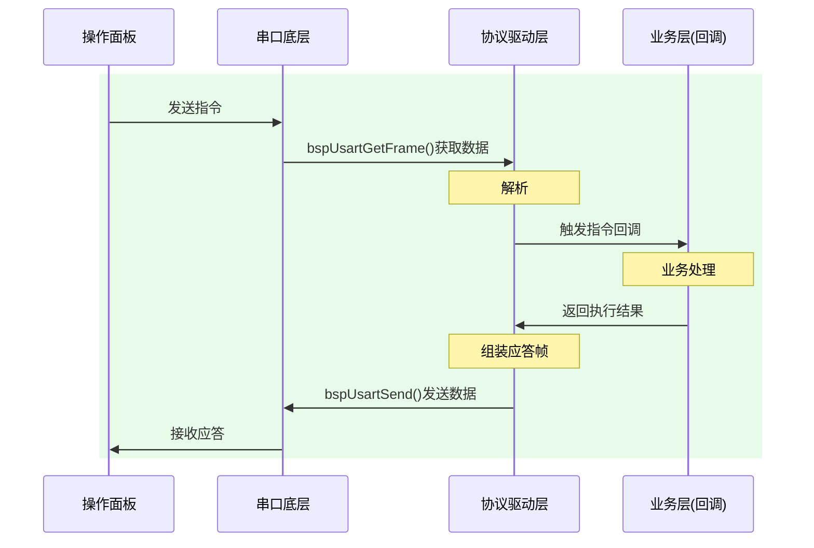
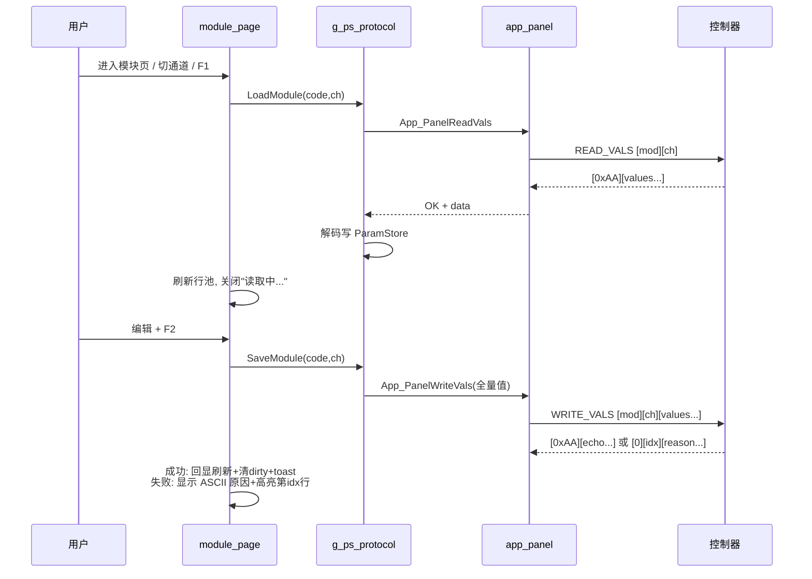

---
领域:
  - 工作
类型:
  - 开发
项目:
  - "[[分拣操作面板]]"
任务:
  - "[[260401S3分拣面板]]"
状态: 进行
相关任务:
创建时间: 2026-04-01T12:59:00
截止时间: 2026-08-16T04:59:00
完成时间:
---
# S3 分拣操作面板（控制器调试工具）

> **一句话**：面板开机从控制器拉取参数定义 JSON（自适应，控制器加参数面板零改动），解析生成中文参数界面；参数值/修改将全部走协议（任务2）。
>
> **仓库**：面板 `D:\Screen\Projects\Panel_RTOS`（HC32F460KETA）｜控制器 `D:\Sort\Sorting_Controller`（GD32F470）｜旧面板字库参考 `D:\Screen\Projects\Operation_Panel`

## 0. 项目目的与任务全景

**项目目的**：把面板做成分拣控制器的**通用调试/操作终端**。控制器是唯一数据权威（参数定义、当前值、合法性校验、落盘），面板负责自适应显示与操作；以后控制器新增参数/模块，面板零改动。

| 任务 | 一句话目标 | 主要内容 | 状态 |
|---|---|---|---|
| **任务1** | 参数界面自适应 | 拉取/解析 UI.JSON，生成中文模块/参数界面，本地编辑/校验/dirty/保存（值源 mock），中文字库 | ✅ 2026-10-24 完成 |
| **任务2** | 参数值真正读写 | `READ_VALS`/`WRITE_VALS` 协议；控制器校验并回 ASCII 原因；面板读取中/保存中/成功/失败处理 | ✅ 2026-10-26 完成（真机联调通过） |
| **任务3** | 调试操作增强 | F1编辑/Enter即时下发/清空重输/TabBar切通道/去底栏、首页使能快捷键、网络独立页、中文报错、输入+读卡器观察、输出点动、JSON 版本化 Flash 缓存、与 UDP 复用 API | ✅ 2026-10-27 代码完成（主机/模拟器 20+3+1 全通过；真机待验，T3-9 数据源待接；§5.7） |
| **任务4** | 面板 UI 优化 | IP 标点输入、首页模块/系统分组、参数页按类型分组、调试页四分类、240×160 视觉统一；不改 GUI 库 | P0~P2 完成；真机待验（§6） |
| **任务5** | 体验与发布 | 参数备注/帮助、中英文、离线参数值缓存、掉线/重连/双面板与长时间跑机验证、现场发布 | 待排期（§7） |

### 待办列表
- [x] 任务1 编码 / 模拟器+硬件测试 / 提交（develop）
- [x] 任务2 编码 / 主机 CTest（2+1+7 全通过）/ 真机联调 / 提交
- [x] 任务3 需求评审（§5.1 十项 + §5.3 协议草案）✅ 2026-10-27
- [x] 任务3 T3-1 参数页交互重构（F1编辑/Enter下发/清空/保留TabBar/去底栏/滚动条可见 + 首页F1/F2使能）✅ 2026-10-26（主机 14/14，待真机）
- [x] 任务3 T3-2 中文报错 + 切换统一 API（含 UDP 行为不变）✅ 2026-10-27（主机 2/2；UDP 未改）
- [x] 任务3 T3-3 首页使能快捷键（0x0005/0x0006）✅ 并入 T3-1（主机通过，待真机）
- [x] 任务3 T3-4 网络设置独立页（0x0007/0x0008 两段确认）✅ 2026-10-27（主机 network_ok/port_fail）
- [x] 任务3 T3-5 JSON 版本化 + W25Qxx 缓存 ✅ 2026-10-27（主机 1/1 A/B 缓存测试；版本页按钮 version_ok）
- [x] 任务3 T3-6 健壮性（重试/读取保值/dirty 按模块）✅ 2026-10-27（退避 1~10s、ClearDirtyRange）
- [x] 任务3 T3-7 调试基础（使能 + 输入观察，0x0010~0x0012）✅ 2026-10-27（主机 debug_ok；输入/读卡器改 0x0016~0x0018 推送）
- [x] 任务3 T3-8 输出点动（0x0013/0x0014）✅ 2026-10-27（ao_udp 事件投递、2s 自动关；调试页/模块页 ●○ 指示）
- [x] 任务3 T3-9 读卡器卡号观察（0x0015）✅ 协议/页面/缓存完成；**控制器 UART 读卡数据源待接**（PanelReaderCacheUpdate）
- [x] 任务3 T3-10 运行开关（可选）✅ 2026-10-27（模块页 F2，主机 switch_ok）
- [ ] 任务4 需求确认（§6.2 八项；确认前不改代码）
- [x] 任务4 P0 IP 标点输入（§6.4）✅ 2026-10-27（GUI 58/58；EIDE 构建通过）
- [x] 任务4 P1 调试页四分类（§6.8）✅ 2026-10-27（4 Tab；Z01~Z05；GUI 59/59；EIDE 构建通过）
- [x] 任务4 P2 首页/参数页分组与视觉统一（§6.5/§6.6）✅ 2026-10-27（home_groups/module_groups；GUI 61/61；EIDE 构建通过）
- [ ] 任务4 P3 可选增强（完整四段 IP、电机连续运行、原始 L/Z，§6.1）
- [ ] 任务5 排期（§7）
- [ ] 任务3 真机验收：网络重启生效、调试输入/输出、运行开关、读卡器（数据源接入后）
- [x] 工作区收尾：面板 `README.md`、GUI 子模块、控制器提交 ✅ 2026-10-27

> 任务1各阶段原始记录见 **附录A**；路径与文件索引见 **附录B**。任务2记录见 §4.8。

---

## 1. 通信协议基础（现行 `my_protocol`）

> 面板与控制器共用 `02_Middleware/my_protocol`（控制器侧 `APP/panel/my_protocol` 同版本），二进制分帧、请求-回复、库内分片/ACK/重传。以下帧格式为现行实现。

| 名称       | 长度    | 内容      | 备注                         |
| -------- | ----- | ------- | -------------------------- |
| 字段       | 字节数   | 取值/规则   | 说明                         |
| HEAD 帧头  | 1     | 0x55    | 固定帧起始魔术字                   |
| LEN 帧总长  | 2     | 整帧字节总数  | 包含 HEAD~TAIL 全部字段，**大端模式** |
| VER 版本   | 1     | 0x01    | 当前协议唯一版本                   |
| CFG 配置位  | 1     | 位图控制    | 通信属性配置位                    |
| SEQ 序列号  | 2     | 0~65535 | 分片/事务序号，**大端模式**           |
| CMD 指令码  | 2     | 自定义指令   | 业务功能码，**大端模式**             |
| DATA 数据域 | LEN-9 | 业务数据    | 最小0字节，当前配置上限501字节（`PROTOCOL_FRAME_MAXLEN=512`） |
| CHECK 校验 | 1     | CRC8    | 校验范围：LEN ~ DATA            |
| TAIL 帧尾  | 1     | 0xAA    | 固定帧结束魔术字                   |

> 实测配置：`PROTOCOL_FRAME_MAXLEN=512` → 单帧载荷上限 501B；JSON 每片 499B。



**现行指令**（两端 `panel_cmd.h` 必须逐字节一致）：
| CMD | 名称 | 方向 | 说明 |
|---|---|---|---|
| `0x0001` | HEARTBEAT | 面板→控制器 | 控制器回版本串；面板判定在线 |
| `0x0002` | JSON | 面板→控制器 | 面板按 `[seq]` 逐片申请；控制器回 `[seq][total][data...]`，空应答=发完 |
| `0x0003` | READ_VALS | 面板→控制器 | **任务2 新增**（§4.2） |
| `0x0004` | WRITE_VALS | 面板→控制器 | **任务2 新增**（§4.2） |

### 历史会议记录（2026/4/17，保留）
- 不兼容升级，只烧录定制版本，分阶段，后续进行开发
- [ ] 支持中/英文
- [ ] IP/端口设置界面：支持四段IP设置，端口选择
- [x] 模块开关界面
- [x] 参数设置界面
- [x] 通道/模块

---

## 2. 任务1总结（已完成）

### 2.1 目标回顾
面板从控制器拉取 `UI.JSON`（15 模块 / 245 实参，UTF-8 中文），零硬编码地生成模块列表与参数页；中文显示（板载 W25Qxx unifont 字库）；参数可本地编辑/校验/保存（本期值源为 JSON 默认值 mock，为任务2协议读写预留接口）。

### 2.2 已实现功能
- **JSON 链路**：逐片拉取（68 片）→ 收齐 → 解析一次 → 模型/值池初始化；首页显示下载进度/解析结果。
- **中文字库**：W25Qxx（SPI3）→ unifont 20px → GUI 字体钩子；汉字 20×20、ASCII 10×20；16 槽字模缓存；缺字空心框；未装钩子时旧 5×7 路径原样保留。
- **模块列表页**：15 模块中文名 + code，尾部"版本信息"；↑/↓ 选择、Enter 进入；在线状态/状态栏。
- **模块参数页**：模块名标题、通道 TabBar（模块 4/15 单通道自动隐藏）、参数列表（名称/值/dirty `*`）、数字编辑、min/max 预校验、超范围 alert、切通道/退出 dirty 确认、保存按钮 + F2、保存 toast。
- **数据层**：`panel_model`（零拷贝 JSON 解析、模型、值池、dirty 位图、`ParamSource_t` 抽象 + mock）。
- **模拟器**：`gui_lcd_test.exe --json <path>` 直接跑固件页面 + 文件字库（`unifont20.bin`），与硬件逐像素一致。
- **工程**：EIDE + Keil 双工程登记；现文档只保留根 `README.md`（人类）与 `AGENTS.md`（AI），GUI 同。

### 2.3 交付物（关键文件）

| 层 | 文件 | 说明 |
|---|---|---|
| 字库 Flash | `01_Hardware/component/w25qxx/w25qxx.{c,h}` | 官方 XHSC W25QXX 组件（LL 函数表，含写/擦备用）；`W25QXX_GetJedecId` |
| 字库适配 | `01_Hardware/adapt/w25qxx/w25qxx_hc32_adapter.{c,h}` | SPI3 LL（PB4=SCK/PB3=MOSI/PB6=MISO/PB7=CS/PB5=WP），12.5MHz |
| 字体服务 | `04_Application/app/app_font.c/h` | unifont 20px 提供者（`offset=ugbkaddr+uni×60`，缓存） |
| 字库工具 | `tools/dump_font.py` | RTT/USART1 双通道转储、CRC、预览、比对 |
| GUI | `02_Middleware/GUI/inc/ui_font.h`、`src/ui_font.c` | `UI_Glyph_t`/`UI_FontOps_t`、UTF-8 解码 |
| GUI 改造 | `src/ui_canvas.c`、`ui_popup.c`、`ui_param.c` | 钩子绘制/测宽/换行按 UTF-8 字符边界 |
| 模拟器 | `test/font_file.c/h`、`test/panel_app_stub.c/h`、`test/main.c` | 文件字库 + `--json` + `PANEL_SIM_APP` 复用固件页 |
| 模型 | `02_Middleware/panel_model/{inc,src,test}` | `json_parse`/`param_model`/`param_store`/`param_source(_mock)` + CTest |
| 应用 | `04_Application/app/app_param.c/h` | JSON ready 后解析一次 + 值池初始化 |
| 页面 | `04_Application/ui_pages/home_page.c`、`module_page.c/h`、`version_page.c` | 模块列表 / 参数页 / 版本信息 |
| 配置 | `ui_event.h`、`ui_user_def.h`、`app_key.c`、`main.c`、双工程 | F1/F2/F3 事件、字号 20、按键映射、初始化顺序 |

**提交**（develop）：`fcf38af`/`784c4a2`（W25Qxx）、`2b9875d`（dump 工具）、`41bf420`（panel_model）、`4143430`（字库+参数页）、`e55aec4`（工程+文档）；GUI 子模块 `b85f3f4`。

### 2.4 验收证据（汇总）

| 项 | 结果 |
|---|---|
| 字库实测 | JEDEC `0xEF4018`=W25Q128；`fontok=0xAA`；`ugbkaddr=0`、`ugbksize=0x3F4D94`；7 个采样字模哈希与 `unifont20.bin` 一致 `0xFA8E09D2` |
| 字体渲染 | 硬件读回 `s_default_framebuffer` 与 `unifont20.bin` 同规则渲染**逐像素 0 差异**；模拟器与硬件整帧 **0 差异** |
| 帧耗时 | 首帧全屏 44ms；列表滚动稳态 max 36~38ms（验收线 80ms） |
| JSON 模型 | CTest 通过：15 模块/245 实参/环形仓 41 参数/类型计数 127/72/40/6；**UI.JSON 全部 33,577 个前缀逐一解析均安全拒绝**；容量/畸形样本全通过 |
| UI 全流程 | 模拟器断言 + 硬件同场景 **10 个场景逐像素 0 差异**（home/module/编辑/确认/alert/save/重进等） |
| 固件构建 | Keil AC6 0 error（新增 0 warning）；EIDE `Succeed`（86 C + 1 asm）；flash 94232B / RAM 160096B |
| 实机 | RTT `[Param] parsed modules=15 params=245 unknown=0`；编辑 200→dirty→F2→200/0→重进保留；进度页"下载界面 26/68" |

### 2.5 关键决策（后续必须遵守）
1. **值序契约**：参数值数组顺序 = JSON items 实参序（跳过 `type==""` 帧项），线宽 = 该 item 的 `length`（1/2B，大端）。
2. **JSON 零拷贝**：`JsonSpan_t` 指向 `s_json_rx`；解析后该 40KB 缓冲**只读常驻**，任何重拉前必须先复位模型。
3. **统一字号 20px**：全工程 `USER_DEFAULT_FONT_SIZE=20`；字库固定 20px，提供者忽略请求 px。
4. **字体钩子向后兼容**：未安装 `UI_FontOps_t` 时旧 5×7 路径不变（模拟器无字库可回退）。
5. **值源抽象**：页面只经 `ParamSource_Get()`；任务2 注册协议源即可，页面不改。
6. **控制器权威**：合法性最终由控制器判定（面板仅 min/max 预校验）；失败原因由控制器回 **ASCII 文本**，面板原样显示，不维护错误码表（§4.2）。**任务3 起 reason 改 UTF-8 中文（§5 T3-2）。**
7. **单通道规则**：模块 4（主轨）/15（环形仓）`max_size=1`，面板不显示 CH2。
8. **启用/使能即参数**：`分拣仓使能` 等 `en_*` 属于系统参数模块（code=0），无需单独使能指令。
9. **模拟器复用固件页**：`PANEL_SIM_APP` 条件编译，主仓库 CMake 注入固件页面 + panel_model；GUI 子模块单独构建仍走 demo。
10. **双工程登记**：新增 `.c` 必须同时进 `Panel.uvprojx` 与 EIDE；EIDE 优先用 MCP，不手改 yml。

### 2.6 已知限制（任务2/3 处理）
- 值源为 **mock**：显示 JSON 默认值，重启恢复默认；**不从控制器读、不向控制器写**（任务2）。
- 保存仅清 dirty（本地），控制器侧无任何变更（任务2）。
- `remark` 不显示（已解析保留，将来可用）。
- F1/F3 事件已预留未使用（任务2 建议 F1=重新读取）。
- 字库全量硬件转储未完成（RTT 在 240~430KB 卡死）；模拟器 `unifont20.bin` 由同尺寸参考字库 + 硬件逐像素验证。
- 无 IP/端口四段单行编辑页（任务4 P0 只补标点输入，完整四段见 §6.2 第2项/P3）；无中英文切换；无离线缓存（重启丢编辑）。
- 未做真控制器联调（当前只验到 JSON/UI）。

### 2.7 数据契约与字库格式速查

**JSON 结构**（UTF-8、紧凑、无转义）：
```jsonc
{"low_com_configs":[
  {"name":"分拣仓模块设置","code":1,"max_size":2,"items":[
    {"key":"命令","length":1,"defaultValue":0,"remark":"","type":"","min":0,"max":2},
    {"key":"模块号","length":1,...,"type":"","min":0,"max":0},      // 前3项=帧项，type==""，解析时跳过
    {"key":"通道号","length":1,...,"type":"","min":1,"max":2},
    {"key":"库区电机运行时间","length":2,"defaultValue":180,"remark":"单位：s",
     "type":"配置项","min":0,"max":65535}
  ]}, ...]}
```
- `type`：`配置项|输入口|输出口|读卡器`（未知→配置项并计数）。
- 容量：模块 ≤16、参数 ≤320、单模块 ≤48；模块号 0–12/14/15（13 缺席）。
- 生成端：控制器 `APP/src/param_json.c` ← `APP/inc/param_def.h`（唯一维护点）。

**字库格式**（W25Qxx，地址 0 起）：
- 头 12B：`fontok(0xAA) | pad | ugbkaddr(u32 LE) | ugbksize(u32 LE)`。
- 字模：`offset = ugbkaddr + unicode×60`（20px，槽 60B）；**列优先**：第 x 列 3 字节，每字节 8 像素 MSB 在上，仅前 20 行有效。
- 宽度：`uni<0x80` 半宽（10 列/advance 10），其余全宽（20 列/20）；全 `0x00` = 合法空白，全 `0xFF`/越界 = 缺字。

### 2.8 踩坑记录（务必保留）
1. 直接 `UI_PopupShow` 后必须 `UI_PopupRelayout()`（便捷封装内部已做），否则 `w/h=0` 不可见。
2. 目标工程 `-fshort-enums`：`UI_Event_t` = **5B**（pyOCD 注入事件按 5B 步长）。
3. `pyocd rtt` 强杀会使 CMSIS-DAP 假死 → 用脚本读 `_SEGGER_RTT` 后干净退出。
4. `eide_set_inc_dirs` **不要**回写 `ARMCLANG/include`、`libcxx`（会遮蔽 newlib）。
5. SPI3 需关闭 JTAG TDO/TRST 释放 PB3/PB4；MISO 内部上拉。
6. 字模全 `0x00` 视为空格，不按缺字处理。
7. 列表顶部再↑/底部再↓ 必须 `return 0`，把焦点交还页面导航（否则无法切通道）。
8. `UI_Obj_t` 为 `#pragma pack(1)`，32 位目标 `fresh_interval` 偏移 +17。
9. 模块列表只在解析完成时建一次，禁止每帧重建。
10. EIDE `srcDirs` 与 `virtualFolder` 同名文件会重复编译 → 去重。
11. RTT 大流量（全量字库 4MB）不稳定，长传输走 USART1 或分块。
12. 面板首次拉 JSON 需 11~20s（68 片逐片请求），等待期 UI 必须有进度。

---

## 3. 当前架构（现状）

### 3.1 目录职责
| 目录 | 职责 |
|---|---|
| `01_Hardware/bsp` | 时钟/SysTick/USART/SPI 基础；`Bsp_GetTickMs` 全局时基 |
| `01_Hardware/component/st75256`、`w25qxx` | LCD / 字库 Flash 芯片逻辑（ops 表，硬件无关） |
| `01_Hardware/adapt/st75256`、`w25qxx`、`keypad` | HC32 LL/GPIO 适配（唯一碰寄存器处） |
| `02_Middleware/GUI` | 静态 GUI 框架 + `UI_FontOps_t` 字体钩子；Win32 模拟器 |
| `02_Middleware/panel_model` | JSON 解析/模型/UI 元数据/值池/值源抽象（主机 CTest） |
| `02_Middleware/my_protocol` | 串口协议库（两端同版本，独立 git 仓库） |
| `04_Application/app` | `app_ui/app_key/app_panel/app_font/app_param/app_json_cache/app_log` |
| `04_Application/ui_pages` | `home/module/network/debug/switch/version_page` |
| `00_Project` | EIDE + Keil 工程（新文件双登记） |

### 3.2 启动与运行数据流
```
HardwareInit: Clk → SysTick → LED → USART1 → ST75256 → W25Qxx
App_LogInit → App_UIInit(主页) → App_FontInit(字库钩子) → App_JsonCacheInit(写/擦自检)
→ App_KeyInit → App_PanelInit
主循环: App_KeyProcess → App_PanelLoop(心跳/JSON_VERSION/缓存命中或逐片拉取)
→ App_ParamLoop(ready 后解析一次+值池初始化) → App_LogLoop → UI_Loop
进入模块页: ParamSource_Get()->LoadModule(code,ch) → ParamStore → 行池物化 → UI_List
保存: ParamSource_Get()->SaveModule(code,ch) → 回显写回 → ClearDirtyRange(module)
网络: NetworkPage → NETCONF_STAGE → NETCONF_CONFIRM → 控制器写 Flash/镜像 CH2
调试: DebugPage 开关 → DEBUG_SET(1) → 控制器变化推送输入/读卡器 → 页面/模块页 ●○ 点动
```

### 3.3 关键接口速查
| 模块 | API |
|---|---|
| `app_panel` | `App_PanelInit/Loop`、`App_PanelIsOnline`、`App_PanelGetControllerVersion`、`App_PanelJsonReady/GetJson/JsonProgress`；`Vals/Enable/Net/Debug/Switch*` 异步 API |
| `app_json_cache` | `App_JsonCacheInit/Probe/Save`（W25Qxx A/B，CRC32+版本） |
| `app_param` | `App_ParamInit/Loop/Poll/State`（`WAITING/READY/FAILED`） |
| `param_model` | `ParamModel_Get/Parse/FindByCode/UiMeta`；`PModModule_t`/`PModParam_t`/`PModUiMeta_t` |
| `param_store` | `ParamStore_Init/Get/Set/IsDirty/ClearDirty/ClearDirtyRange/DirtyCount`（`[320][2]` u16 + dirty 位图） |
| `param_source` | `g_ps_mock`、`ParamSource_Set/Get`、`PS_State_t{IDLE,LOADING,READY,ERROR,SAVING}` |
| `ui_font` | `UI_SetFontOps`、`UI_FontUtf8Decode`、`UI_FontFetch`、`UI_Glyph_t{w,h,advance,col_bytes,bitmap}` |
| `w25qxx` | `W25Qxx_HC32Init/DeInit/Read/Write/EraseSector/EraseChip/GetIds/MaxAddr` |
| 页面 | `ModulePage_Open(module)`、`NetworkPage_Open()`、`DebugPage_Open()`、`SwitchPage_Open(module,ch)`、`home_page`、`version_page` |

### 3.4 页面 / 按键（现状）
```
home_page: 标题"调试工具" + 在线状态 + 动态列表(非 SYS 模块 + 系统入口；模块/系统之间 1px 分隔线) + 状态栏
module_page: 标题(模块名) + 通道 TabBar(可选) + 参数 List(输入/输出/读卡器/配置顺序，组间 1px 分隔线不占行)；F1 编辑/Enter 立即下发/F3 重读/F2 运行开关
network_page: 标题"网络设置" + 5 行元数据（网段/本地IP/远程IP/本地端口/远程端口）
debug_page: 标题"IO调试" + 4 Tab(输入/输出/设备/读卡)；输入 X01~X08/X11~X18、输出 Y01~Y06/Y11~Y16、设备 Z01~Z05 + 模块7灯/报警、读卡器；Enter 点动
switch_page: 标题"运行开关" + 1~2 行开关；F1 编辑/Enter 下发/F3 重读
version_page: 版本信息（控制器版本串）
```
| 位置 | 按键 | 行为 |
|---|---|---|
| home 列表 | ↑/↓/Enter | 选模块/特殊入口（网络设置、调试模式、IO调试、版本信息） |
| home 模块行 | F1/F2 | 切换当前模块 CH1/CH2 使能（单通道忽略 F2） |
| module 通道 | ←/→ | 切通道（dirty 先确认；OK 恢复本模块默认并清 dirty） |
| module 列表 | ↑/↓ | 滚动；到边界交还焦点 |
| module 列表 | F1 | 清空并进入编辑 |
| module 列表 | Enter（编辑态） | 提交并立即整模块 WRITE；失败回滚字段 |
| module 任意 | F2 | 打开运行开关页（模块 1/2/4/5） |
| module 任意 | F3 | 重读当前通道 |
| module 任意 | Cancel | 有 dirty 先确认，再返回 home |
| network | F1/Enter | 清空编辑/提交；Enter 后旧→新确认 → stage+confirm |
| network | F3/Cancel | 重读/返回（取消确认恢复旧值） |
| home 调试模式 | Enter | 唯一调试开关；开启前确认并停止全部输出 |
| debug | ←/→ | 切换输入/输出/设备/读卡 Tab（焦点在 TabBar） |
| debug | ↑/↓ | TabBar ↓ 进入列表；列表内选择，跳过设备小节标题；顶部 ↑ 回 TabBar |
| debug | Enter | 输出/设备行点动；电机行先确认；输入/读卡器只读（调试页无开关） |
| debug | F3 | 重新 DEBUG_GET；设备页重试模块7读取 |
| debug | Cancel | 返回 home；不改变调试开关状态 |
| switch | F1/Enter/F3/Cancel | 编辑/立即下发/重读/返回 |

### 3.5 构建 / 测试 / 烧录
```powershell
# 固件（EIDE，MCP 可用时）
eide_reload <uid>; eide_build <uid>      # 产物 00_Project/EIDE/build/Target_1/Panel.axf
# 固件（Keil）打开 00_Project/MDK/Panel.uvprojx → Target_1
# 烧录（CLI 直烧，已验证；面板 EIDE 的下载配置也是 pyocd）
pyocd flash -u LU_2022_8888 -t hc32f460xe 00_Project/EIDE/build/Target_1/Panel.axf

# 模型单测（1/1）
cmake -G "MinGW Makefiles" -S 02_Middleware/panel_model -B 02_Middleware/panel_model/build
cmake --build 02_Middleware/panel_model/build; ctest --test-dir 02_Middleware/panel_model/build --output-on-failure

# 面板应用/协议/JSON 缓存（3/3）
cmake -G "MinGW Makefiles" -S 04_Application/test -B 04_Application/test/build
cmake --build 04_Application/test/build; ctest --test-dir 04_Application/test/build --output-on-failure

# 模拟器（主仓库，页面回归 20/20）
cmake -S 02_Middleware/GUI -B 02_Middleware/GUI/build
cmake --build 02_Middleware/GUI/build --config Debug
./02_Middleware/GUI/build/test/gui_lcd_test.exe --json UI.JSON
ctest --test-dir 02_Middleware/GUI/build --output-on-failure
```
> RTT 用脚本读 `_SEGGER_RTT`（勿用 `pyocd rtt` 强杀）；事件注入注意 `UI_Event_t`=5B。
> 当前 EIDE 面板固件 ROM 129.0KB / RAM 163.7KB；控制器 EIDE FLASH 279,644B / RAM 412,800B。

#### 3.5.1 调试探针 / DAP 速查（两工程同时连接）

| 工程 | 探针 | pyocd 选择 | 目标 MCU | pyocd 目标参数 | 串口 |
|---|---|---|---|---|---|
| 面板 `Panel_RTOS` | jixin.pro CMSIS-DAP_LU (C251:F001) | `-u LU_2022_8888` | HC32F460KETA | `-t hc32f460xe` | COM8 |
| 控制器 `Sorting_Controller` | Arm DAPLink CMSIS-DAP (0D28:0204) | `-u 000000800672ff`（全 UID `000000800672ff303937504d43095549a5a5a5a597969908`，可只写前 14 位） | GD32F470ZI | `-t gd32f470zi` | COM7 |

- 两个探针可同时在线：**每个 pyocd 进程必须带不同 `-u`**，不要两个进程抢同一个探针。
- **EIDE 下载器是项目配置，不自动选择**（由各项目 `.eide/eide.yml` 的 `uploader` 字段决定；GUI 下载与 MCP `eide_flash` 都按它执行）：
  - 面板 `Panel_RTOS/00_Project/EIDE/.eide/eide.yml` → `uploader: pyOCD`（`targetName: hc32f460`，speed 1M，探针 jixin）
  - 控制器 `Sorting_Controller/.eide/eide.yml` → `uploader: OpenOCD`（`interface: cmsis-dap`，`target: stm32f4x`，探针 DAPLink）
  - EIDE 配置未绑定探针 UID；同时插多个 CMSIS-DAP 时若下载选错目标，临时只插目标探针最稳。
- 单独跑 CLI pyocd 可用 `-u` 精确选探针（见上表），用于读取/验证；直烧也已验证（见上）。
- 重新插拔后 COM 号可能变，以 `pyocd list` + VID 为准。

```powershell
pyocd list                                                              # 确认探针/UID/VID
# 面板（jixin）只读验证
pyocd commander -u LU_2022_8888 -t hc32f460xe -c "read32 0xE000ED00" -c "read32 0x40010450"
# 控制器（DAPLink）只读验证
pyocd commander -u 000000800672ff -t gd32f470zi -c "read32 0xE000ED00" -c "read32 0xE0042000"
```

**识别校验**：
- GD32F470ZI：CPUID `0x410FC241`（Cortex-M4），DBG ID@`0xE0042000`=`0x22020419`；连接时出现 `Invalid coresight component cidr=0x0` 警告可忽略。
- HC32F460KETA：CPUID `0x410FC241`，EFM UQID@`0x40010450`=`0x48433133`（"HC13…"）。

### 3.6 资源占用
- Keil：Flash 94,232B；RAM 160,096B（含 GUI/模型/40KB JSON/帧缓冲，192KB 内）。
- 帧耗时：首帧 44ms；列表滚动 max 36~38ms。

---

## 4. 任务2总结：参数值读写（已完成）

> 完成时间：2026-10-25/26（面板 `6fdd6eb`/`2d04875`、控制器 `27fcee2` + 联调修复；测试 `aefdf09`）。
> 验收：主机 CTest **2/2（协议帧）+ 1/1（模型）+ 7/7（页面场景）全部通过**；真机联调通过（COM_B 未物理验证）。

### 4.1 目标与落地结果
**目标（已实现）**：
- 进入模块页 / 切通道 / F1 → 读取该模块该通道**全部实参**（整模块读写，非字段增量）。
- 编辑后 F2 → 写回控制器；控制器校验（范围/端口唯一性）、持久化、通知模块，回显生效值覆盖本地。
- 面板全程有"读取中/保存中/成功/失败"提示；失败显示控制器 ASCII 原因并高亮出错字段。

**落地结果**：
- 面板页面/ParamStore 通道 **0-based（CH1/CH2）**，`param_source_protocol` 统一转协议 **1-based（1/2）**。
- 值按 JSON `length` 打包：`2B` 用 u16 大端，`1B` 单字节；最大 96B（48 实参 × 2B）。
- 只允许一条读/写流在途：ACK 超时 500ms、业务回复 1500ms；读重试 1 次、写不重试。
- 值源：固件固定 `g_ps_protocol`；模拟器用 `panel_app_stub`/`g_ps_mock`，可注入超时/冲突/字段错/离线。
- 读失败当前策略：该通道恢复 JSON 默认值（已知限制，任务3 改为保留上次成功值）。
- **不在本期**：系统参数专用 UI、使能即时启停、运行开关、离线缓存、双面板并发。

### 4.2 协议定稿

```text
0x0003 READ_VALS
  请求: [mod:1][ch:1]                      ch=1..max_size（面板按 JSON 保证合法）
  成功: [0xAA][values...]                  按 JSON 实参序，每项 length 字节，u16 大端
  失败: [0x00][idx:1][reason_ascii...]     idx=出错实参(1-based)，0=通用；reason 无结尾符，长度=帧数据-2

0x0004 WRITE_VALS
  请求: [mod][ch][values...]               长度必须 = Σlength（面板按 JSON 生成）
  成功: [0xAA][echo values...]             控制器回显生效值（面板直接覆盖本地值池）
  失败: [0x00][idx][reason_ascii...]
```

**失败原因（控制器回 ASCII 文本，面板原样显示，不维护错误码表）**：
| 场景 | idx | reason（ASCII） | 面板展示 |
|---|---|---|---|
| 模块不存在 | 0 | `bad module` | Alert 标题"读取/保存失败"，正文原样 |
| 通道号非法 | 0 | `bad channel` | 同上 |
| 载荷长度不符 | 0 | `bad length` | 同上 |
| 字段值越界 | i（1-based） | `param invalid` | Alert 正文 + 高亮第 i 行 |
| 独占端口被其他模块占用 | 0 | `port conflict` | Alert 正文 |
| SYS 立即落盘失败 | 0 | `flash write failed` | Alert 正文 |
| 超时（无回复） | — | — | 面板本地提示"控制器无响应" |

> 原因文本必须 ASCII（控制器 `param_def.h` 里中文名不参与）；面板把回复中的 reason 拷进静态缓冲再用——协议缓冲回调返回后即失效。
> ⚠️ **需求变更（2026-10-26）**：任务3 T3-2 将 reason 改为 **UTF-8 中文**（上限 64B），本节为任务2 现状记录。

**约束核算**：模型容量单模块 ≤48 实参 × 2B = 96B；WRITE 请求 ≤98B、READ/WRITE 成功回显 ≤97B、失败 ≤26B，均远小于单帧 501B，无分片。当前 `UI.JSON` 最坏模块 15 为 41 实参/56B（WRITE 58B、回显 57B）。
**语义**（控制器侧，与 `udp_comm.c` 0x0A/0x0B 行为一致）：
- 读：`paramModuleReg(mod)` → `paramModuleVal(reg, ch-1)`，`length==2` 转大端。
- 写：校验长度 → 逐项 `paramValInRange` → `paramCheckModuleUnique` → 写入 → **模块0**镜像前 6 个网络字段到另一通道并 `paramFlush()`；其他模块 `paramMarkDirty()`（10s 防抖落盘）→ 成功后 `moduleClaimAllEnabled()` + `moduleParamChangedNotify(mod, ch-1)`。
- 失败不改任何值（面板收到失败后保持原显示）。

**落地参数**：`PANEL_VALS_VALUES_MAX=96`、`PANEL_VALS_REASON_MAX=24`；成功回复 = `[0xAA]+values`，失败 = `[0x00][idx][reason]`；面板回复缓冲 97B，reason 在回调内拷贝为 NUL 结尾静态串。

### 4.3 控制器侧实现（已完成；**不重构 udp_comm/param_mgr**）

> 实际实施记录见下方 **T2-2**。控制器负责人决定：不抽公共助手、不改 `udp_comm.c`；`panel.c` 内独立实现并加交叉注释。

1. `APP/panel/panel_cmd.h`：新增 `PANEL_CMD_READ_VALS 0x0003U`、`PANEL_CMD_WRITE_VALS 0x0004U`（与面板逐字节一致）；容量宏 `PANEL_VALS_*` 已随 T2-1 落地，直接复用。
2. `APP/panel/panel.c` 内**直接实现**（逻辑参照 `udp_comm.c` 0x0A/0x0B）：
   - `PANEL_LINK_t` 增加 `uint8_t vals_buf[PANEL_VALS_OK_REPLY_MAX]`（与 JSON 回复缓冲分离）。
   - 新增 `cbReadVals`/`cbWriteVals` 与错误回复 helper（`[0x00][idx][reason_ascii]`）。
   - `panelLinkInit` 注册两条新回调（A/B 链路共用）。
   - 新增 include：`param_mgr.h`、`srv_modulemgr.h`、`ao_param.h`。
   - 在 `panel.c` 与 `udp_comm.c` 对应 case 互相加注释：**"此处逻辑需与 udp_comm.c 0x0A/0x0B 保持同步"**。
3. 实现要点（与 UDP 版逐项对齐）：
   - 长度期望 = `2 + Σmeta.length`；逐项 `paramValInRange`（失败回 idx=i+1 + `param invalid`）。
   - 唯一性 `paramCheckModuleUnique`（失败回 idx=0 + `port conflict`）。
   - 写入后：模块 0 镜像前 6 项网络参数到另一通道 + `paramFlush()`；其他模块 `paramMarkDirty()`；然后 `moduleClaimAllEnabled()` + `moduleParamChangedNotify(mod, ch-1)`。
   - 成功回显：按 `length` 逐项转大端（u16 高字节在前，u8 原样）。
4. 验证：EIDE 构建成功；UDP 0x0A/0x0B 抽样回归（本次未改 UDP，仅确认未受影响）；真控制器烧录走控制器 EIDE（其 `uploader` 配置=OpenOCD），CLI pyocd 用 `-u 000000800672ff` 读验证或直烧（§3.5.1）。

### 4.4 面板侧实现（已完成）

> 实际实施记录见下方 **T2-3**（app_panel 读写流）、**T2-4**（协议值源 + 页面）、**T2-5**（主机场景回归）。
1. `04_Application/app/panel_cmd.h`：同步两条指令（与控制器逐字节一致）。
2. `04_Application/app/app_panel.c/h`：
   - 新增 `s_vals_buf[PANEL_VALS_OK_REPLY_MAX]` 专用于读写回复（现有 `s_reply_buf[64]` 不够）。
   - 新增异步接口：
     ```c
     uint8_t App_PanelReadVals(uint8_t mod, uint8_t ch);
     uint8_t App_PanelWriteVals(uint8_t mod, uint8_t ch, const uint8_t *vals, uint16_t len);
     uint8_t App_PanelValsBusy(void);
     uint8_t App_PanelValsResult(uint8_t *status, uint8_t *idx,
                                 char *reason, uint16_t reason_max,
                                 const uint8_t **data, uint16_t *len);
     ```
   - 读/写共用一条在途流（`s_vals_busy`），超时 2s、retry 1；回调解析 `status/idx/reason`（reason **拷进静态缓冲**，协议缓冲回调后失效），成功数据指向 `s_vals_buf`。
3. 新增 `04_Application/app/param_source_protocol.c/h`：实现 `ParamSource_t`
   - `LoadModule`：`App_PanelReadVals`；`Poll` 在 OK 时按 `length` 大端解码写入 `ParamStore`，并**清该模块该通道 dirty**（读=以控制器为准）。
   - `SaveModule`：把该模块该通道全部值按 `length` 打包（完整模块数组），`App_PanelWriteVals`；OK 时用回显覆盖值池并清 dirty。
   - `LastError`：返回**控制器 ASCII 原因**的静态拷贝（无映射表）；`Poll` 映射 `PS_LOADING/READY/ERROR/SAVING`。
4. `app_param.c`：解析成功且 `App_PanelIsOnline()` 后 `ParamSource_Set(&g_ps_protocol)`；离线保持 `g_ps_mock`。或**始终注册协议源**、离线时 Load 直接 ERROR(`controller offline`)，页面显示缓存/默认值并提示（二选一，实现时记录；推荐始终注册，行为一致）。
5. `module_page.c`：
   - 进入/切通道：`LoadModule` → Progress "读取中..." → READY 刷新行池；ERROR alert：标题中文"读取失败"，正文=ASCII 原因 + 保留现值。
   - 保存：`SaveModule` → Progress "保存中..." → OK toast "已保存"（回显刷新）+ 清 dirty；ERROR alert：标题"保存失败"，正文=ASCII 原因（`idx≠0` 时 `UI_ListSelectIndex(idx-1)` 高亮该行）。
   - F1 → 重新读取当前模块/通道（有 dirty 先确认"丢弃未保存修改并重新读取?"）。
   - 读取/保存期间禁用编辑与保存，重复按键忽略；超时提示"控制器无响应"。
6. `app_key.c` 无需改（F1/F2 已映射）；`ui_event.h` 已含 eKeyF1。
7. 模拟器：`test/panel_app_stub.c` 增加读写模拟（回显 + 可注入 `status/idx/reason` + 可配置延迟），供页面状态机主机回归；`--json` 流程保持可用。
8. 工程：`param_source_protocol.c/h` 登记 EIDE + Keil；`app_panel.h` 变更不影响其他模块。

### 4.5 交互与时序


### 4.6 实施步骤与验收

- [x] **T2-1 协议同步**：两端 `panel_cmd.h` 落码 + 注释表（含 ASCII 原因约定）；主机桩按帧解析验证长度/字节序。**验收：两端常量逐字节一致；最大载荷核算 ≤501B**。✅ 2026-10-25
- [x] **T2-2 控制器 panel 独立实现**：`cbReadVals`/`cbWriteVals` + 注册 + `vals_buf`；**不改 `udp_comm.c`/`param_mgr.c`**，按 §4.3 对照清单逐项与 UDP 0x0A/0x0B 对齐。**验收：EIDE 构建成功；串口测试桩发 READ/WRITE 回包正确（值大端/回显/ASCII 原因/idx）；SYS 写后两通道镜像；非 SYS 写后 10s 落盘；UDP 0x0A/0x0B 抽样回归不变**。✅ 2026-10-25：真机 READ/WRITE/SYS 镜像/立即+10s 落盘全过；**UDP 0x0A/0x0B 未改未回归**；参数区临时迁到 bank0（原 bank1 被 WP），升级固件会擦参数，根治需解 sector 20 WP。
- [x] **T2-3 面板 app_panel 读写流**：接口/回调/超时/结果结构 + `s_vals_buf`。**验收：模拟器桩下 READ 数据进入结果结构；超时置 ERROR；`status/idx/reason` 正确透传且 reason 已拷贝**。✅ 2026-10-25：主机 mock 测试 2/2 通过；EIDE 构建成功；页面接入见 T2-4。
- [x] **T2-4 协议值源 + 页面状态机**：`param_source_protocol` + module_page 读取中/保存中/错误高亮/F1；工程登记。**验收（模拟器）：进入→读取中→值刷新；编辑→保存→回显刷新/清 dirty；注入 `port conflict`→提示+高亮；超时→无响应；离线→读取失败提示且不崩溃**。✅ 2026-10-25：模拟器场景通过；T2-5 自动化夹具已补（7/7）。
- [x] **T2-5 模拟器桩 + 主机回归**：`panel_app_stub` 读写模拟（延迟/注入失败），页面场景断言。**验收：主机夹具覆盖读取成功/超时/字段错/端口冲突/保存成功/离线，全部通过**。✅ 2026-10-25：`panel_ui_test` 7/7 通过。
- [x] **T2-6 真机联调 + 收尾**：面板接真控制器。**验收：①读取值与上位机/UDP 一致；②改 3 个字段保存→控制器上位机可见、重启控制器后保留（SYS 立即/业务 10s 后）；③冲突端口被拒并高亮；④单通道模块无 CH2 请求；⑤断线重连可继续读取；⑥记录提交**。✅ 2026-10-25：①-⑤真机通过；⑤用控制器 `reset halt` 保持离线替代物理拔线，恢复后 F1 读取成功；提交见下。

#### T2-1 实施记录（2026-10-25）

**两端 `panel_cmd.h`（逐字节一致，SHA256 `081B2876…201B95D`）**
- 新增 `PANEL_CMD_READ_VALS 0x0003U`、`PANEL_CMD_WRITE_VALS 0x0004U`。
- 注释表补齐：READ/WRITE 请求/成功/失败载荷、`[0x00][idx][reason_ascii]`、ASCII 原因清单（`bad module`/`bad channel`/`bad length`/`param invalid`/`port conflict`/`flash write failed`）、idx 1-based。
- 新增容量宏：`PANEL_VALS_VALUES_MAX=96`（48×2B）、`PANEL_VALS_HEAD_LEN=2`、`PANEL_VALS_WRITE_REQ_MAX=98`、`PANEL_VALS_OK_REPLY_MAX=97`、`PANEL_VALS_REASON_MAX=24`、`PANEL_VALS_ERR_REPLY_MAX=26`。

**主机桩**
- 新增 `04_Application/test/{CMakeLists.txt,test_panel_cmd.c,.gitignore}`；用真实 `my_protocol` 内存回环模拟面板/控制器。
- 覆盖：READ/WRITE 请求帧（LEN/CMD 小端、CRC8 HEAD~DATA、帧尾）、`[mod][ch]`、values u16 大端、成功 `[0xAA][values...]`、失败 `[0x00][idx][reason]`（`param invalid` idx=7、`port conflict` idx=0）、无回复超时、双端头文件逐字节一致。
- 命令：`cmake -G "MinGW Makefiles" -S 04_Application/test -B 04_Application/test/build` → `cmake --build 04_Application/test/build` → `ctest --test-dir 04_Application/test/build --output-on-failure`；结果 `1/1 passed`，零 warning。

**载荷核算**
- 模型容量 48 实参 × 2B = 96B → WRITE 请求 98B / OK 回显 97B / 失败 26B，均 ≤ `PROTOCOL_DATALEN_MAX=501B`。
- 当前 `UI.JSON` 最坏模块 15（41 实参、values 56B）→ WRITE 58B / 回显 57B。

**未做**
- 未改 `my_protocol`、未烧录；控制器 `cbReadVals/cbWriteVals` 留 T2-2。

#### T2-2 实施记录（2026-10-25）

**改动（仅 `APP/panel/panel.c/h`，未动 `udp_comm.c`/`param_mgr.c`）**
- `PANEL_LINK_t` 增加 `vals_buf[PANEL_VALS_OK_REPLY_MAX]`（97B，与 JSON 缓冲分离）。
- 新增 `panelReplyValsError()`：`[0x00][idx][reason_ascii]`，原因截断 ≤24B。
- 新增 `panelPackVals()`：按实参序打包，`length=2` 时 u16 大端，否则 1B。
- `cbReadVals`：校验长度/模块/通道 → `[0xAA][values...]`。
- `cbWriteVals`：校验长度/模块/通道 → 逐项范围校验（`param invalid`，idx=i+1）→ `paramCheckModuleUnique`（`port conflict`）→ 写入；SYS 前 6 项镜像另一通道并 `paramFlush()`，业务模块 `paramMarkDirty()`（10s 防抖）→ `moduleClaimAllEnabled()` + `moduleParamChangedNotify()` → 回显重建后的生效值。
- A/B 两条链路均注册 READ/WRITE；`panel.h` 协议说明更新。
- 交叉注释：`panel.c` 标注与 `udp_comm.c` 0x0A/0x0B 同步；未改 UDP 文件。

**验证**
- EIDE 构建：面板 `Panel`（`00_Project/EIDE`）**Succeed**（仅 `app_panel.c`，`my_protocol.h` 既存 `-Wpadded` 告警）；控制器 `Sorting_Controller` **Succeed**（无改动，链接通过）。
- 控制器全量 rebuild：**Succeed**（164 C + 1 asm，FLASH 268548B / RAM 420056B）；`panel.c` 0 warning；仅既有 `my_protocol` 未用变量与 newlib 链接告警。
- 主机串口桩（临时，未入库）：真实 `panel.c` + `my_protocol` + 内存链路，假参数/模块表；覆盖 READ 成功/坏模块/坏通道/坏长度、WRITE 成功回显、SYS 镜像、范围错误 idx=2、端口冲突、坏长度、占用表清 0 后回显生效值；全部通过。
- UDP 0x0A/0x0B 未改，回归风险为零（尚未抽样实测）。
- 2026-10-25 已烧录面板与控制器（EIDE 自动选探针会选错，需手动指定：面板 jixin `LU_2022_8888` + pyOCD `hc32f460`；控制器 Arm DAPLink `000000800672…` + OpenOCD `stm32f4x`，verify OK）；真机 READ/WRITE 协议验收已执行（见下）。
- 测试注意：`local_port` 仅接受 8090/7090，其他值 lwip 初始化只回退 RAM（不改存储）；控制器侧 local_port 持久化已验证，但面板 UI 在 T2-4 前仍是 mock 值源，面板上改参数不会写控制器，重启回 JSON 默认属预期。

**真机串口测试（2026-10-25，COM12）**
- READ 0/1、0/2、4/1、15/1 全通过；WRITE 4/1 回显一致；模块1 越界 idx=3、bad module/channel/length 全通过。
- 发现 `remote_ip23` 默认 0xFEFE > max 0xFEFD，SYS 整包写被 `param invalid` idx=4 拒绝（local_port 也因此写不进去）；已将 `APP/inc/param_def.h` 的 `remote_ip23` max 改为 0xFEFE，重烧后 SYS WRITE 通过。**上位机 appsettings.json 需同步 max=65278**。
- 原参数页 `0x08180000`（`bspGetSector` = sector 20，bank1）被 option bytes 写保护：`FMC_STAT=0x10 (WPERR)`，`paramFlush()` 静默失败。已临时把参数区迁到 **bank0 升级缓冲末两页**：`0x080FE000/0x080FF000`（`BSP/inc/flash_layout.h`），页擦写成功、`FMC_STAT=0`。
- 持久化复测通过：`sys_rsv1` 写 `0x5A5A` → 复位 → 读回 `0x5A5A`；`local_port` 8090→7090 → 复位 → 读回 7090 → 恢复 8090；模块1 `in_mode` 1→0 → 等待 >10s → 复位 → 读回 0 → 恢复 1。
- 代价：升级固件会擦 512KB 升级缓冲，参数区在缓冲末 8KB，升级后参数丢失；根治需用 GD-Link/GD32 Programmer 解除 **sector 20** WP 后把参数区迁回 `0x08180000`。**不要用 OpenOCD/STM32 工具改 GD32 option bytes**。

#### T2-3 实施记录（2026-10-25）

**改动（`04_Application/app/app_panel.c/h`）**
- 新增 `App_PanelValsRead` / `App_PanelValsWrite`：单请求在途；离线、忙、本地长度非法、发送失败直接置错误。
- 新增 `App_PanelValsPoll` / `App_PanelValsGetResult`；结果含 `state/module/channel/data_len/data[96]/error_idx/reason[25]`。
- 成功回复 `0xAA + values` 原样进 `data`（T2-4 按模型 length 解包，u16 大端）；失败 `0x00 + idx + ASCII reason` 拷贝并 NUL 结尾；坏回复/超长/超时分别置 `bad reply`/`bad length`/`no response`。
- READ 单帧 ACK 超时 500ms、业务回复 1500ms、允许重发 1 次；WRITE 允许重发 0 次，避免重复落盘/通知。
- `App_PanelInit` 复位读写状态；`s_vals_buf[97]` 作为协议回复缓冲。

**验证**
- 新增 `04_Application/test/test_app_panel_vals.c` + `stubs/`，mock `Protocol_SendCmd` 捕获请求并注入回复/超时；覆盖 READ/WRITE 成功、失败原因+idx 拷贝、超时、忙拒绝、离线、坏回复、超长写。
- `ctest`：`panel_cmd` + `app_panel_vals` **2/2 通过**。
- EIDE 面板构建 **Succeed**（ROM 89100B / RAM 156.5KB）；`app_panel.c` 仅既有 `my_protocol` `-Wpadded` 告警，本模块无新增告警。
- 未烧录；面板 UI 仍 mock，T2-4 接 `param_source_protocol` 后才有页面读写。

#### T2-4 实施记录（2026-10-25）

**改动**
- 新增 `04_Application/app/param_source_protocol.c/h`：`ParamSource_t` 异步包装 READ/WRITE；按模型 length 打包/解包，成功回显写回 `ParamStore` 并清 dirty；失败保存 ASCII reason + idx。
- **真机发现并修复**：页面/ParamSource 通道下标是 0-based，协议通道是 1-based；`LoadModule/SaveModule` 调用 `App_PanelVals*` 时统一 `ch+1`，否则控制器回 `bad channel`。
- `param_source.h` 增加 `LastErrorIndex`（1-based，0=通用）；mock/protocol 均已实现。
- `app_param.c` 的 `App_ParamInit` 注册 `g_ps_protocol`；模拟器 `PanelAppStub_Init` 同样注册。
- `module_page.c`：读取/保存 Progress；加载失败恢复默认值并提示“读取失败”；保存失败提示“保存失败”；`idx>0` 选中并反色高亮该行，`port conflict` 加粗列表边框；读写期间冻结编辑/保存；F1 重读（dirty 先确认）。
- `panel_app_stub.c`：300ms 异步读/写模拟，读从 `ParamStore` 打包，写回显请求；`PANEL_SIM_VALS_FAIL` 注入 `timeout/read-timeout/save-timeout/port/save-port/invalid/save-invalid/offline/read-offline/save-offline`。
- 工程登记：EIDE 源目录自动收录；Keil `Panel.uvprojx` 已加 `param_source_protocol.c/h`。

**验证**
- EIDE 面板构建 **Succeed**（ROM 93244B / RAM 156.8KB）；仅既有 `my_protocol`/`param_model` `-Wpadded` 告警。
- GUI 模拟器构建 **Succeed**。
- 模拟器实测：模块4 进入→读取→值刷新；编辑后 `0*`→F2→toast“已保存”且 `*` 清除；`save-port`→“保存失败: port conflict”；`save-timeout`→“保存失败: no response”；`read-offline`→“读取失败”且不崩溃；`save-invalid`（idx=1）→关闭弹窗后第1行反色高亮。
- T2-5 自动化 CTest 已补（`panel_ui_test`，7/7）；本页手工场景仍保留。

#### T2-5 实施记录（2026-10-25）

- 新增 `02_Middleware/GUI/test/panel_ui_test.c` + `test/fixtures/ui_min.json`：无窗口控制台夹具，直接驱动固件 `home_page`/`module_page`，`panel_app_stub` 提供 300ms 异步读写和失败注入。
- CMake 新增 `panel_ui_test` 目标与 7 个 CTest：`read_ok`、`read_timeout`、`offline`、`save_ok`、`save_port`、`save_invalid`、`save_timeout`。
- 断言覆盖：当前页面、模块4读取值、`param invalid` idx、`port conflict`/`no response`/`offline` 原因、错误弹窗文本、保存后 dirty 清除。
- `save_ok` 同时覆盖 dirty `*` 再编辑：`0→1` 后带 `1*` 再改成 `2`，验证 `UI_ParamOnKey` 裁剪 `*` 的修复。
- 夹具使用固定 2 模块 JSON（系统配置 + 主轨 3 参数），不依赖仓库根 `UI.JSON` 的模块4差异。
- 验证：`cmake --build build` 成功；`ctest --test-dir build --output-on-failure` **7/7 通过**（0.25s）。

#### T2-6 进度（2026-10-25）

- 面板 `fetch_ui_json.py` 从 RAM 读回 `s_json_rx` **33577B**，证明面板 USART1 ↔ 控制器面板口、心跳/JSON 在线。
- **COM_A 已定位为软件问题**：控制器 `bsp_usart.c` 对所有 UART 固定用 `DMA_SUBPERI4`；USART5(COM_A) 需要 `DMA_SUBPERI5`，导致 COM_A 的 DMA RX/TX 请求未接对。已改为按实例选择（USART5/UART6/UART7→5，其余→4），控制器重编译/OpenOCD 烧录。
- COM_A 修复后，PC 端 `COM12`（接 COM_A）`READ 4 1` 返回 `00 00 00 00 00 00 00 08 00 07`，确认 `rail_cnt=8`（端口号）、`air_press_alarm=7`。
- 面板临时自动测试固件（验证后已删除并恢复普通固件）：`read_ok=1`、`read_match=1`、`write_ok=1`（读卡器 0→1 回显）；恢复 0 时业务回复超时（`restore_ok=0`），但随后 COM_A 读回第0项=0，**实际已恢复**，无残留。
- **面板 UI 真机读取**：SWD 注入 Down×4+Enter 进入模块4，10 行值 `0,0,0,0,0,0,0,8,0,7`，`App_PanelVals` state=OK、mod=4、ch=1。
- **面板 UI 真机写单字段**：第0行 0→1，F2 保存后 COM_A 读回 `01 ...`；再改回 0，读回恢复 0。
- **面板 UI 改 3 字段 + 控制器重启保持**：第0行=1、第7行=6、第9行=5，F2 保存成功；等待 >10s 落盘，OpenOCD `reset run` 控制器后 COM_A 读回仍为 `01 ... 06 00 05`；F1 重读回填正确；随后已恢复 `0,8,7`。
- **双通道 CH2**：模块0 打开 CH1 后 Tab 右切 CH2，`module_page s_ch=1`、协议 `ch=2`、37B 读取成功。
- **真机发现并修复 UI 参数 dirty 标记缺陷**：值尾带 `*` 时进入编辑，`edit_buf` 也含 `*`，退格后再追加会变成 `97` 等非法值（实测第7行 9*→7 提交失败）。`UI_ParamOnKey` 进入编辑时裁剪尾部 `*`；GUI/面板重构建烧录后，`7*→6` 再编辑通过。
- **冲突端口测试已通过**：临时把 SYS `en_rail`（模块0 CH1 第14项/第25字节）置1，面板 UI 将模块4第7行 `8→7`（与第9行气压报警同端口），F2 保存后控制器返回 `port conflict`（idx=0），面板显示保存失败；COM_A 回读模块4仍为 `0,8,7`，未被写入。随后 `en_rail` 已恢复0，面板复位回首页。
- **断线重连已通过（软断链）**：OpenOCD `reset halt` 保持控制器停机，3s 后面板 `g_app_ctx.controler_lined=0`；F1 返回 `offline`。随后 `reset run` 恢复控制器，面板自动回到在线，F1 重读模块4成功（`0,8,7`）。未实际拔插 COM_B 线缆。
- **提交完成（本地，未 push）**：控制器 `8a09722 fix(usart)`（COM_A DMA 子外设）、`d4f1c61 fix(param)`（remote_ip23 上限）、`bf72c23 fix(flash)`（参数区迁移）、`27fcee2 feat(panel)`（READ/WRITE）；GUI `3f20789 fix(ui)`（dirty `*`）、`76f7568 test(ui)`（7 场景夹具）；面板 `2aec351 fix(ui)`（UI.JSON 上限）、`6fdd6eb`/`2d04875`/`aefdf09`/`649184a`/`a0a2a85`/`8c949ff`/`e0b6104`（应用层/页面/测试/文档/子模块指针）。
- T2-5/T2-6 均已完成；物理拔线未做，以控制器 halt 软断链替代并验证恢复。

### 4.7 已知边界与遗留（任务3 前状态 → 当前）

| 类别 | 任务3 前 | 当前（2026-10-27） |
|---|---|---|
| 读写粒度 | 整模块全量读写；任一字段错整包拒绝 | 保持（96B 上限足够） |
| 读失败 | 恢复 JSON 默认值 | **已改**：保留上次成功值（T3-6） |
| dirty 清理 | `ParamStore_ClearDirty(ch)` 清整通道 | **已改**：`ParamStore_ClearDirtyRange` 按模块（T3-6） |
| 使能生效 | SYS 写 `en_*` 未 `ModuleEnableNotify()` | **已改**：首页 F1/F2 走 `SET_ENABLE`，立即通知（T3-1/T3-3） |
| JSON 拉取 | 开机一次，失败不重试 | **已改**：1~10s 退避重试 + 断链恢复重拉（T3-5/T3-6） |
| 单通道模块 | 模块 4/15 的 CH2 值存在但 UI 隐藏 | 保持（面板按 JSON 不发 CH2） |
| 参数持久化 | 控制器参数区临时在 bank0 升级缓冲末 8KB | 控制器侧根治：解 sector20 WP 后迁回 `0x08180000` |
| UDP 路径 | 任务2 未改 `udp_comm.c`，未回归 | **T3-2**：面板切统一 API；`udp_comm.c` 未改，UDP 行为保持不变 |
| 双面板 | 仅 COM_A 实测；COM_B/并发写未验证 | **任务5** |
| 面板值缓存 | 重启后重新读取；离线无缓存 | JSON 定义已缓存（T3-5）；**参数值**离线缓存仍属任务5 |
| 编辑输入 | 仅 ASCII 数字 | 保持（参数均为数值） |

### 4.8 提交与复跑记录（2026-10-26）

**提交（本地，未 push）**
| 仓库 | 提交 |
|---|---|
| 控制器 | `8a09722 fix(usart)`（COM_A DMA 子外设）、`d4f1c61 fix(param)`（remote_ip23 上限）、`bf72c23 fix(flash)`（参数区迁移）、`27fcee2 feat(panel)`（READ/WRITE） |
| 面板 | `2aec351 fix(ui)`、`6fdd6eb feat(panel)`、`2d04875 feat(ui)`、`aefdf09 test(panel)`、`649184a`/`a0a2a85`/`8c949ff`/`e0b6104`（注释/文档/子模块指针） |
| GUI | `3f20789 fix(ui)`（dirty `*`）、`76f7568 test(ui)`（7 场景夹具） |

**本次复跑（全部通过）**
- `04_Application/test`：`panel_cmd`、`app_panel_vals` **2/2 Passed**。
- `panel_model`：**1/1 Passed**（8.29s）。
- `02_Middleware/GUI`：`panel_ui_test` **7/7 Passed**（read_ok / read_timeout / offline / save_ok / save_port / save_invalid / save_timeout）。

**工作区待收尾**
- 面板 `README.md` 已大幅更新但未提交；GUI 子模块有未提交 `README.md` 变更与未跟踪 `ARCHITECTURE.md`（面板仓库仅指针 `m`）。
- 控制器 `APP/src/ao_sys.c` 有未提交改动（`QTimeEvt_armX` → `QTimeEvt_rearm`，防抖重装）。

---

## 5. 任务3规划：调试操作增强（下一步）

> 2026-10-26 需求补充（第二版）：F1 编辑 / Enter 即时下发、编辑清空重输、左右切通道、去底栏、首页使能快捷键、网络独立页、中文报错、输入/读卡器调试观察、输出口调试下发、JSON 版本化 Flash 缓存、与 UDP 复用 API。具体字段/交互待评审，本节先锁定范围、依赖与步骤。

#### 职责边界（抽象，先不落实现）

| 维度 | 控制器（权威端） | 面板（交互端） |
|---|---|---|
| 参数定义 | 定义参数、顺序、范围、单位、提示与版本；决定何时变更 | 获取并按版本缓存；自适应生成界面；不硬编码参数含义 |
| 参数值 | 提供当前值；接收修改；最终校验；持久化；让修改生效 | 读取并显示；收集输入；做基础范围提示；提交修改；展示结果 |
| 使能/开关 | 执行并使能/禁能立即生效；维护端口占用与冲突 | 提供快捷操作入口；显示状态；发起请求并刷新 |
| 网络配置 | 保存、双通道镜像、立即生效、最终校验 | 独立页面编辑；关键修改二次确认；展示结果 |
| 调试能力 | 提供调试模式、输入状态、读卡器卡号、输出点动；保证安全边界 | 提供调试界面；观察数据；触发动作；退出/断线时收尾 |
| 错误信息 | 给出明确中文失败原因 | 展示原因并定位到相关项；不自行编造规则 |
| 规则一致性 | 面板与上位机共用同一套业务逻辑 | 不复制业务规则，只调用与展示 |

**核心原则**：控制器是唯一权威，面板是通用交互终端；控制器新增能力，面板尽量零改动或只做配置适配。

#### 控制器统一 API 现状（2026-10-26，UDP 已切换）

| API | 对应 UDP | 面板可复用点 |
|---|---|---|
| `paramConfigSet/Get` | 0x0B / 0x0A | 现有 READ_VALS/WRITE_VALS 可直接改调，去掉 panel.c 重复逻辑 |
| `moduleEnableSet/Get` | 0x45 / 0x46 | 首页使能快捷键/读取 |
| `netconfStage/netconfConfirm` | 0x09 / 0x40 | 网络两段式修改（网段/IP/端口白名单），确认后写 Flash，**复位后生效** |
| `debugEnter/Exit/Active`、输入快照 | 0x15 / 0x90 | 调试模式、输入观察；输出点动仍在 ao_udp |

> 面板 `panel.c` 目前仍是任务2 的直连实现，T3-2 统一改调 API；控制器侧剩余工作主要是新面板命令的薄封装 + JSON 版本/调试数据源。

### 5.1 目标与需求清单
| # | 需求 | 行为概述 |
|---|---|---|
| 1 | **参数快速修改** | 参数行 **F1 进入编辑**；编辑中 **Enter 提交并立即下发**（不再依赖 F2 批量保存） |
| 2 | **模块列表使能快捷键** | 每行右侧 CH1/CH2 两个圆圈/复选框；**F1 切 CH1、F2 切 CH2**，立即生效 |
| 3 | **网络设置独立页** | 网段/本地/远程 IP（每项两段，合并为完整四段）+ 端口；**无通道 Tab**；控制器两段式修改（stage→confirm），**修改需二次确认，保存后重启控制器生效** |
| 4 | **中文报错** | 控制器 reason 改 UTF-8 中文；面板本地错误（离线/超时等）也中文 |
| 5 | **调试使能 + 端口调试** | 调试模式开关；**输入口 + 读卡器端口**可观察；参数页里输出口按确定/其他键下发点动（交互未定） |
| 6 | **UDP 复用通用 API** | 控制器抽公共参数/使能/调试 API，面板与 UDP 共用；**UDP 回归必做** |
| 7 | **JSON Flash 缓存** | 面板保存 JSON；开机取控制器版本号对比，**版本变化才重新拉取/更新** |
| 8 | **参数页保留 TabBar 切通道** | 多通道模块显示通道1/通道2 TabBar，←/→ 切换；单通道隐藏；编辑态 ← 仍是退格 |
| 9 | **去掉底栏** | 参数页删除底部保存按钮/状态栏，列表占满屏幕 |
| 10 | **编辑清空重输** | 进入编辑时清空旧值，避免"继续输入"造成拼接（与 #1 合并实现） |

**不在范围**：备注/中英文/离线参数值缓存/双面板（任务5）；运行开关（可选，T3-8）。

### 5.2 关键决策与依赖

1. **公共 API（需求6）**：控制器统一 API 已落地并由 UDP 使用（`paramConfigSet/Get`、`moduleEnableSet/Get`、`netconfStage/Confirm`）。**T3-2 已完成**：面板 `panel.c` 改调 API、删除重复校验；UDP 文件未改，面板侧只验证行为一致。**未新增 `srv_param_api`。**
2. **中文 reason（需求4）**：**T3-2 已完成**。面板 `panel.c` 把 API 结果码映射为中文原因（`模块不存在/通道号错误/数据长度错误/第N项参数越界/端口被其他模块占用/参数写入失败`）；协议 reason 缓冲 24B→64B（UTF-8），两端同步；面板本地错误（离线/超时/回复无效）也中文。
3. **JSON 版本化缓存（需求7）**：
   - **用量评估**：控制器 JSON 当前 **33,577B**，上限 40,960B；W25Q128 共 16MB，字库占 `0x000000~0x3F4D94`（约 4.15MB），剩余约 **11.8MB**。内部 Flash 512KB、sector 8KB、固件约 94KB，虽空间够，但会与固件升级擦除范围冲突且无文件语义。
   - **结论：放 W25Qxx**。预留顶部 **1MB**（`0x00F00000~0x00FFFFFF`），4KB sector：
     - `0x00F00000~0x00F1FFFF` JSON 缓存 A/B（2×64KB，单槽 ≥40KB 上限）
     - `0x00F20000~0x00F9FFFF` 配置导入/导出快照区（8×64KB=512KB，每槽存一份 JSON/参数快照）
     - `0x00FA0000~0x00FFFFFF` 日志/诊断预留（384KB）
   - 记录格式：`{magic, seq, version, len, crc, payload}`；A/B 双槽，防掉电半写；JSON 仅版本变化时写，A/B 交替，擦写寿命足够。
   - 开机：在线 → 取 JSON 版本（`CRC32(JSON 字节)+len`）→ 与缓存比对；一致直接用缓存（跳过 68 片拉取），不一致才拉取并更新缓存；缓存损坏自动回退拉取。
   - **前置**：W25Qxx 写/擦接口此前只编译验证过（T1 仅实测读），T3-5 已做写/擦自检（`0x00F9F000` 扇区回环）。
   - **当前落地（2026-10-27）**：只实现 A/B 槽 + 自检扇区；`0x00F20000~0x00F9FFFF` 配置快照区与 `0x00FA0000` 日志区**未实现**，保留规划。未来导入/导出配置可直接使用快照槽（格式与 JSON 缓存同构）。
4. **参数页交互重构（需求1/8/9/10，2026-10-26 方案修正）**：
   - `UI_Param` 增加 `edit_key` + `clear_on_edit`：编辑键由页面配置，不再硬编码 F1；模块页设 `eKeyF1` + 清空重输；
   - 参数页**保留通道 TabBar**（切换 CH1/CH2），删除底部保存栏；头部只显示模块名，列表占满剩余高度；
   - 多通道进入时焦点先到 TabBar，↓ 到列表；单通道隐藏 TabBar 直接聚焦列表；编辑态 ← 仍是退格；
   - 键位：**F1=清空编辑、Enter=提交并下发、F3=重新读取、F2=运行开关页**；**F2 不参与参数保存**；
   - 首页模块行显示 CH1/CH2 使能圆圈，**F1/F2 为首页快捷使能**（不在参数页）；
   - 滚动条保留 Auto；修复聚焦粗边框遮挡（`UI_ListDrawScrollbar` 按实际边框内缩）；
   - **网络关键项二次确认**：IP/端口走控制器两段式网络 API（stage → confirm）；Enter 后先弹确认（旧值→新值 + "需重启控制器生效"），确认后 stage+confirm，取消保持原值；普通参数仍 Enter 直接下发。
5. **调试（需求5）**：**T3-7/T3-8 已完成**。
   - 复用 `debugEnter/debugExit/debugActive`；输入观察用 `drvInputGetStable` 快照；
   - 读卡器观察内容 = 卡号：T3-9 已新增 `PanelReaderCacheUpdate(port,id,len)` 与 `s_readers[16]`；**实际 UART 读卡解析器仍缺**，驱动接入后即可显示；
   - 输出点动复用 `udpDebugOutputOpen`（2s 自动关），面板命令经 **ao_udp 事件投递**；
   - 参数页输出口调试：**已实现**调试模式下输出口行 Enter 点动当前端口值，●/○ 指示；
     F1 仍用于编辑端口号；调试页和参数页都只发一次点动命令。
6. **使能单一入口**：面板只用 `SET_ENABLE/READ_ENABLE`（走 `ModuleEnableNotify`，立即生效）；SYS 的 `en_*` 仍存在但界面不直接编辑。
7. **安全**：**已实现**首页“调试模式”开关（开启前确认、停机所有输出）；调试页无开关，只观察/点动；输入/读卡器由控制器变化时主动推送；输出 2s 自动关；离页不改变开关状态，控制器在面板心跳丢失 3s 时兜底退出。
8. **JSON 可选 UI 元数据（网络页，需求3）**：控制器 `param_json.c` 为 SYS 网络项输出 `ui=ip4_subnet/ip4_local/ip4_remote/port_local/port_remote`、`group=network`、端口 `choices`，占位项 `ui:"hidden"`；缺省 `number`，旧 JSON 完全兼容。面板据此渲染网段/本地 IP/远程 IP/本地端口/远程端口——**网络页不做任何参数名硬编码**。

### 5.3 协议定稿（2026-10-27）

| CMD | 名称 | 请求 | 成功回复 | 失败 |
|---|---|---|---|---|
| `0x0005` | SET_ENABLE | `[module][ch: 1/2][en: 0/1]` | `[0xAA][ch1][ch2]`（0xAA=使能/0x55=禁能） | `[0x00][0][UTF-8 原因]` |
| `0x0006` | READ_ENABLE | `[module]`；空=全部 | `[0xAA]` + `[module][ch1][ch2]...`（单通道 CH2 回 CH1） | 同上 |
| `0x0007` | NETCONF_STAGE | `[sub:1~4][参数...]` | `[0xAA][sub][回显...]` | `[0][sub][UTF-8 原因]` |
| `0x0008` | NETCONF_CONFIRM | `[sub][0xAA]` | `[0xAA]`（已写 Flash，**复位后生效**） | `[0][sub][UTF-8 原因]` |
| `0x0009` | JSON_VERSION | 空 | `[0xAA][crc32:4][len:2]`（大端） | 同上 |
| `0x000A` | SWITCH_SET | `[mod][ch][len][data...]` | `[0xAA]` | 同上 |
| `0x000B` | SWITCH_GET | `[mod][ch]` | `[0xAA][len][data...]` | 同上 |
| `0x0010` | DEBUG_GET | 空 | `[0xAA][active]` | 同上 |
| `0x0011` | DEBUG_SET | `[0/1]` | `[0xAA][active]` | 同上 |
| `0x0012` | DEBUG_READ_INPUTS | 空 | `[0xAA][18B]`（X01..X18，1=有信号） | 同上 |
| `0x0013` | DEBUG_PULSE_OUTPUT | `[port]` | `[0xAA]`（2s 自动关） | 同上 |
| `0x0014` | DEBUG_OUTPUT_OFF | 空 | `[0xAA]` | 同上 |
| `0x0015` | DEBUG_READERS | 空 | `[0xAA][count]` + `{[port][id_len][id...]}`×count（≤8 条，id≤16B） | 同上 |
| `0x0016` | DEBUG_INPUT_EVT | 控制器→面板，无回复 | `[18B]`（输入变化时推送） | — |
| `0x0017` | DEBUG_READERS_EVT | 控制器→面板，无回复 | `[count]` + `{[port][id_len][id...]}`×count | — |
| `0x0018` | DEBUG_STATE_EVT | 控制器→面板，无回复 | `[active:1]`（调试状态变化） | — |

> 所有失败统一 `[0x00][idx][原因]`（idx 仅参数写入使用，1-based；其余为 0）。reason 为 **UTF-8 中文，上限 64B**；`READ_VALS/WRITE_VALS` 的 reason 失败帧最大 66B。
> 运行开关只对模块 1/2/4/5 开放（模块 1 为 2B，其余 1B）。
> 调试输入/读卡器页面不再轮询：控制器在调试模式变化时用 `0x0016/0x0017/0x0018` 主动推送（`expect_ack=0`，无回复）；`0x0012/0x0015` 保留为一次性诊断查询。

### 5.4 子任务与验收（按简单 → 难排序）

> 控制器统一 API 已就绪（见上方现状表），多数子任务只剩面板 UI + `panel.c` 薄封装；新指令统一写入两端 `panel_cmd.h`。

- [x] **T3-1 参数页交互重构 + 首页使能快捷键（原 T3-3 并入）** ✅ 2026-10-26
  - F1 清空编辑、Enter 提交并立即整模块 WRITE、F3 重读；**保留 TabBar** 切 CH1/CH2；删底栏，头部只显示模块名。
  - 首页模块行显示 CH1/CH2 圆圈，F1/F2 快捷使能（`0x0005/0x0006`）。
  - 下发中 Progress、冻结编辑；失败回滚字段。滚动条保留 Auto，并修复聚焦粗边框遮挡。
  **验收：单字段 Enter 立即生效；清空重输；TabBar 切通道；列表行数增加；失败回滚；首页 F1/F2 使能/失能。**（主机 14/14 通过；待真机）

- [x] **T3-2 中文报错 + 切换统一 API（控制器小改）** ✅ 2026-10-27
  - `panel.c` 的 READ/WRITE 改调 `paramConfigSet/Get`，删除重复校验；结果码映射中文 reason（协议 reason 缓冲 64B）；面板本地错误中文。
  - 控制器 `cbReadVals/cbWriteVals` 变薄封装；UDP 不动。
  **验收：UDP 行为不变；面板错误全中文；主机 CTest 通过；READ/WRITE 真机一致。**（主机 2/2；UDP 未改；真机待验，§5.7）

- [x] **T3-3 首页使能快捷键（API 现成）** ✅ 并入 T3-1（2026-10-26）
  - 新指令 `0x0005/0x0006` 封装 `moduleEnableSet/Get`；首页每行 CH1/CH2 圆圈，F1/F2 切换，启动读全部；单通道隐藏 CH2。
  **验收：切换立即启停；重启保持；圆圈与控制器一致。**（主机通过；待真机）

- [x] **T3-4 网络设置独立页（netconf API 现成）** ✅ 2026-10-27
  - 控制器 JSON 为 SYS 网络项补充可选 `ui/group/choices`（旧 JSON 兼容）；面板按元数据渲染网段/本地/远程 IP（当前每项两段）、端口候选、隐藏占位项。
  - 新指令 `0x0007/0x0008` 封装 `netconfStage/netconfConfirm`；首页入口；无通道 Tab；IP 分段输入 + 端口候选/手输；Enter 弹确认（旧→新 + 需重启生效）→ stage+confirm。
  **验收：IP/端口修改正确；取消不下发；控制器复位后生效；CH2 镜像一致；白名单外端口被拒并显示中文原因；旧 JSON 回退普通参数页不崩溃。**（主机 `network_ok`/`network_port_fail`；真机待验，§5.7）

- [x] **T3-5 JSON 版本化 + W25Qxx 缓存（控制器易、面板中等）** ✅ 2026-10-27
  - 新指令 `0x0009` 返回 CRC32+len；W25Qxx 预留 1MB（JSON A/B + 自检扇区）；先做写/擦自检；开机版本比对命中/未命中；掉电安全。
  - 版本信息页显示 JSON 长度/CRC32，并新增“检查并更新 JSON”按钮（重新比对/缓存命中/拉取并重建首页）。
  **验收：二次开机命中不拉取；版本变化自动更新；掉电半写不破坏旧缓存；配置槽可读写。**（主机 `app_json_cache` 1/1 + `version_ok`；缓存命中/版本变化/写失败已测；配置快照槽未实现，§5.7）
- [x] **T3-6 健壮性（面板，纯本地）** ✅ 2026-10-27
  - JSON 退避重试；读取失败保留上次成功值；`ClearDirtyRange`；离线恢复自动刷新。
  **验收：断链/恢复自动重拉；超时不被默认值覆盖；A 模块保存不影响 B 模块 dirty。**（主机/模型通过；真机待验，§5.7）

- [x] **T3-7 调试基础：使能 + 输入观察（debug API 现成，需上下文投递）** ✅ 2026-10-27
  - `0x0010~0x0012`：状态/进入退出/18 路输入快照；首页“调试模式”是唯一开关（进入确认、停止输出），IO调试页只观察。
  - 输入/读卡器不再轮询：控制器变化时主动推送 `0x0016/0x0017/0x0018`；调试页只做一次 `DEBUG_GET`。
  **验收：进入调试输出全停；输入与实际一致；断线安全。**（主机 `debug_ok`；控制器心跳丢失 3s 兜底退出；真机待验，§5.7）
- [x] **T3-8 输出点动（跨上下文，中等偏难）** ✅ 2026-10-27
  - `0x0013/0x0014`：经事件投递 ao_udp 调 `udpDebugOutputOpen`（2s 自动关）；调试页 F1/F2 选口 + Enter 只发一次脉冲。
  - 调试页本地 ●/○ 指示 2s；模块参数页调试模式下输出口行 Enter 点动、●/○ 指示。
  **验收：点动 2s 自动关；换口先关旧口；参数页触发可用。**（主机 `debug_ok`/`output_pulse`；真机待验，§5.7）

- [x] **T3-9 读卡器卡号观察（最难，数据源待设计）** ✅ 2026-10-27 代码完成，数据源待接
  - `0x0015` 返回最近卡号；控制器新增 `s_readers[16]` 缓存与 `PanelReaderCacheUpdate(port,id,len)`；调试模式下变化主动推送 `0x0017`；面板调试页“读卡器”行展示 `Pn: XX ...`。
  - **缺口**：控制器现有代码没有 UART 读卡解析器，缓存为空时显示“无数据”；驱动识别卡号后调用 `PanelReaderCacheUpdate` 即可闭环。
  **验收：刷已知卡号能在面板看到；多端口区分正确；无数据时不崩溃。**（协议/页面/缓存已测；真机数据源未接，§5.7）
- [x] **T3-10 运行开关（可选，产品确认后做）** ✅ 2026-10-27
  - `0x000A/0x000B` 封装 `ModuleSwitchSet/Get`；模块页 F2 入口；只开放模块 1/2/4/5。
  **验收：读写一致；复位保持；不影响参数读写。**（主机 `switch_ok`；真机待验，§5.7）

### 5.5 顺序与风险

**顺序**：T3-1 → T3-2 → T3-3 → T3-4 → T3-5 → T3-6 → T3-7 → T3-8 → T3-9 → T3-10。
理由：T3-1/T3-2 是面板交互与统一 API 的基础；T3-3/T3-4 直接套现成 API；T3-5 独立；T3-6 纯本地；调试按"观察 → 动作 → 数据源"由易到难。

| 风险 | 对策 |
|---|---|
| 面板切 API 后 READ/WRITE 行为偏差 | `paramConfigSet/Get` 已是 UDP 同款；T3-2 用现有场景逐项对比；一次提交可回退 |
| 网络修改复位才生效被误解 | 确认弹窗明示"保存后需重启控制器"；页面标注待生效状态 |
| 中文 reason 长度/缓冲 | 上限 64B；面板静态缓冲 + 截断保 NUL |
| JSON 缓存掉电半写/版本不一致 | A/B 双槽或临时+提交；CRC32+len；命中前校验；失败回退拉取 |
| W25Qxx 写/擦未实测 | T3-5 先做预留区写擦回环 |
| 调试进入/退出跨上下文 | 经事件投递到 ao_udp；面板只发请求；首页开关/掉线兜底 |
| 输出点动误动作 | 调试模式门槛 + 2s 自动关 + 换口先关旧口 + 首页开关关闭 |
| 读卡器卡号无现成数据源 | 先做控制器侧数据链路调研；未确定前 T3-9 不启动 |
| Enter 即时下发频繁写 Flash | 业务模块 10s 防抖；SYS/网络走两段式并提示重启 |
| 单通道模块 CH2 | UI 隐藏；`moduleEnableSet` 已拒绝 CH2；面板显示中文原因 |

**任务3 完成标准**：参数 F1 编辑/Enter 即时下发（清空重输、TabBar 切通道、无底栏）；首页使能快捷键立即生效；网络独立页两段确认可用；错误全中文；JSON 版本化缓存生效；输入可观察、输出可点动；读卡器卡号可见（若数据源就绪）；UDP 行为不变。
> 2026-10-27 状态：以上代码全部完成，主机/模拟器与双工程构建通过；真机验收待执行，读卡器仅缺控制器 UART 数据源。

### 5.6 T3-1 实施记录（2026-10-26，方案修正后）

**交互定稿**
- **参数页**：保留通道 TabBar（CH1/CH2），删除底部保存栏；头部只显示模块名；多通道列表 y=44/高 114（5 行），单通道隐藏 TabBar、列表 y=22/高 136（6 行）。多通道进入时焦点先到 TabBar，↓ 到列表。
- **参数键位**：F1 清空并进入编辑（焦点在 TabBar 时页面 F1 兜底移到列表再编辑）；Enter 提交并立即整模块 WRITE；F3 重读当前通道；TabBar ←/→ 切通道；F2 不参与参数保存；编辑态 ← 退格。
- **首页**：模块行右侧显示 `1● 2○`（●=使能/○=禁能，单通道只显示 1，SYS 显示 `--`）；F1/F2 快捷切换当前模块 CH1/CH2，开机读全部状态。
- **滚动条**：保留 `Auto`（超出可见行显示）；`UI_ListDrawScrollbar` 按实际边框内缩（聚焦 3px），修复聚焦粗边框把滚动条盖住的问题（首页/参数页都受益）。

**代码改动**
- `04_Application/ui_pages/module_page.c`：恢复 TabBar/`apply_layout`；标题只写模块名；列表事件表接管 ↑/↓/Enter/Cancel/F1/F2/F3，TabBar 接管 ←/→；页面 F1 兜底从 TabBar 进编辑；`on_commit` 校验→`ParamStore_Set`→记录旧值→`save_module`；`rollback_commit` 下发失败回滚本字段；成功 Toast “已下发”、失败弹“下发失败”。
- `02_Middleware/GUI/inc/ui_param.h` + `src/ui_param.c`：新增 `edit_key` / `clear_on_edit`，编辑键由页面配置（`eEvtNone`=不可编辑）；模块页 F1+清空，demo 页 Enter+续写；编辑态不再硬吞 F1/F2/F3，交页面决定。
- `02_Middleware/GUI/src/ui_list.c`：滚动条按实际边框宽度内缩（Auto/Show 判定不变），修复聚焦边框遮挡。
- `04_Application/ui_pages/home_page.c`：按模块号缓存 CH1/CH2 状态并格式化为圆圈；F1/F2 切换；`READ_ENABLE` 全量读取失败 2s 重试；使能失败 Toast。
- `04_Application/app/app_panel.c/h`：新增 `App_PanelEnableSet/ReadAll/Poll/GetResult`（异步、单在途、SET 不重发）。
- `04_Application/app/panel_cmd.h` + 控制器 `APP/panel/panel_cmd.h`：逐字节一致，新增 `SET_ENABLE=0x0005`、`READ_ENABLE=0x0006`。
- 控制器 `APP/panel/panel.c`：新增 `cbSetEnable`/`cbReadEnable`，直接复用 `moduleEnableSet/moduleEnableGet`，A/B 链路均注册；未改 `udp_comm.c`。
- 文档：根 `README.md`（§1/§6.4/§7/§14.5 + §16）、`AGENTS.md`、GUI `README.md`/`AGENTS.md` 已同步。

**协议落地（ASCII 原因，T3-2 再改中文）**
- `SET_ENABLE`: 请求 `[mod][ch:1/2][en:0/1]` → 成功 `[0xAA][ch1][ch2]`（0xAA/0x55）；失败 `[0x00][0][reason]`。
- `READ_ENABLE`: 请求 `[mod]`，空=全部 → `[0xAA] + [mod][ch1][ch2]...`（单通道 CH2 回 CH1）；失败同上。
- 长度：SET 成功 3B；READ 全部 1+15×3=46B，均远小于单帧上限。

**主机回归 / 构建（全部通过）**
- `02_Middleware/GUI`：`panel_ui_test` **14/14**。新增 `clear_edit`、`scrollbar`、`channel`、`tab_edit`（TabBar 焦点下 F1 编辑）、`home_enable`、`home_enable_single`、`home_scrollbar`。
- `02_Middleware/panel_model`：**1/1**；`04_Application/test`：**2/2**（含 0x0005/0x0006 常量、两端头文件一致、app_panel 使能 SET/READ/错误/超时解析）。
- 控制器 EIDE 构建（MCP）：**Succeed**（FLASH 273780B / RAM 412336B）。
- 面板 EIDE 构建：**Succeed**（ROM 94.0KB / RAM 157.2KB；仅既有 vendor/my_protocol/panel_model padding 警告）。
- 新增夹具 `ui_scroll.json`（双通道 8 参数）、`ui_many.json`（7 模块首页滚动条）。

**未做**
- 未烧录真机；T3-1/T3-3 真机验收（Enter 立即生效、失败回滚、TabBar 切通道、滚动条观感、首页 F1/F2 使能/失能与重启保持）待执行。
- 首页 `●/○` 依赖中文 20px 字库；已确认模拟器 `unifont20.bin` 含 U+25CF/U+25CB，真机需目视确认。

### 5.7 T3-2~T3-10 实施记录（2026-10-27）

**总体结果**
- 全部子任务代码完成；GUI `panel_ui_test` **20/20**、面板应用 CTest **3/3**、模型 CTest **1/1** 通过。
- 控制器 EIDE 构建 **Succeed**（FLASH **279,644B** / RAM **412,800B**）；面板 EIDE 构建 **Succeed**
  （ROM **129.0KB** / RAM **163.7KB**）。
- 真机验收未做；T3-9 的控制器 UART 读卡数据源仍未接入（协议/页面已就绪）。

**T3-2 中文报错 + 统一 API**
- 控制器 `cbReadVals/cbWriteVals` 改调 `paramConfigGet/Set`；只做请求头检查、回显、返回码→中文原因映射。
- reason 上限 64B（UTF-8），失败帧 `[0x00][idx][reason]` ≤66B；`SET_ENABLE/NETCONF` 同步中文。
- 面板本地错误（离线/超时/发送失败/回复无效/长度）中文；SYS 整包写返回“系统参数请用专用入口”。

**T3-4 网络设置独立页**
- 控制器 `param_json.c` 输出 `ui/group/choices`；`remote_ip01`/SYS 其余项 `hidden`。
- `panel_model` 新增 `PModUiMeta_t`（最多 64 条）与 `ParamModel_UiMeta(flat)`，旧 JSON 兼容。
- 新页面 `network_page.c`：5 行（网段/本地/远程 IP/端口），F1 编辑、Enter 二次确认，
  `NETCONF_STAGE(0x0007)`→`NETCONF_CONFIRM(0x0008)`；成功后提示需重启。
- `netconfConfirm` 写 CH1 后镜像 6 个网络字段到 CH2；面板本地值池同步 CH2。
- 首页去掉 SYS 普通参数行，改为“网络设置”；旧 JSON 回退 SYS 参数页。

**T3-5 JSON 版本化 + W25Qxx 缓存**
- 新指令 `JSON_VERSION(0x0009)` 返回 CRC32+len（大端）。
- 面板 `app_json_cache.c`：顶部 1MB 预留，A/B 槽 `0x00F00000/0x00F10000`，自检扇区 `0x00F9F000`；
  记录头 20B（magic/seq/version/len/crc），擦除→写入→回读校验，断电只损目标槽。
- 开机版本命中直接读缓存跳过 68 片拉取；未命中/损坏才拉取并更新较旧槽。
- 版本信息页显示当前 JSON 长度/CRC32，并新增“检查并更新 JSON”按钮：重新走版本比对/
  缓存命中/拉取，成功后回首页重建模块列表；失败显示解析原因。
- 主机 `app_json_cache_test` 用 1MB 内存 Flash 验证 A/B、版本、损坏、写失败安全。

**T3-6 健壮性**
- JSON 分片失败退避 1s→2s→…→10s；心跳丢失丢弃半包并复位版本比对，恢复自动重拉。
- 读取失败保留上次成功值（不再用默认值覆盖）；错误提示“读取失败(保留上次值)”。
- `ParamStore_ClearDirtyRange(flat,count,ch)` 按模块清 dirty；保存/读取/回滚/mock 均改用范围清除。
- 模块页离线→在线且无 dirty 时自动重读当前模块/通道。

**T3-7/T3-8 调试基础 + 输出点动**
- 新指令 `DEBUG_GET(0x0010)`、`DEBUG_SET(0x0011)`、`DEBUG_READ_INPUTS(0x0012)`、
  `DEBUG_PULSE_OUTPUT(0x0013)`、`DEBUG_OUTPUT_OFF(0x0014)`。
- 控制器新增 `SIG_UDP_DEBUG_ON/OFF`、`SIG_UDP_DEBUG_OUT_ON/OFF`，进入/退出/点动都在 ao_udp
  上下文执行；进入停全部输出+CAN，退出关点动口；面板心跳丢失 3s 仅对面板调试兜底退出。
- 调试开关移到首页“调试模式”行（唯一开关，开启前确认）；调试页改为单列表：
  `输出点动`、`X01~X18`、`读卡器`，不再放开关；离页不改变状态，控制器心跳丢失 3s 兜底退出。
- 输入/读卡器改为控制器变化主动推送：`DEBUG_INPUT_EVT(0x0016)`、`DEBUG_READERS_EVT(0x0017)`、
  `DEBUG_STATE_EVT(0x0018)`，无回复、仅变化时发；进入调试页只做一次 `DEBUG_GET`，控制器补发快照。
- 输出点动只发一次 `DEBUG_PULSE_OUTPUT`，控制器 2s 自动关；调试页用本地 ●/○ 指示 2s，不轮询回读。
- 模块参数页调试模式下，`输出口` 行右侧显示 ●/○，Enter 点动该行端口值，F1 仍编辑端口号。

**T3-9 读卡器卡号观察**
- 控制器按 UART 口缓存最近卡号 `s_readers[16]` + `PanelReaderCacheUpdate(port,id,len)`；
  调试模式下变化时主动推送 `DEBUG_READERS_EVT(0x0017)`；`DEBUG_READERS(0x0015)` 保留为
  一次性诊断查询（`[0xAA][count]{[port][len][id...]}`，≤8 条/16B）。
- 面板调试页 `读卡器` 行显示 `Pn: XX XX ...`（多口 `+N`），无数据时“无数据”。
- **缺口**：控制器现有 UART 读卡解析器不存在，缓存为空时显示“无数据”；接入时只需调用
  `PanelReaderCacheUpdate`（建议在 AO/串口解析上下文调用）。

**T3-10 运行开关**
- 新指令 `SWITCH_GET(0x000B)`/`SWITCH_SET(0x000A)`；控制器只开放模块 1/2/4/5
  （模块 1 两字节，其余一字节），其余返回“模块无运行开关”。
- 模块页 F2 打开 `switch_page`：读取当前值，F1 清空编辑、Enter 立即下发、F3 重读、Cancel 返回；
  下发失败恢复旧值并弹中文原因。

**提交**
- 控制器：`869ad4f`（中文/统一 API）、`4371732`（网络+JSON 元数据）、`60e608a`（JSON 版本）、
  `fcc5a8f`（调试/读卡器/运行开关）、`f4a5e14`（调试输入/读卡器主动推送）、
  `9b97cdd`（调试事件空事件保护）。
- 面板：`388884c`（T3-2）、`bd6d113`+`e180f5a`（T3-4）、`90dbc85`+`f3e5aca`（T3-5/6）、
  `9f41a16`（T3-7~T3-10）、`2955d6f`（文档）、`0de4905`（元数据容量 64）、`acab8a9`（文档同步）、
  `2a86d21`（调试推送 + JSON 更新按钮 + 输出点动）、`bb75237`（调试开关移到首页）。
- GUI：`f3ae45f`（中文原因）、`527c544`（网络回归）、`1d8ad47`（调试/开关回归）、
  `59c2ea5`（调试推送/JSON更新/输出点动回归）、`31e25e4`（GUI 文档）、
  `4027086`（首页开关回归）、`b6df56b`（GUI 文档）。
- 文档合并：面板 `c8c0dd4`、GUI `6530674`；ao_udp 影响说明 `cf0ac69`。
- 文档：根 `README.md` 新增 §17，根 `AGENTS.md`/GUI `README.md`/`AGENTS.md` 同步；
  面板 `1b7025e` 同步文档；后合并为“人类只读 README、AI 只读 AGENTS”（删除
  `CLAUDE.md`/`MY_STYLE.md`/`panel-control.md`/GUI `CLAUDE.md`/`ARCHITECTURE.md`）；
  本任务笔记新增 §5.7/§5.8 并回填 §5.3/§5.4。

**未做**
- 真机联调：网络修改重启生效/CH2 镜像、调试输入与点动安全、运行开关、读卡器。
- 控制器 UART 读卡器解析器接入（T3-9 数据源）。
- 网络页端口候选目前为手输+本地白名单校验，未做上下键候选选择器。

### 5.8 控制器侧待补/待确认（交给控制器开发）

| 优先级 | 项目          | 现状/建议                                                                               |
| --- | ----------- | ----------------------------------------------------------------------------------- |
| 高   | UART 读卡器解析器 | 控制器没有读卡 UART 收包/取卡号逻辑；驱动识别卡号后调用 `PanelReaderCacheUpdate(port,id,len)`，T3-9 才能显示真实卡号 |
| 高   | Flash 写失败上报 | `paramFlush()` 无返回值，`netconfConfirm/paramConfigSet` 无法把写 Flash 失败告诉面板；建议返回状态并映射中文原因 |
| 中   | 运行开关覆盖面     | `ModuleSwitchSet/Get` 只有模块 1/2/4/5 有实现；3/6/7/8/9/10/11/12/14/15 的开关语义需产品确认后实现       |
| 中   | 读卡缓存线程安全    | `PanelReaderCacheUpdate` 若在 UART ISR 调用，需与 `PanelProcess` 读取互斥或改事件投递                |
| 低   | A/B 事件广播    | 调试输入/读卡器事件当前同时发 COM_A/COM_B；可增加“面板调试订阅”减少无谓流量                                       |
| 低   | 网络元数据维护     | `param_json.c` 按 SYS 前 6 项下标写 `ui/group/choices`；SYS 参数顺序变化需同步                      |
| 中   | 输出有效性判定不一致 | `drv_output.h` 的 `isOutputValid()` 含 Y/L/Z，`drv_output.c` 的 `drvIsOutputValid()` 只含 Y；`panel.c` 用前者。需确认 L/Z 是否允许点动，并对齐两套判定与 `panel_cmd.h` 注释 |
| 低   | 诊断命令        | `DEBUG_READ_INPUTS(0x0012)`/`DEBUG_READERS(0x0015)` 已非页面主路径，保留为诊断或后续删除              |

---

## 6. 任务4规划：面板 UI 优化（待确认）

> 2026-10-27 整理。目标是在**不改 GUI 库**的前提下，完成 IP 标点输入、首页模块/系统分组、参数页按类型分组、调试页按输入/输出/设备/读卡器重排，并统一 240×160 单色视觉。
>
> 当前页面与按键行为见 §3.4；任务3 真机验收、控制器读卡器数据源仍按 §5.7/§5.8 跟踪。本节线框只表达层级，**不代表 160px 高度内的实际可见行数**；先确认 §6.2 的八项，再按 §6.11 实施。

### 6.1 范围与优先级

| 优先级 | 项目 | 交付内容 | 改动面 |
|---|---|---|---|
| **P0** | IP 标点输入 | `network_page` 编辑态把 F1/F2/F3 合成 `,`/`;`/`.`；不改 GUI 库 | 面板页面 + 主机测试 |
| **P1** | 调试页四分类 | 输入 / 输出 / 设备 / 读卡器；去掉 X09/X10 与 P1~P16 选择器；设备页分电机、三色灯、报警 | 面板页面 + 主机测试 |
| **P2** | 首页/参数页分组 | 首页分“模块/系统”；参数页按 `CONFIG/INPUT/OUTPUT/READER` 分组；分组只影响显示 | 面板页面 + 主机测试 |
| **P3** | 可选增强 | 完整四段 IP 单行编辑、电机连续运行、原始 L/Z 高级诊断 | 需另评，不随 P0~P2 默认实施 |

**不在本期**：GUI 库新增控件/改事件；彩色或图片资源；参数存储/`WRITE` 顺序重排；完整四段 IP 单行编辑；电机连续运行；原始 L/Z 诊断。

### 6.2 待确认项（确认前不改代码）

| # | 待确认 | 建议/默认 | 影响 |
|---|---|---|---|
| 1 | 硬件丝印 F1/F2/F3 是否就是 `,`/`;`/`.` | 按 **F1=`,`、F2=`;`、F3=`.`** 规划；若丝印不同只改按键映射表 | P0 键位与测试 |
| 2 | IP 编辑两段 `a.b` 还是完整四段 `a.b.c.d` | **保持每行两段**；完整四段单行编辑放 P3 | 控制器当前按 `local_ip01/local_ip23/remote_ip23` 分段存储；四段需两次 stage/confirm |
| 3 | “电机输出”指模块参数里的 Y 口电机，还是 `Z01~Z05` 原始电机口 | **用户 2026-10-27 确认：电机是 `Z01~Z05`（41~45），不是 Y 1-6/11-16**；设备页“电机”组固定为 Z01~Z05，Enter 走 `DEBUG_PULSE_OUTPUT` | 设备页行数、点动风险 |
| 4 | “三色灯”是 L0/L1 直接灯输出，还是模块7 红/绿/黄配置口 | 默认按模块7 的 `red_io1/green_io2/yellow_io3`；L0/L1 原始灯放 P3 | 与任务3 “面板不硬编码参数名”一致，标签取 JSON |
| 5 | “报警端口”是否就是模块7 蜂鸣器/独立IO | 默认只显示模块7 `buzzer_io4`；其他物理口需列清单后再加 | 设备页“报警”分组范围 |
| 6 | 标点键只用于 IP 编辑，还是所有参数编辑态 | **只用于 `network_page` 编辑态**；模块参数均为整数，暂不加标点 | 页面层 helper 的复用范围 |
| 7 | 调试页用 4 个 Tab 还是 5 个 | **4 个：输入/输出/设备/读卡**；5 个在 240px 下过挤 | TabBar 宽度、列表高度、测试夹具 |
| 8 | 分组标题用反色条还是 1px 分隔线 | 默认反色条；若确认 1px 线则统一替换。**1bpp 已确认**，不引入彩色/图片 | 页面绘制与视觉回归 |

### 6.3 视觉规范

| 项目 | 规范 |
|---|---|
| 分辨率/色深 | 240×160，1bpp 单色；现有帧缓冲/驱动不变 |
| 字体 | 固定 20px 字库；**标题区高 22px，不引入 22px 字库** |
| 页边距 | 左右 4px；标题 `y=0`；列表 `y=22`（无 TabBar）/`y=44`（有 TabBar） |
| 列表行 | 行高 20px；行距 2px；`padding=2`；参数页/调试页统一 |
| 选中态 | 选中行反色；列表聚焦边框保持现有实现，滚动条按边框内缩 |
| 分组标题 | 反色条或 1px 分隔线（§6.2 第8项）；**不可编辑、不占参数下标** |
| 状态指示 | `●/○`（U+25CF/U+25CB），不用 emoji；`●` 只表示使能/本地点动窗口 |
| 状态栏 | 首页保留底部 JSON/在线状态栏；网络/调试页在标题右侧显示“重启生效/调试中”；参数页不恢复底栏 |
| 组件 | 复用 `UI_List`、`UI_TabBar`、`UI_Text`、`UI_Popup`；不改 GUI 库 |

### 6.4 IP 输入与按键（P0）

#### 6.4.1 现状

- `UI_EventCode_t` 已有 `eKeyDot/eKeyComma/eKeySemicolon`，`ui_param.c` 已能把它们插入编辑缓冲。
- `app_key.c` 目前只映射 F1/F2/F3，没有单独标点键。
- `network_page.c` 编辑态目前会吞掉 F1/F2/F3，需要页面层接住并转换成标点事件。
- **不需要改 GUI 库**；只改 `network_page.c` 的按键分发。

#### 6.4.2 键位

| 状态 | F1 | F2 | F3 | Enter | Cancel | ← |
|---|---|---|---|---|---|---|
| 非编辑 | 进入编辑 | 无操作 | 重读 | 打开/确认 | 返回 | — |
| 编辑中 | 输入 `,` | 输入 `;` | 输入 `.` | 提交 | 还原 | 退格 |

> 非编辑态行为保持任务3：F1 编辑、F3 重读；网络页 F2 无操作，模块页 F2 仍是运行开关页。

#### 6.4.3 实现边界

- 只在 `network_page.c` 的编辑态拦截 F1/F2/F3，合成 `eKeyComma/eKeySemicolon/eKeyDot` 后交给 `UI_CompOnKeyRaw()`。
- 不直接改 `UI_Param` 内部缓冲，不改 GUI 库。
- 非编辑态保持原功能；模块参数页暂不支持标点（参数均为整数）。
- 若后续确认“所有编辑态一致”，再抽页面层 helper，不改变本期的页面边界。

#### 6.4.4 校验

- IP 仍按每行 `a.b` 校验：必须有且只有一个 `.`，两段均 0~255，不允许空段、`1..2`、`256.1`、`.1`、`1.`。
- 端口只允许数字，继续按 `min/max` 和 `choices` 校验；IP 的 `min/max` 由控制器元数据决定。
- 非法输入恢复原值并弹出现有 Alert；控制器仍做最终校验并回中文原因。

#### 6.4.5 IP 数据模型

| 页面行 | 控制器字段 | 说明 |
|---|---|---|
| 网段 | `local_ip01` | 前两段；确认时同时镜像到 `remote_ip01` |
| 本地IP | `local_ip23` | 本地后两段 |
| 远程IP | `remote_ip23` | 远程后两段 |
| 本地端口 | `local_port` | 白名单 `8090/7090` |
| 远程端口 | `remote_port` | 白名单 `8089/7089` |

- 完整本地地址 = `local_ip01.local_ip23`（例如 `176.176` + `254.2` = `176.176.254.2`）；完整远程地址 = `remote_ip01.remote_ip23`（`remote_ip01` 由网段镜像）。
- **P0 只补标点输入，不合并行、不做四段单行编辑。** 完整四段属 P3，需要把一行拆成两次 stage/confirm，并明确网段共享的副作用。

#### 6.4.6 P0 实施记录（2026-10-27）

- `network_page.c`：IP 行编辑态 F1/F2/F3 分别转为 `eKeyComma/eKeySemicolon/eKeyDot`；端口行不转换；非编辑态 F1 编辑/F3 重读保持不变。
- GUI 测试新增 `ip_edit_keys`、`ip_punct`、`ip_invalid`，覆盖标点插入、`.` 输入提交、非法 `1..2` 拒绝及端口行不插标点。
- 验证：GUI CTest **58/58**、面板应用 **3/3**、`panel_model` **1/1**；面板 EIDE `build successfully`（仅既有告警）。

### 6.5 首页分组（P2）

```text
调试工具                  在线
分拣仓模块设置       CH1● CH2○
鸟钩桥接模块设置     CH1○ CH2●
...
────────────────────────────
网络设置
调试模式             关
IO调试               进入
版本信息
```

- 模块行保留 CH1/CH2 使能圆点；F1/F2 仍只对模块行使能。
- “调试模式”仍是唯一调试开关；“IO调试”只负责进入观察页；“版本信息”保持只读。
- 模块与系统入口之间只画 **1px 分隔线，不占列表行**；不再使用 `── ... ──` 标题行。
- 首页列表统一 `x=4/w=232`、行距 2；模块多时依赖现有 Auto 滚动条。

#### 6.5.1 P2 首页实施记录（2026-10-27）

- `home_page.c` 删除占行 header；列表为“模块行 → 1px 分隔线 → 网络/调试/IO/版本”。
- 分隔线在 page draw 中按列表行坐标绘制，滚动时跟随；不参与选择/按键。
- 首页列表统一为 `x=4/w=232`、行距 2；网络页行距也统一为 2。
- 新增 `home_groups` 测试；现有使能/版本/调试/模块入口回归全过。

### 6.6 模块参数页分组（P2）

```text
分拣仓模块设置
[通道1] [通道2]
进站计数          X01
进站满光电        X03
────────────────────────
进站电磁阀        Y01
库区电机          Y06
────────────────────────
进站读卡器        P1
────────────────────────
进站模式配置        1
...
```

- 分组来源 `PModParam_t.type`：`PTYPE_INPUT/OUTPUT/READER/CONFIG`；未知 type 按 `CONFIG`。
- 显示顺序固定为 **输入 → 输出 → 读卡器 → 配置/时间**；组内保持 JSON 原始顺序。**参数存储、`ParamStore` 下标、整模块 `WRITE` 打包顺序完全不变**。
- 组间只画 **1px 分隔线，不占显示行**；不使用 `── ... ──` 标题行，避免减少首屏可见参数数。
- 空组不显示；单通道模块不显示 TabBar；多通道列表仍为 `y=44/高 114`，滚动条 Auto。
- 选择/编辑只落在参数行；`on_commit`、`rollback_commit`、`pulse_row_output` 继续用 flat 下标。
- 下发失败定位按 `flat -> display row` 反查，不能再用“参数下标 - 1”。

#### 6.6.1 P2 参数页实施记录（2026-10-27）

- `load_rows` 按 `输入 → 输出 → 读卡器 → 配置/时间` 四组重建显示行，组内保持 JSON 顺序；空组不显示。
- 删除占行 header，改用 `s_row_sep[]` 标记组首行；page draw 画 1px 分隔线，滚动时跟随。
- `s_flat_idx`/`on_commit`/`rollback_commit`/`pulse_row_output` 均按 flat 操作；`WRITE` 打包顺序不变。
- 下发失败按 flat 反查 display row，不再用 `idx-1`。
- 新增 `module_groups` 测试（分组顺序、隐藏项、flat 映射、错误定位）；现有模块读写/通道/滚动/点动回归全过。
- 验证：GUI CTest **61/61**；面板应用 **3/3**；`panel_model` **1/1**；面板 EIDE `build successfully`。

### 6.7 网络页（P0/P2）

```text
网络设置                  重启生效
── IP 地址 ──────────
网段              176.176
本地IP            254.2
远程IP            254.254
── 端口 ────────────
本地端口           8090
远程端口           8089
```

- 保持现有 5 行结构，不增加通道 Tab；重点是编辑态能按 `.`。
- 标题右侧显示“重启生效”（4 字）；确认弹窗仍显示“旧值→新值 + 需重启控制器生效”。
- 端口候选/手输保持现状；上下键候选选择器仍是 P3/后续，不在本期。
- 旧 JSON 无网络元数据时继续回退普通 SYS 参数页，不崩溃。

### 6.8 调试页重排（P1）

#### 6.8.1 页面结构

```text
IO调试                    调试中
[输入] [输出] [设备] [读卡]
Z01 ○
Z02 ○
Z03 ○
Z04 ○
Z05 ○
────────────────────────
CH1 红灯       Y01 ○
CH1 绿灯       Y02 ○
CH1 黄灯       Y03 ○
...
────────────────────────
CH1 蜂鸣器     Y04 ○
...
```

- 一级分类固定 4 个 Tab；左右切换，↓ 进入列表，列表顶部再 ↑ 回 TabBar；Enter 只对输出/设备点动，输入/读卡器只读。
- 调试开关仍只在首页；调试页不放开关，离页不改变调试状态；控制器心跳丢失 3s 兜底退出。
- 状态栏显示“调试中/未启用/离线/通信中”；本地点动指示 `●` 持续 2s，不代表控制器实际输出状态。

#### 6.8.2 输入

- 只显示 X01~X08、X11~X18；**X09/X10 不显示**。
- 两列 8 行（`X01/X11`、`X02/X12`…`X08/X18`），只读，`●/○`；未启用/无快照显示 `-`。
- 数据来自控制器 `0x0016` 推送；F3 重新 `DEBUG_GET` 后由控制器补发快照。

#### 6.8.3 输出

- 只显示 Y01~Y06、Y11~Y16；**Y07/Y08 不显示**。
- 每行一个端口（不再用 P1~P16 选择器）；↑/↓ 选口，Enter 点动当前口；控制器 2s 自动关。
- 本地点动行显示 `●`，2s 后回 `○`；换口时旧行立即回 `○`（控制器 `udpDebugOutputOpen` 会先关旧口）。

#### 6.8.4 设备

> **2026-10-27 用户确认**：电机是 **`Z01~Z05`（41~45）**，不是 Y 1-6/11-16；原“51/52/53/54/55”为口误。

- **电机**：固定 `Z01~Z05`（OutputID 41~45），不再从模块参数名称推导；Enter 点动走 `DEBUG_PULSE_OUTPUT`，电机行二次确认。
- **三色灯**：模块7 的 `red_io1/green_io2/yellow_io3`，标签直接用 JSON 参数名；无模块7 时隐藏该组。
- **报警**：模块7 的 `buzzer_io4`；其他物理口按 §6.2 第5项确认后再加。
- 设备页首次进入时，用现有 `ParamSource` 串行读取模块7 CH1/CH2（灯/报警端口值）；电机 Z 口为固定映射，无需读模块。读取期间显示默认值，读完刷新；F3 重试。**不新增协议**。
- 电机行 Enter 先弹一次确认（“点动电机 Zxx?”），确认后才发 `DEBUG_PULSE_OUTPUT`；灯/蜂鸣器直接点动。端口值为 0 或无效时显示“未配置”，不发送。
- `L0/L1` 原始灯口仅在 P3/确认后增加“原始诊断”小节，默认不显示。

#### 6.8.5 读卡器

- 按已收到数据的端口逐行显示 `P1: A1B2C3...`；多端口多行；无数据时一行“无数据”；未启用时一行“--”。
- 卡号最多显示前 8B（16 hex），超出用 `..` 截断，避免 240px 溢出。
- 数据来自 `0x0017` 推送；F3 重新 `DEBUG_GET` 后由控制器补发；控制器 UART 读卡解析器仍未接入，真实卡号闭环仍按 §5.8 跟踪。
- 已配置但从未收到数据的端口列表为 P3 增强，本期不做。

#### 6.8.6 导航

| 按键 | 行为 |
|---|---|
| ←/→ | 切换 TabBar 一级分类；列表重建后焦点回 TabBar |
| ↓ | TabBar → 列表；列表内向下移动，跳过设备小节标题 |
| ↑ | 列表内向上；列表顶部 → TabBar |
| Enter | 输出/设备行点动；输入/读卡器无操作 |
| F3 | 重新 `DEBUG_GET`，控制器补发输入/读卡器快照；设备页同时重试未完成的模块读取；不做轮询 |
| F1/F2 | 调试页不占用（无操作） |
| Cancel | 返回首页；不改变调试开关 |

#### 6.8.7 P1 实施记录（2026-10-27）

- `debug_page.c` 改为 4 Tab（输入/输出/设备/读卡）；输入两列 8 行并隐藏 X09/X10；输出 12 行 Y 口；设备固定 Z01~Z05 + 模块7 红/绿/黄/蜂鸣器；读卡按已收到数据逐口显示。
- 设备 Tab 首次进入用 `ParamSource` 串行读模块7 CH1/CH2；电机 Z 行动点动前二次确认；F3 重试读取；点动仍只发一次 `DEBUG_PULSE_OUTPUT`，本地 ●/○ 2s。
- 协议注释同步为 `OutputID_e` 有效值（Y/L/Z），面板与控制器 `panel_cmd.h` 保持逐字节一致。
- 验证：GUI CTest **59/59**（含 `panel_ui_debug`、`panel_ui_debug_device`）；面板应用 **3/3**；`panel_model` **1/1**；面板 EIDE `build successfully`，0 error。

### 6.9 控制器与协议影响

| 项目 | 是否需要改 | 说明 |
|---|---|---|
| GUI 库 | **不改** | 标点事件已在 `ui_event.h/ui_param.c`；Tab/列表/弹窗均复用现有组件 |
| 面板 `network_page` | 改 | 编辑态 F1/F2/F3 → 标点；IP 两段校验 |
| 面板 `debug_page` | 大改 | 4 Tab、端口行模型、设备分组、本地 2s 指示 |
| 面板 `home_page/module_page` | 中改 | 分组标题行、header 跳过、flat 映射 |
| 控制器协议 | 基本不改 | Y/L/Z 点动已由 `DEBUG_PULSE_OUTPUT` 支持；仅修正 `panel_cmd.h` 端口范围注释 |
| 控制器模块7读取 | 面板侧读 | 用 `ParamModel/ParamStore` 取红/绿/黄/蜂鸣器配置，不新增命令 |
| 读卡器真实数据 | 仍缺 | 控制器 UART reader parser 未完成；面板先显示“无数据” |
| 电机连续运行 | 当前不支持 | 只有 2s 点动；需要连续运行则新增协议/命令，P3 |

### 6.10 端口映射与数据来源

| 类别 | 控制器资源 | 有效范围/输出 ID | 面板目标 | 数据来源 |
|---|---|---|---|---|
| 输入 | `X01~X08`、`X11~X18` | 1-8、11-18 | 输入 Tab 两列 8 行 | `0x0016` 推送 / `0x0012` 一次性查询 |
| 数字输出 | `Y01~Y06`、`Y11~Y16` | 1-6、11-16 | 输出 Tab 12 行 | 静态表 + `0x0013` |
| 模块电机 | `OUTPUT_DC`（库区/桥接/主轨/提升） | 映射到 Y 口 | 设备 Tab 电机组 | 模块 1/2/4/5 参数，按模块/通道去重 |
| 三色灯 | 模块7 `red_io1/green_io2/yellow_io3` | `OUTPUT_DC` Y 口 | 设备 Tab 三色灯组 | 模块7 参数，标签取 JSON |
| 报警 | 模块7 `buzzer_io4` | `OUTPUT_DC` Y 口 | 设备 Tab 报警组 | 模块7 参数 |
| 读卡器 | UART 1-3、11-13 | 1-3、11-13 | 读卡器 Tab | `0x0017` 推送 / `0x0015` 一次性查询 |
| 电机 | `Z01~Z05` | 41-45 | 设备 Tab 电机组 | 静态表 + `0x0013` |
| 原始灯 | `L0G/L0R/L0Y/L0A`、`L1G/L1R/L1Y/L1A` | 21-24、31-34 | P3 原始诊断 | 同上 |

> **有效性判定**：`drv_output.h` 的 `isOutputValid()` 含 Y/L/Z，`drv_output.c` 的 `drvIsOutputValid()` 只含 Y；`panel.c` 的 `DEBUG_PULSE_OUTPUT` 用前者。P1 设备页要发 Z 41~45，必须同步修正 `panel_cmd.h` 的 `1..16` 注释；L0/L1 仍属 P3。

### 6.11 实施步骤与测试

| 阶段 | 步骤 | 验证 |
|---|---|---|
| P0 | `network_page.c` 编辑态标点分发；IP 两段校验补测 | `ip_punct`/`ip_invalid`/`ip_edit_keys`；现有 20 场景全过 |
| P1 | `debug_page.c` 4 Tab、输入两列、输出 12 行、设备/读卡器分组、F3 刷新 | `debug_tabs`/`debug_inputs_hide`/`debug_outputs_pulse`/`debug_device`/`debug_reader`/`debug_nav` |
| P2 | `home_page.c` 模块/系统分组；`module_page.c` 类型分组与 header 映射 | `home_groups`/`module_groups`/`module_write_order`/错误定位 |
| P3 | 可选：完整四段 IP、电机连续运行、原始 L/Z | 单独评审，不阻塞 P0~P2 |

**测试清单**

- `panel_ui_test`：新增 IP 标点、非法 IP、非编辑态 F1/F3、4 Tab 切换、X09/X10 隐藏、Y 输出点动、设备电机确认、读卡器空数据、首页/参数页 header 跳过、整模块 `WRITE` 顺序不变。
- 现有 `panel_ui_test` **26 场景**必须全过；`panel_model` 1/1、面板应用 CTest 3/3 不回归。
- 模拟器 `--json UI.JSON` 可操作；面板 EIDE 构建通过；真机待验。
- 只允许改 GUI `test/`；`02_Middleware/GUI/inc`、`src` 不改。

### 6.12 风险与对策

| 风险 | 对策 |
|---|---|
| F1/F2/F3 丝印与假设不一致 | §6.2 第1项先确认；映射表集中在 `network_page.c`，改一处即可 |
| IP 语义误读（两段 vs 四段） | §6.4.5 明示字段；P0 只做标点，四段单行编辑放 P3 |
| 分组标题占用首屏行数，首页/参数页可见行减少 | 20px 标题行 + Auto 滚动；P2 回归观感，必要时评估紧凑标题 |
| header 行破坏 flat 下标/错误定位 | `row -> flat` 映射 + header 哨兵；`WRITE` 顺序测试；错误按 flat 反查 |
| 首页 header 被选中/触发使能 | 页面层跳过 header；F1/F2/Enter 在 header 上 no-op；主机测试 |
| 设备页电机/灯/报警依赖名称或模块7 字段名，JSON 改名后漏项 | P1 用名称含“电机”+模块7 字段名；后续可加可选 `ui` 元数据，面板不硬编码 key |
| 设备页读多个模块造成卡顿 | 首次进入串行读取、显示“读取中/默认”；缓存到本次调试会话；F3 重试 |
| 电机误动作 | 电机行二次确认 + 调试模式门槛 + 2s 自动关 + 首页总开关 |
| L/Z 有效性两套判定不一致 | P3 前对齐 `isOutputValid`/`drvIsOutputValid`；更新协议注释 |
| 读卡器无数据源 | 显示“无数据/--”；数据源接入仍按 §5.8 跟踪 |
| 4 Tab 与 5 Tab 取舍反复 | §6.2 第7项先确认；4 Tab 为默认方案，5 Tab 需重排宽度/测试 |
| 违反“不改 GUI 库” | 所有分组/标点均在页面层；只改测试夹具；评审 diff 检查 |

### 6.13 文件与验收

| 层 | 文件 | 改动 |
|---|---|---|
| 面板 | `04_Application/ui_pages/network_page.c` | P0 标点分发、IP 校验、标题“重启生效” |
| 面板 | `04_Application/ui_pages/debug_page.c` | P1 4 Tab、端口行模型、设备/读卡器分组、2s 指示 |
| 面板 | `04_Application/ui_pages/home_page.c` | P2 模块/系统 header、跳过/映射 |
| 面板 | `04_Application/ui_pages/module_page.c` | P2 类型分组、header 映射、错误定位 |
| 面板 | `04_Application/app/panel_cmd.h` + 控制器 `APP/panel/panel_cmd.h` | 同步 `DEBUG_PULSE_OUTPUT` 端口范围注释；保持逐字节一致 |
| 控制器 | `APP/panel/panel.c`（仅注释/校验对齐时） | P3/L/Z 前确认 `isOutputValid` 行为 |
| GUI | `02_Middleware/GUI/test/panel_ui_test.c` + fixtures | 新增场景；不改 `inc/src` |
| 文档 | 本文件 §3.4/§6、面板 `README.md`/`AGENTS.md`、GUI `README.md`/`AGENTS.md` | 实施后回填 |

**验收标准**

- IP 编辑态 F1/F2/F3 分别输入 `,` `;` `.`；按 `.` 能正常提交；非编辑态 F1 仍是编辑、F3 仍是重读。
- 不改 `02_Middleware/GUI/inc`、`src`（测试除外）。
- 调试页不再是一条平行长列表；输入不含 X09/X10；输出只含 Y1-6/Y11-16；电机/三色灯/报警有独立分组。
- 点动仍是一次命令 + 控制器 2s 自动关；调试开关仍在首页。
- 首页分“模块/系统”；参数页分组不改变 `WRITE` 顺序；现有 26 场景全过并新增本节的 IP/调试/分组测试。
- 面板 EIDE 构建通过；模拟器 `--json` 可操作；真机待验。

---

## 7. 任务5概要：体验与发布（待排期）

- **备注/帮助**：T2 渲染确认全角标点后，参数行可查看 `remark`（弹窗式），含义不再靠猜。
- **中英文**：先做 UI 文案表（界面固定文字），参数名仍由控制器 JSON 提供中文；英文参数名需控制器侧可选 `en` 字段。
- **离线缓存**：面板内部 Flash 保存最近一次成功的模块值，开机先显示缓存并标记“未同步”。
- **双面板/COM_B**：物理接线验证 A/B 并发、参数脏提示；控制器侧可选参数变更广播。
- **稳定性**：连续读写 24h、掉线/重连、异常帧/超长帧压力；看门狗与异常恢复策略。
- **发布**：版本号与变更记录、打包、现场升级说明；控制器参数区 WP 根治（迁回 bank1 `0x08180000`）。

---

## 附录A：任务1 实施记录（T1–T8，归档）

> 以下为各阶段原始记录，保留用于维护追溯；结论已提炼至 §2。

### T1 实施记录（2026-10-23）

**新增文件**
- `01_Hardware/component/w25qxx/w25qxx.{c,h}`：复用官方 XHSC `drivers/bsp/components/w25qxx`（LL `stc_w25qxx_ll_t` 函数表，保留 license），提供 `W25QXX_Init/DeInit/GetManDeviceId(0x90)/GetUniqueId/ReadStatus/ReadData/PageProgram/EraseSector/EraseChip`；另加 `W25QXX_GetJedecId(0x9F)`。应用本期只读，写/擦除供后续字库更新。
- `01_Hardware/adapt/w25qxx/w25qxx_hc32_adapter.{c,h}`：仿官方 `ev_hc32f460_lqfp100_v2_w25qxx.c`，内部持有 `stc_w25qxx_ll_t`，对外给 BSP 函数 `W25Qxx_HC32Init/DeInit/Read/Write/EraseSector/EraseChip/GetIds/MaxAddr`；PB4=SCK(43)、PB3=MOSI(40)、PB6=MISO(41)、PB7=CS、PB5=WP；关闭 JTAG TDO/TRST；SPI3 用 `SPI_3_WIRE` + `SPI_DelayTimeConfig(8/8/1 SCK)`，PCLK1/8=12.5MHz；`Trans/Receive` 走 LL 批量 `SPI_Trans/SPI_Receive`（带超时）。写/擦 wrapper 仅编译验证，未在字库区实测。

**修改文件**
- `04_Application/hc32f4xx_conf.h`：`LL_SPI_ENABLE` 由 `DDL_OFF` 改为 `DDL_ON`（否则 LL SPI 头/源被整体裁掉，`SPI_Init` 等不可用）。
- `04_Application/main.c`：`HardwareInit()` 增加 `W25Qxx_HC32Init()`；临时自检已删除，仅保留初始化。
- `00_Project/EIDE/.eide/eide.yml`：两个新目录加入 `srcDirs`，incList 加入 `component/w25qxx`、`adapt/w25qxx`。
- `00_Project/MDK/Panel.uvprojx`：Component/Adapt 组登记新 `.c`，IncludePath 同步新增。

**验证结果**
- EIDE build：成功（0 error，新增文件零 warning）。
- Keil build：成功（0 error；全量构建仅既有 GUI/my_protocol warning，增量 0 warning）。
- 硬件（官方组件 + BSP 封装后，自检只走 `W25Qxx_HC32GetIds/Read`，pyOCD 烧录 + RTT）：
  ```
  [I][W25QXX] man id=0xEF17 jedec=0xEF4018
  [I][W25QXX] addr0[16]=AA B6 0F 00 00 00 00 00 94 4D 3F 00 07 00 00 00
  [I][W25QXX] fontok=0xAA (OK)
  [I][W25QXX] glyph hash=0xFA8E09D2
  ```
  `man id=0xEF17` 是官方 `GetManDeviceId(0x90)` 口径（W25Q128）；`jedec=0xEF4018` 是新增 0x9F 口径，两者一致指向 W25Q128（16MB）。7 个采样汉字（系统参数分拣仓）的 60B 字模哈希与 `unifont20.bin` 同算法结果 `0xFA8E09D2` 完全一致，**T1 重构验收通过**。
  附带信息：`fontok@0`、`ugbkaddr@4`、`ugbksize@8`；读出 `ugbkaddr=0`、`ugbksize=0x003F4D94`（约 4.15MB）。
- 初版自研 `my_w25qxx` 的 JEDEC/addr0/fontok 测试同样通过；后续按官方组件 + BSP 封装重构，已提交 `784c4a2 refactor(spi): 复用官方 W25QXX 组件并封装 BSP 接口`。

**复测命令（已验证可用）**
```powershell
pyocd flash -t hc32f460xe 00_Project/EIDE/build/Target_1/Panel.axf
# RTT 读取：用 pyOCD Python API 打开会话，按 map 中 _SEGGER_RTT 地址解析
#   CB=acID[16]+maxUp/maxDown+ aUp[n]{sName,pBuffer,size,WrOff,RdOff,flags}
#   读 pBuffer[RdOff..WrOff) 环形区间后干净关闭会话（本次用临时脚本完成，未入库）
```
> 注意：`pyocd rtt` 在 Windows 下被强杀可能使 CMSIS-DAP 假死，需重新插拔；建议用脚本直接读 `_SEGGER_RTT` 结构后干净退出。

### T2 实施记录（2026-10-23）

**新增/修改（临时测试代码已在 T2 验收后删除）**
- `04_Application/app/app_font_test.c/h`：直读 W25Qxx 的 UTF-8 测试页 + 字库帧转储（**已删除**）。
  - 测试页：边框 + "系统参数 分拣仓"、数字/半角标点、单字间隔、A-Z；`ST75256_Refresh()` 一次。
  - 字模：`offset=uni*60`，20 列×3B/列，列优先 MSB first，每列只取前 20 行；ASCII 10 列/10px，CJK 20 列/20px。
  - 转储帧：`A5 5A | type(1) | seq(2 LE) | len(2 LE) | payload | CRC16(2 LE)`，type=1 数据/2 结束；payload 1024B；结束帧带总长度与帧数；首 12B 由 PC 端置 0。
  - 触发：RTT 自动或 KEY_Debug 长按走 USART1（临时，已删除）；`g_font_dump_limit` 可经 pyOCD 写 RAM 限长。
- `04_Application/main.c`：测试模式分支（**已恢复原 UI 流程**）。
- `04_Application/app/app_key.c`：KEY_Debug 长按触发（**已恢复**）。
- `00_Project/EIDE/.eide/eide.yml`、`00_Project/MDK/Panel.uvprojx`：`app_font_test.c/h` 登记（**已移除**）。
- `tools/dump_font.py`：RTT（pyOCD）/USART1（pyserial）双通道；CRC 校验、缺帧检查、首 12B 置 0、`--compare`、`--preview`（PNG/BMP）、`--limit` 小样本。**保留**。
- `02_Middleware/GUI/test/unifont20.bin`：4,148,628B，SHA256 `CC25FD0E12077F488C490E008DD24AC1767B6B491CF4BF1E70F074088A379ACD`（`*.bin` 已 gitignore）。
- 提交：T1 `fcf38af feat(spi): 新增 W25Qxx 字库 Flash 驱动` + `784c4a2 refactor(spi): 复用官方 W25QXX 组件并封装 BSP 接口`；T2 `2b9875d feat(tools): 新增 unifont 字库转储脚本`；GUI 子模块 `.gitignore` `1fe1cf7 chore(gitignore): 忽略 test 目录字库转储文件`。

**实测结果**
- 采样串硬件显示正确；pyOCD 读回 `s_default_framebuffer`（`0x1FFF9C8A`，4800B），与 `unifont20.bin` 同布局渲染**逐像素 0 差异**。
- `fontok=0xAA`、`ugbkaddr=0`、`ugbksize=0x3F4D94`；确认直索引与 60B 字形格式。
- 全量 RTT 转储：本机 CMSIS-DAP 在约 240~430KB 后卡死（两次，需拔插 USB），未完成；RTT 缓冲临时改 16KB/1KB 帧仍复现，已恢复 1KB。USART1 路径已实现但未接线实测。
- EIDE/Keil 均编译通过；EIDE 全量构建时 `SEGGER_RTT.c` 有 83 条 vendor 警告（未改 vendor 代码），应用新增文件零警告；Keil 0 error。
- 板上当前为 T2 后清理版固件（官方 W25QXX 组件 + BSP 封装、正常 UI、无测试代码、1KB RTT）；RTT 实测 `UI ready`、JSON 33577B 正常。

**结论**
- `uni×60` 与 ASCII 10px/CJK 20px 规则成立；模拟器所需 `unifont20.bin` 已就绪（同尺寸参考字库 + 硬件显示逐像素验证）。
- 若必须从硬件全量转储：需临时恢复转储固件/触发（参考本记录），断开控制器，USB-TTL RX 接面板 USART1_TX(PC11)、GND 共地，运行 `python tools/dump_font.py --transport serial --port COMx --timeout 600`。

### T3 实施记录（2026-10-23）

**新增**
- `02_Middleware/GUI/inc/ui_font.h`：`UI_Glyph_t`（w/h/advance/col_bytes/bitmap，列优先 MSB 在上）+ `UI_FontOps_t`（单 `fetch` 钩子）。
- `02_Middleware/GUI/src/ui_font.c`：钩子安装/查询、`UI_FontUtf8Decode`（1~4B，非法/截断/过长编码只消费首字节并回 U+FFFD）、`UI_FontFetch` 包装。

**修改**
- `src/ui_canvas.c`：新增钩子绘制路径——逐 UTF-8 字符 `fetch` 后按列逐位经 `UI_DrawPixelClipped` 画点（背景不画）；缺字画空心框（ASCII 半宽/其余全宽）；`\n` 按 `UI_GetLineHeight` 推进。`UI_GetTextWidth(N)` 钩子模式按字符 advance 求和（N 的 len 语义为字节，且不拆分多字节字符）；`UI_GetTextHeight(px)=px`、`UI_GetLineHeight(px)=px+2`；新增 `UI_GetCharAdvance()` 供换行器按字符推进。未装钩子时全部原路径保留。
- `src/ui_popup.c`：`popup_count_lines`/`popup_draw_wrapped` 的空格宽、词间距、硬断累加全部改为 `UI_GetCharAdvance` 逐字符推进，硬断段边界落在 UTF-8 字符边界（并加"单字放不下也强制消费"防死循环）。
- `src/ui_param.c`：光标块宽度/名字区半字距改用 `UI_GetCharAdvance("0")`，不再直接套内置字体 6px 公式。
- `src/ui_text.c`：核对后无需改动（marquee 走 `UI_GetTextWidth` + 整串重绘，无字节截断点）。
- `CMakeLists.txt`：`my_ui` 编入 `src/ui_font.c`。
- 双工程登记：`00_Project/EIDE/.eide/eide.yml`、`00_Project/MDK/Panel.uvprojx` 均已加入 `ui_font.c`。

**验证结果**
- 模拟器构建（CMake+MinGW，C11）：成功，零警告；`gui_lcd_test.exe` 重新链接。
- `gcc -Wall -Wextra` 全量编译 `src/*.c` + 模拟器页面：零警告。
- **无提供者回归**：临时主机像素夹具（240×160 帧缓冲 + FNV-1a，覆盖主页/版本页/模块页加载/列表滚动/编辑提交/保存 toast/Confirm/Alert/Toast/Progress/转圈/Titled/长文本换行等 28 个场景，固定时基）对比 T3 前后帧缓冲哈希**全部一致**。
- **钩子模式自测**（伪 20px 字库）：UTF-8 2/3 字节/非法/截断解码、ASCII 半宽=10px 与 CJK 全宽=20px 推进、`UI_GetTextWidthN` 字节上限、`UI_GetTextHeight/LineHeight`=20/22、列优先 MSB 位图落点像素数、缺字 20×20 空心框、长中文 toast 换行不挂死，全部通过。
- 未做：真实字库提供者与硬件渲染（T4/T5）；`test/main.c` 接入（T5）。

### T4 实施记录（2026-10-23）

**新增**
- `04_Application/app/app_font.c/h`：`UI_FontOps_t` 固件提供者。`App_FontInit()` 读 `0x90`/`0x9F` ID、解析地址 0 的 12B 头（`fontok/ugbkaddr/ugbksize`，对齐结构：`[0]=fontok`、`[4..7]=ugbkaddr`、`[8..11]=ugbksize`），校验失败时回退 base=0/size=0x3F4D94；`fontok!=0xAA` 仅告警继续；最后 `UI_SetFontOps`。
- `04_Application/ui_pages/font_test_page.c/h`：**T4 临时页**（T8 删除）。顶部三行采样串（汉字/数字/标点/A-Z），下方 24 项 20px 列表每 250ms 自动滚动。

**关键实现**
- 取模：`offset = ugbkaddr + uni×60`；ASCII(`uni<0x80`) 取前 10 列、advance=10，其余 20 列/advance=20；`uni>0xFFFF`、越界、读取失败、全 `0xFF`（擦除态）→ 返回失败，GUI 画空心框。
- **全 `0x00` 视为合法空白**（空格/U+3000），不按缺字处理——否则源串空格会显示成空心框；这是对 §5.2 原“全 0x00 也失败”的修正，已由硬件采样串验证。
- 字模缓存：16 槽直接映射 + age 近似 LRU（命中更新 age，未命中取空槽/最旧槽），每槽 60B，RAM 约 1.1KB；字库只读，无失效逻辑。
- 提供者**固定 20px，忽略请求的 px**（§5.1 统一字号）；现有 16/24 字号页面会按 20px 字模显示，待 T7 统一改为 20。T5 模拟器提供者应保持同一行为。
- `main.c`：`App_LogInit → App_UIInit → App_FontInit → App_KeyInit → App_PanelInit`，随后临时 `UI_PageSwitch(&font_test_page)`；主循环临时改为 `T4_UiLoopStats()`（每秒 RTT 输出帧数/均值/最大值，T8 删除）。
- 工程登记：`Panel.uvprojx`、`eide.yml` 均已加入 `app_font.c/h` 与 `font_test_page.c/h`（EIDE 文件列表无对应 MCP 工具，需手工改后 `eide_reload`）。

**验证结果**
- Keil AC6 全量构建：`0 Error(s), 0 Warning(s)`；`Panel.hex` 已用 pyOCD 烧录（CMSIS-DAP，`hc32f460`）。
- RTT：`flash man=0xEF17 jedec=0xEF4018`、`unifont ready base=0x000000 size=4148628`、`UI ready`；期间 JSON 仍正常 `json ready len=33577`。
- **LCD 逐像素比对**：pyOCD 暂停 CPU 后读 `s_default_framebuffer`（240×160，页式 1bpp），用 `unifont20.bin` 按同一钩子规则渲染采样串，**顶部 3 行（0..65px）0 像素差异**；截图人工确认中文/数字/标点/大写字母全部正确，空格为空白。T5 用模拟器整帧复核为 0 差异（见 T5 记录）。
- **帧耗时（RTT，连续 30s）**：首帧全屏刷新 44ms；列表滚动稳态 `max=36~38ms`（均值按 1ms 分辨率显示 0ms），`约 1.4 万次 UI_Loop/s`；均低于 80ms 验收线。
- 未做：EIDE 构建/烧录复核（`eide_reload` + `eide_build`）；T5 模拟器同串对比。

### T5 实施记录（2026-10-23）

**新增**
- `02_Middleware/GUI/test/font_file.c/h`：模拟器字库提供者。`FontFile_Init(path)` 用 `fopen/fseek/ftell` 取长度后 `malloc` 一次性读入（4,148,628B，仅模拟器允许堆），`fetch` 直接切片；偏移 `uni×60`、ASCII 10 列/10px、其余 20 列/20px，缺字规则与固件一致（全 `0xFF` 失败、全 `0x00` 合法空白）；固定 20px 忽略 px。
- `02_Middleware/GUI/test/pages/font_demo_page.c/h`：**T5 临时页**（后续 T7 用真实页面替换）。布局与固件 `font_test_page` 完全一致：顶部三行采样串 + 24 项静态列表（index 0）。
- `test/CMakeLists.txt`：编入 `font_file.c`、`font_demo_page.c`，并注入 `GUI_FONT_BIN="${CMAKE_CURRENT_SOURCE_DIR}/unifont20.bin"` 绝对路径。

**修改**
- `test/main.c`：`UI_Init` 后尝试 `FontFile_Init(GUI_FONT_BIN)`；成功则 `UI_SetFontOps(FontFile_Ops())` 并进入 `font_demo_page`，失败则维持 `main_page` + 内置字体；有字库时暂停旧 `example_draw` 方块演示，退出时 `FontFile_DeInit`。`--json`/panel_model 装载留到 T6/T7。

**验证结果**
- `cmake --build build --config Debug`：零警告；`gui_lcd_test.exe` 启动正常（进程存活，字库路径为编译期绝对路径）。
- `gcc -std=c11 -Wall -Wextra` 编译 my_ui + `font_file.c` + `font_demo_page.c` 无告警。
- **与硬件整帧对比**：主机无头夹具用同一 `my_ui` + `font_file` + `font_demo_page` 渲染 240×160，pyOCD 冻结固件重绘后读回 `s_default_framebuffer`，**整帧 0 像素差异**（硬件 `first_visible=0`，列表滚动索引 3 但未进入操作态、无高亮差异）。顶部采样串与列表均一致。

**pyOCD 备注（32 位目标）**：`UI_Obj_t` 是 `#pragma pack(1)`，ARM 上 `UI_Ops_t` 为 4×4B，故 `g_ui.config.fresh_interval` 偏移为 **+17**（不是 64 位主机的 +33）；冻结重绘时应写 +17，否则会误改 `page_stack`。T4 的抓帧结果已由 T5 用正确偏移复核。

### T6 实施记录（2026-10-23）

**新增**
- `02_Middleware/panel_model/inc/`：`json_parse.h`、`param_model.h`、`param_store.h`、`param_source.h`。
- `src/json_parse.c`：单遍递归下降解析（object/array/string/uint/真实值跳过，深度上限 32）。字符串遇 `\` 直接 `JSON_ERR_ESCAPE`；所有游标带 `len` 边界检查；数字仅接受非负整数并做溢出/范围校验。
- `src/param_model.c`：全局单例 + `ParamModel_Parse()` + `ParamModel_FindByCode()`。
- `src/param_store.c`：`[320][2]` u16 值池 + 80B 位图 dirty；`Set` 做 min/max 校验（越界不改值）；`ClearDirty(0xFF)=全部`，`DirtyCount(0xFF)=任一通道 dirty 的参数数`。
- `src/param_source_mock.c`：`g_ps_mock` 同步 READY；Load 校验模块存在（不存在 → ERROR），不改值（保留编辑后重进）；Save 清该通道 dirty。
- `test/test_model.c` + `CMakeLists.txt` + `.gitignore`：独立主机测试工程（`enable_testing`/CTest）。

**关键实现/偏差**
- 帧项（`type==""`）仍完整解析校验，但不入参数池、不占单模块 48 上限；参数顺序严格按 JSON items 顺序追加到平坦池。
- 未知 `type` → `PTYPE_CONFIG` 并 `unknown_type_cnt++`（模型多 2B，供应用层 T7 记日志）；本样本未知数为 0。
- 字符串零拷贝：`JsonSpan_t` 直接指向 JSON 缓冲；模型不复制、不修改输入。
- 未实现 §7.3 的 `ParamModel_ParseFromPanel()`：middleware 不反向依赖 `04_Application/app_panel`；T7 在应用层用 `App_PanelGetJson` + `ParamModel_Parse()` 粘合。
- 结构体未 `#pragma pack`（保持对齐访问），`ParamModel_t` 实测约 7.9KB（仍远低于 192KB RAM）；未把 `src/*.c` 加入 GUI/EIDE/Keil 工程，留 T7/T8 统一登记。

**验证结果（`cmake -G "MinGW Makefiles" -B build && cmake --build build && ctest`）**
- 构建零警告（`-Wall -Wextra`）；CTest `panel_model` **Passed 2.45s**。
- 真实 `UI.JSON`（33,577B）：15 模块、245 实参、code 0–12/14/15（13 缺席）、模块 4/15 单通道、环形仓（code 15）41 参数、帧项全跳过、类型计数 127/72/40/6（配置/输入/输出/读卡器）全部吻合。
- 抽查 5 项 min/max/def/length/type 全部一致：进站读卡器(0/13/0,1B,读卡器)、进站模式配置(0/1/1,1B)、库区电机运行时间(0/65535/180,2B)、本地IP前16位(45232/45232/45232,2B)、单件放行检测光电(0/18/0,1B,输入口)。
- 畸形样本（空串/截断/顶层非对象/缺 low_com_configs/缺字段/code16/max_size3/length3/def65536/尾逗号/尾随垃圾/`\"` 转义）全部报错且 `parsed=0`；**UI.JSON 全部 33,577 个前缀逐一解析均安全拒绝**（无崩溃）。
- 容量：17 模块、单模块 49 参数、总 322 参数均返回 `JSON_ERR_CAPACITY`；store/mock 的默认值、越界、dirty、清 dirty、坏模块 ERROR 路径全部通过。

### T7 实施记录（2026-10-24）

**新增**
- `04_Application/app/app_param.c/h`：应用层粘合。`App_ParamPoll()` 在 `App_PanelJsonReady()` 后解析一次，记 `unknown_type_cnt` 日志，成功后 `ParamStore_Init()`；状态 `WAITING/READY/FAILED`，`App_ParamLoop()` 挂主循环。§7.3 的 `ParamModel_ParseFromPanel()` 不再塞进 middleware，由此处完成同职责。
- `04_Application/ui_pages/module_page.c/h`：模块参数页（标题、通道 TabBar、参数列表、保存按钮、F2、dirty 确认、超范围 alert、保存 toast）。
- `02_Middleware/panel_model/src/param_source.c` + `ParamSource_Set/Get`：值来源注册表，页面只通过 `ParamSource_Get()` 取源；任务2 换 `g_ps_protocol` 不改页面。
- `02_Middleware/GUI/test/panel_app_stub.c/h`：模拟器侧 `App_Panel*/App_Param*` 桩（加载 UI.JSON、模拟 0/3→3/3 下载进度、1s 后解析）。

**修改**
- `home_page.c`：重构为 20px 标题/在线状态 + 16 行动态列表（15 模块 + 版本信息）+ 状态栏；模块行用 `UI_Param`（`value_max=0`，右侧显示 code，聚焦反白）；列表实例事件表接管 ↑/↓/Enter；JSON 解析完成后只建表一次。
- `module_page.c` 关键交互：
  - 行池 `48×UI_Param`，名称按 UTF-8 安全物化，值为 `ParamStore_Get()` + dirty `*` 后缀。
  - 列表实例事件表接管 ↑/↓/Enter/Cancel/F2；编辑态 Enter/Cancel 转发给 `UI_Param`，数字/← 仍走 list→item 转发。
  - **焦点边界**：列表顶部再 ↑、底部再 ↓ 时返回 0，让页面导航把焦点交回 TabBar/保存按钮（否则列表永久吃箭头，无法切通道）。
  - 切通道：有 dirty 弹 `丢弃未保存修改?`，OK 把当前模块当前通道恢复为 default 并清 dirty，再加载目标通道；Cancel 留在原通道。
  - 退出：有 dirty 弹 `有未保存修改,退出?`；无 dirty 直接 `UI_PagePop`。
  - 提交：手工解析十进制（忽略尾部 `*`）→ min/max 预校验 → `ParamStore_Set`；越界弹 `超出范围 min~max` 并恢复显示值。
  - 保存：`ParamSource.SaveModule` → mock 立即 READY → 清 dirty、保留列表选中项、`load_rows(1)` 后 toast `已保存(本地)`；异步源自动走 PROGRESS 分支。
  - 直接调用 `UI_PopupShow` 的 3 处（错误/两种确认）补 `UI_PopupRelayout()`——**这是硬件验收发现的坑**：`UI_PopupShow` 只入栈不做布局，直接调用会 `w/h=0` 不可见；便捷封装内部已做。
- `version_page.c`：全部字号统一 20，标题改“版本信息”，行距按 20px 重排。
- `main.c`：`App_ParamInit()` 初始化；主循环 `App_PanelLoop → App_ParamLoop`；删除 T4 临时测试页跳转（T4 统计仍临时保留，T8 删）。
- `app_key.c`：`KEY_F1/F2/F3 → eKeyF1/F2/F3`；`ui_event.h` 在 `eKeySemicolon` 后插 F1/F2/F3；`ui_user_def.h` 默认字号 16→20。
- `02_Middleware/GUI/test/CMakeLists.txt`：主仓库内条件编译固件 `home_page.c/module_page.c/version_page.c` + panel_model 源 + `panel_app_stub.c`，定义 `PANEL_SIM_APP`、`GUI_UI_JSON`；GUI 子模块单独构建时仍走旧 demo 页。`test/main.c` 支持 `--json <path>`、F1/F2/F3、窗口关闭时释放 JSON。
- `test/pages/main_page.c`：回退主页去掉 Param 按钮，仅留 Version（避免与固件 module_page 符号/依赖冲突）。
- `panel_model/CMakeLists.txt` + `test_model.c`：编入 `param_source.c`，补注册表断言（默认 mock、NULL 复位）；CTest 仍通过（2.6~2.9s）。
- `Panel.uvprojx` / `eide.yml`：Keil 侧登记 `app_param.c/h`、`module_page.c/h`、panel_model 5 个源文件及 `panel_model/inc`。EIDE 侧改用 MCP：`eide_add_src_dir` 增加 `panel_model/src`、`04_Application/app`、`04_Application/ui_pages`，`eide_set_inc_dirs` 增加 `panel_model/inc`；不手工改 yml（会与 EIDE 内存态冲突）。注意 `eide_get_inc_dirs` 里 Keil 自带的 `ARMCLANG/include`、`libcxx` 是工具链隐式项，`eide_set_inc_dirs` 时**不要**把它们写回用户 incList，否则 libcxx `stdint.h` 会遮蔽 newlib。

**模拟器/主机验证**
- `cmake --build build`：零警告；实际 `gui_lcd_test.exe` 启动显示主页“解析完成 15模块/245参数”。
- 主机无头夹具（同一 `my_ui` + 固件页面 + `font_file` + 固定时基）完整走验收场景，断言全通过：
  - 进度态/READY；15 模块/245 参数；通道2 默认 180。
  - 编辑电机=200，`ParamStore=200` 且 dirty=1；`*` 后缀显示。
  - 退出确认 `有未保存修改,退出?` Cancel 留在本页且 dirty 保持。
  - 切通道确认 `丢弃未保存修改?` Cancel 留在通道2且 dirty 保持。
  - 模式配置输 5 → `超出范围 0~1` alert；Enter 关闭。
  - F2 → dirty=0、值仍 200、toast `已保存(本地)`；保存后列表选中项保持。
  - 退出→重进通道2 值 200、dirty=0。
- 硬件帧对比：用同一组按键脚本（pyOCD 写 `s_event_queue` 注入事件；**当前工程 `-fshort-enums`，`UI_Event_t` 为 5B**，写入必须按 5B 步长）冻结后读 `s_default_framebuffer`，与模拟器同场景帧缓冲逐字节比对，**以下 10 个场景全部 0 像素差异**：`home_ready / module_ch1 / module_motor / module_edited / exit_confirm / switch_confirm / alert / saved_toast / saved / reenter`。

**固件/硬件验证**
- Keil AC6 全量 rebuild：**0 Error(s)**；4 条均为既有 vendor/my_protocol 警告（`hc32_ll_utility.c` 未用参数、`my_protocol.c` 未用变量），T7 新增文件 0 warning。
- EIDE MCP `eide_rebuild`：**Succeed**（87 C + 1 asm；T8 删除临时页后 86 C + 1 asm），产物 `00_Project/EIDE/build/Target_1/Panel.axf`；警告均为 vendor/LL/RTT/my_protocol 与 panel_model 结构体 padding（`-Weverything`），无 error。
- pyOCD 烧录 `Panel.axf`（CMSIS-DAP，hc32f460xe）后复位；RTT：`[Param] parsed modules=15 params=245 unknown=0`（约 11s；本次复位后首次拉到 JSON 需 11~20s，验收脚本等待 20s）。
- 进度页实测：约 3s 时帧缓冲显示“下载界面 26/68”+列表空态“下载中”。
- 场景实测（直接读 RAM 值/状态）：
  - 编辑后 `motor ch1 200 dirty ch1 1`；退出确认 Cancel 后仍 `200/1`。
  - F2 后 `200/0`；退出回 home 再重进通道2 仍 `200/0`；帧内 `200` 无 `*`。
  - 页面指针：home `0x1FFF8004`、module `0x1FFF8020`，切换正确。
- 试验期间曾因 pyOCD 探针卡死（连续 attach 后 `pyocd list` 无响应）需拔插 USB；重插后恢复，未改固件。

**遗留**
- ~~EIDE 侧 srcDirs 与 virtualFolder 同名文件去重~~：T8 已删除 `font_test_page` 的 virtualFolder 条目并核对；srcDirs 继续覆盖 `app/ui_pages/panel_model`。
- ~~T4/T5 临时页保留~~：T8 已删除。

### T8 实施记录（2026-10-24）

**清理**
- `04_Application/main.c`：删除 `T4_UiLoopStats()`（含每秒 `LOG_INF("T4", ...)`），主循环恢复直接 `UI_Loop()`。
- 删除 `04_Application/ui_pages/font_test_page.c/h`（T4 临时页）与 `02_Middleware/GUI/test/pages/font_demo_page.c/h`（T5 临时页）；`test/main.c` 非 `PANEL_SIM_APP` 回退页统一为 `main_page`，`test/CMakeLists.txt` 移除临时页源文件。
- `Panel.uvprojx` 移除 `font_test_page.c/h` 条目；EIDE 移除对应 virtualFolder 条目，`eide_reload` 后确认保留。保留 `font_file.c`（模拟器字库提供者，非临时）。

**双工程核对**
- Keil：`app_param.c/h`、`module_page.c/h`、panel_model 5 源 + `panel_model/inc` 均在；全量 rebuild **0 error / 4 warning**（均为既有 vendor/my_protocol），`05_Output/Keil/Panel.axf`，flash 94232B / RAM 160096B。
- EIDE：`eide_rebuild` **Succeed**，86 C + 1 asm；`panel_model/inc` 与 `app/ui_pages/panel_model` srcDirs 生效，`Target_1/Panel.axf` 生成。
- 模拟器：CMake 构建通过；`gui_lcd_test.exe --json UI.JSON` 启动后存活（无崩溃）。`panel_model` CTest **1/1 passed**（2.57s）。

**文档**
- 旧 `panel-control.md` 已合并进根 `README.md`（T1/T2/T3 全部实现记录），不再单列。
- 根 `AGENTS.md`：补充 EIDE、`panel_model`、`app_font/app_param`、pages、CTest 命令、JSON 缓冲只读约束与提交 scope。
- `GUI/README.md` + `GUI/AGENTS.md`：人类/AI 各一份；补充 `PANEL_SIM_APP`/`--json`、F1-F3、字库提供者与临时页移除说明。

**提交**
- GUI 子模块 `b85f3f4 feat(ui): 模拟器复用固件页面并支持字库与 JSON`
- 根仓库 `41bf420 feat(panel_model): 新增 UI.JSON 解析、参数模型与值池`
- 根仓库 `4143430 feat(ui): 接入字库并提供 JSON 自适应模块参数页`
- 根仓库 `e55aec4 chore(project): 登记双工程源文件并更新 JSON 方案文档`

**未做**
- 未烧录 T8 Keil/EIDE 产物；T7 同场景硬件验收已完成，T8 仅删除未引用代码。
- `02_Middleware/my_protocol/` 是独立 git 仓库且根仓库无 `.gitmodules`，保持未跟踪，未纳入本次提交。

---

## 附录B：参考索引

- 面板：`Panel_RTOS/README.md`（**唯一人类文档**，含 T1/T2/T3 实现与排障）、`AGENTS.md`（唯一 AI 文档）、`GUI/README.md`+`GUI/AGENTS.md`、`app_panel.c`、`param_source_protocol.c`、`app_param.c`、`module_page.c`、`tools/fetch_ui_json.py`、`tools/dump_font.py`、仓库根 `UI.JSON`
- 控制器：`APP/inc/param_def.h`（参数唯一维护点）、`APP/src/param_json.c`（JSON 生成）、`APP/inc/param_mgr.h` + `APP/src/param_mgr.c`（类型/范围/唯一性/值区）、`APP/src/udp_comm.c` 0x0A/0x0B（值读写语义参考）、`APP/panel/panel.c`（`cbReadVals/cbWriteVals`）、`APP/panel/panel_cmd.h`、`APP/inc/srv_modulemgr.h`（`ModuleEnableNotify`）
- 测试：`04_Application/test/`（panel_cmd / app_panel_vals / app_json_cache CTest）、`02_Middleware/panel_model/test/`、`02_Middleware/GUI/test/panel_ui_test.c`（20 场景）；命令见 §3.5
- 旧面板字库：`Operation_Panel/midware/ziflash.h:38-97`（引脚/指令）、`ziflash.c:165`（读）、`fonts.h`（ftinfo 头）、`Dispaly.c:2068`（字模排布）、`Dispaly.c:5539-5585`（偏移/宽度规则）
- 官方例程：`...\ev_hc32f460_lqfp100_v2\examples\spi\`（LL SPI 主机轮询）
