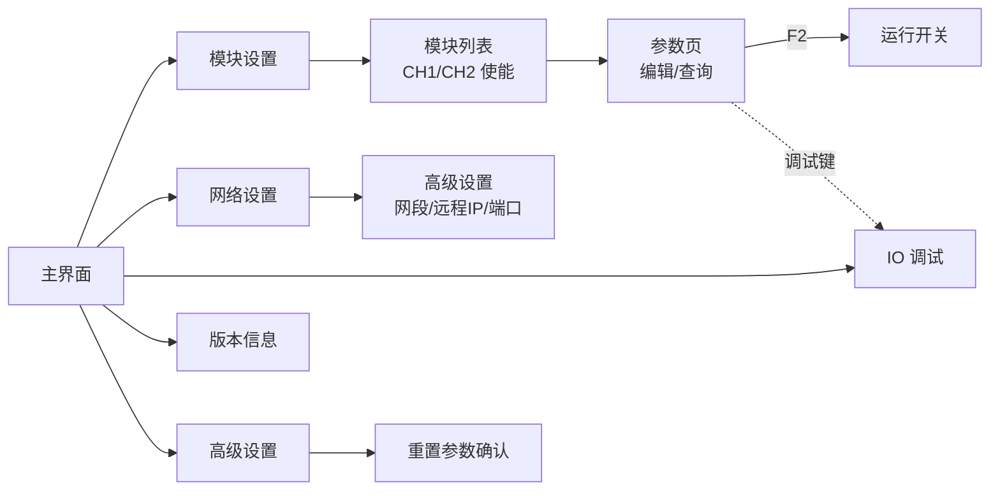

---
领域:
  - 工作
类型:
  - 文档
项目:
  - "[[分拣操作面板]]"
相关任务:
状态: 进行
创建时间: 2026-11-27T15:30:00
完成时间:
---

# 分拣调试面板 操作说明书

> **适用版本**：面板固件 `v1.0.0`（2026-11-27）｜控制器 `v1.0.0`｜协议库 `v1.0.0`
> **适用对象**：分拣线现场调试、参数配置、故障排查人员
> **一句话**：这块 240×160 单色屏是分拣控制器的人机界面，负责改模块参数、配网络、点动 IO、看重置与版本。

> [!info] 界面来源
> 文中所有截图都取自固件真实页面：GUI 模拟器按固件页面 1:1 渲染（同字库、同布局、同按键路径），不是手绘示意图。截图里的参数值来自示例 `UI.JSON`（15 个模块 / 245 个参数），现场以实际控制器数据为准；控制器版本一栏显示 `SIM` 表示当前是模拟器桩。

---

## 目录

- [[#1 三分钟上手]]
- [[#2 按键说明]]
- [[#3 主界面]]
- [[#4 模块设置]]
- [[#5 网络设置]]
- [[#6 IO 调试]]
- [[#7 版本信息]]
- [[#8 高级设置]]
- [[#9 提示语与弹窗对照]]
- [[#10 常见问题]]
- [[#11 维护与版本]]

## 界面地图

---

## 1 三分钟上手

1. **上电**，屏幕显示主界面，右上角「在线」表示与控制器通信正常。
2. 用 **↑ ↓** 选择五项菜单：模块设置 / 网络设置 / IO调试 / 版本信息 / 高级设置。
3. **OK** 进入，**Esc** 或 **Cancel** 返回上一层。
4. 改参数：进「模块设置」→ 选模块 → **F1** 编辑 → 数字键输入 → **OK** 提交（立即下发）。
5. 查参数含义：停在参数行按 **查询** 键。
6. 点动输出：进「IO调试」→ 右上开关按 **OK** 确认进入调试 → 「输出」页签选口号按 **OK**，触发出力 2 秒后自动关闭。

> [!warning] 两条不可逆动作
> - 进入 **调试** 会立即停止控制器所有输出（确认框「进入调试将停止所有输出」）。
> - 按 **Pause** 键会立刻重启面板，没有二次确认。

---

## 2 按键说明

面板是 5 行 × 6 列矩阵键盘（30 键）。本文用到的键如下：

| 键 | 名称 | 作用 |
|---|---|---|
| ↑ ↓ | 上 / 下 | 列表内移动焦点；弹窗时切换选中的弹窗 |
| ← → | 左 / 右 | 模块页、调试页切通道/页签；编辑态下 ← 为退格 |
| **OK** | 确认 | 进入页面、打开选中项、弹窗选 OK |
| **Cancel** | 取消 | 关闭弹窗、取消编辑、返回上一页 |
| **Esc** | 返回 | 与 Cancel 等效（返回上一层） |
| **F1** | 功能键 1 | 模块列表：切换 CH1 使能；模块页：编辑当前参数；网络页：进入编辑 |
| **F2** | 功能键 2 | 模块列表：切换 CH2 使能；模块页：打开「运行开关」页 |
| **F3** | 功能键 3 | 模块列表：重新读取使能；模块页：重新读取参数；调试页：刷新 |
| **查询** | Query | 模块页：显示当前参数名 + 说明（常驻弹窗） |
| **调试** | Debug | 模块页：跳到 IO 调试页，再按一次返回 |
| 0–9 | 数字键 | 参数编辑时输入数字 |

> [!note] 其余键
> 照明、Login、Product、Call、AutoOut、QCFail、QCPass 这些键当前**不参与界面操作**，按了没有反应，属预留/产线功能键。Pause 为复位键。

---

## 3 主界面

![[01-home.png|380]]

标题栏左侧固定为「调试工具」，右侧是通信状态：**在线** / **离线**。下方是固定五项菜单：

| 菜单 | 进入后能做什么 |
|---|---|
| **模块设置** | 看模块列表、改参数、切通道、开关运行 |
| **网络设置** | 改本地 IP、网段、远程 IP 与端口 |
| **IO调试** | 看输入点、点动输出、看读卡器卡号 |
| **版本信息** | 看版本/在线/JSON/模块数/运行时间，手动检查 JSON |
| **高级设置** | 重置控制器参数 |

![[02-menu-focus.png|380]]

> [!tip] 焦点怎么认
> 被选中的行整行反白（白底黑字）。列表到底后焦点停住、不循环，按住方向键只会停在最后一行。

---

## 4 模块设置

### 4.1 模块列表

![[03-module-list.png|380]]

每行是「模块名 + CH1 使能圈 + CH2 使能圈」：

- 圈里实心（●）＝该通道已使能；空心（○）＝未使能。
- 圈只反映控制器回报的状态，不随按键立刻变化，写完会重新读取。

![[04-module-list-enabled.png|380]]

| 操作 | 效果 |
|---|---|
| ↑ ↓ | 选择模块 |
| **OK** | 进入该模块的参数页 |
| **F1** | 切换当前模块 **CH1** 使能 |
| **F2** | 切换当前模块 **CH2** 使能 |
| **F3** | 重新读取整张使能表 |
| **Esc** | 返回主界面 |

> [!note] 单通道模块
> 有些模块只有一个通道，CH2 位置显示 `1`、没有圆圈，按 F2 无效果。

### 4.2 模块参数页

![[05-module-page.png|380]]

- 标题是模块名；下方是「通道1 / 通道2」页签。
- 每行左边是参数名，右边是当前值；焦点行**只反白名称区**，值保持黑底白字，方便看清数字。
- 按 **← →** 在通道间切换，每个通道各自记住上次停在哪一行。

![[06-module-ch2.png|380]]

### 4.3 修改参数

![[08-edit.png|380]]

1. 焦点停在要改的行，按 **F1**：值被清空，右侧出现闪烁光标。
2. 数字键输入新值（只允许数字）。
3. **OK** 提交：面板把**整个模块**当前所有参数打包下发，成功后行值更新；失败则回滚为原值并提示原因。
4. **Esc** 取消：不改任何值，退出编辑。

> [!warning] 提交的是整模块
> 面板每次提交都会把该模块全部参数一起写下去，所以不会出现「改了一个、其它被清空」的情况；但同一模块两人同时改，后提交的会覆盖先提交的。

### 4.4 查询参数说明

![[07-query.png|380]]

参数行上按 **查询** 键，弹出常驻窗口：第一行参数名，下面是该参数的说明（来自 JSON 的 `remark`）。

- 再按 **Esc** 关闭。
- 该参数没有备注时，顶部只闪一条「无备注」提示，不弹窗。
- 编辑状态下查询键不弹窗，先按 Esc 退出编辑。

### 4.5 运行开关

模块页按 **F2** 进入，右上角显示当前模块与通道：

![[09-switch.png|380]]

- 「进站关闭 / 出站关闭」两行，值 `0` 正常、`1` 关闭（关闭该方向运行）。
- 修改：**F1** 进入编辑（值清空）→ 按 `0` 或 `1` → **OK** 提交，立即下发，顶部依次提示「下发中…」「已下发」。
- 只有带运行开关的模块才打得开，否则提示「模块无运行开关」。
- **Esc** 返回模块页。

---

## 5 网络设置

### 5.1 主菜单

![[10-network.png|380]]

两行：**本地 IP**（四段 a.b.c.d，直接显示当前值）和 **高级设置**。

### 5.2 修改本地 IP

![[11-network-edit.png|380]]

1. 按 **OK** 或 **F1** 进入编辑；值不清空，光标在末尾。
2. **←** 退格删除，数字键输入。编辑态下 **F1** 输入 `,`、**F2** 输入 `;`、**F3** 输入 `.`（IP 点就用 F3）。
3. **OK** 提交 → 弹出确认框，显示「旧值 → 新值」。

![[12-network-confirm.png|380]]

4. **OK** 确认下发，**Cancel/NO** 放弃。下发成功后提示需要重启控制器才生效。

> [!note] 四段 IP 的规则
> 本地 IP 前两段等于网段（固定 176.176 一类），只有后两段可改；改网段会同时影响本地与远程 IP 的前两段。

### 5.3 高级设置（网络）

![[13-network-advanced.png|380]]

四行：**网段**、**远程 IP**、**本地端口**、**远程端口**。

| 项 | 说明 |
|---|---|
| 网段 | IP 前两段，改这里等于改整段地址空间 |
| 远程 IP | 控制器的对端地址，后两段可改 |
| 本地端口 | 只允许 `8090` / `7090`，其它值会被控制器回退 |
| 远程端口 | 只允许 `8089` / `7089` |

每行同样走「编辑 → 提交 → 旧值→新值确认」。

---

## 6 IO 调试

### 6.1 调试开关

![[14-debug-input.png|380]]

右上角显示调试状态：**离线** / **未启用** / **调试中**。

![[15-debug-switch-confirm.png|380]]

- 未启用时按 **OK**：弹出「进入调试将停止所有输出 继续?」，选 OK 才进入。
- 调试中再按 **OK**：**直接退出**，不弹确认。
- 离开调试页不会改变调试状态；断链时控制器保持调试，面板恢复后约 1 秒内自动同步回「调试中」。

### 6.2 输入

![[14-debug-input.png|380]]

X01～X18 共 18 个输入点，按 4 行 × 4 点排布，每点后面跟状态：

| 符号 | 含义 |
|---|---|
| ● | 有信号 |
| ○ | 无信号 |
| ? | 未知（未进入调试，或还没收到控制器快照） |

输入由控制器在**变化时主动推送**，面板不轮询，所以点一下光电会立即刷新。

### 6.3 输出

![[16-debug-output.png|380]]

输出分 4 个组标题（不可选）+ 25 个合法输出口：

`Y01~Y06`、`Y11~Y16`、`L0G~L0A`、`L1G~L1A`、`Z01~Z05`

- 选中输出口按 **OK** 点动，控制器**2 秒后自动关闭**。
- 行尾亮 ● 表示本地点动中；再按 OK 可提前关闭。
- 组标题行按 OK 无反应。

### 6.4 读卡

![[17-debug-reader.png|380]]

P1～P6 六个读卡口，右侧显示最近读到的卡号；`-` 表示暂无数据。卡号同样是控制器主动推送，只在刷卡变化时刷新。

---

## 7 版本信息

![[18-version.png|380]]

九行只读信息：

| 行 | 含义 |
|---|---|
| 面板版本 | 面板固件版本 |
| 控制器版本 | 控制器回报的版本号；`SIM` 表示模拟器 |
| 工作模式 | 调试 / 运行 / 离线 |
| 连接状态 | 在线 / 离线 |
| JSON | 当前界面配置长度与 CRC（如 `34095B 00000000`） |
| 模块/参数 | 模块数与参数总数（如 `15/245`） |
| JSON缓存 | 命中 / 已更新 / 不可用 / 未用 |
| 上次错误 | 最近一次失败原因，无则 `-` |
| 运行时间 | 面板已运行时长 |

![[19-version-json.png|380]]

只有 **JSON** 行可操作：按 **OK** 弹「检查并更新 JSON?」，确认后重新向控制器拉取界面配置，过程显示进度；成功提示「JSON已更新」，超时提示「更新超时」，控制器不在线时提示「控制器离线」。

> [!tip] 什么时候用
> 控制器换了模块表、改了参数定义，面板显示的还是老菜单时，用这一行重新拉取。

---

## 8 高级设置

![[20-advanced.png|380]]

只有一行：**重置控制器参数**。

![[21-advanced-confirm.png|380]]

- **OK** 或 **F1** → 确认框「重置控制器参数？将恢复默认参数」。
- 选 OK：控制器把所有模块参数恢复默认并落盘，成功后顶部提示「参数已重置」。

![[22-reset-toast.png|380]]

- 选 NO / Esc：什么都不发生。
- 面板**不会**改本地缓存的值，重置后回「模块设置」按 **F3** 重新读取即可看到默认值。

> [!warning] 重置范围
> 除**系统参数**（模块 0 的 IP、端口等网络配置）与**使能表**外，其余模块参数全部回默认值。这是全站级操作，动手前确认产线停产。

---

## 9 提示语与弹窗对照

| 提示 | 出现场景 | 处理 |
|---|---|---|
| 在线 / 离线 | 标题栏 | 离线查串口、电源、协议版本 |
| 未启用 / 调试中 | 调试页右上 | 决定是否可点动输出 |
| 无备注 | 模块页按查询、该参数无 remark | 正常，说明 JSON 没写备注 |
| 进入调试将停止所有输出 继续? | 进入调试 | OK 进入、NO 返回 |
| 检查并更新 JSON? | 版本页 JSON 行 | 模块表变化后使用 |
| 重置控制器参数？将恢复默认参数 | 高级设置 | 全站参数重置，谨慎 |
| 参数已重置 | 重置成功 | 回模块页 F3 重读 |
| 控制器离线 | 网络/版本/重置等需要通信的操作 | 先恢复通信 |
| 更新超时 / JSON已更新 | JSON 拉取 | 失败重试或查链路 |

---

## 10 常见问题

**Q1：主页右上角一直「离线」。**
检查串口接线与波特率；确认控制器与面板协议同版本（两端 `panel_cmd.h` 必须一致，升级要双端同版）。

**Q2：参数改了，但分拣设备动作没变。**
参数已下发到控制器，但部分网络类参数需要**重启控制器**才生效；确认改的是当前通道（CH1/CH2）。

**Q3：改参数按 OK 报错、值变回去了。**
控制器拒绝或超时，面板会回滚。看顶部提示的原因；确认模块在线、参数在允许范围内。

**Q4：查询键没弹窗，只闪「无备注」。**
该参数在 JSON 里没写 `remark`，属数据问题，不是面板故障。

**Q5：进了调试，所有输出都不动了。**
这是设计行为：进入调试即停止全部输出，防止误动作。退出调试后恢复。

**Q6：读卡页一直是「-」。**
没刷卡，或控制器没推送（控制器侧读卡解析不在本次范围内）；先刷卡再看。

**Q7：模块列表的 CH 圈和实际不一致。**
按 **F3** 重新读取；圈只反映控制器回报，不跟随按钮即时变化。

---

## 11 维护与版本

**界面来源**：截图由 `02_Middleware/GUI` 的 Win32 模拟器真实渲染采集（`scripts/walkthrough_sim.ps1` 同款方法：启动 `gui_lcd_test.exe --json`，注入按键，PrintWindow 抓客户区）。

**更新流程**：
1. 固件页面或协议有变更 → 重新跑一遍截图；
2. 对照页面源码更新本文对应章节的文字与截图；
3. 在下面表格记一行版本。

| 版本 | 日期 | 变更 |
|---|---|---|
| v1.0 | 2026-11-27 | 首版：主页/模块/网络/调试/版本/高级设置全流程，22 张实拍界面 |

> [!info] 与规划文档的关系
> 本说明书是**给现场人看的操作口径**；需求、任务与验收记录在「分拣操作面板」规划文档里，两处不重复维护。
