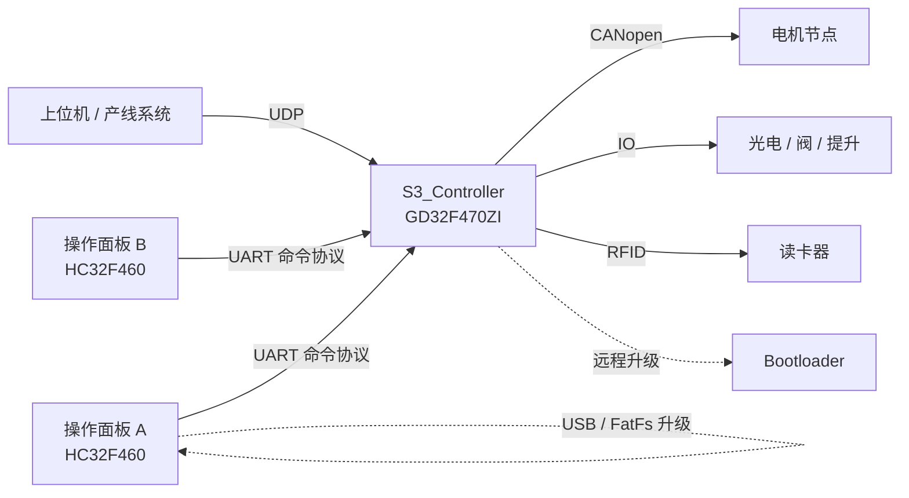

---
领域:
  - 工作
类型:
  - 文档
项目:
  - "[[吊挂操作面板]]"
任务:
  - "[[261030吊挂操作面板维护]]"
相关任务:
状态: 已归档
创建时间: 2026-11-20T14:25:00
截止时间: 2027-07-30T14:05:00
完成时间:
---

# 261030吊挂操作面板维护 · 归档

> 本文件是 [[261030吊挂操作面板维护]] 的**项目级归档文档**：只收已交付 / 取消需求的压缩摘要与历史快照，append-only，不再改动既有段落。
> 现行计划、契约、任务以总规划为准；本文件不承担"下一步做什么"。

## R1 换绑优化（2026-11-16 交付）

- **需求**：面板换绑优化——心跳字段门控 + `0x0112` 透传允许 + QCPass 判断；需求笔记 [[261030面板换绑功能优化]]。
- **任务**：T1-1..T1-9 全部完成（T1-4 按用户 2026-11-16 确认归档）。
- **行为**：心跳字段门控换绑生效；QCPass 与手拍一致；面板按 `0xAA` 开 / `0x55` 关收发 `0x112`。
- **验证**：Keil 0 error + 真机矩阵（允许 / 拒绝 / 掉电 / 短帧 / QCPass / 控制器链路）。
- **提交**：`26f708f` / `d88fa5d` / `7249ee0` / `9957cf7` / `433441d` / `e82dcaa`。
- **T1-9（← C8，2026-11-17）**：`MAIN.C` 删除 `rebindAck` 读取与 62 弹窗，仅在 `U_SyncTime` 后清 `PackSign[U_ReBind]`；`MenuParam.h` 删除 `TReBindDenied`；`LangMenu.c` 删除 15 张有文案语言表第 62 条（葡语表为空）。行为：任意 `0x112` 回复只清等待，无回复 `TNoAck`，开关仍由心跳同步。验证：Keil 0 error / 24 warnings（均未改动文件）+ 人工 `00/01/任意/无回复`。

## R3 人体感应 / 照明输出分离（2026-11-15 交付）

- **需求**：照明与输出双通道、手动优先、登录释放、byte39 门控；控制器侧定制。
- **任务**：T3-1 / T3-2 / T3-4 完成，T3-3 取消。
- **行为**：照明 / 输出双通道手动优先；未配人体感应时走原有行为；登录 / 退出灯门控生效。
- **验证**：Keil 0 error + 真机矩阵（byte39 门控、双通道、手动优先、换登录释放、登录 / 退出灯门控）。
- **提交**：`7b5e3d5` / `41c4805` / `17ae6a3` / `7db5535` / `79d4ac3` / `83bf75b`。
- **控制器现状**：门控判据落在 `BsEnable`（原记录 byte39 门控的同义实现）。

## R4 报废件数 + 透传翻页（2026-11-18 交付；翻页由 C13 下线）

- **需求**：报废页输入 1–99 件 + 二次确认 + `0x0106/func 0x04`；透传区 5 行视口 + Up/Down 翻页（R5 并入后取消）。

### 任务

| 任务 | 状态 | 结果 | 提交 |
|---|---|---|---|
| T4-1 报废页件数输入、二次确认与 0x04 发送 | 完成 | 件数无默认值 1–99；0 / 空 / 超界不可确认；确认框显示件数；确认发 13 字节 0x04；ESC 可回退 | `80db7ce` |
| T4-2 0x04 的 0x82 / 超时结果联动 | 完成 | 0x82（分支条件 `>=0x81`）清状态回主页；超时回件数页并 `TNoAck`；件数默认 0 / 右对齐 / 无效清空 | `c963ef3` / `8087b79` |
| T4-3 上位机 0x04 联调与真机验收 | 完成 | 0x106/0x04 13 字节、0x82 回包；人工抓包与实机确认（C12 关闭） | `c963ef3` / `8087b79` |
| T4-4 报废页 5 行显示与长语言缓冲 | 完成 | 固定 5 行 y=42/63/84/105/126；接受 `qtyLine[40]` 与长行换行 / 覆盖风险 | `34fa22b` / `c963ef3` |
| T4-5 报废页 Up/Down 翻页与页请求 | 完成 | 页请求 state 1、页响应留页；接受输入 / 等待门控风险 | `34fa22b` / `c963ef3` |
| T4-6 报废翻页上位机联调与真机验收 | 完成 | 页 1/2 返回 5 行、Up/Down 正确；用户实机确认 | `c963ef3` / `8087b79` |
| T4-7 报废确认框长语言缓冲区修复 | 取消 | 并入 T4-4（C10 / C12）；长语言缓冲风险接受 | — |
| T4-8 0x0106 / 0x1004 回包分类与等待互斥 | 完成 | 页响应仅 state 1 置 `1\|0x80`；0x82 仅 state 2 结束 0x04 等待 | `c963ef3` / `8087b79` |

### 协议与状态机

- **`0x0106`**：`func 0x00` 查询（10 字节 ASCII 卡号）→ 应答进报废页（E10 起进页前不再发）；`func 0x03` 旧执行保留；`func 0x04` payload 13 字节 = 10 字节 ASCII 卡号 + `,` + 2 字节 ASCII 件数（`01`–`99`，`00` 非法），示例卡号 `0000123456`、3 件 → `30 30 30 30 31 32 33 34 35 36 2C 30 33`。
- **结果**：0x04 不等 `0x0106` ACK，只等 0x82（`0x1002` 消息）或 `IsWaitSign` 超时；0x82 不是 `0x0106` 回复。
- **状态位**：`OpStaOrCnt` 低 7 位 0=浏览 / 输入、1=翻页等待、2=0x04 等待；`0x80`=收到回复。页响应只在 state 1 置 `1|0x80` 并留页；0x82 只在 state 2 置 `2|0x80` 后回主页，state 1 只提示。
- **已知风险（C11 接受）**：state 2 的迟到页响应只清 `PackSign`，但 `CmdProtocol` 仍会清 `IsWaitSign`，导致 0x82 迟迟不到时无超时；`>=0x81` 分支会收 0x81 / 0x83。
- **翻页（现由 C13 下线）**：Up=`func 0x02`、Down=`func 0x01`，请求 1 字节 `u8PS`；仅 `OpStaOrCnt==0`、非确认、非件数输入时发，发送后 `OpStaOrCnt=1`；页响应走 `0x1004` / 对象 `0x0106`；每页固定 5 行，首 / 尾页不特殊少发。

### 决策

| D | 决策 | 结论 |
|---|---|---|
| D7 | 报废件数协议 | 保留 `func 0x03`；新增 `func 0x04`（13 字节卡号 + 件数）；0x04 不等 `0x0106` ACK，只等 0x82 / 超时 |
| D8 | 报废页翻页约定 | 固定 5 行；Up `0x02` / Down `0x01`；请求 1 字节 `u8PS`；仅浏览态且非执行等待时发；不解析回包结果 |
| D9 | 透传等待分类 | 原计划 WaitKind 分类未落地；实际按 `OpStaOrCnt` + `IsWaitSign`：0x04 由 0x82 / 超时结束，页等待由 state 1 + 页响应 / 超时结束 |

### 变更时间线（C4–C13）

- **C4（2026-11-16，新增，R4）**：报废页件数输入（1–99，无默认值，0 非法）+ 二次确认；新增 `0x0106/func 0x04` 携 13 字节卡号 + 件数。
- **C5（2026-11-16，新增，R5）**：透传区固定 5 行；Up/Down 翻页 `func 0x02/0x01`，1 字节当前页；首 / 尾页不特殊少发。
- **C6（2026-11-16，修改，R4）**：R5 并入 R4，原 T5-1/T5-2/T5-3 取消，改 T4-4/T4-5/T4-6。
- **C7（2026-11-16，修改，R4）**：T4-2 收到 ACK 后不回主页，停留报废页（`OpStaOrCnt=2` 结果态）。
- **C9（2026-11-17，修改，R4）**：0x04 不等 `0x0106`，只等 0x82 或超时；状态 0/1/2 + `0x80` 回复位；0x82 仅 state 2 置位；拆分 `M_Discard` 的 0x1002 分支。
- **C10（2026-11-17，修改，R4）**：T4-4 合并 T4-7；透传区按 `dispPoint.CurrentY + MultiLine` 连续绘制，最多 5 个可见行。
- **C11（2026-11-17，修改，R4）**：以代码为准——0x04 成功由 0x82 清状态回主页、不做结果页；超时回件数页；页响应 state 1 留页；WaitKind / D9 未落地。
- **C12（2026-11-17，修改，R4）**：关闭 T4-3/T4-4/T4-5——0x04 手动联调通过；接受固定 5 行与 `qtyLine[40]` 风险；接受页请求 / 输入中翻页风险；不再做布局与门控改造。
- **C13（2026-11-18，修改，R4）**：见下方「C13 现状」。

### C13 现状（E10 `8bb846e`）

- `key.c`：`M_Discard` 的 Up/Down（`OK_Press=0x12/0x11`）整段注释，注释写「翻页功能先取消，后续可能恢复」。
- `MenuUI.c`：报废页翻页请求块（`OK_Press & 0x10` → `send_trans_command_start(0x85, 0x0106, funcCode, 1, req, 1)`）整段注释。
- `MenuUI.c` 入口：进入报废页不再发 `0x0106/func 0x00` 申请衣架，改为 `Discard_ClearState()` + 清 `TransUIBuff[U_Discard].PtLines` + `HangNo=0` + `InputMode=1` 直接进页；原代码块注释保留，注明后续可能恢复。
- 影响：报废页只显示进入时的 5 行，Up/Down 无动作；上位机暂不需要实现页请求；恢复需另立需求。

## R5 报废页透传翻页（2026-11-16 取消）

- **结果**：并入 R4（← C6）；原 T5-1/T5-2/T5-3 取消，改为 T4-4/T4-5/T4-6。

## 附录 A：环境与基线快照（2026-11-20）

> 总规划 §0 只记仓库路径 / 构建 / 测试；分支与提交随时间变化，快照留在这里备查。

- **工作区**：`D:\Screen\HangerOperatePanel`（根目录不是 git 仓库），含 4 个面板工程副本、`Doc/`（规格书 / 联络单 / 用户指南）、`固件/`（Boot 合并 hex、加密 bin 发布产物）。原记录路径 `D:\Screen\Projects\Operation_Panel` 已不存在。
- **面板主仓**：`Operation_Panel` @ `E1/硕达报废/develop` `8bb846e`（2026-11-18「暂时取消报废页面的翻页功能」）；此前 `8087b79`（版本号 E10）、`c963ef3`（T4-8/T4-2）、`34fa22b`（T4-4/T4-5）、`80db7ce`（T4-1）；发布分支 `release/V061` @ `7bd9a43`（领先 `develop` 2 个提交）；R1 分支 `feature/换绑优化` @ `e82dcaa`（origin 仍为 `31f4155`）。
- **同工作区副本**：`Operation_Panel_Boot` @ `master` `8503025`（dirty：`MDK/HC32F460KETA.uvprojx`）；`A11C052(V050+扫码枪)`（`CPVER` 为 C5x 系列，非 git）；`X048(047+非本位)`（`CPVER` 为 X48，非 git）。
- **控制器**：`S3_Controller` @ `develop` `aeef0ca`（干净）；定制分支 `人体感应定制/develop` @ `1a82c99`（T3-2 `41c4805`、登录 / 退出灯门控 `17ae6a3`）、`feature/人体存在` @ `83bf75b`、`feature/换绑优化` @ `84d5822`（T1-6）。
- **构建产物**：面板 2026-11-18 14:31 `Operation_Panel/MDK/output/debug/HC32F460KETA.hex`，`HC32F460KETA_Debug` 0 Error / 13 Warning（均既有 warning，日志 `HC32F460KETA.build_log.htm`）；发布合并件 `固件/Boot+E10.hex`（2026-11-18 14:16）；控制器 `DGController_3` 上次 0 error / 0 warning（2026-11-13，未重跑）。
- **控制器侧仓库**：`S3_Bootloader`、`S3_Controller_HardwareTest`、`S3_MDK`、`RTT`（均在 `D:\S3\Project\`，未侦察）；上位机模拟器 `D:\S3\pc_sim\udp_sim.py`（Typer + Rich TUI，T1-9 联调已增强 25B 心跳、`Data[24]` 换绑标识、`0x112` 自动回复、`noack`、`--stat/--rebind/--rebind-ack/--hb-log`）。
- **未解析 / 未找到**：面板 `版本说明1.xlsx`、控制器 `UpdateHistory.txt`（加密 / 二进制）；两仓库无 `README.md` / `AGENTS.md` / `docs/`（仅第三方库自带 README）。
- **vault 规范**：`C:\Users\SiaZh\OneDrive\SIA的obsidian系统\规范.md`。

### 系统拓扑（面板视角）

- 控制器 `main.h` 中 `sNUM = 2`，对应 A / B 两个站各一块面板；面板 UI 文案由 `LangMenu.c` 的 16 组语言表驱动，菜单入口见 `MenuUI.h` 的 `M_*`。
- 控制器侧流程与通讯细节见 [[261029S3维护]]。
