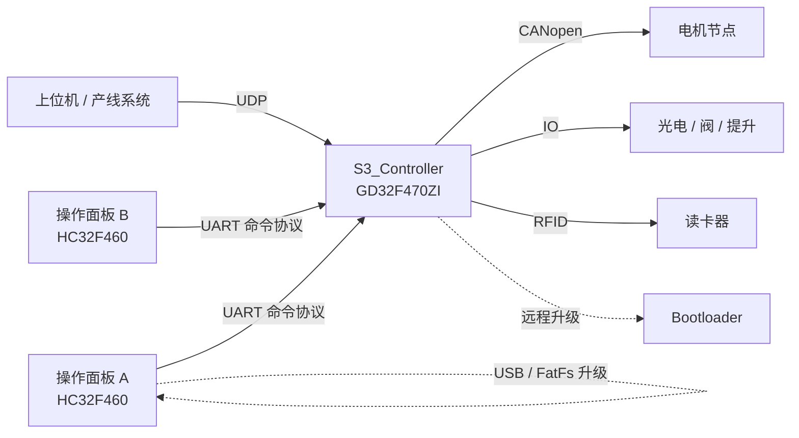

---
领域:
  - 工作
类型:
  - 开发
项目:
  - "[[吊挂操作面板]]"
任务:
  - "[[261030吊挂操作面板维护]]"
相关任务:
  - "[[261029S3维护]]"
状态: 进行
创建时间: 2026-10-30T14:06:05
截止时间: 2027-07-30T14:05:00
完成时间:
---
<!-- plan-doc:v1 -->

# 261030吊挂操作面板维护

> **一句话**：吊挂操作面板（HC32F460）固件维护规划；S3 控制器作为配套依赖，见 [[261029S3维护]]。
> **仓库**：`D:\Screen\Projects\Operation_Panel`（主）｜`D:\S3\Project\S3_Controller`（配套）
> **规则**：改需求先记 C；一功能一机制；执行一次只做一条。

## 0. 看板

- **阶段**：R1 换绑已交付；R3 人体感应/照明输出已交付；R4 报废件数与透传翻页进行中（T4-1 代码完成；T4-2 阻塞：超时/0x82/迟到页响应，ACK 停留按 C7；T4-4/T4-5 审阅阻塞）；R5 已并入 R4；R2 读卡器版本待做
- **下一条**：T4-2（P0；先定 ACK/超时结果态与 0x82，T4-5 前置）
- **本次范围**：R4（T4-1..T4-7；T4-1 完成，T4-2/T4-4/T4-5/T4-7 待修）；R5 取消并入 R4；R2 保持待做，R1/R3 已收口
- **事实源**：代码 / 测试 > 仓库 README、AGENTS（两仓库均未找到）> 本文
- **最后更新**：2026-11-16｜**活跃变更**：C3, C4, C6, C7｜**冻结**：—｜**血缘**：—（本文件即规划文档，无前身 / 后继）

### 需求登记

<!-- 需求统一走 /splan-req；R1 / R2 / R3 / R4 / R5 已登记。已完成需求只留摘要，明细见 §6。 -->

| R | 需求 | 来源 | 状态 | 覆盖任务 | 文档 |
|---|---|---|---|---|---|
| R1 | 面板换绑优化：心跳字段门控 + 0x0112 透传允许 + QCPass 判断 | 需求笔记 | 交付 | T1-1..T1-8（完成） | [[261030面板换绑功能优化]] |
| R2 | 面板读取读卡器版本号：About 页经 `0x149` 查询进站读卡器版本并显示；上位机后续复用 | 现场问题 | 待做 | T2-1, T2-2 | — |
| R3 | 人体感应/照明输出分离：双通道手动优先、登录释放、byte39 门控 | 定制需求 | 交付 | T3-1/T3-2/T3-4（T3-3 取消） | — |
| R4 | 报废件数 + 透传翻页：输入 1–99 件、二次确认、固定 5 行/页、Up/Down 翻页 | 现场需求 | 进行 | T4-1..T4-7 | — |
| R5 | 报废页透传翻页（并入 R4） | 现场需求 | 取消 | T5-1..T5-3（取消）→ T4-4..T4-6 | — |

### 任务总览

| 任务 | 状态 | 出口条件 |
|---|---|---|
| T4-1 报废页件数输入、二次确认与 0x04 发送 | done | 件数无默认值，1–99；0/空/超界不可确认；二次确认显示件数；确认后发 13 字节 0x04；ESC 可回退；代码完成，联调待 T4-3；审阅发现缅甸语确认框缓冲区溢出，T4-7 跟踪 |
| T4-2 0x0106 ACK/超时状态与弹窗联动 | blocked | ACK 后停留报废页（C7，不回主页）；超时同样置 2，是否只读/可重试待定；0x82 语义与 §3.3 冲突；迟到页响应待隔离 |
| T4-4 报废页透传区固定 5 行 | doing | 坐标已实现；审阅阻塞：透传行用 `MultiLine` 会换行，不能保证固定 5 行；人工未上机 |
| T4-5 报废页 Up/Down 翻页与 0x0106 页请求 | blocked | 页请求未检查传送等待、未区分件数输入；0x0106 页响应可误判执行 ACK；待 T4-2/T4-4 |
| T4-6 报废翻页上位机联调与真机验收 | todo | 首/尾页固定 5 行；Up/Down 正确；不影响件数确认/执行 |
| T4-7 报废确认框长语言缓冲区修复 | todo | 缅甸语 `DiscardTb[1]` 52 字节；`qtyLine` 40 字节溢出；扩至 ≥64 或拆分绘制 |
| T4-3 上位机 0x04 联调与真机验收 | todo | 上位机按件数报废；1/99/0/取消/超时矩阵通过；无回归 |
| T2-1 控制器读卡器版本查询与 0x149 回包 | todo | 进站读卡器 `10 A0 01` 查询、`10 A1 01` 解析、500ms 超时、0x149 回包 |
| T2-2 面板 About 页读卡器版本查询与显示 | todo | About 页显示实际版本；离线显示 `--`；不回归 CP / 控制器版本 |

> R1 / R3 全部任务已归档，摘要见 §6；R4 见 §1；R5 已并入 R4。

### 机制登记

| 机制                                | 位置                                                                    | 用途                                                   | 扩展方式                                            | 使用者     |
| --------------------------------- | --------------------------------------------------------------------- | ---------------------------------------------------- | ----------------------------------------------- | ------- |
| 命令协议 CmdProtocol                  | `Operation_Panel/midware/CmdProtocol.c/.h`                            | 面板与控制器 UART 命令封装：BCC 校验、129 字节分包、450ms 超时重发（最多 2 次）  | 在 `send_command*` / `CMD_Rev` 上扩命令号与参数，不复制收发流程  | 面板全部业务  |
| 菜单状态机 MenuUI                      | `Operation_Panel/midware/MenuUI.c/.h`                                 | 页面切换与绘制（`M_Home` / `M_Login` / `M_Debug` 等），每页 7 行   | 增 `M_*` 常量与处理函数，沿用 `current_menu_index`         | 面板 UI   |
| 多语言 LangMenu                      | `Operation_Panel/midware/LangMenu.c`                                  | `MultiMenu[16]` 语言文案表                                | 各语言段补同索引条目                                      | 菜单与提示   |
| 按键 key                            | `Operation_Panel/midware/key.c`                                       | 按键扫描、消抖、长按                                           | 扩按键映射与事件                                        | 菜单      |
| 读卡 rfidio                         | `Operation_Panel/midware/rfidio.c`                                    | 刷卡 ID 采集与状态                                          | 扩读卡状态机与接口                                       | 登录、出入站  |
| 参数存储 ziflash / interflash / flash | `Operation_Panel/midware/ziflash.c`、`interflash.c`、`flash.c`          | 内部 / 外部 Flash 参数与升级参数存取                              | 扩参数结构与读写函数                                      | 系统参数、升级 |
| 面板远程升级 RemoteUpdate               | `Operation_Panel/midware/RemoteUpdate.c`                              | 接收升级参数与固件包，写 Boot 参数并跳转                              | 扩升级包协议字段                                        | 升级      |
| USB / FatFs                       | `Operation_Panel/midware/USB/`、`midware/fatfs/`                       | USB Host MSC + FatFs，U 盘升级与文件操作                      | 扩文件操作，不改协议                                      | 升级、数据   |
| 显示 Dispaly / LCD                  | `Operation_Panel/midware/Dispaly.c`、`lcd/lcd.c`、`fonts.c`             | 点阵字体与界面绘制                                            | 扩绘制函数与字库                                        | 面板 UI   |
| 面板通信对端 Panel                      | `S3_Controller/APP/Panel.c`                                           | 面板命令解析、消息队列与提示文案（`MsgText`）                          | 扩命令表与 `MsgText`，仅作跨端约束                          | 面板通信    |
| 换绑状态同步                            | `Operation_Panel/source/MAIN.C`、`midware/MenuParam.c`、`midware/key.c` | `PCustomOCTb[4]` 与 0x1001 心跳 `ReBindEnable` 同步、允许后生效 | 复用 0x1001 解析与 `send_trans_command_start`，不新增协议栈 | R1      |

> 控制器侧机制（`Panel` / `UDP_Comu` / `BusinessLogic` / `MotionUnit` / `Sensor` / `LineControl` / `FaultDetect` / `HorizWareHouse` / `RFIDReader` / `RemoteUpdate`）统一登记在 [[261029S3维护]] §0；本文件不重复。跨端任务引用时写「机制：复用控制器 X（见 S3 文档）」。

### 基线

- **仓库 / 分支 / 提交**：
  - `Operation_Panel` 当前检出：`E1/硕达报废/develop` @ `80db7ce`（T4-1/T4-2 基线；T4-4/T4-5 未提交改动，工作区 dirty）；R3 分支 `feature/人体存在` @ `7115440`（含 T3-1 `7b5e3d5`、T3-4 `7db5535`），定制分支 `E0/人体存在/develop` @ `867d157`
  - `Operation_Panel` 最新发布分支：`release/V061` @ `7bd9a43`（领先 `develop` 2 个提交）
  - R1 实现分支：`feature/换绑优化` @ `31f4155`（T1-2/T1-5/T1-8/T1-7 已提交）
  - `S3_Controller`（配套）当前检出：`人体感应定制/develop` @ `1a82c99`（含 T3-2 `41c4805`、登录/退出灯门控 `17ae6a3` 及后续定制提交；工作区干净）；`develop` @ `aeef0ca`；`feature/人体存在` @ `83bf75b`；`feature/换绑优化` @ `84d5822`（T1-6）
  - `git status --short`：面板仅 `midware/MenuUI.c`、`midware/key.c` 2 个任务文件改动（T4-4/T4-5）；控制器干净
- **构建命令**：
  - 面板：Keil MDK `MDK/HC32F460KETA.uvprojx`，Target `HC32F460KETA_Debug` → `MDK/output/debug/HC32F460KETA.hex`
  - 控制器：Keil MDK `MDK/network.uvprojx`，Target `DGController_3` → `MDK/Objects/app.hex`
- **测试**：未找到自动化测试与 CI；验证依赖 Keil 构建 0 error + 真机
- **版本标识**：面板 `develop` 为 `CPVER "060"` / `CPVERA "V-CP060260528 00:00:00"`，`release/V061` 为 `CPVER "R61"`（`MenuUI.h`）；控制器 `develop` / 任务分支为 `ControlVer "V3.0.07.0"`，当前检出 `人体感应定制/develop` 为 `V3.e.07.1`（`UDP_Comu.c`）
- **最近构建产物**：面板 2026-11-16（`MDK/output/debug/HC32F460KETA.axf`）；控制器 2026-11-13（`MDK/Objects/app.axf`）
- **构建现状**：面板 T3-1 构建 0 error，T3-4 以烧录固件隐含通过（未单独跑），T4-2 0 error / 12 warnings（均为 `MenuUI.c` 既有告警），T4-4/T4-5 0 error / 13 warnings（12 条 `MenuUI.c` + 1 条 `key.c:204`，均为既有）；控制器 T3-2 起 `DGController_3` 0 error / 0 warning（原 `SEGGER_RTT_Init` 基线单错消失）

## 1. 任务池

### P0（立即）

- [ ] **T4-2 0x0106 ACK/超时状态与弹窗联动** → 需求：R4（← C4, C7）；产出：`Operation_Panel/midware/MenuUI.c`、`source/MAIN.C`、`MenuParam.c/h`；前置：T4-1 完成；验证手段：正常 450ms 内收到 `0x0106` ACK 则清状态并停留报废页（C7，不回主页）；超时提示 `TNoAck`；`0x82` 弹窗仅额外显示；迟到 ACK 不误跳；Keil `HC32F460KETA_Debug` 0 error；机制：复用 CmdProtocol 透传 + `M_Discard` 状态机；边界：不解析 ACK 内容、不新增控制器协议、不改 `0x03`
- [ ] **T4-4 报废页透传区固定 5 行** → 需求：R4（← C6）；产出：`Operation_Panel/midware/MenuUI.c`；前置：T4-1 代码已实现；验证手段：标题 y=0、件数标签/值同一行 y=21、透传 5 行固定 y=42/63/84/105/126；空行不位移；Keil `HC32F460KETA_Debug` 0 error；机制：复用 MenuUI 绘制；边界：不改翻页/协议/状态
- [ ] **T4-5 报废页 Up/Down 翻页与 0x0106 页请求** → 需求：R4（← C6）；产出：`Operation_Panel/midware/MenuUI.c`、`key.c`、可能 `source/MAIN.C`；前置：T4-4、T4-2 完成；验证手段：Up 发 `0x0106/func 0x02` + `u8PS`，Down 发 `0x0106/func 0x01` + `u8PS`；仅浏览态/非等待；回包刷新 5 行；不误当执行 ACK；Keil `HC32F460KETA_Debug` 0 error；机制：复用 CmdProtocol 透传 + MenuUI 页状态（D8）；边界：不改 `0x03/0x04`、不改控制器、不修 M_SysMsg
- [ ] **T4-7 报废确认框长语言缓冲区修复** → 需求：R4（← C4）；产出：`Operation_Panel/midware/MenuUI.c`；前置：T4-1；验证手段：缅甸语 `DiscardTb[1]` 52 字节标签在确认框 `sprintf` 不越界；`qtyLine` ≥64 或拆分绘制；Keil `HC32F460KETA_Debug` 0 error；机制：复用 MenuUI 确认框；边界：不改文案/协议/布局
- [ ] **T2-1 控制器读卡器版本查询与 0x149 回包** → 需求：R2（← C3）；产出：`S3_Controller/APP/RFIDReader.c/h`、`Panel.c/h`；分支 `feature/T2-1-reader-version`（基于 `develop` `aeef0ca`）；验证手段：静态核对 `10 A0 01` 发送、`10 A1 01` 解析、500ms 超时、`0x149` 响应 `[sel,status,ver10]`；Keil `DGController_3` 0 error；机制：复用控制器 RFID 读卡（见 [[261029S3维护]]）+ 面板对象读（D6）；边界：只查该站进站读卡器；不改读卡器固件 / SR3 协议 / 面板 UI / 上位机 / 0x55 过滤

### P1 / P2

- [ ] **T2-2 面板 About 页读卡器版本查询与显示** → 需求：R2（← C3）；产出：`Operation_Panel/midware/MenuUI.c`、`MenuParam.c/h`、`source/MAIN.C`；前置：T2-1 完成；验证手段：About 页进入发 `0x0149`（sel=0）→ 显示 `RD0312`；读卡器离线 / 超时 → `--`；CP / 控制器版本不回归；Keil `HC32F460KETA_Debug` 0 error；机制：复用 CmdProtocol 对象读 + About 页（D6）；边界：不改换绑逻辑、不实现控制器查询、不改上位机
- [ ] **T4-3 上位机 0x04 联调与真机验收** → 需求：R4（← C4）；前置：T4-2 完成；验证手段：上位机解析 10 字节 ASCII 卡号 + `,` + 2 字节 ASCII 件数；1/99 件、0 件拒绝、取消不发送、超时、`0x82` 弹窗；控制器透传 13 字节；Keil 两工程 0 error；机制：复用现有 UDP 透传链路；边界：不改上位机其他命令、不改控制器代码
- [ ] **T4-6 报废翻页上位机联调与真机验收** → 需求：R4（← C6）；前置：T4-5 完成；验证手段：上位机回 `0x0106` 页数据，首/尾页固定 5 行不特殊少发；Up/Down 正确；翻页不影响件数确认/执行 ACK；若页请求需卡号则改 11 字节并记 C；Keil 两工程 0 error；机制：复用现有 UDP 透传；边界：不改其他页/命令

### 外部依赖与验收

- [ ] **V-2 读卡器版本真机验收** → 验收：面板 About 页显示实际 `RD0312`；拔掉 / 失联读卡器显示 `--`；刷卡与升级不受影响；上位机后续复用 `0x149` 缓存

> R1 / R3 已完成并归档，见 §6；不再保留逐任务记录。

## 2. 契约

- **架构**：本文件以面板（HC32F460KETA）为主；面板经 UART 命令协议连控制器（GD32F470ZI），控制器再经以太网 UDP 连上位机 / 其它控制器、经 CANopen 连电机节点；控制器细节见 [[261029S3维护]]
- **协议 / 数据格式**：
  - 面板协议：BCC 校验；单包上限 129 字节（`EVERY_PACK_MAX`），命令缓冲 5 包；重发 450ms、最多 2 次（`CmdProtocol.h`）
  - 控制器 UDP（边界）：结构体按 `#pragma pack(1)` 打包（`UDP_CMD.h`）；PC 心跳含 MAC、进站满、允许接收、链条启动、语言、屏蔽、返工模式
  - 版本：面板 `develop` 为 `CP060`、`release/V061` 为 `R61`；控制器 `develop` / 任务分支为 `V3.0.07.0`，当前检出 `人体感应定制/develop` 为 `V3.e.07.1`
  - 报废件数（R4）：沿用 `0x0106`；`func 0x00` 查询不变；`func 0x03` 旧执行保留；`func 0x04` 执行 payload 13 字节 = 10 字节 ASCII 卡号 + `,` + 2 字节 ASCII 件数（`01`–`99`，`00` 非法）；`0x0106` 应答只作通信 ACK，`0x82` 弹窗为额外提示
  - 报废页翻页（R4 扩展）：`0x0106`，`func 0x02` 上一页 / `func 0x01` 下一页；请求 1 字节当前页 `u8PS`（默认上位机缓存当前报废卡；若不缓存则改 10 字节卡号 + 页号，T4-6 确认）；上位机回 `0x1004` / 对象 `0x0106` 页数据；每页固定 5 行
- **读卡器版本对象（← C3，2026-11-02）**：新增 `OBJ_READER_VER 0x149`（`0x148` 为控制器版本，`0x150` 为防晃）；请求 1 字节 `reader_sel`（0=进站，1/2 预留下放/出站）；响应 `[reader_sel, status, ver10]`，status 0=OK / 1=超时或失联；控制器向进站读卡器发 `10 A0 01`，解析 `10 A1 01`，500ms 超时；面板 About 页显示，上位机后续复用同一缓存
- **已完成需求（R1 / R3）**：契约已冻结在代码；行为摘要见 §6，不再逐条展开

## 3. 设计要点

### 3.1 系统拓扑（面板视角）

- 控制器 `main.h` 中 `sNUM = 2`，对应 A / B 两个站各一块面板
- 面板 UI 文案由 `LangMenu.c` 的 16 组语言表驱动，菜单入口见 `MenuUI.h` 的 `M_*`
- 控制器侧流程与通讯细节不在本文展开，见 [[261029S3维护]]

### 3.2 面板读卡器版本查询（R2）

- **链路**：面板 About 页 → 控制器 `OBJ_READER_VER 0x149` → 该站进站读卡器 `10 A0 01` → `10 A1 01 "RD0312" MODE` → 控制器缓存 → 面板显示。
- **对象语义（← C3）**：请求 1 字节 `reader_sel`（0=进站；1/2 预留下放/出站）；响应 `[reader_sel, status, ver10]`，status 0=OK / 1=超时或失联；版本字符串 10 字节，不足补 0。
- **控制器**：`RFID_Recv` 增加 `10 A1 01` 10 字节响应解析，缓存到 `ReaderVer[sNUM][11]`；查询超时 500ms；`Panel_ReadData` 触发查询，`Panel_Send` 异步回 `0x149`。
- **面板**：About 页新增 `Reader:` 行（y=63）；进入页面发 `0x0149`（sel=0）；解析响应后显示 `RD0312`，超时 / 失联显示 `--`；CP / 控制器版本逻辑不变。
- **不做**：不改读卡器固件 / SR3 协议 / 上位机；暂不查下放 / 出站读卡器（selector 预留）；不改换绑逻辑。

### 3.3 报废件数（R4）

- **入口**：`M_Product` 选“2.报废产品” → `0x0106/func 0x00` 查询（10 字节 ASCII 卡号）→ 收到应答进 `M_Discard`。
- **件数页**：进入时件数为空，不预设 0/1；数字键输入 1–99；0、空、超界不可确认；查询时快照 `PStationInfoTb[4]`，卡号为 0 拒绝查询。
- **二次确认**：OK 后弹确认框并显示件数；ESC 取消回件数页；确认后发 `0x0106/func 0x04`。
- **payload**：13 字节 = 10 字节 ASCII 卡号 + `,` + 2 字节 ASCII 件数，例如卡号 `0000123456`、3 件：`30 30 30 30 31 32 33 34 35 36 2C 30 33`。
- **结果**：`0x0106` 应答只作通信 ACK，收到即清重发等待并停留报废页（`OpStaOrCnt=2` 结果态，C7，不回主页）；不解析应答内容。上位机 `0x82` 弹窗为额外提示，按现有逻辑显示、不等待、不补显；被其他全屏消息遮挡时接受丢失。超时显示 `TNoAck`；超时后只读还是可重试待定。
- **状态**：执行等待期间忽略重复 OK；ESC / 超时清 `PackSign[U_Discard]`、`OpStaOrCnt`；迟到 ACK 不得再次触发跳页；结果态需明确允许 ESC，若要求继续输入/翻页则不能停在 `OpStaOrCnt=2`。
- **文案**：`DiscardTb` 增加“报废件数:”和二次确认文案；简中 / 英先补，其余语种按现有 `DiscardTb` 语种同步。
- **不做**：不改 `func 0x03` 旧语义；不改控制器代码（透传 13 字节）；不解析上位机弹窗文本；不新增控制器侧机制。

### 3.4 报废页透传翻页（R4 扩展）

- **布局**：标题 y=0；件数标签/值同一行 y=21；透传区固定 5 行 y=42/63/84/105/126；空行保留位置，不上移。
- **翻页键**：Up=上一页，Down=下一页；只在浏览态（`InputMode=0`）、`DiscardConfirm=0`、`OpStaOrCnt=0` 时发；输入态/确认/等待不翻页。
- **指令**：上一页 `send_trans_command_start(0x85, 0x0106, 0x02, 1, req, 1)`；下一页 `func 0x01`；`req[0] = TransUIBuff[U_Discard].u8PS`。
- **回包**：上位机 `0x1004`、对象 `0x0106`；`Prase_Trans_Data` 更新 `u8PS` / `u8PTim` 和文本行；面板按固定 5 行重画。
- **首尾页**：每页固定 5 行，上位机不需要为第一页/最后一页少发；边界返回原页或空页由上位机决定。
- **状态**：翻页请求与执行 ACK 共用 `0x0106`；等待执行 ACK 时禁止翻页，发送 `0x04` 前清 `PackSign[U_Discard]`；迟到的页响应不得触发回主页。
- **不做**：不修 `M_SysMsg` 翻页；不改控制器；不改 `0x03/0x04`；不改上位机其他命令。

## 4. 决策与变更

> R1 / R3 的 D/C 明细已并入 §6 需求归档；这里只保留未落地需求。

### 决策（D）

| D | 决策 | 结论 | 任务 |
|---|---|---|---|
| D6 | 读卡器版本查询对象与范围 | 新对象 `0x149`（0x148 已占、0x150 为防晃）；请求 `reader_sel`，响应 `[sel,status,ver10]`；先只查进站读卡器，下放/出站预留；控制器按需查询 + 500ms 超时 | T2-1, T2-2 |
| D7 | 报废件数协议 | 保留 `func 0x03` 旧执行；新增 `func 0x04`，payload 13 字节 = 10 字节 ASCII 卡号 + `,` + 2 字节 ASCII 件数（`01`–`99`，`00` 非法）；`0x0106` 只作通信 ACK，结果弹窗 `0x82` 为额外提示 | T4-1, T4-2, T4-3 |
| D8 | 报废页翻页约定 | 固定 5 行；Up=上一页 `0x02`、Down=下一页 `0x01`；请求 1 字节 `u8PS`（默认上位机缓存当前报废卡）；仅浏览态且非执行等待时发；不解析回包结果 | T4-4, T4-5, T4-6 |

### 变更（C）

| C | 日期 | 类型 | 需求 | 内容 | 影响 | 处理 | 任务 |
|---|---|---|---|---|---|---|---|
| C3 | 2026-11-02 | 新增 | R2 | 新增面板读卡器版本查询：`0x149` 对象、进站读卡器 `10 A0 01` / `10 A1 01`、About 页显示；上位机暂不做 | 任务、契约、测试、文档、机制 | T2-1, T2-2 | T2-1, T2-2 |
| C4 | 2026-11-16 | 新增 | R4 | 报废页增加件数输入（1–99，无默认值，0 非法）与二次确认；新增 `0x0106/func 0x04` 携 13 字节卡号+件数；收到 ACK 回主页，`0x82` 弹窗额外提示 | 任务、契约、测试、文档、机制 | T4-1, T4-2, T4-3, T4-7 | T4-1, T4-2, T4-3, T4-7 |
| C5 | 2026-11-16 | 新增 | R5 | 报废页透传区固定 5 行；Up/Down 翻页，`0x0106 func 0x02/0x01`，1 字节当前页；上位机回页数据；首/尾页不特殊少发 | 任务、契约、测试、文档、机制 | T5-1, T5-2, T5-3 | T5-1, T5-2, T5-3 |
| C6 | 2026-11-16 | 修改 | R4 | R5 报废页翻页并入 R4（同一报废需求）；原 T5-1/T5-2/T5-3 取消，改 T4-4/T4-5/T4-6 | 任务、契约、测试、文档、机制 | T4-4, T4-5, T4-6 | T4-4, T4-5, T4-6 |
| C7 | 2026-11-16 | 修改 | R4 | T4-2 收到 `0x0106` ACK 后不回主页，停留报废页（`OpStaOrCnt=2` 结果态）；超时后只读/重试待定 | 任务、契约、测试、文档、机制 | T4-2, T4-3, T4-6 | T4-2, T4-3, T4-6 |

## 5. 实施记录

- [x] **R1 换绑优化** —— T1-1..T1-8 全部完成（T1-4 验收按用户 2026-11-16 确认归档）；验证：Keil 0 error + 真机矩阵（允许/拒绝/掉电/短帧/QCPass/控制器链路）；行为：心跳字段门控换绑、QCPass 与手拍一致、面板收发 0xAA/0x55；结果：通过；提交：`26f708f`/`d88fa5d`/`7249ee0`/`9957cf7`/`433441d`
- [x] **R3 人体感应/照明输出分离** —— T3-1/T3-2/T3-4 完成，T3-3 取消；验证：Keil 0 error + 真机矩阵（byte39 门控、双通道、手动优先、换登录释放、登录/退出灯门控）；行为：照明/输出双通道手动优先，未配人体走老行为；结果：通过；提交：`7b5e3d5`/`41c4805`/`17ae6a3`/`7db5535`/`79d4ac3`/`83bf75b`
- [x] **T4-1 报废页件数输入、二次确认与 0x04 发送** —— 代码完成：件数 1–99、二次确认、`0x0106/func 0x04` 13 字节、卡号快照 / 全 0 拒绝；验证：Keil `HC32F460KETA_Debug` 0 error + 静态核对通过；行为：报废页输入件数并二次确认后发 0x04；人工/联调待 T4-3；审阅发现缅甸语确认框 `qtyLine[40]` 溢出，T4-7 跟踪；结果：代码完成
- [ ] **T4-2 0x0106 ACK/超时状态与弹窗联动** —— ACK 不回主页按 C7 接受（停留 `OpStaOrCnt=2` 结果态）；阻塞：超时分支同样置 2，只读/可重试未定；`0x82` 仍为终止并回主页，与 §3.3“仅额外显示”冲突；页响应与 0x04 ACK 共用 `0x0106`，迟到页响应可置 `PackSign` 被误判；Keil `HC32F460KETA_Debug` 0 error / 12 warnings（既有告警）；人工/联调未测；结果：未完成
- [ ] **T4-4 报废页透传区固定 5 行** —— 待审阅修复：标题 y=0、件数 y=21、透传 5 行坐标已实现；阻塞：透传行仍用 `MultiLine`，长行会换行挤占下一行，不能保证固定 5 行；`qtyLine[40]` 长语言溢出同 T4-7；Keil 0 error / 13 warnings（既有）；人工未上机；结果：未通过
- [ ] **T4-5 报废页 Up/Down 翻页与 0x0106 页请求** —— 阻塞：页请求未检查 `m_TransCmdResend.IsWaitSign`，等待中可重发并覆盖；未区分件数输入（`SaveTempIndex>0`）与浏览态；`0x0106` 页响应与查询/执行共用对象，迟到页响应可误判 ACK；页请求超时无 `TNoAck`；Keil 0 error / 13 warnings（既有）；人工未上机；结果：未通过

## 6. 归档

| 需求 | 结果 | 摘要 | 提交 |
|---|---|---|---|
| R1 换绑优化 | 完成 | 心跳字段门控 + 0x0112 透传允许 + QCPass 同手拍 + 0xAA/0x55；T1-1..T1-8 全完成 | `26f708f`/`d88fa5d`/`7249ee0`/`9957cf7`/`433441d` |
| R3 人体感应/照明输出分离 | 完成 | 双通道手动优先 + 登录释放 + byte39 门控（现状 `BsEnable`）+ 登录/退出灯门控；T3-1/T3-2/T3-4 完成，T3-3 取消 | `7b5e3d5`/`41c4805`/`17ae6a3`/`7db5535`/`79d4ac3`/`83bf75b` |
| R5 报废页透传翻页 | 取消 | 并入 R4；原 T5-1/T5-2/T5-3 取消，改 T4-4/T4-5/T4-6 | — |

## 7. 参考与索引

### 仓库

| 仓库                         | 路径                                         | 角色                                                                         | 构建                                                | 测试   |
| -------------------------- | ------------------------------------------ | -------------------------------------------------------------------------- | ------------------------------------------------- | ---- |
| Operation_Panel            | `D:\Screen\Projects\Operation_Panel`       | 吊挂操作面板固件（HC32F460KETA）                                                     | `MDK/HC32F460KETA.uvprojx` → `HC32F460KETA_Debug` | 无自动化 |
| S3_Controller              | `D:\S3\Project\S3_Controller`              | 配套：S3 吊挂控制器固件（GD32F470ZI，lwIP + CANopen）                                   | `MDK/network.uvprojx` → `DGController_3`          | 无自动化 |
| S3_Bootloader              | `D:\S3\Project\S3_Bootloader`              | 配套：控制器 Bootloader（GD32F470ZI）                                              | `MDK/network.uvprojx` → `DGController_3`          | 未侦察  |
| S3_Controller_HardwareTest | `D:\S3\Project\S3_Controller_HardwareTest` | 配套：控制器硬件测试固件                                                               | `USER/network.uvprojx` → `lwIP`（输出 `test`）        | 未侦察  |
| S3_MDK                     | `D:\S3\Project\S3_MDK`                     | 配套：控制器 MDK 工程副本（`network.uvprojx`，Target `DGController_3`；产物时间 2025-11-20） | `MDK/network.uvprojx` → `DGController_3`          | 未侦察  |
| pc_sim                     | `D:\S3\pc_sim`                             | 配套：上位机模拟器（控制器联调，Typer + Rich TUI）                                          | `python udp_sim.py [IP]`                          | 手动调试 |
| RTT                        | `D:\S3\Project\RTT`                        | SEGGER RTT 调试打印源码                                                          | —                                                 | —    |

### 关键文件

| 文件 | 作用 |
|---|---|
| `Operation_Panel/source/MAIN.C` | 面板主循环、初始化、命令分发 |
| `Operation_Panel/midware/CmdProtocol.c/.h` | 面板与控制器命令协议、重发 |
| `Operation_Panel/midware/MenuUI.c/.h` | 菜单状态机、版本号 `CPVER` |
| `Operation_Panel/midware/MenuParam.c/.h` | `PCustomOCTb[4]` / `PCustomTb[4]` / `PCustomOCShow[4]` 定义 |
| `Operation_Panel/midware/MenuParam.c`、`SC_MenuParam.c`、`TC_MenuParam.c` | 参数菜单 |
| `Operation_Panel/midware/LangMenu.c` | 16 语言菜单文案（含“扫码自动出衣”旧文案） |
| `Operation_Panel/midware/key.c`、`rfidio.c` | 按键、读卡；手拍扫码绑定、QCPass 键判断与 M_Custom 确认 |
| `Operation_Panel/midware/interface.c/.h` | `S_CodeAutoOut` 配置存储映射 |
| `Operation_Panel/midware/ziflash.c`、`interflash.c`、`flash.c`、`w25qxx/` | 参数与升级存储 |
| `Operation_Panel/midware/RemoteUpdate.c` | 面板远程升级 |
| `Operation_Panel/midware/USB/`、`midware/fatfs/` | USB Host MSC + FatFs |
| `Operation_Panel/midware/Dispaly.c`、`lcd/lcd.c`、`fonts.c` | 显示与字库 |
| `S3_Controller/APP/main.c` | 配套：控制器入口 |
| `S3_Controller/APP/Panel.c/.h` | 配套：面板命令、0x1001 打包、透传转发（协议对端；R4 验证 13 字节原样转发） |
| `S3_Controller/APP/RFIDReader.c/.h` | 配套：读卡器 UART、卡号 / 升级帧；R2 增加 `10 A1 01` 版本解析与查询 |
| `S3_Controller/APP/UDP_Comu.c`、`UDP_CMD.c` | 配套：以太网 UDP 通信与命令 |
| `S3_Controller/BSP/CanOpen/` | 配套：CANopenNode 从站与 OD |

> 其余控制器模块（`BusinessLogic` / `MotionUnit` / `Sensor` / `LineControl` / `FaultDetect` / `HorizWareHouse` / `RFIDReader` / `RemoteUpdate`）见 [[261029S3维护]] §7，本文件不重复。

### 文档

- 需求笔记：[[261030面板换绑功能优化]]（R1 文档列）
- 读卡器版本历史参考：[[260206测试程序增加读卡器版本号]]（已完成测试程序记录，含三种读卡器种类识别；非当前生产面板实现）
- 配套规划：[[261029S3维护]]（控制器；含 UDP / 业务 / CANopen 细节）
- 上位机软件（外部）：R4 需解析 `0x0106/func 0x04` 的 10 字节 ASCII 卡号 + `,` + 2 字节 ASCII 件数；面板不解析 ACK 内容
- 上位机软件（外部）：R4 扩展需支持 `0x0106 func 0x02/0x01` 页请求；默认缓存当前报废卡，页请求仅 1 字节 `u8PS`；每页固定 5 行，首/尾页不特殊少发
- 两仓库均未找到 `README.md` / `AGENTS.md` / `docs/`（仅第三方库自带 README）
- 面板根目录 `版本说明1.xlsx`（二进制，未解析）
- 控制器 `UpdateHistory.txt` 内容为加密 / 二进制，未解析
- 基线以 §0 为准；[[261029S3维护]] 与本文记录的面板分支不同时，开工前按任务指定分支核对
- vault 规范：`C:\Users\SiaZh\OneDrive\SIA的obsidian系统\规范.md`

### 相关仓库 / 依赖

- 面板：FatFs `Operation_Panel/midware/fatfs`；HC32F460 DDL `Operation_Panel/src`、`inc`、`common`
- 配套控制器：lwIP `S3_Controller/LIB/lwip`；CANopenNode `S3_Controller/LIB/CANopenNode`；GD32F4xx 标准外设库 `S3_Controller/LIB`
- 控制器规划：[[261029S3维护]]
- 构建工具：Keil MDK（两工程 `.uvprojx`）
