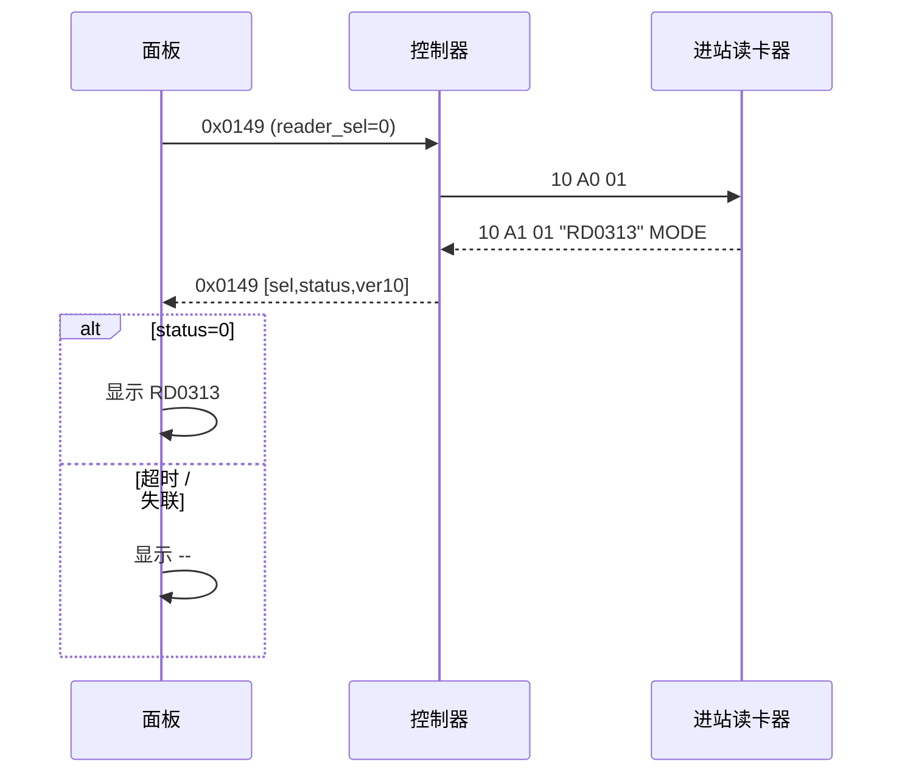

---
领域:
  - 工作
类型:
  - 开发
项目:
  - "[[吊挂操作面板]]"
任务:
  - "[[261030吊挂操作面板维护]]"
相关任务:
  - "[[261029S3维护]]"
状态: 进行
创建时间: 2026-10-30T14:06:05
截止时间: 2027-07-30T14:05:00
完成时间:
---
<!-- plan-doc:v1 -->

# 261030吊挂操作面板维护

> **一句话**：吊挂操作面板（HC32F460）固件维护规划；S3 控制器作为配套依赖，见 [[261029S3维护]]。
> **仓库**：`D:\Screen\HangerOperatePanel\Operation_Panel`（面板）｜`D:\S3\Project\S3_Controller`（控制器）
> **规则**：改需求先记 C；一功能一机制；执行一次只做一条；归档见 [[261030吊挂操作面板维护-archive]]。

## 0. 看板

- **阶段**：R1 / R3 / R4 已交付归档（R4 翻页由 C13 下线），R5 取消并入 R4；R2 读卡器版本待做
- **下一条**：T2-1（控制器读卡器版本查询与 0x149 回包）
- **基线**：
  - 面板：`D:\Screen\HangerOperatePanel\Operation_Panel` → Keil `MDK/HC32F460KETA.uvprojx`，Target `HC32F460KETA_Debug`，产物 `MDK/output/debug/HC32F460KETA.hex`
  - 控制器：`D:\S3\Project\S3_Controller` → Keil `MDK/network.uvprojx`，Target `DGController_3`，产物 `MDK/Objects/app.hex`
  - 测试：两仓库均无自动化测试与 CI；验证 = Keil 构建 0 error + 真机
- **最后更新**：2026-11-24｜**活跃变更**：—（C3 / C8 / C13 / C14 均已落地）
- **事实源**：代码 / 测试 > 本文 > 归档文档（两仓库均无 README / AGENTS / docs）

### 需求登记

| R | 需求 | 来源 | 状态 | 覆盖任务 |
|---|---|---|---|---|
| R1 | 换绑优化：心跳字段门控 + 0x0112 透传允许 + QCPass 判断 | 需求笔记 | 交付 | 见归档（R1 段） |
| R2 | 面板读取读卡器版本号：About 页经 `0x149` 查询进站读卡器版本并显示，上位机后续复用 | 现场问题 | 待做 | T2-1, T2-2, V-2 |
| R3 | 人体感应 / 照明输出分离：双通道手动优先、登录释放、byte39 门控 | 定制需求 | 交付 | 见归档（R3 段） |
| R4 | 报废件数 + 透传翻页：1–99 件、二次确认、5 行视口；翻页与进页前查询由 C13 下线 | 现场需求 | 交付 | 见归档（R4 段） |
| R5 | 报废页透传翻页（并入 R4） | 现场需求 | 取消 | 见归档（R5 段） |

### 机制登记

| 机制 | 位置 | 用途 | 扩展方式 | 使用者 |
|---|---|---|---|---|
| 命令协议 CmdProtocol | `Operation_Panel/midware/CmdProtocol.c/.h` | 面板与控制器 UART 命令封装：BCC 校验、129 字节分包、450ms 超时重发（最多 2 次） | 在 `send_command*` / `CMD_Rev` 上扩命令号与参数，不复制收发流程 | 面板全部业务 |
| 菜单状态机 MenuUI | `Operation_Panel/midware/MenuUI.c/.h` | 页面切换与绘制（`M_Home` / `M_Login` / `M_Debug` 等），每页 7 行 | 增 `M_*` 常量与处理函数，沿用 `current_menu_index` | 面板 UI |
| 多语言 LangMenu | `Operation_Panel/midware/LangMenu.c` | `MultiMenu[16]` 语言文案表 | 各语言段补同索引条目 | 菜单与提示 |
| 按键 key | `Operation_Panel/midware/key.c` | 按键扫描、消抖、长按 | 扩按键映射与事件 | 菜单 |
| 读卡 rfidio | `Operation_Panel/midware/rfidio.c` | 刷卡 ID 采集与状态 | 扩读卡状态机与接口 | 登录、出入站 |
| 参数存储 ziflash / interflash / flash | `Operation_Panel/midware/ziflash.c`、`interflash.c`、`flash/flash.c` | 内部 / 外部 Flash 参数与升级参数存取 | 扩参数结构与读写函数 | 系统参数、升级 |
| 面板远程升级 RemoteUpdate | `Operation_Panel/midware/RemoteUpdate.c` | 接收升级参数与固件包，写 Boot 参数并跳转 | 扩升级包协议字段 | 升级 |
| USB / FatFs | `Operation_Panel/midware/USB/`、`midware/fatfs/` | USB Host MSC + FatFs，U 盘升级与文件操作 | 扩文件操作，不改协议 | 升级、数据 |
| 显示 Dispaly / LCD | `Operation_Panel/midware/Dispaly.c`、`lcd/lcd.c`、`fonts.c` | 点阵字体与界面绘制 | 扩绘制函数与字库 | 面板 UI |
| 面板通信对端 Panel | `S3_Controller/APP/Panel.c` | 面板命令解析、消息队列与提示文案（`MsgText`） | 扩命令表与 `MsgText`，仅作跨端约束 | 面板通信 |
| 换绑状态同步 | `Operation_Panel/source/MAIN.C`、`midware/MenuParam.c`、`midware/key.c` | `PCustomOCTb[4]` 与 0x1001 心跳 `ReBindEnable` 同步、允许后生效 | 复用 0x1001 解析与 `send_trans_command_start`，不新增协议栈 | R1 |

> 控制器侧机制（`Panel` / `UDP_Comu` / `BusinessLogic` / `MotionUnit` / `Sensor` / `LineControl` / `FaultDetect` / `HorizWareHouse` / `RFIDReader` / `RemoteUpdate`）统一登记在 [[261029S3维护]] §0，本文件不重复；跨端任务写「机制：复用控制器 X（见 S3 文档）」。

## 1. 任务池

### P0（立即）

- [ ] **T2-1 控制器读卡器版本查询与 0x149 回包** → 需求：R2（← C3）；产出：`S3_Controller/APP/RFIDReader.c/h`、`Panel.c/h`，分支 `feature/T2-1-reader-version`；验证：静态核对 `10 A0 01` 发送、`10 A1 01` 应答帧（10 字节）解析、500ms 超时、`0x149` 响应 `[sel,status,ver10]` + Keil `DGController_3` 0 error；机制：复用控制器 RFID 读卡（见 [[261029S3维护]]）+ 面板对象读（依据：契约 0x149 条）；边界：只查该站进站读卡器，不改读卡器固件 / SR3 协议 / 面板 UI / 上位机 / 0x55 过滤

### P1

- [ ] **T2-2 面板 About 页读卡器版本查询与显示** → 需求：R2（← C3）；产出：`Operation_Panel/midware/MenuUI.c`、`MenuParam.c/h`、`source/MAIN.C`；前置：T2-1 完成；验证：About 页进入发 `0x0149`（sel=0）→ 显示 `RD0313`，读卡器离线 / 超时 → `--`，CP / 控制器版本不回归，Keil `HC32F460KETA_Debug` 0 error；机制：复用 CmdProtocol 对象读 + About 页（依据：契约 0x149 条）；边界：不改换绑逻辑、不实现控制器查询、不改上位机
- [ ] **V-2 读卡器版本真机验收** → 需求：R2；产出：真机验收记录（含抓包）；验证：人工：面板 About 页显示实际 `RD0313` → 拔掉 / 失联读卡器显示 `--` → 刷卡与升级不受影响，三条全满足才算通过；机制：复用 T2-1 / T2-2 实现，不新增机制；边界：只验收，不改代码

## 2. 契约

- **架构**：本文件以面板（HC32F460KETA）为主；面板经 UART 命令协议连控制器（GD32F470ZI），控制器再经以太网 UDP 连上位机 / 其它控制器、经 CANopen 连电机节点（拓扑图见归档附录 A）。控制器细节见 [[261029S3维护]]。
- **面板协议**：BCC 校验；单包上限 129 字节（`EVERY_PACK_MAX`），命令缓冲 5 包；重发 450ms、最多 2 次（`CmdProtocol.h`）。
- **控制器 UDP（边界）**：结构体按 `#pragma pack(1)` 打包（`UDP_CMD.h`）；PC 心跳含 MAC、进站满、允许接收、链条启动、语言、屏蔽、返工模式。
- **版本标识**：面板用 `MenuUI.h` 的 `CPVER`（当前检出 `E10`；`develop` 为 `060`、`release/V061` 为 `R61`）；控制器用 `APP/UDP_Comu.c` 的 `ControlVer`（`develop` 为 `V3.0.07.0`，`人体感应定制/develop` 为 `V3.e.07.1`）。
- **报废 `0x0106`**：`func 0x00` 查询衣架（E10 起进页前不再发）；`func 0x03` 已由 0x04 取代、面板不再发送（`80db7ce`）；`func 0x04` 执行 payload 13 字节 = 10 字节 ASCII 卡号 + `,` + 2 字节 ASCII 件数（`01`–`99`，`00` 非法）；0x04 不等 `0x0106` ACK，只等 `0x1002` 的 0x82 提示消息或 `IsWaitSign` 超时。
- **`0x0106` 状态位**：`OpStaOrCnt` 低 7 位 0=浏览 / 输入、1=翻页等待、2=0x04 等待，高位 `0x80`=收到回复；页响应只在 state 1 置位并留页，0x82 只在 state 2 置位后回主页。
- **报废页翻页**：已废止（← C13，E10 `8bb846e` 注释下线）；恢复时用 `func 0x02` / `func 0x01` + 1 字节 `u8PS` 页请求，细节见归档 R4 段。
- **读卡器版本 `0x149`（← C3）**：`0x148` 为控制器版本、`0x150` 为防晃；请求 1 字节 `reader_sel`（0=进站，1/2 预留下放 / 出站）；响应 `[reader_sel, status, ver10]`，status 0=OK / 1=超时或失联，`ver10` = 读卡器应答的 6 字节 ASCII 版本（`RD03xx`，当前基线 `RD0313`）补 0 到 10 字节；控制器发 `10 A0 01`、解析 `10 A1 01` 应答帧（10 字节 = 3 头 + 6 版本 + MODE），500ms 超时；面板 About 页显示，上位机后续复用同一缓存。
- **换绑 `0x112`（← C8）**：请求 `0x112` + `0xAA` 开 / `0x55` 关（经 `0x85` 透传，1 字节）；任意回复只清等待、用于判超时，不读回复数据、不显示弹窗；开关仍由 0x1001 心跳 byte39 同步。实现只在 `feature/换绑优化`（`e82dcaa`），未合入 develop 与 E10 线。

## 3. 方案

### 3.1 面板读卡器版本查询（R2）

- **链路**：面板 About 页 → 控制器 `OBJ_READER_VER 0x149` → 该站进站读卡器 `10 A0 01` → `10 A1 01 "RD0313" MODE` → 控制器缓存 → 面板显示。
- **对象语义**：请求 1 字节 `reader_sel`；响应 `[reader_sel, status, ver10]`；读卡器实际应答 6 字节 ASCII 版本 + MODE，对象内补 0 到 10 字节。
- **控制器**：`RFID_Recv` 增加 `10 A1 01` 应答解析（10 字节帧），缓存到 `ReaderVer[sNUM][11]`；查询超时 500ms；`Panel_ReadData` 触发查询，`Panel_Send` 异步回 `0x149`。
- **面板**：About 页新增 `Reader:` 行（y=63）；进入页面发 `0x0149`（sel=0）；解析后显示 `RD0313`，超时 / 失联显示 `--`；CP / 控制器版本逻辑不变；阿拉伯语分支按镜像布局同样加该行。
- **不做**：不改读卡器固件 / SR3 协议 / 上位机；暂不查下放 / 出站读卡器（selector 预留）；不改换绑逻辑。
- **参考**：[[260206测试程序增加读卡器版本号]]（历史测试程序记录，含三种读卡器种类识别；不是当前生产面板实现）；读卡器 `0x10` 指令表见 [[260804SR3框架整理]]。

## 4. 决策与变更

### 决策（D）

| D | 决策 | 结论 | 任务 |
|---|---|---|---|
| D6 | 读卡器版本查询对象与范围 | 新对象 `0x149`（`0x148` 已占、`0x150` 为防晃）；请求 `reader_sel`，响应 `[sel,status,ver10]`；先只查进站读卡器，下放 / 出站预留；控制器按需查询 + 500ms 超时 | T2-1, T2-2 |

> D7–D9（报废件数协议、翻页约定、透传等待分类）随 R4 归入 [[261030吊挂操作面板维护-archive]]。

### 变更（C）

| C | 日期 | 类型 | 需求 | 内容 | 影响 | 处理 |
|---|---|---|---|---|---|---|
| C3 | 2026-11-02 | 新增 | R2 | 新增面板读卡器版本查询：`0x149` 对象、进站读卡器 `10 A0 01` / `10 A1 01`、About 页显示；上位机暂不做 | 任务 / 契约 / 测试 / 文档 / 机制 | T2-1, T2-2 |
| C8 | 2026-11-17 | 修改 | R1 | `0x112` 回复只判超时、不读数据；删除 `TReBindDenied` / 62 弹窗及 15 张语言表条目；开关仍由 0x1001 心跳 byte39 同步 | 任务 / 契约 / 测试 / 文档 / 机制 | T1-9（完成） |
| C13 | 2026-11-18 | 修改 | R4 | 以 `8bb846e` 为准：报废页 Up/Down 翻页全链路注释下线；进页前不再发 `func 0x00` 申请衣架，改 `Discard_ClearState()` + 清 `PtLines` + `HangNo=0` + `InputMode=1` 直接进页 | 任务 / 契约 / 测试 / 文档 / 机制 | 文档与契约已同步；恢复另立需求 |
| C14 | 2026-11-24 | 修改 | R2 | 读卡器基线 RD0312 → RD0313（SR3 `main` `768e92d`，0x10 帧格式未变）；`10 A1 01` 应答实为 6 字节 ASCII 版本 + MODE，`ver10` 补 0 到 10 字节；验收示例改为 RD0313 | 契约 / 测试 / 文档 | T2-1, T2-2, V-2 验收值已同步 |

> R4 / R5 的历史变更（件数协议、翻页约定、状态机口径、验收结论）随 R4 归入 [[261030吊挂操作面板维护-archive]]。

## 5. 实施记录

- [x] **R1 换绑优化** —— T1-1..T1-9 全部完成（T1-4 按用户 2026-11-16 确认归档）；验证：Keil 0 error + 真机矩阵（允许 / 拒绝 / 掉电 / 短帧 / QCPass / 控制器链路）→ 通过；行为：心跳字段门控换绑，QCPass 与手拍一致，面板按 `0xAA` / `0x55` 收发；结果：通过（遗留：换绑代码只在 `feature/换绑优化` `e82dcaa`，未合入 develop / E10 线）；明细见归档 R1 段。
- [x] **R3 人体感应 / 照明输出分离** —— T3-1 / T3-2 / T3-4 完成、T3-3 取消；验证：Keil 0 error + 真机矩阵（byte39 门控、双通道、手动优先、换登录释放、登录 / 退出灯门控）→ 通过；行为：照明与输出双通道手动优先，未配人体感应走原行为；结果：通过；明细见归档 R3 段。
- [x] **R4 报废件数 + 透传翻页** —— T4-1..T4-8 完成或取消（T4-7 并入 T4-4）；验证：Keil 0 error / 13 warnings + 上位机抓包与真机（0x04 13 字节、0x82 回包、页 1/2 各 5 行）→ 通过；行为：报废页输入件数并二次确认后发 0x04，成功回主页、超时回件数页，透传区固定 5 行；结果：通过（C13 随后下线翻页与进页前查询）；明细见归档 R4 段。

## 6. 归档

| R | 结果 | 一句话 | 归档 |
|---|---|---|---|
| R1 | 交付 | 心跳字段门控 + 0x0112 透传允许 + QCPass；T1-1..T1-9 | [[261030吊挂操作面板维护-archive]] |
| R3 | 交付 | 照明 / 输出双通道手动优先 + 登录释放 + byte39 门控 | [[261030吊挂操作面板维护-archive]] |
| R4 | 交付 | 件数 1–99 + 二次确认 + 0x04；5 行视口；翻页与进页前查询由 C13 下线 | [[261030吊挂操作面板维护-archive]] |
| R5 | 取消 | 报废页透传翻页并入 R4 | [[261030吊挂操作面板维护-archive]] |
