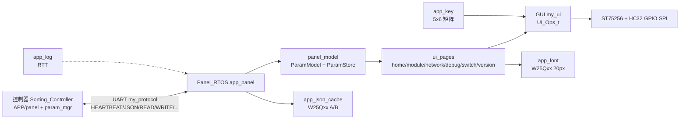

---
领域:
  - 工作
类型:
  - 开发
项目:
  - "[[吊挂操作面板]]"
任务:
  - "[[261030吊挂操作面板维护]]"
相关任务:
状态: 进行
创建时间: 2026-10-30T14:06:05
截止时间: 2027-07-30T14:05:00
完成时间:
---
<!-- plan-doc:v1 -->

# 261030吊挂操作面板维护

> **一句话**：吊挂操作面板固件的长期维护规划基线，后续需求、任务与变更在此登记。
> **仓库**：`D:\Screen\Projects\Panel_RTOS`｜`02_Middleware/GUI`｜`02_Middleware/my_protocol`｜`D:\Sort\Sorting_Controller`（控制器）
> **规则**：改需求先记 C；一功能一机制；执行一次只做一条。

## 0. 看板

- **阶段**：初始化（基线已建，等待需求登记）
- **下一条**：—（任务池为空）
- **本次范围**：只做只读侦察与基线/机制/索引；不做需求拆解、不改代码
- **事实源**：代码 / 测试 > 仓库 README、AGENTS > 本文
- **最后更新**：2026-10-30｜**活跃变更**：—｜**冻结**：—｜**血缘**：前身 —｜后继 —

### 需求登记

| R | 需求 | 来源 | 状态 | 覆盖任务 | 文档 |
|---|---|---|---|---|---|
| — | 暂无需求（用 `/splan-req` 登记） | — | — | — | — |

### 任务总览

| 任务 | 状态 | 出口条件 |
|---|---|---|
| — | — | 任务池为空，等待需求拆解 |

### 机制登记

| 机制 | 位置 | 用途 | 扩展方式 | 使用者 |
|---|---|---|---|---|
| UI 页面框架 | `02_Middleware/GUI/src/ui.c`、`ui_page.c`、`ui_event.c` | 单线程三阶段循环、页面栈、组件焦点、统一事件队列 | 新页面/组件沿用 `UI_Page_t` 与 `UI_CompBase_t`，不引入 malloc | 全部 `ui_pages/`、Win32 模拟器 |
| 页面状态契约 | `04_Application/ui_pages/page_state.h` | 列表重建时同步 `SELECTED`、保留焦点行与滚动窗口 | 新增 inline helper，不复制到各页面 | home/module/module_list/network/debug/version 页 |
| 显示 HAL | `02_Middleware/GUI/inc/ui_interface.h`、`04_Application/app/app_ui.c` | `draw_pixel/clear/refresh/get_time` 四函数 | 换显示后端只实现 `UI_Ops_t` | GUI 绘制链路 |
| LCD 驱动 HAL | `01_Hardware/component/st75256/`、`01_Hardware/adapt/st75256/` | ST75256 命令/像素与 HC32 GPIO 位翻转 SPI | 换 MCU 只换 `ST75256_Ops_t` 适配层 | `app_ui.c`、全屏刷新 |
| Flash HAL | `01_Hardware/component/w25qxx/`、`01_Hardware/adapt/w25qxx/` | 字库读取与 JSON 缓存读写 | 扩展 `W25Qxx_Ops_t` 实现，上层只改槽/偏移 | `app_font.c`、`app_json_cache.c` |
| 参数值源抽象 | `02_Middleware/panel_model/inc/param_source.h`、`04_Application/app/param_source_protocol.c` | 页面通过 `ParamSource_t` 异步读写整模块 | 新来源实现 5 个回调；固件用协议源，模拟器用 stub | `module_page`、switch/debug 相关流程 |
| UI.JSON 模型与值池 | `02_Middleware/panel_model/inc/param_model.h`、`param_store.h` | JSON 零拷贝解析为模块/参数；每通道 uint16 值 + dirty | 容量宏与解析器扩展字段，不绕过模型直接读 JSON | `app_param.c`、全部参数页 |
| 面板协议帧 | `02_Middleware/my_protocol/`、`04_Application/app/panel_cmd.h` | UART 二进制分帧、ACK/重传、命令码与帧布局 | 新增命令先改双端 `panel_cmd.h`（逐字节一致）再加回调 | `app_panel.c`、控制器 `APP/panel` |
| 异步请求状态机 | `04_Application/app/app_panel.c` | 单请求在途、超时/重试、结果 + `reason`/`idx` | 新操作沿用 `BUSY/OK/ERROR/TIMEOUT` 与 `Poll/GetResult` 模式 | module/network/switch/debug/version 页 |
| JSON A/B 缓存 | `04_Application/app/app_json_cache.c` | W25Qxx 顶部 1MB A/B 槽，CRC32 + len + seq | 复用探针/保存接口，不改槽地址 | `app_panel.c`、`version_page` |
| 字库提供者 | `04_Application/app/app_font.c`、`02_Middleware/GUI/inc/ui_font.h` | W25Qxx 20px UTF-8 字形，缺字回退内置 5×7 | 新字号/字库换 `UI_FontOps_t` 实现 | GUI 文本/弹窗/参数 |
| 日志与时基 | `04_Application/app/app_log.c`、`01_Hardware/bsp/` | RTT 非阻塞日志；`Bsp_GetTickMs()` 1ms 全局时基 | 新模块用 `LOG_*` 与 `Bsp_GetTickMs`，不加阻塞延时 | 全部 app/页面 |
| 按键映射 | `04_Application/app/app_key.c`、`01_Hardware/adapt/keypad/` | 5×6 矩阵扫描、ZenButton 消抖、映射 `UI_EventCode_t` | 新增键只改 `s_key_map`，不直接改页面键码 | 全部页面 |

### 基线

- 仓库 / 分支 / 提交：`Panel_RTOS` @ `develop` `481af7f`（2026-10-29，`origin` 为 gitee `hc32f460-learnproj`）。
- 工作区状态：`02_Middleware/GUI`（嵌套仓库 `70b0ceb`，有修改）、`02_Middleware/panel_model/inc/param_model.h`、`04_Application/app/app_key.c`、`04_Application/ui_pages/module_page.c`、`AGENTS.md`、`README.md` 有未提交改动；`02_Middleware/my_protocol/` 未跟踪（嵌套仓库 `8fa3cbf`，2026-10-23）。
- 关联控制器：`D:\Sort\Sorting_Controller` @ `S3/feature/panel` `46dc93d`（2026-10-29）；`APP/panel/panel_cmd.h` 与面板同名文件必须逐字节一致。
- 构建命令：
  - 固件 Keil：打开 `00_Project/MDK/Panel.uvprojx`，构建 `Target_1`（AC6），产物在 `05_Output/Keil/`。
  - 固件 EIDE：打开 `00_Project/EIDE`，构建 `Target_1`，产物在 `00_Project/EIDE/build/Target_1/`。
  - GUI：`cmake -S 02_Middleware/GUI -B 02_Middleware/GUI/build` → `cmake --build 02_Middleware/GUI/build --config Debug` → `02_Middleware/GUI/build/test/gui_lcd_test.exe --json UI.JSON`。
  - 协议/应用/缓存主机测试：`cmake -G "MinGW Makefiles" -S 04_Application/test -B 04_Application/test/build` → build → `ctest --test-dir 04_Application/test/build --output-on-failure`。
  - 模型主机测试：`cmake -S 02_Middleware/panel_model -B 02_Middleware/panel_model/build` → build → `ctest --test-dir 02_Middleware/panel_model/build --output-on-failure`。
- 测试：README/AGENTS 声明 GUI `panel_ui_test` 31 场景、`04_Application/test` 3 项、`panel_model` 1 项；本次只读侦察未重跑。
- 协议一致性测试依赖控制器头文件：`04_Application/test` 默认查找 `D:/Sort/Sorting_Controller/APP/panel/panel_cmd.h`，可用 `SORTING_CONTROLLER_DIR` 覆盖。
- 样例 JSON：`UI.JSON` 34,095 B，15 模块 / 原始 290 项 / 运行时 245 参数（PowerShell `ConvertFrom-Json` 实测）。
- 文档漂移：README 写 `panel_ui_test` 27 场景、JSON 33,577 B / 245 参数；CMake 与当前 `UI.JSON` 分别为 31 场景、34,095 B。以代码和当前文件为准。
- 硬件与运行模型：HC32F460KETA + ST75256 240×160 单色 LCD + W25Qxx；仓库名带 RTOS，但当前是裸机超级循环。

## 1. 任务池

### R-T-D-C 关联表 / 状态总览

| 任务 | 状态 | 需求 | 决策 | 变更 | 记录 |
|---|---|---|---|---|---|
| — | — | — | — | — | — |

### P0（立即）

- （空，等待 `/splan-req` 登记需求）

### P1 / P2

- （空）

### 外部依赖与验收

- （空）

## 2. 契约

<!-- 待 /splan-req 后按需求补充；当前约束以 AGENTS.md 与双端 panel_cmd.h 为准。 -->

- 待登记。

## 3. 设计要点

### 3.1 分层与数据流

- 方案要点：固件按 `01_Hardware` → `02_Middleware` → `04_Application` 分层；页面只通过 `ParamSource_t` 读写，GUI 只通过 `UI_Ops_t` 绘制，硬件访问只经 ops 表。
- 边界：本节只描述现状，不代表新方案；新方案在需求确认后补。

## 4. 决策与变更

### 决策（D）

| D | 决策 | 结论 | 任务 |
|---|---|---|---|
| — | — | — | — |

### 变更（C）

| C | 日期 | 类型 | 需求 | 内容 | 影响 | 处理 | 任务 |
|---|---|---|---|---|---|---|---|
| — | — | — | — | — | — | — | — |

## 5. 实施记录

<!-- 一行一条，只写结果；没有跑验证不许勾 [x]。 -->

（空）

## 6. 归档

| 任务 | 结果 | 关联 | 提交 |
|---|---|---|---|
| — | — | — | — |

## 7. 参考与索引

### 仓库

| 仓库 | 路径 | 角色 | 构建 | 测试 |
|---|---|---|---|---|
| Panel_RTOS | `D:\Screen\Projects\Panel_RTOS` | 面板固件（HC32F460） | Keil/EIDE `Target_1` | `04_Application/test` 3 项、`panel_model` 1 项 |
| GUI | `D:\Screen\Projects\Panel_RTOS\02_Middleware\GUI` | GUI 框架 + Win32 模拟器（嵌套仓库） | CMake + MinGW | `panel_ui_test` 31 场景、`ui_core_test` |
| my_protocol | `D:\Screen\Projects\Panel_RTOS\02_Middleware\my_protocol` | 面板/控制器二进制协议（嵌套仓库） | 随固件/主机测试编译 | `panel_cmd_test` 覆盖帧布局 |
| Sorting_Controller | `D:\Sort\Sorting_Controller` | 分拣控制器（面板对端） | EIDE + GCC ARM | 未在本仓库验证 |

### 关键文件

| 文件 | 作用 |
|---|---|
| `04_Application/main.c` | 初始化顺序与超级循环 |
| `04_Application/app/app_panel.c` | 心跳/JSON 拉取/READ-WRITE/使能/网络/调试/开关异步状态机 |
| `04_Application/app/panel_cmd.h` | 面板命令码与帧布局（与控制器逐字节一致） |
| `04_Application/app/param_source_protocol.c` | `ParamSource_t` 协议实现、整模块打包/解包 |
| `04_Application/app/app_json_cache.c` | JSON A/B 缓存与 CRC32/版本 |
| `04_Application/app/app_font.c` | W25Qxx 20px 字形提供者 |
| `04_Application/app/app_key.c` | 矩阵键扫描、消抖与事件映射 |
| `04_Application/ui_pages/page_state.h` | 列表焦点/SELECTED/滚动保持契约 |
| `04_Application/ui_pages/` | 主页/模块列表/模块/网络/调试/开关/版本页 |
| `02_Middleware/panel_model/src/json_parse.c` | UI.JSON 解析 |
| `02_Middleware/panel_model/inc/param_model.h` | 模块/参数/UI 元数据容量 |
| `02_Middleware/panel_model/src/param_store.c` | 值池、dirty、按模块清除 |
| `02_Middleware/GUI/src/ui.c` | `UI_Loop` 三阶段与事件路由 |
| `02_Middleware/GUI/src/ui_list.c` | 列表滚动/选中/操作态 |
| `02_Middleware/GUI/src/ui_param.c` | 参数行编辑/校验/提交 |
| `02_Middleware/GUI/src/ui_popup.c` | 弹窗栈/Toast/进度 |
| `02_Middleware/GUI/test/panel_ui_test.c` | 固件页面无窗口回归（31 场景） |
| `04_Application/test/CMakeLists.txt` | 协议/应用/缓存 3 项主机测试 |
| `02_Middleware/panel_model/CMakeLists.txt` | 模型主机测试 |

### 文档

- `README.md`：项目唯一人类文档（状态/构建/协议/控制器参数说明）
- `AGENTS.md`：协作、提交、架构与测试约束
- `02_Middleware/GUI/AGENTS.md`：GUI 框架/事件/弹窗/列表细节
- `D:\Sort\Sorting_Controller\CLAUDE.md`：控制器构建与架构
- `D:\Sort\Sorting_Controller\docs\模块参数读写参考.md`：控制器参数读写参考

### 相关仓库 / 依赖

- 控制器仓库 `D:\Sort\Sorting_Controller`（GD32F470，EIDE + GCC ARM）；其 `APP/panel/panel_cmd.h` 是双端一致性校验的另一端。
- `02_Middleware/GUI` 与 `02_Middleware/my_protocol` 是嵌套 git 仓库，根仓库没有 `.gitmodules`。
