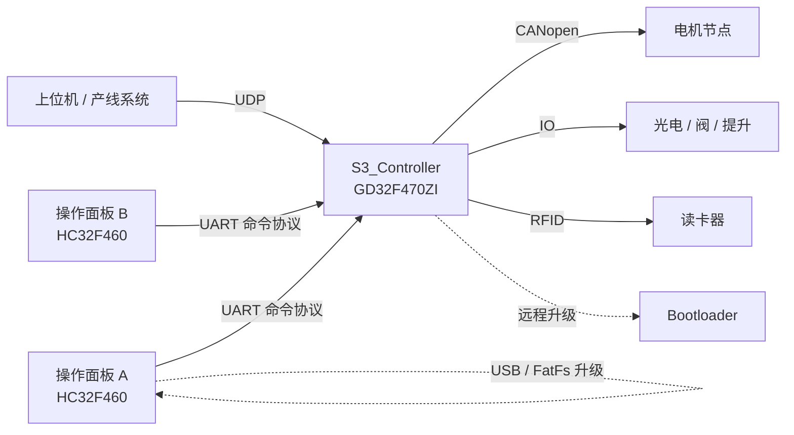

---
领域:
  - 工作
类型:
  - 开发
项目:
  - "[[吊挂操作面板]]"
任务:
  - "[[261030吊挂操作面板维护]]"
相关任务:
  - "[[261029S3维护]]"
状态: 进行
创建时间: 2026-10-30T14:06:05
截止时间: 2027-07-30T14:05:00
完成时间:
---
	<!-- plan-doc:v1 -->

# 261030吊挂操作面板维护

> **一句话**：吊挂操作面板（HC32F460）固件维护规划；S3 控制器作为配套依赖，见 [[261029S3维护]]。
> **仓库**：`D:\Screen\Projects\Operation_Panel`（主）｜`D:\S3\Project\S3_Controller`（配套）
> **规则**：改需求先记 C；一功能一机制；执行一次只做一条。

## 0. 看板

- **阶段**：R1 换绑已交付（T1-9/C8 完成）；R3 人体感应/照明输出已交付；R4 件数/0x04 已交付、翻页与进页前衣架查询已由 C13 下线（T4-1..T4-8 完成/取消）；R5 已并入 R4；R2 读卡器版本待做
- **下一条**：T2-1（P0；控制器读卡器版本查询与 0x149 回包）
- **本次范围**：R2（T2-1/T2-2）；R1/R3/R4 已交付（R4 翻页由 C13 下线）；R5 取消并入 R4
- **事实源**：代码 / 测试 > 仓库 README、AGENTS（两仓库均未找到）> 本文
- **最后更新**：2026-11-18｜**活跃变更**：C3, C4, C6, C7, C8, C9, C10, C11, C12, C13｜**冻结**：—｜**血缘**：—（本文件即规划文档，无前身 / 后继）

### 需求登记

<!-- 需求统一走 /splan-req；R1 / R2 / R3 / R4 / R5 已登记。已完成需求只留摘要，明细见 §6。 -->

| R | 需求 | 来源 | 状态 | 覆盖任务 | 文档 |
|---|---|---|---|---|---|
| R1 | 面板换绑优化：心跳字段门控 + 0x0112 透传允许 + QCPass 判断 | 需求笔记 | 交付 | T1-1..T1-9（完成） | [[261030面板换绑功能优化]] |
| R2 | 面板读取读卡器版本号：About 页经 `0x149` 查询进站读卡器版本并显示；上位机后续复用 | 现场问题 | 待做 | T2-1, T2-2 | — |
| R3 | 人体感应/照明输出分离：双通道手动优先、登录释放、byte39 门控 | 定制需求 | 交付 | T3-1/T3-2/T3-4（T3-3 取消） | — |
| R4 | 报废件数 + 透传翻页：输入 1–99 件、二次确认、5 行透传视口、Up/Down 翻页 | 现场需求 | 交付 | T4-1..T4-8（T4-7 并入 T4-4）；翻页与进页前查询由 C13 下线 | — |
| R5 | 报废页透传翻页（并入 R4） | 现场需求 | 取消 | T5-1..T5-3（取消）→ T4-4..T4-6 | — |

### 机制登记

| 机制                                | 位置                                                                    | 用途                                                   | 扩展方式                                            | 使用者     |
| --------------------------------- | --------------------------------------------------------------------- | ---------------------------------------------------- | ----------------------------------------------- | ------- |
| 命令协议 CmdProtocol                  | `Operation_Panel/midware/CmdProtocol.c/.h`                            | 面板与控制器 UART 命令封装：BCC 校验、129 字节分包、450ms 超时重发（最多 2 次）  | 在 `send_command*` / `CMD_Rev` 上扩命令号与参数，不复制收发流程  | 面板全部业务  |
| 菜单状态机 MenuUI                      | `Operation_Panel/midware/MenuUI.c/.h`                                 | 页面切换与绘制（`M_Home` / `M_Login` / `M_Debug` 等），每页 7 行   | 增 `M_*` 常量与处理函数，沿用 `current_menu_index`         | 面板 UI   |
| 多语言 LangMenu                      | `Operation_Panel/midware/LangMenu.c`                                  | `MultiMenu[16]` 语言文案表                                | 各语言段补同索引条目                                      | 菜单与提示   |
| 按键 key                            | `Operation_Panel/midware/key.c`                                       | 按键扫描、消抖、长按                                           | 扩按键映射与事件                                        | 菜单      |
| 读卡 rfidio                         | `Operation_Panel/midware/rfidio.c`                                    | 刷卡 ID 采集与状态                                          | 扩读卡状态机与接口                                       | 登录、出入站  |
| 参数存储 ziflash / interflash / flash | `Operation_Panel/midware/ziflash.c`、`interflash.c`、`flash.c`          | 内部 / 外部 Flash 参数与升级参数存取                              | 扩参数结构与读写函数                                      | 系统参数、升级 |
| 面板远程升级 RemoteUpdate               | `Operation_Panel/midware/RemoteUpdate.c`                              | 接收升级参数与固件包，写 Boot 参数并跳转                              | 扩升级包协议字段                                        | 升级      |
| USB / FatFs                       | `Operation_Panel/midware/USB/`、`midware/fatfs/`                       | USB Host MSC + FatFs，U 盘升级与文件操作                      | 扩文件操作，不改协议                                      | 升级、数据   |
| 显示 Dispaly / LCD                  | `Operation_Panel/midware/Dispaly.c`、`lcd/lcd.c`、`fonts.c`             | 点阵字体与界面绘制                                            | 扩绘制函数与字库                                        | 面板 UI   |
| 面板通信对端 Panel                      | `S3_Controller/APP/Panel.c`                                           | 面板命令解析、消息队列与提示文案（`MsgText`）                          | 扩命令表与 `MsgText`，仅作跨端约束                          | 面板通信    |
| 换绑状态同步                            | `Operation_Panel/source/MAIN.C`、`midware/MenuParam.c`、`midware/key.c` | `PCustomOCTb[4]` 与 0x1001 心跳 `ReBindEnable` 同步、允许后生效 | 复用 0x1001 解析与 `send_trans_command_start`，不新增协议栈 | R1      |

> 控制器侧机制（`Panel` / `UDP_Comu` / `BusinessLogic` / `MotionUnit` / `Sensor` / `LineControl` / `FaultDetect` / `HorizWareHouse` / `RFIDReader` / `RemoteUpdate`）统一登记在 [[261029S3维护]] §0；本文件不重复。跨端任务引用时写「机制：复用控制器 X（见 S3 文档）」。

### 基线

- **工作区**：`D:\Screen\HangerOperatePanel`（根目录不是 git 仓库）含 4 个面板工程副本、`Doc/`（规格书 / 联络单 / 用户指南）与 `固件/`（Boot 合并 hex、加密 bin 发布产物）；2026-11-18 侦察确认原记录的 `D:\Screen\Projects\Operation_Panel` 已不存在
- **仓库 / 分支 / 提交**：
  - `Operation_Panel`（主仓，本工作区）：`D:\Screen\HangerOperatePanel\Operation_Panel` 当前检出 `E1/硕达报废/develop` @ `8bb846e`（E10；2026-11-18「暂时取消报废页面的翻页功能」，即 C13；工作区干净、已提交、未 push）；此前：`8087b79` 版本号 E10、`c963ef3` T4-8/T4-2、`34fa22b` T4-4/T4-5、`80db7ce` T4-1
  - `Operation_Panel` 发布分支：`release/V061` @ `7bd9a43`（领先 `develop` 2 个提交）；R1 实现分支：`feature/换绑优化` @ `e82dcaa`（origin 仍为 `31f4155`）
  - 同工作区其他副本（不在本规划主线，改动前先确认）：`Operation_Panel_Boot` @ `master` `8503025`（dirty：`MDK/HC32F460KETA.uvprojx`）；`A11C052(V050+扫码枪)`（`CPVER` 为 C5x 系列，非 git）；`X048(047+非本位)`（`CPVER` 为 X48，非 git）
  - `S3_Controller`（配套）：`D:\S3\Project\S3_Controller` 当前检出 `develop` @ `aeef0ca`（干净）；定制分支 `人体感应定制/develop` @ `1a82c99`（T3-2 `41c4805`、登录/退出灯门控 `17ae6a3`）、`feature/人体存在` @ `83bf75b`、`feature/换绑优化` @ `84d5822`（T1-6）
  - `git status --short`：面板主仓干净；`feature/换绑优化` 干净；控制器干净；`Operation_Panel_Boot` 有 1 个 uvprojx 改动
- **构建命令**：
  - 面板：Keil MDK `Operation_Panel/MDK/HC32F460KETA.uvprojx`，Target `HC32F460KETA_Debug` → `MDK/output/debug/HC32F460KETA.hex`
  - 控制器：Keil MDK `S3_Controller/MDK/network.uvprojx`，Target `DGController_3` → `MDK/Objects/app.hex`
- **测试**：未找到自动化测试与 CI；验证依赖 Keil 构建 0 error + 真机
- **版本标识**：面板当前检出 `CPVER "E10"`；`develop` `060`、`release/V061` `R61` 为既有记录（`Operation_Panel/midware/MenuUI.h`）；控制器 `ControlVer "V3.0.07.0"`（`APP/UDP_Comu.c`）
- **最近构建 / 现状**：面板 2026-11-18 14:31 `Operation_Panel/MDK/output/debug/HC32F460KETA.hex`，`HC32F460KETA_Debug` 0 Error / 13 Warning（均既有 warning，日志 `HC32F460KETA.build_log.htm`）；发布合并件 `固件/Boot+E10.hex`（2026-11-18 14:16）；控制器 `DGController_3` 上次 0 error / 0 warning（2026-11-13，本次未重跑）

## 1. 任务池

### P0（立即）

- [ ] **T2-1 控制器读卡器版本查询与 0x149 回包** → 需求：R2（← C3）；产出：`S3_Controller/APP/RFIDReader.c/h`、`Panel.c/h`；分支 `feature/T2-1-reader-version`（基于 `develop` `aeef0ca`）；验证手段：静态核对 `10 A0 01` 发送、`10 A1 01` 解析、500ms 超时、`0x149` 响应 `[sel,status,ver10]`；Keil `DGController_3` 0 error；机制：复用控制器 RFID 读卡（见 [[261029S3维护]]）+ 面板对象读（D6）；边界：只查该站进站读卡器；不改读卡器固件 / SR3 协议 / 面板 UI / 上位机 / 0x55 过滤

### P1 / P2

- [ ] **T2-2 面板 About 页读卡器版本查询与显示** → 需求：R2（← C3）；产出：`Operation_Panel/midware/MenuUI.c`、`MenuParam.c/h`、`source/MAIN.C`；前置：T2-1 完成；验证手段：About 页进入发 `0x0149`（sel=0）→ 显示 `RD0312`；读卡器离线 / 超时 → `--`；CP / 控制器版本不回归；Keil `HC32F460KETA_Debug` 0 error；机制：复用 CmdProtocol 对象读 + About 页（D6）；边界：不改换绑逻辑、不实现控制器查询、不改上位机

### 外部依赖与验收

- [ ] **V-2 读卡器版本真机验收** → 验收：面板 About 页显示实际 `RD0312`；拔掉 / 失联读卡器显示 `--`；刷卡与升级不受影响；上位机后续复用 `0x149` 缓存

> R1/R3/R4 已完成并归档，见 §6；R4 代码在 `E1/硕达报废/develop`，当前 @ `8bb846e`（C13 已下线翻页与进页前衣架查询）。

## 2. 契约

- **架构**：本文件以面板（HC32F460KETA）为主；面板经 UART 命令协议连控制器（GD32F470ZI），控制器再经以太网 UDP 连上位机 / 其它控制器、经 CANopen 连电机节点；控制器细节见 [[261029S3维护]]
- **协议 / 数据格式**：
  - 面板协议：BCC 校验；单包上限 129 字节（`EVERY_PACK_MAX`），命令缓冲 5 包；重发 450ms、最多 2 次（`CmdProtocol.h`）
  - 控制器 UDP（边界）：结构体按 `#pragma pack(1)` 打包（`UDP_CMD.h`）；PC 心跳含 MAC、进站满、允许接收、链条启动、语言、屏蔽、返工模式
  - 版本：面板 `develop` 为 `CP060`、`release/V061` 为 `R61`、当前检出 `E10`；控制器当前检出 `develop` @ `aeef0ca` 为 `V3.0.07.0`，`人体感应定制/develop` 为 `V3.e.07.1`（既有记录）
  - 报废件数（R4）：沿用 `0x0106`；**C13：E10 进页前不再发 `func 0x00` 查询衣架**；`func 0x03` 旧执行保留；`func 0x04` 执行 payload 13 字节 = 10 字节 ASCII 卡号 + `,` + 2 字节 ASCII 件数（`01`–`99`，`00` 非法）；**0x04 不等 `0x0106` ACK，只等 0x82 提示消息或 `IsWaitSign` 超时**；0x82 是 `0x1002` 消息，不是 `0x0106` 回复；当前代码 0x82 成功后清状态回主页
  - 报废页翻页（R4 扩展；**C13：E10 `8bb846e` 已注释下线，以下为恢复参考**）：`0x0106`，`func 0x02` 上一页 / `func 0x01` 下一页；请求 1 字节当前页 `u8PS`（默认上位机缓存当前报废卡；若不缓存则改 10 字节卡号 + 页号，T4-6 确认）；上位机回 `0x1004` / 对象 `0x0106` 页数据；每页固定 5 行；页请求用 `OpStaOrCnt=1` 跟踪，不能依赖 `IsWaitSign`
  - 报废 0x0106 状态（C11）：`OpStaOrCnt` 低 7 位 0=浏览/输入、1=翻页等待、2=0x04 等待；`0x80`=收到回复。页响应只 state 1 置 `1|0x80` 并留页；0x82 只 state 2 置 `2|0x80` 后回主页；state 2 迟到页响应只清 `PackSign`，但当前仍会清 `IsWaitSign`
- **读卡器版本对象（← C3，2026-11-02）**：新增 `OBJ_READER_VER 0x149`（`0x148` 为控制器版本，`0x150` 为防晃）；请求 1 字节 `reader_sel`（0=进站，1/2 预留下放/出站）；响应 `[reader_sel, status, ver10]`，status 0=OK / 1=超时或失联；控制器向进站读卡器发 `10 A0 01`，解析 `10 A1 01`，500ms 超时；面板 About 页显示，上位机后续复用同一缓存
- **换绑 0x112 回复（← C8，2026-11-17）**：任意 `0x112` 回复只清等待、用于判断是否超时，不读回复数据；不显示“不允许启用换绑”弹窗；开关仍由 0x1001 心跳 byte39 同步；请求仍为 `0x112` + `0xAA/0x55`
- **已完成需求（R3）**：契约已冻结在代码；行为摘要见 §6，不再逐条展开

## 3. 设计要点

### 3.1 系统拓扑（面板视角）

- 控制器 `main.h` 中 `sNUM = 2`，对应 A / B 两个站各一块面板
- 面板 UI 文案由 `LangMenu.c` 的 16 组语言表驱动，菜单入口见 `MenuUI.h` 的 `M_*`
- 控制器侧流程与通讯细节不在本文展开，见 [[261029S3维护]]

### 3.2 面板读卡器版本查询（R2）

- **链路**：面板 About 页 → 控制器 `OBJ_READER_VER 0x149` → 该站进站读卡器 `10 A0 01` → `10 A1 01 "RD0312" MODE` → 控制器缓存 → 面板显示。
- **对象语义（← C3）**：请求 1 字节 `reader_sel`（0=进站；1/2 预留下放/出站）；响应 `[reader_sel, status, ver10]`，status 0=OK / 1=超时或失联；版本字符串 10 字节，不足补 0。
- **控制器**：`RFID_Recv` 增加 `10 A1 01` 10 字节响应解析，缓存到 `ReaderVer[sNUM][11]`；查询超时 500ms；`Panel_ReadData` 触发查询，`Panel_Send` 异步回 `0x149`。
- **面板**：About 页新增 `Reader:` 行（y=63）；进入页面发 `0x0149`（sel=0）；解析响应后显示 `RD0312`，超时 / 失联显示 `--`；CP / 控制器版本逻辑不变。
- **不做**：不改读卡器固件 / SR3 协议 / 上位机；暂不查下放 / 出站读卡器（selector 预留）；不改换绑逻辑。

### 3.3 报废件数（R4）

- **入口（C13，以 `8bb846e` 为准）**：`M_Product` 选「2.报废产品」→ `Discard_ClearState()` + 清 `PtLines` + `HangNo=0` + `InputMode=1` → 直接进 `M_Discard`；卡号取本地 `PStationInfoTb[4]`，不再发 `0x0106/func 0x00` 申请衣架（原代码注释保留，后续可能恢复）。
- **件数页与二次确认**：进入时件数为空，不预设 0/1；数字键输入 1–99，0/空/超界不可确认，卡号 0 也不再拦截；OK 弹确认框并显示件数，ESC 回件数页，确认后发 `0x0106/func 0x04`。
- **payload**：13 字节 = 10 字节 ASCII 卡号 + `,` + 2 字节 ASCII 件数，例如卡号 `0000123456`、3 件：`30 30 30 30 31 32 33 34 35 36 2C 30 33`。
- **结果与超时（C11，状态位语义见 §2）**：0x82 成功即 `Discard_ClearState()` 回主页；无 0x82 由 `IsWaitSign==2` 触发 `TNoAck` 回件数页；页响应仅 state 1 留页；state 2 迟到页响应只清 `PackSign`，但 `CmdProtocol` 仍清 `IsWaitSign`（C11 已接受）。
- **文案 / 不做**：`DiscardTb` 补「报废件数:」与确认文案（简中 / 英先补，其余语种同步）；不改 `func 0x03`、不改控制器（透传 13 字节）、不解析上位机弹窗、不新增控制器侧机制。

### 3.4 报废页透传翻页（R4 扩展；C13 已下线）

- **现状（C13，以 `8bb846e` 为准）**：`key.c` 的 `M_Discard` Up/Down（`OK_Press=0x12/0x11`）与 `MenuUI.c` 的翻页请求块均已注释；报废页只显示进入时的 5 行，Up/Down 无动作；恢复需新需求。
- **布局（C12，以当前代码为准）**：标题 y=0；件数标签/值同一行 y=21；透传区固定 5 行 y=42/63/84/105/126，仍用 `MultiLine`；接受长行换行/覆盖风险，不再改 `dispPoint.CurrentY`。
- **恢复参考（D8，未生效）**：Up=`func 0x02`、Down=`func 0x01`，请求 1 字节 `u8PS`；仅 `OpStaOrCnt==0`、非确认、非件数输入时发，发送后 `OpStaOrCnt=1`；页响应走 `0x1004`/对象 `0x0106`，仅 state 1 置 `1|0x80` 留页并更新 `u8PS`/`u8PTim`；每页固定 5 行、首尾页不特殊少发；不修 `M_SysMsg` 翻页、不改控制器与 `0x03/0x04`。

## 4. 决策与变更

> R1 / R3 的历史 D/C 明细已并入 §6 需求归档；R1 的 C8 因重开保留于此；这里只保留未落地需求。

### 决策（D）

| D | 决策 | 结论 | 任务 |
|---|---|---|---|
| D6 | 读卡器版本查询对象与范围 | 新对象 `0x149`（0x148 已占、0x150 为防晃）；请求 `reader_sel`，响应 `[sel,status,ver10]`；先只查进站读卡器，下放/出站预留；控制器按需查询 + 500ms 超时 | T2-1, T2-2 |
| D7 | 报废件数协议 | 保留 `func 0x03` 旧执行；新增 `func 0x04`，payload 13 字节 = 10 字节 ASCII 卡号 + `,` + 2 字节 ASCII 件数（`01`–`99`，`00` 非法）；0x04 不等 `0x0106` ACK，只等 0x82 提示/超时（C9/D9） | T4-1, T4-2, T4-3 |
| D8 | 报废页翻页约定 | 固定 5 行；Up=上一页 `0x02`、Down=下一页 `0x01`；请求 1 字节 `u8PS`（默认上位机缓存当前报废卡）；仅浏览态且非执行等待时发；不解析回包结果 | T4-4, T4-5, T4-6 |
| D9 | 透传等待分类 | 原计划用 WaitKind 分类；当前代码未落地（C11），实际按 `OpStaOrCnt` + `IsWaitSign`：0x04 由 0x82/超时结束，页等待由 state 1 + 页响应/超时结束；迟到页响应仍可能清 0x04 等待 | T4-2, T4-5, T4-8 |

### 变更（C）

| C | 日期 | 类型 | 需求 | 内容 | 影响 | 处理 | 任务 |
|---|---|---|---|---|---|---|---|
| C3 | 2026-11-02 | 新增 | R2 | 新增面板读卡器版本查询：`0x149` 对象、进站读卡器 `10 A0 01` / `10 A1 01`、About 页显示；上位机暂不做 | 任务、契约、测试、文档、机制 | T2-1, T2-2 | T2-1, T2-2 |
| C4 | 2026-11-16 | 新增 | R4 | 报废页增加件数输入（1–99，无默认值，0 非法）与二次确认；新增 `0x0106/func 0x04` 携 13 字节卡号+件数；收到 ACK 回主页，`0x82` 弹窗额外提示 | 任务、契约、测试、文档、机制 | T4-1, T4-2, T4-3, T4-7 | T4-1, T4-2, T4-3, T4-7 |
| C5 | 2026-11-16 | 新增 | R5 | 报废页透传区固定 5 行；Up/Down 翻页，`0x0106 func 0x02/0x01`，1 字节当前页；上位机回页数据；首/尾页不特殊少发 | 任务、契约、测试、文档、机制 | T5-1, T5-2, T5-3 | T5-1, T5-2, T5-3 |
| C6 | 2026-11-16 | 修改 | R4 | R5 报废页翻页并入 R4（同一报废需求）；原 T5-1/T5-2/T5-3 取消，改 T4-4/T4-5/T4-6 | 任务、契约、测试、文档、机制 | T4-4, T4-5, T4-6 | T4-4, T4-5, T4-6 |
| C7 | 2026-11-16 | 修改 | R4 | T4-2 收到 `0x0106` ACK 后不回主页，停留报废页（`OpStaOrCnt=2` 结果态）；超时后只读/重试待定 | 任务、契约、测试、文档、机制 | T4-2, T4-3, T4-6 | T4-2, T4-3, T4-6 |
| C8 | 2026-11-17 | 修改 | R1 | `0x112` 回复只判超时、不读数据；任意 `0x112` 回复清等待；删除 `TReBindDenied`/62 弹窗及 15 张有文案语言表条目（葡语空表）；开关仍由 0x1001 心跳 byte39 同步 | 任务、契约、测试、文档、机制 | T1-9（完成） | T1-9 |
| C9 | 2026-11-17 | 修改 | R4 | 0x04 不等 `0x0106`，只等 0x82 提示或超时；状态 0/1/2 + `0x80` 回复位；0x82 仅 state 2 置 `0x80`，state 1 不动；页响应仅 state 1；拆分 M_Discard 的 0x1002 分支；D9 等待分类 | 任务、契约、测试、文档、机制 | T4-2, T4-5, T4-8 | T4-2, T4-5, T4-8 |
| C10 | 2026-11-17 | 修改 | R4 | T4-4 合并 T4-7：报废页透传区按其他透传页 `dispPoint.CurrentY + MultiLine` 连续绘制，最多 5 个可见行，超出不显示；长语言缓冲随 T4-4 验证 | 任务、契约、测试、文档、机制 | T4-4 | T4-4 |
| C11 | 2026-11-17 | 修改 | R4 | 以当前代码为准：T4-8/T4-2 采用 0/1/2 + `0x80`，但 0x04 成功由 0x82（当前分支条件 `>=0x81`）清状态回主页，不做结果页；0x04 超时回件数页；页响应 state 1 留页；WaitKind/D9 未落地；`>=0x81` 会收 0x81/0x83 需注意 | 任务、契约、测试、文档、机制 | T4-8（完成）、T4-2（完成） | T4-2, T4-8 |
| C12 | 2026-11-17 | 修改 | R4 | 以当前代码/抓包为准，关闭 T4-3/T4-4/T4-5：T4-3 0x04 手动联调通过；T4-4 接受当前固定 5 行与 `qtyLine[40]` 风险；T4-5 接受当前页请求/输入中翻页风险；不再做布局/门控改造 | 任务、契约、测试、文档、机制 | T4-3, T4-4, T4-5 | T4-3, T4-4, T4-5 |
| C13 | 2026-11-18 | 修改 | R4 | 以 `8bb846e` 为准：报废页 Up/Down 翻页全链路注释下线（`key.c` 0x11/0x12、`MenuUI.c` 翻页请求块）；进页前不再发 `0x0106/func 0x00` 申请衣架，改 `Discard_ClearState()` + 清 `PtLines` + `HangNo=0` + `InputMode=1` 直接进页；代码保留，注释写明后续可能恢复 | 任务、契约、测试、文档、机制 | 文档同步为当前代码；恢复另立需求 | T4-5, T4-6 |

## 5. 实施记录

- [x] **R1 换绑优化** —— T1-1..T1-8 全部完成（T1-4 验收按用户 2026-11-16 确认归档）；验证：Keil 0 error + 真机矩阵（允许/拒绝/掉电/短帧/QCPass/控制器链路）；行为：心跳字段门控换绑、QCPass 与手拍一致、面板收发 0xAA/0x55；结果：通过；提交：`26f708f`/`d88fa5d`/`7249ee0`/`9957cf7`/`433441d`
- [x] **T1-9 换绑 0x112 回复仅作超时判定** —— `MAIN.C` 删除 `rebindAck` 读取与 62 弹窗，仅在 `U_SyncTime` 后清 `PackSign[U_ReBind]`；`MenuParam.h` 删除 `TReBindDenied`；`LangMenu.c` 删除 15 张有文案语言表第 62 条；验证：Keil 0 error/24 warnings（均未改动文件）+ 人工 `00/01/任意/无回复` → 通过；行为：任意 `0x112` 回复只清等待，无回复 `TNoAck`，开关仍由心跳同步；结果：通过；提交：`e82dcaa`
- [x] **R3 人体感应/照明输出分离** —— T3-1/T3-2/T3-4 完成，T3-3 取消；验证：Keil 0 error + 真机矩阵（byte39 门控、双通道、手动优先、换登录释放、登录/退出灯门控）；行为：照明/输出双通道手动优先，未配人体走老行为；结果：通过；提交：`7b5e3d5`/`41c4805`/`17ae6a3`/`7db5535`/`79d4ac3`/`83bf75b`
- [x] **T4-1 报废页件数输入、二次确认与 0x04 发送** —— 代码完成：件数 1–99、二次确认、`0x0106/func 0x04` 13 字节、卡号快照 / 全 0 拒绝；验证：Keil `HC32F460KETA_Debug` 0 error + 静态核对通过；行为：报废页输入件数并二次确认后发 0x04；人工/联调待 T4-3；缅甸语确认框缓冲随 T4-4 修复；结果：代码完成；提交：`80db7ce`
- [x] **T4-8 0x0106/0x1004 回包分类与等待互斥** —— 以当前代码为准（未落地 WaitKind）：页响应仅 state 1 置 `1|0x80`；0x82 仅 state 2 结束 0x04 等待；验证：Keil 0 error/13 warnings + 人工确认通过；行为：页响应留页，0x82 结束 0x04 等待；结果：通过；提交：`c963ef3`/`8087b79`
- [x] **T4-2 0x04 的 0x82/超时结果联动** —— 当前代码 0x82（分支条件 `>=0x81`）清状态回主页；0x04 超时回件数页并 `TNoAck`；件数默认 0/右对齐/无效清空；验证：Keil 0 error/13 warnings + 人工确认通过；行为：0x82 成功回主页，超时回件数页；结果：通过；提交：`c963ef3`/`8087b79`
- [x] **T4-3 上位机 0x04 联调与真机验收** —— 当前代码/抓包：0x106/0x04 13 字节，0x82 回包；验证：人工抓包与实机确认通过；行为：上位机报废成功；结果：通过（C12）；提交：`c963ef3`/`8087b79`
- [x] **T4-4 报废页 5 行显示与长语言缓冲** —— 当前代码固定 5 行 y=42/63/84/105/126；验证：人工页面显示确认；行为：5 行透传显示；结果：通过（C12 接受 `qtyLine[40]`/长行风险）；提交：`34fa22b`/`c963ef3`
- [x] **T4-5 报废页 Up/Down 翻页与页请求** —— 当前代码页请求 state 1、页响应留页；验证：人工 Up/Down/页 1/2 确认；行为：翻页留页；结果：通过（C12 接受输入/等待门控风险）；提交：`34fa22b`/`c963ef3`
- [x] **T4-6 报废翻页上位机联调与真机验收** —— 当前代码/抓包：页 1/2 返回 5 行、Up/Down 正确；验证：用户实机确认通过；行为：翻页联调通过；结果：通过；提交：`c963ef3`/`8087b79`

## 6. 归档

| 需求 | 结果 | 摘要 | 提交 |
|---|---|---|---|
| R1 换绑优化 | 完成 | 心跳字段门控 + 0x0112 透传允许 + QCPass 同手拍 + 0xAA/0x55；T1-1..T1-9 完成；C8 的 0x112 回复只判超时 | `26f708f`/`d88fa5d`/`7249ee0`/`9957cf7`/`433441d`/`e82dcaa` |
| T1-9 换绑 0x112 回复仅作超时判定 | 完成 | R1（← C8）；任意 `0x112` 回复只清等待、不读数据；删除 `TReBindDenied`/62 与 15 张语言表条目；开关仍由心跳 byte39 同步 | `e82dcaa` |
| T4-8 0x0106/0x1004 回包分类与等待互斥 | 完成 | R4（← C9/C11）；页响应仅 state 1；0x82 仅 state 2 结束等待；0x04 成功回主页 | `c963ef3`/`8087b79` |
| T4-2 0x04 的 0x82/超时结果联动 | 完成 | R4（← C9/C11）；0x82 清状态回主页；超时回件数页；件数默认 0/右对齐 | `c963ef3`/`8087b79` |
| T4-3 上位机 0x04 联调与真机验收 | 完成 | R4（← C4/C12）；0x106/0x04 13 字节、0x82 回包；人工抓包/实机通过 | `c963ef3`/`8087b79` |
| T4-4 报废页 5 行显示与长语言缓冲 | 完成 | R4（← C10/C12）；当前固定 5 行；接受 `qtyLine[40]`/长行风险 | `34fa22b`/`c963ef3` |
| T4-5 报废页 Up/Down 翻页与页请求 | 完成 | R4（← C9/C11/C12）；页请求 state 1、页响应留页；接受输入/等待门控风险 | `34fa22b`/`c963ef3` |
| T4-6 报废翻页上位机联调与真机验收 | 完成 | R4（← C6）；页 1/2 返回 5 行、Up/Down 正确；用户实机确认 | `c963ef3`/`8087b79` |
| T4-7 报废确认框长语言缓冲区修复 | 取消 | 并入 T4-4（C10/C12）；长语言缓冲风险接受 | — |
| R4 报废件数 + 透传翻页 | 完成 | T4-1..T4-8 完成/取消（T4-7 并入 T4-4）；0x04、0x82、翻页、5 行；C12 接受布局/门控风险；人工/抓包通过 | `80db7ce`/`34fa22b`/`c963ef3`/`8087b79` |
| T4-5 / T4-6 报废页翻页 | 取消 | ← C13：E10 `8bb846e` 注释下线，实现本身已验收通过，代码保留待恢复 | `8bb846e` |
| R3 人体感应/照明输出分离 | 完成 | 双通道手动优先 + 登录释放 + byte39 门控（现状 `BsEnable`）+ 登录/退出灯门控；T3-1/T3-2/T3-4 完成，T3-3 取消 | `7b5e3d5`/`41c4805`/`17ae6a3`/`7db5535`/`79d4ac3`/`83bf75b` |
| R5 报废页透传翻页 | 取消 | 并入 R4；原 T5-1/T5-2/T5-3 取消，改 T4-4/T4-5/T4-6 | — |

## 7. 参考与索引

### 仓库

| 仓库 | 路径 | 角色 / 构建 |
|---|---|---|
| Operation_Panel | `D:\Screen\HangerOperatePanel\Operation_Panel`（另有 `_Boot`、`A11C052`、`X048` 副本，见 §0） | 面板固件（HC32F460KETA）；`MDK/HC32F460KETA.uvprojx` → `HC32F460KETA_Debug` |
| S3_Controller | `D:\S3\Project\S3_Controller` | 控制器固件（GD32F470ZI，lwIP + CANopen）；`MDK/network.uvprojx` → `DGController_3` |
| S3 其他 | `D:\S3\Project\`：`S3_Bootloader`、`S3_Controller_HardwareTest`、`S3_MDK`、`RTT` | Bootloader / 硬件测试固件 / MDK 工程副本 / RTT 源码；均未侦察 |
| pc_sim | `D:\S3\pc_sim` | 上位机模拟器（Typer + Rich TUI）；`python udp_sim.py [IP]` |

> 两仓库均无自动化测试与 CI；验证依赖 Keil 构建 0 error + 真机。

### 关键文件

| 文件 | 作用 |
|---|---|
| `Operation_Panel/source/MAIN.C` | 主循环、初始化、命令分发（换绑 `0x112` 清等待） |
| `Operation_Panel/midware/MenuUI.c/.h`、`key.c`、`LangMenu.c` | 菜单状态机 / 按键 / 16 语言文案（报废、翻页、换绑 UI 均在此；版本号 `CPVER`） |
| `Operation_Panel/midware/MenuParam.c/.h`、`SC_MenuParam.c`、`TC_MenuParam.c`、`interface.c/.h` | `PCustomOCTb`/`PCustomTb`/`PCustomOCShow[4]`、参数菜单、`S_CodeAutoOut` |
| `Operation_Panel/midware/CmdProtocol.c/.h`、`rfidio.c`、`RemoteUpdate.c`、`Dispaly.c`、`lcd/`、`fonts.c` | 命令协议与重发、读卡、远程升级、显示与字库 |
| `Operation_Panel/midware/ziflash.c`、`interflash.c`、`flash.c`、`w25qxx/`、`USB/`、`fatfs/` | 参数 / 升级存储、USB Host MSC + FatFs |
| `S3_Controller/APP/main.c`、`Panel.c/.h`、`RFIDReader.c/.h`、`UDP_Comu.c`、`UDP_CMD.c`、`BSP/CanOpen/` | 控制器入口、面板命令与透传、读卡器、UDP、CANopen（细节见 [[261029S3维护]]） |

### 文档

- 需求笔记 [[261030面板换绑功能优化]]（R1）；读卡器版本历史 [[260206测试程序增加读卡器版本号]]（测试程序记录，非生产实现）；配套规划 [[261029S3维护]]
- 上位机（外部）：R4 需解析 `0x0106/func 0x04` 的 10 字节 ASCII 卡号 + `,` + 2 字节件数，面板不解析 ACK；页请求 `func 0x02/0x01` 暂不需要（C13 下线翻页）
- 测试工具（外部）：`D:\S3\pc_sim\udp_sim.py`；T1-9 联调增强 25B 心跳、`Data[24]` 换绑标识、`0x112` 自动回复、`noack`、`--stat/--rebind/--rebind-ack/--hb-log`
- 未解析 / 未找到：面板 `版本说明1.xlsx`、控制器 `UpdateHistory.txt`（加密 / 二进制）；两仓库无 `README.md` / `AGENTS.md` / `docs/`
- 基线以 §0 为准；与 [[261029S3维护]] 记录的面板分支不一致时，开工前按任务指定分支核对
- vault 规范：`C:\Users\SiaZh\OneDrive\SIA的obsidian系统\规范.md`

### 相关仓库 / 依赖

- 面板：FatFs `Operation_Panel/midware/fatfs`；HC32F460 DDL `Operation_Panel/src`、`inc`、`common`；构建工具 Keil MDK
- 配套控制器：lwIP `S3_Controller/LIB/lwip`；CANopenNode `S3_Controller/LIB/CANopenNode`；GD32F4xx 库 `S3_Controller/LIB`
