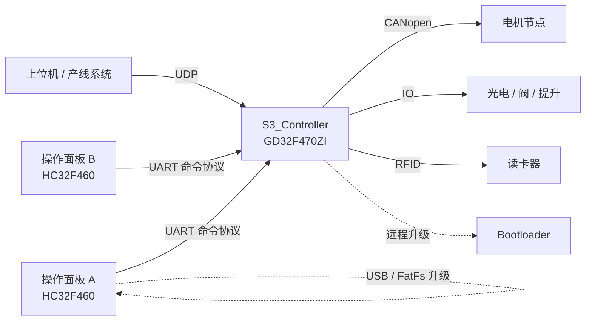

---
领域:
  - 工作
类型:
  - 开发
项目:
  - "[[吊挂操作面板]]"
任务:
  - "[[261030吊挂操作面板维护]]"
相关任务:
  - "[[261029S3维护]]"
状态: 进行
创建时间: 2026-10-30T14:06:05
截止时间: 2027-07-30T14:05:00
完成时间:
---
<!-- plan-doc:v1 -->

# 261030吊挂操作面板维护

> **一句话**：吊挂操作面板（HC32F460）固件维护规划；S3 控制器作为配套依赖，见 [[261029S3维护]]。
> **仓库**：`D:\Screen\Projects\Operation_Panel`（主）｜`D:\S3\Project\S3_Controller`（配套）
> **规则**：改需求先记 C；一功能一机制；执行一次只做一条。

## 0. 看板

- **阶段**：基线已建立（只读侦察完成），需求待登记
- **下一条**：—（无任务；先 `/splan-req` 登记需求）
- **本次范围**：只做面板侧基线 / 机制 / 索引维护；控制器仅作配套记录；不做需求规划、不改代码、不构建
- **事实源**：代码 / 测试 > 仓库 README、AGENTS（两仓库均未找到）> 本文
- **最后更新**：2026-10-30｜**活跃变更**：—｜**冻结**：—｜**血缘**：—（本文件即规划文档，无前身 / 后继）

### 需求登记

<!-- 空：需求统一走 /splan-req；未登记前不生成任务。 -->

| R | 需求 | 来源 | 状态 | 覆盖任务 | 文档 |
|---|---|---|---|---|---|

### 任务总览

| 任务 | 状态 | 出口条件 |
|---|---|---|

### 机制登记

| 机制 | 位置 | 用途 | 扩展方式 | 使用者 |
|---|---|---|---|---|
| 命令协议 CmdProtocol | `Operation_Panel/midware/CmdProtocol.c/.h` | 面板与控制器 UART 命令封装：BCC 校验、129 字节分包、450ms 超时重发（最多 2 次） | 在 `send_command*` / `CMD_Rev` 上扩命令号与参数，不复制收发流程 | 面板全部业务 |
| 菜单状态机 MenuUI | `Operation_Panel/midware/MenuUI.c/.h` | 页面切换与绘制（`M_Home` / `M_Login` / `M_Debug` 等），每页 7 行 | 增 `M_*` 常量与处理函数，沿用 `current_menu_index` | 面板 UI |
| 多语言 LangMenu | `Operation_Panel/midware/LangMenu.c` | `MultiMenu[16]` 语言文案表 | 各语言段补同索引条目 | 菜单与提示 |
| 按键 key | `Operation_Panel/midware/key.c` | 按键扫描、消抖、长按 | 扩按键映射与事件 | 菜单 |
| 读卡 rfidio | `Operation_Panel/midware/rfidio.c` | 刷卡 ID 采集与状态 | 扩读卡状态机与接口 | 登录、出入站 |
| 参数存储 ziflash / interflash / flash | `Operation_Panel/midware/ziflash.c`、`interflash.c`、`flash.c` | 内部 / 外部 Flash 参数与升级参数存取 | 扩参数结构与读写函数 | 系统参数、升级 |
| 面板远程升级 RemoteUpdate | `Operation_Panel/midware/RemoteUpdate.c` | 接收升级参数与固件包，写 Boot 参数并跳转 | 扩升级包协议字段 | 升级 |
| USB / FatFs | `Operation_Panel/midware/USB/`、`midware/fatfs/` | USB Host MSC + FatFs，U 盘升级与文件操作 | 扩文件操作，不改协议 | 升级、数据 |
| 显示 Dispaly / LCD | `Operation_Panel/midware/Dispaly.c`、`lcd/lcd.c`、`fonts.c` | 点阵字体与界面绘制 | 扩绘制函数与字库 | 面板 UI |
| 面板通信对端 Panel | `S3_Controller/APP/Panel.c` | 面板命令解析、消息队列与提示文案（`MsgText`） | 扩命令表与 `MsgText`，仅作跨端约束 | 面板通信 |

> 控制器侧机制（`Panel` / `UDP_Comu` / `BusinessLogic` / `MotionUnit` / `Sensor` / `LineControl` / `FaultDetect` / `HorizWareHouse` / `RFIDReader` / `RemoteUpdate`）统一登记在 [[261029S3维护]] §0；本文件不重复。跨端任务引用时写「机制：复用控制器 X（见 S3 文档）」。

### 基线

- **仓库 / 分支 / 提交**：
  - `Operation_Panel` 当前检出：`develop` @ `50b235c`（2026-10-09，Merge feature/取消电机节点不在线提示）
  - `Operation_Panel` 最新发布分支：`release/V061` @ `7bd9a43`（2026-10-21，领先 `develop` 2 个提交）
  - `S3_Controller`（配套）：`develop` @ `e9120b3`（2026-10-09，移除死代码）
  - 两仓库 `git status --short` 均为空
- **构建命令**：
  - 面板：Keil MDK `MDK/HC32F460KETA.uvprojx`，Target `HC32F460KETA_Debug` → `MDK/output/debug/HC32F460KETA.hex`
  - 控制器：Keil MDK `MDK/network.uvprojx`，Target `DGController_3` → `MDK/Objects/app.hex`
- **测试**：未找到自动化测试与 CI；验证依赖 Keil 构建 0 error + 真机
- **版本标识**：面板 `develop` 为 `CPVER "060"` / `CPVERA "V-CP060260528 00:00:00"`，`release/V061` 为 `CPVER "R61"` / `CPVERA "V-CP061261010 00:00:00"`（`MenuUI.h`）；控制器 `ControlVer "V3.0.06.3"`（`UDP_Comu.c`）
- **最近构建产物**：面板 2026-10-13（`MDK/output/debug/HC32F460KETA.axf`）；控制器 2026-10-15（`MDK/Objects/app.axf`）

## 1. 任务池

### R-T-D-C 关联表 / 状态总览

| 任务 | 状态 | 需求 | 决策 | 变更 | 记录 |
|---|---|---|---|---|---|

### P0（立即）

<!-- 空：等待 /splan-req 登记需求后生成任务。 -->

### P1 / P2

<!-- 空。 -->

### 外部依赖与验收

<!-- 空。 -->

## 2. 契约

- **架构**：本文件以面板（HC32F460KETA）为主；面板经 UART 命令协议连控制器（GD32F470ZI），控制器再经以太网 UDP 连上位机 / 其它控制器、经 CANopen 连电机节点；控制器细节见 [[261029S3维护]]
- **协议 / 数据格式**：
  - 面板协议：BCC 校验；单包上限 129 字节（`EVERY_PACK_MAX`），命令缓冲 5 包；重发 450ms、最多 2 次（`CmdProtocol.h`）
  - 控制器 UDP（边界）：结构体按 `#pragma pack(1)` 打包（`UDP_CMD.h`）；PC 心跳含 MAC、进站满、允许接收、链条启动、语言、屏蔽、返工模式
  - 版本：面板 `develop` 为 `CP060`、`release/V061` 为 `R61`；控制器 `V3.0.06.3`
- **构建与测试命令**：见 §0 基线；无自动化测试

## 3. 设计要点

### 3.1 系统拓扑（面板视角）

- 控制器 `main.h` 中 `sNUM = 2`，对应 A / B 两个站各一块面板
- 面板 UI 文案由 `LangMenu.c` 的 16 组语言表驱动，菜单入口见 `MenuUI.h` 的 `M_*`
- 控制器侧流程与通讯细节不在本文展开，见 [[261029S3维护]]

## 4. 决策与变更

### 决策（D）

| D | 决策 | 结论 | 任务 |
|---|---|---|---|

### 变更（C）

| C | 日期 | 类型 | 需求 | 内容 | 影响 | 处理 | 任务 |
|---|---|---|---|---|---|---|---|

## 5. 实施记录

<!-- 空：任务完成后一行一条。 -->

## 6. 归档

| 任务 | 结果 | 关联 | 提交 |
|---|---|---|---|

## 7. 参考与索引

### 仓库

| 仓库 | 路径 | 角色 | 构建 | 测试 |
|---|---|---|---|---|
| Operation_Panel | `D:\Screen\Projects\Operation_Panel` | 吊挂操作面板固件（HC32F460KETA） | `MDK/HC32F460KETA.uvprojx` → `HC32F460KETA_Debug` | 无自动化 |
| S3_Controller | `D:\S3\Project\S3_Controller` | 配套：S3 吊挂控制器固件（GD32F470ZI，lwIP + CANopen） | `MDK/network.uvprojx` → `DGController_3` | 无自动化 |
| S3_Bootloader | `D:\S3\Project\S3_Bootloader` | 配套：控制器 Bootloader（GD32F470ZI） | `MDK/network.uvprojx` → `DGController_3` | 未侦察 |
| S3_Controller_HardwareTest | `D:\S3\Project\S3_Controller_HardwareTest` | 配套：控制器硬件测试固件 | `USER/network.uvprojx` → `lwIP`（输出 `test`） | 未侦察 |
| S3_MDK | `D:\S3\Project\S3_MDK` | 配套：控制器 MDK 工程副本（`network.uvprojx`，Target `DGController_3`；产物时间 2025-11-20） | `MDK/network.uvprojx` → `DGController_3` | 未侦察 |
| pc_sim | `D:\S3\pc_sim` | 配套：上位机模拟器（控制器联调，Typer + Rich TUI） | `python udp_sim.py [IP]` | 手动调试 |
| RTT | `D:\S3\Project\RTT` | SEGGER RTT 调试打印源码 | — | — |

### 关键文件

| 文件 | 作用 |
|---|---|
| `Operation_Panel/source/MAIN.C` | 面板主循环、初始化、命令分发 |
| `Operation_Panel/midware/CmdProtocol.c/.h` | 面板与控制器命令协议、重发 |
| `Operation_Panel/midware/MenuUI.c/.h` | 菜单状态机、版本号 `CPVER` |
| `Operation_Panel/midware/MenuParam.c`、`SC_MenuParam.c`、`TC_MenuParam.c` | 参数菜单 |
| `Operation_Panel/midware/LangMenu.c` | 16 语言菜单文案 |
| `Operation_Panel/midware/key.c`、`rfidio.c` | 按键、读卡 |
| `Operation_Panel/midware/ziflash.c`、`interflash.c`、`flash.c`、`w25qxx/` | 参数与升级存储 |
| `Operation_Panel/midware/RemoteUpdate.c` | 面板远程升级 |
| `Operation_Panel/midware/USB/`、`midware/fatfs/` | USB Host MSC + FatFs |
| `Operation_Panel/midware/Dispaly.c`、`lcd/lcd.c`、`fonts.c` | 显示与字库 |
| `S3_Controller/APP/main.c` | 配套：控制器入口 |
| `S3_Controller/APP/Panel.c/.h` | 配套：面板命令与消息处理（协议对端） |
| `S3_Controller/APP/UDP_Comu.c`、`UDP_CMD.c` | 配套：以太网 UDP 通信与命令 |
| `S3_Controller/BSP/CanOpen/` | 配套：CANopenNode 从站与 OD |

> 其余控制器模块（`BusinessLogic` / `MotionUnit` / `Sensor` / `LineControl` / `FaultDetect` / `HorizWareHouse` / `RFIDReader` / `RemoteUpdate`）见 [[261029S3维护]] §7，本文件不重复。

### 文档

- 配套规划：[[261029S3维护]]（控制器；含 UDP / 业务 / CANopen 细节）
- 两仓库均未找到 `README.md` / `AGENTS.md` / `docs/`（仅第三方库自带 README）
- 面板根目录 `版本说明1.xlsx`（二进制，未解析）
- 控制器 `UpdateHistory.txt` 内容为加密 / 二进制，未解析
- 基线差异：[[261029S3维护]] 记录面板为 `release/V061` @ `7bd9a43`（R61；版本提交 `c0c3b68`）；本文件记录当前检出 `develop` @ `50b235c`（CP060）。两者相差 2 个提交，开工前按任务指定分支核对
- vault 规范：`C:\Users\SiaZh\OneDrive\SIA的obsidian系统\规范.md`

### 相关仓库 / 依赖

- 面板：FatFs `Operation_Panel/midware/fatfs`；HC32F460 DDL `Operation_Panel/src`、`inc`、`common`
- 配套控制器：lwIP `S3_Controller/LIB/lwip`；CANopenNode `S3_Controller/LIB/CANopenNode`；GD32F4xx 标准外设库 `S3_Controller/LIB`
- 控制器规划：[[261029S3维护]]
- 构建工具：Keil MDK（两工程 `.uvprojx`）
