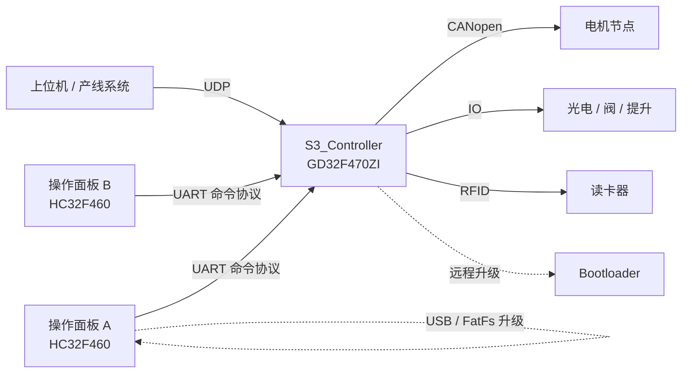
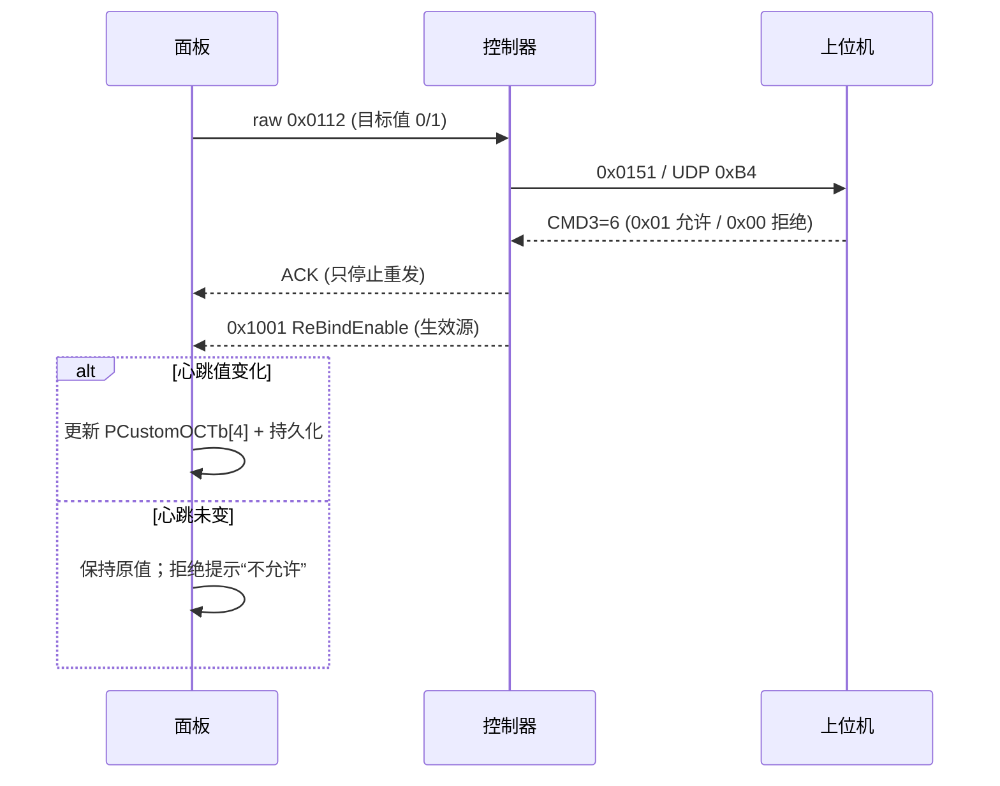
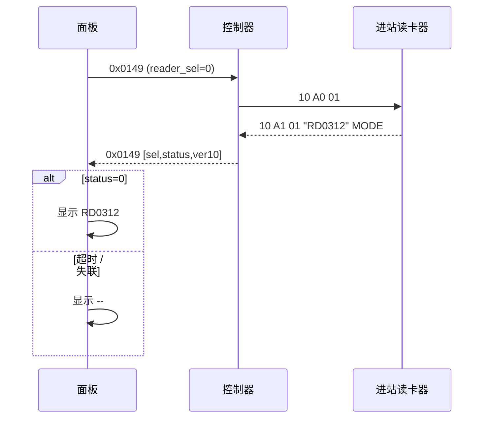

---
领域:
  - 工作
类型:
  - 开发
项目:
  - "[[吊挂操作面板]]"
任务:
  - "[[261030吊挂操作面板维护]]"
相关任务:
  - "[[261029S3维护]]"
状态: 进行
创建时间: 2026-10-30T14:06:05
截止时间: 2027-07-30T14:05:00
完成时间:
---
<!-- plan-doc:v1 -->

# 261030吊挂操作面板维护

> **一句话**：吊挂操作面板（HC32F460）固件维护规划；S3 控制器作为配套依赖，见 [[261029S3维护]]。
> **仓库**：`D:\Screen\Projects\Operation_Panel`（主）｜`D:\S3\Project\S3_Controller`（配套）
> **规则**：改需求先记 C；一功能一机制；执行一次只做一条。

## 0. 看板

- **阶段**：R1 收尾中（T1-4 验收待做）；R2 已登记；R3 照明输出分离全部完成（T3-1/T3-2/T3-4，用户已确认真机矩阵）
- **下一条**：T1-4（P0；换绑优化构建与真机验收；C11：Support×QCPass 组合不再测）
- **本次范围**：R1 换绑优化验收（T1-4）；R2 读卡器版本查询已登记；R3 照明输出分离 T3-1 完成、T3-2 待做（T3-3 已取消）
- **事实源**：代码 / 测试 > 仓库 README、AGENTS（两仓库均未找到）> 本文
- **最后更新**：2026-11-09｜**活跃变更**：C1/C2/C3/C4/C5/C6/C7/C8/C9/C10/C11/C12/C13/C14/C15/C16/C17｜**冻结**：—｜**血缘**：—（本文件即规划文档，无前身 / 后继）

### 需求登记

<!-- 需求统一走 /splan-req；R1 / R2 已登记。 -->

| R | 需求 | 来源 | 状态 | 覆盖任务 | 文档 |
|---|---|---|---|---|---|
| R1 | 面板换绑功能优化：`PCustomOCTb[4]` 改名“启动换绑”；按心跳字段是否存在启用；开关经透传由上位机允许后生效 | 需求笔记 | 待做 | T1-1, T1-2, T1-3, T1-4, T1-5, T1-6, T1-7, T1-8 | [[261030面板换绑功能优化]] |
| R2 | 面板读取读卡器版本号：About 页经 `0x149` 查询进站读卡器版本并显示；上位机后续复用，暂不做 | 现场问题 | 待做 | T2-1, T2-2 | — |
| R3 | 照明输出分离控制（人体存在延伸，定制）：照明/输出独立双通道、登录不控灯、人体自动、照明键短按灯/长按输出、手动优先、换登录释放、无状态同步、心跳 byte39 门控 | 定制需求 | 完成 | T3-1, T3-2, T3-4 | — |

### 任务总览

| 任务                        | 状态   | 出口条件                                                                         |
| ------------------------- | ---- | ---------------------------------------------------------------------------- |
| T1-1 锁定换绑透传协议与字段存在性策略     | done | 结论报告给出对象 ID / 允许拒绝码 / 超时 / 心跳偏移 / 兼容策略                                       |
| T1-2 实现心跳字段存在性检测与同步       | done | 长帧 Support=1 且状态同步；短帧 Support=0 且保持旧行为                                       |
| T1-3 实现“启动换绑”菜单与允许后生效     | done | 心跳变化才生效并持久化；ACK 只停重发；拒绝 / 超时保持心跳值并提示                                         |
| T1-4 换绑优化构建与真机验收          | todo | Keil 0 error；真机覆盖允许 / 拒绝 / 掉电 / 短帧；补 QCPass 键（C11：Support×QCPass 不测）与控制器链路闭环 |
| T1-6 控制器换绑心跳追加（只改心跳）      | done | PC 心跳 Data[24] 取值直传；有效则 0x1001 40 字节，无效保持 39 字节；编译无新增错误＋模拟两套行为               |
| T1-7 面板 QCPass 键换绑判断      | done | 与手拍逐行一致的判断逻辑（无 Support 门控）；直发 `0x0218`、已扫码 `0x0107`；真机覆盖使能开/关×绑/未绑×扫/未扫      |
| T1-8 面板换绑值收发统一 0xAA/0x55  | done | 收：@39 归一化为 1/0；发：请求字节 0xAA/0x55；注入＋抓包验证                                      |
| T1-5 换绑菜单与透传机制修正（T1-3 修订） | done | OK 只发 0x112、心跳边沿生效持久化、ACK/超时只停重发并提示、短帧旧逻辑                                    |
| T2-1 控制器读卡器版本查询与 0x149 回包 | todo | 进站读卡器 `10 A0 01` 查询、`10 A1 01` 解析、500ms 超时、0x149 回包                          |
| T2-2 面板 About 页读卡器版本查询与显示 | todo | About 页显示实际版本；离线显示 `--`；不回归 CP / 控制器版本                                       |
| T3-1 面板照明键分离手动控制          | done | 短按灯/长按输出手动命令（0x195/0x196）；登录不控灯；Keil 0 error＋真机 M1-M9 全过                     |
| T3-2 控制器双通道独立与登录自释放       | done | 接管标志RAM、手动优先、登录边沿释放；上报40B byte39门控；登录灯控 InPinID 门控（C17）；无新增链接错误＋真机验证         |
| T3-4 面板门控字节39对齐           | done | `[40]/>=41` 改 `[39]/>=40`；随同批 hex 联调通过                                       |

### 机制登记

| 机制 | 位置 | 用途 | 扩展方式 | 使用者 |
|---|---|---|---|---|
| 命令协议 CmdProtocol | `Operation_Panel/midware/CmdProtocol.c/.h` | 面板与控制器 UART 命令封装：BCC 校验、129 字节分包、450ms 超时重发（最多 2 次） | 在 `send_command*` / `CMD_Rev` 上扩命令号与参数，不复制收发流程 | 面板全部业务 |
| 菜单状态机 MenuUI | `Operation_Panel/midware/MenuUI.c/.h` | 页面切换与绘制（`M_Home` / `M_Login` / `M_Debug` 等），每页 7 行 | 增 `M_*` 常量与处理函数，沿用 `current_menu_index` | 面板 UI |
| 多语言 LangMenu | `Operation_Panel/midware/LangMenu.c` | `MultiMenu[16]` 语言文案表 | 各语言段补同索引条目 | 菜单与提示 |
| 按键 key | `Operation_Panel/midware/key.c` | 按键扫描、消抖、长按 | 扩按键映射与事件 | 菜单 |
| 读卡 rfidio | `Operation_Panel/midware/rfidio.c` | 刷卡 ID 采集与状态 | 扩读卡状态机与接口 | 登录、出入站 |
| 参数存储 ziflash / interflash / flash | `Operation_Panel/midware/ziflash.c`、`interflash.c`、`flash.c` | 内部 / 外部 Flash 参数与升级参数存取 | 扩参数结构与读写函数 | 系统参数、升级 |
| 面板远程升级 RemoteUpdate | `Operation_Panel/midware/RemoteUpdate.c` | 接收升级参数与固件包，写 Boot 参数并跳转 | 扩升级包协议字段 | 升级 |
| USB / FatFs | `Operation_Panel/midware/USB/`、`midware/fatfs/` | USB Host MSC + FatFs，U 盘升级与文件操作 | 扩文件操作，不改协议 | 升级、数据 |
| 显示 Dispaly / LCD | `Operation_Panel/midware/Dispaly.c`、`lcd/lcd.c`、`fonts.c` | 点阵字体与界面绘制 | 扩绘制函数与字库 | 面板 UI |
| 面板通信对端 Panel | `S3_Controller/APP/Panel.c` | 面板命令解析、消息队列与提示文案（`MsgText`） | 扩命令表与 `MsgText`，仅作跨端约束 | 面板通信 |
| 换绑状态同步 | `Operation_Panel/source/MAIN.C`、`midware/MenuParam.c`、`midware/key.c` | `PCustomOCTb[4]` 与 0x1001 心跳 `ReBindEnable` 同步、允许后生效 | 复用 0x1001 解析与 `send_trans_command_start`，不新增协议栈 | T1-2、T1-3 |

> 控制器侧机制（`Panel` / `UDP_Comu` / `BusinessLogic` / `MotionUnit` / `Sensor` / `LineControl` / `FaultDetect` / `HorizWareHouse` / `RFIDReader` / `RemoteUpdate`）统一登记在 [[261029S3维护]] §0；本文件不重复。跨端任务引用时写「机制：复用控制器 X（见 S3 文档）」。

### 基线

- **仓库 / 分支 / 提交**：
  - `Operation_Panel` 当前检出：`feature/人体存在` @ `7b5e3d5`（T3-1 六文件已提交；`tool/` 四件套未跟踪不提交；工作区干净）；换绑分支 `feature/换绑优化` 停在 @`433441d`（隔离不动）
  - `Operation_Panel` `develop` / 最新发布分支：`develop` @ `50b235c`；发布 `release/V061` @ `7bd9a43`（领先 `develop` 2 个提交）
  - 实现分支：`feature/换绑优化`（T1-2/T1-5/T1-8/T1-7 已提交）；R2 待 R1 收尾后新建 `feature/T2-2-reader-version`
  - `S3_Controller`（配套）：`develop` @ `aeef0ca`（任务分支 `feature/T1-1-unknown-card-filter` @ `6bb33bf` 未合并；换绑任务分支 `feature/换绑优化` @ `7249ee0`，T1-6 已提交）
  - `git status --short`：面板干净；控制器跟踪文件干净（仅未跟踪 `.embeddedskills/`，非本任务）
- **构建命令**：
  - 面板：Keil MDK `MDK/HC32F460KETA.uvprojx`，Target `HC32F460KETA_Debug` → `MDK/output/debug/HC32F460KETA.hex`
  - 控制器：Keil MDK `MDK/network.uvprojx`，Target `DGController_3` → `MDK/Objects/app.hex`
- **测试**：未找到自动化测试与 CI；验证依赖 Keil 构建 0 error + 真机
- **版本标识**：面板 `develop` 为 `CPVER "060"` / `CPVERA "V-CP060260528 00:00:00"`，`release/V061` 为 `CPVER "R61"` / `CPVERA "V-CP061261010 00:00:00"`（`MenuUI.h`）；控制器 `ControlVer "V3.0.07.0"`（`UDP_Comu.c`）
- **最近构建产物**：面板 2026-10-13（`MDK/output/debug/HC32F460KETA.axf`）；控制器 2026-10-15（`MDK/Objects/app.axf`）
- **构建现状**：控制器完整链接失败（当前观测：`SEGGER_RTT_Init` 未定义，`main.o` 引用；stash 对比 `develop` 基线同样单错，属基线问题未修；早先记 `APP/FullyEnclosed.c` 缺失，同属链接基线缺失类）；本文件任务只要求改动文件编译无新增错误

## 1. 任务池

### R-T-D-C 关联表 / 状态总览

| 任务 | 状态 | 需求 | 决策 | 变更 | 记录 |
|---|---|---|---|---|---|
| T1-7 面板 QCPass 键换绑判断 | done | R1 | D3/D8 | C5/C10/C11 | §5 |
| T1-8 面板换绑值收发统一 0xAA/0x55 | done | R1 | D3/D9 | C8/C9 | §5 |
| T1-4 换绑优化构建与真机验收 | todo | R1 | — | C5 | §5 |
| T2-1 控制器读卡器版本查询与 0x149 回包 | todo | R2 | D6 | C3 | §5 |
| T2-2 面板 About 页读卡器版本查询与显示 | todo | R2 | D6 | C3 | §5 |
| T3-1 面板照明键分离手动控制 | done | R3 | D10 | C12 | §5 |
| T3-2 控制器双通道独立与登录自释放 | done | R3 | D10 | C12/C14/C15/C16 | §5 |
| T3-4 面板门控字节39对齐 | done | R3 | D10 | C15 | §5 |

### P0（立即）

- [ ] **T1-4 换绑优化构建与真机验收** → 需求：R1（← C5 范围扩展；C11：Support×QCPass 组合不再测）；产出：Keil 构建日志 + 真机验收记录；验证手段：`UV4 -b MDK/HC32F460KETA.uvprojx -t HC32F460KETA_Debug` → 0 error；人工：长帧 enable=0 / 1、允许 / 拒绝、掉电重启、短帧旧行为；T1-6/T1-7/T1-8 完成后补：QCPass 键使能开 / 关验证、控制器链路真机闭环、面板收发 0xAA/0x55 验证；机制：复用现有构建；边界：只验证，发现问题开新任务
### P1 / P2

- [ ] **T2-1 控制器读卡器版本查询与 0x149 回包** → 需求：R2（← C3）；产出：`S3_Controller/APP/RFIDReader.c/h`、`Panel.c/h`；分支 `feature/T2-1-reader-version`（基于 `develop` `aeef0ca`）；验证手段：静态核对 `10 A0 01` 发送、`10 A1 01` 解析、500ms 超时、`0x149` 响应 `[sel,status,ver10]`；Keil `DGController_3` 无新增错误（基线 `APP/FullyEnclosed.c` 缺失未修）；机制：复用控制器 RFID 读卡（见 [[261029S3维护]]）+ 面板对象读（D6）；边界：只查该站进站读卡器；不改读卡器固件 / SR3 协议 / 面板 UI / 上位机 / 0x55 过滤
- [ ] **T2-2 面板 About 页读卡器版本查询与显示** → 需求：R2（← C3）；产出：`Operation_Panel/midware/MenuUI.c`、`MenuParam.c/h`、`source/MAIN.C`；前置：R1 T1-2/T1-3 收尾并提交，基于 R1 合并后的 `develop` 新建 `feature/T2-2-reader-version`；验证手段：About 页进入发 `0x0149`（sel=0）→ 显示 `RD0312`；读卡器离线 / 超时 → `--`；CP / 控制器版本不回归；Keil `HC32F460KETA_Debug` 0 error；机制：复用 CmdProtocol 对象读 + About 页（D6）；边界：不改 R1 换绑逻辑、不实现控制器查询、不改上位机

### 外部依赖与验收

- [ ] **V-1 控制器 / 上位机换绑协议** → 验收：控制器在 0x1001 增加 `ReBindEnable` 字段（偏移 39）；上位机对透传请求返回允许 / 拒绝；控制器转发回面板；并入 [[261029S3维护]] 登记
- [ ] **V-2 读卡器版本真机验收** → 验收：面板 About 页显示实际 `RD0312`；拔掉 / 失联读卡器显示 `--`；刷卡与升级不受影响；上位机后续复用 `0x149` 缓存

## 2. 契约

- **架构**：本文件以面板（HC32F460KETA）为主；面板经 UART 命令协议连控制器（GD32F470ZI），控制器再经以太网 UDP 连上位机 / 其它控制器、经 CANopen 连电机节点；控制器细节见 [[261029S3维护]]
- **协议 / 数据格式**：
  - 面板协议：BCC 校验；单包上限 129 字节（`EVERY_PACK_MAX`），命令缓冲 5 包；重发 450ms、最多 2 次（`CmdProtocol.h`）
  - 控制器 UDP（边界）：结构体按 `#pragma pack(1)` 打包（`UDP_CMD.h`）；PC 心跳含 MAC、进站满、允许接收、链条启动、语言、屏蔽、返工模式
  - 版本：面板 `develop` 为 `CP060`、`release/V061` 为 `R61`；控制器 `V3.0.07.0`
- **换绑协议 v1.2（← C1/C2/C8/C9，2026-11-02/09）**：`0x1001` 心跳追加 `ReBindEnable` 于负载偏移 39（0xAA 开 / 0x55 关，控制器直传 PC 心跳第 31 字节原值；面板归一化 0xAA→1）；面板 `u16PLen >= 50`（负载 ≥40）判存在；旧 38/39 字节帧走旧“扫码自动出衣”逻辑。透传使用 raw 子对象 `0x0112`（协议 V1.26 已新增 `112H 启动换绑`：W、1 字节、0x55 关闭 / 0xAA 开启；Ack 0x01 允许 / 0x00 拒绝；`111H` 已用于“带类型返工”），必须封装在 `0x0151` 内（禁止直发；控制器主对象 `0x112` 为 `OBJ_READER_EN`，`0x111` 为 `OBJ_RAISE_TIMEOUT2`）；控制器经 UDP `CMD3=0xB4` 上送、PC 以 `CMD3=6` 下送；450ms 首发 + 700ms×2 重试，约 1.85s 超时；实现分支 `feature/换绑优化`
- **换绑生效源（← C2）**：Ack `0x01` / `0x00` 只用于停止重发；`PCustomOCTb[4]` 只由 0x1001 `ReBindEnable` 更新；心跳边沿才持久化；ACK 不直接写状态
- **QCPass 键行为（← C10/C11）**：与手拍逐行一致，唯一差异是直发指令（手拍 `0x021C`／QCPass `0x0218`）；`PCustomOCTb[4]==1 && BondHanger!=0` 时未扫码 → `TNeedScanBar`、已扫码 → `0x0107`（衣架号＋扫码内容，同手拍格式）；其余情况直发 `0x0218`；无 `ReBindSupported` 门控（C11）
- **照明输出分离（← C12/R3）**：照明与输出独立双通道，各一 RAM 手动接管标志；手动优先，接管期跳过自动；登录边沿释放；状态不同步；手动命令 `0x195`（照明）/`0x196`（输出），值 1=手动开/2=手动关/0=回自动（面板只发 1/2，0 由控制器登录释放）
- **分离启用门控（← C15，C13/C14 作废）**：门控信号=心跳 byte39（`HumanSensValid`，控制器按端口有无配置判定 0/1，T3-2 内定，只看输入端口（InPinID!=0 即=1，输出不管；C16 用户拍板）；面板按负载 `>=40` 解析 `u8DataBuf[39]`（缺段清零；`554e625` 的 `[40]/>=41` 由 T3-4 对齐），`key.c` 以此分流（0 走老开关灯 `0x021E`，非零发手动命令）；控制器负载 40 字节（现行 39＋1：`[39]` 门控值）
- **读卡器版本对象（← C3，2026-11-02）**：新增 `OBJ_READER_VER 0x149`（`0x148` 为控制器版本，`0x150` 为防晃）；请求 1 字节 `reader_sel`（0=进站，1/2 预留下放/出站）；响应 `[reader_sel, status, ver10]`，status 0=OK / 1=超时或失联；控制器向进站读卡器发 `10 A0 01`，解析 `10 A1 01`，500ms 超时；面板 About 页显示，上位机后续复用同一缓存
- **构建与测试命令**：见 §0 基线；无自动化测试

## 3. 设计要点

### 3.1 系统拓扑（面板视角）

- 控制器 `main.h` 中 `sNUM = 2`，对应 A / B 两个站各一块面板
- 面板 UI 文案由 `LangMenu.c` 的 16 组语言表驱动，菜单入口见 `MenuUI.h` 的 `M_*`
- 控制器侧流程与通讯细节不在本文展开，见 [[261029S3维护]]

### 3.2 换绑开关方案（R1）

- **字段存在性即开关**：不判断版本号、不判断 S3；`0x1001` 负载长度 ≥ 40 字节（`u16PLen >= 50`）视为存在 `ReBindEnable`，否则按旧“扫码自动出衣”逻辑。
- **状态分工（← C4）**：`PCustomOCTb[4]` 为生效值（心跳驱动），存 `GlobalProfile[S_CodeAutoOut][0]`，默认 0；`PCustomOCShow[4]` 为编辑值（F1 装载、OK 只发请求）；复用透传层共享状态（`m_TransCmdResend` + `PackSign[U_ReBind]`，`U_ReBind=18`），无单独 pending/重试变量与 ACK/重发函数；`PCustomTb[4]` 仅 ☒/☑ 字形。
- **心跳为生效源**：KEY_OK 不直接赋值，直接调 `send_trans_command_start(0x85, 0x100 + U_ReBind, …)` 发送目标值（封装在 0x0151 内）；`PCustomOCTb[4]` 只由 0x1001 `ReBindEnable` 边沿更新；心跳值变化时持久化一次；透传层 `AckRightSign` / `IsWaitSign` 停止重发。
- **应答只作重发依据**：Ack `0x01` 允许 / `0x00` 拒绝都只停止重发，不写 `PCustomOCTb[4]`；无 Ack 按 450ms 首发 + 700ms×2 重试，约 1.85s 后清 pending 并提示“未响应”；拒绝只提示“不允许”，生效值仍以心跳为准。
- **时序**：Ack 与心跳到达顺序任意；ACK 处理器不碰生效值，心跳处理器不依赖 ACK；避免 ACK 覆盖心跳或反之。
- **兼容（← C4）**：菜单文案统一为“启动换绑”（15 语言 `MCustomTb[4]` 原项直改）；字段不存在时仅 OK 保留旧赋值逻辑，不再区分旧文案；拒绝弹 `TReBindDenied=62`“不允许启用换绑”，无 ACK 超时按 `IsWaitSign==2` 弹 `TNoAck`（与其它菜单一致）。
- **约束**：V-1 必须基于含 `QCFailMode` 的控制器 `develop`，否则 `ReBindEnable` 会落到偏移 38；禁止复用 `STABindMode` bit12（控制器该位为 `canError`）；协议 V1.26 已新增 `112H 启动换绑`（W，1 字节，0x55 关闭 / 0xAA 开启 ← C9；Ack 0x01 允许 / 0x00 拒绝），`111H` 已用于“带类型返工”（C1）。
- **遗留（待 T1-4 / V-1 验收）**：上位机透传允许 / 拒绝真实现；旧 `S_CodeAutoOut=1` 升级迁移；断链 / 双面板是否一律以 0x1001 为准。
- **不做**：不改控制器 / 上位机；不改 0x0107 绑定数据格式；不改非标准版。

- **时序约束（← C2）**：ACK 与心跳顺序任意；ACK 不写 `PCustomOCTb[4]`，只停止重发。

### 3.3 面板读卡器版本查询（R2）

- **链路**：面板 About 页 → 控制器 `OBJ_READER_VER 0x149` → 该站进站读卡器 `10 A0 01` → `10 A1 01 "RD0312" MODE` → 控制器缓存 → 面板显示。
- **对象语义（← C3）**：请求 1 字节 `reader_sel`（0=进站；1/2 预留下放/出站）；响应 `[reader_sel, status, ver10]`，status 0=OK / 1=超时或失联；版本字符串 10 字节，不足补 0。
- **控制器**：`RFID_Recv` 增加 `10 A1 01` 10 字节响应解析，缓存到 `ReaderVer[sNUM][11]`；查询超时 500ms；`Panel_ReadData` 触发查询，`Panel_Send` 异步回 `0x149`。
- **面板**：About 页新增 `Reader:` 行（y=63）；进入页面发 `0x0149`（sel=0）；解析响应后显示 `RD0312`，超时 / 失联显示 `--`；CP / 控制器版本逻辑不变。
- **不做**：不改读卡器固件 / SR3 协议 / 上位机；暂不查下放 / 出站读卡器（selector 预留）；不改 R1 换绑逻辑。

### 3.4 控制器换绑链路、面板归一化与 QCPass 键判断（R1，←C5/C6/C7/C8/C9/C10/C11）

- **控制器链路（T1-6，只改心跳 ← C6/C7/C8）**：分支 `feature/换绑优化`（控制器仓库新建，基于 `develop` `aeef0ca`；与面板同名分支不同仓库，互不干扰）。透传两方向已核查为通用通道、零改动：上行 `Panel.c:3065` 0x0151 原样进 `TransDataPNL` → `UDP_Comu.c:1578` 转 0xB4 上送；下行 `UDP_Comu.c:647` TRANSFER_RAW_DOWN 原样进 `TransDataPC` → `Panel.c:667` 以 0x1004 下发（面板侧 T1-5 已就绪）。只做两处：① `UDP_CMD.h` 的 `PC_HEARTBEAT_STRU` 追加 1 字节（`LinkTestCmd` 按 sizeof 截断拷贝，不加读不到），取 `Data[24]`（PC 心跳第 31 字节，返工之后；0xAA 开 / 0x55 关），Len≥25 判存在并记入本站状态（`Panel.c` 的 `ReBindEnable/Valid[sNUM]` 数组，未进 `StatParam`，守 4 文件边界）；② `Panel.h` 的 `PER_UPLOAD_PACK_STRU` 追加 1 字节，`PerUploadPack` 在有效时**直传原值** 0xAA/0x55 打包 @39（40 字节），无效时保持 39 字节（面板走旧模式，无需应答）。
- **面板收发统一 0xAA/0x55（T1-8 ← C8/C9）**：收：`MAIN.C` 的 0x1001 分支收帧时归一化（`0xAA→1、其余→0`）再进 `ReBindEnable` / `PCustomOCTb[4]`，短帧（39 字节）逻辑不变，手拍判断与 ☒/☑ 显示不受影响；发：OK 请求把 `PCustomOCShow[4]` 的 1→0xAA、0→0x55 后装包（112H 请求值按协议已改为 0x55 关闭 / 0xAA 开启，ACK 维持 0x01/0x00）。
- **QCPass 判断（T1-7 ← C10/C11）**：`key.c` 的 `KEY_QCPass` 分支照搬手拍（`KeySP`，`key.c:94`），唯一差异是直发指令（手拍 `0x021C`／QCPass `0x0218`）：`PCustomOCTb[4]==1 && BondHanger!=0` 时，未扫码 → 弹 `TNeedScanBar`，已扫码 → 发 `0x0107`（衣架号＋扫码内容，同手拍格式，清状态）；其余情况走原本 QCPass 流程（`QCPassSign=1` 直发 `0x0218`）。`BondHanger`=控制器衣架号、`ScanBarChar`=扫码内容；无 `ReBindSupported` 门控（C11 用户指示删除；C10 原 Support 行作废）；非标模式分支不变。
- **不做**：上位机真实现（V-1 保持待验收）；`0x0107` 格式改动；手拍逻辑改动；非标逻辑改动；修 `FullyEnclosed.c` 基线。

### 3.5 照明输出分离控制（R3，←C12）

- **通道独立（D10）**：照明（`Lamp`）与输出（`OUT_IO`）各一手动接管标志（RAM，不进 Flash）；接管期间 `BodySensFunc` 跳过该通道自动逻辑；两通道互不联动。
- **面板（T3-1 已实现 `554e625`，门控见下 C14 条）**：`key.c` 照明键短按 toggle 照明手动、长按 toggle 输出手动；登录→照明联动面板侧查无（零改动）。
- **手动命令对象（已定）**：`0x195`（照明手动）/`0x196`（输出手动），值语义 0=回自动 / 1=手动开 / 2=手动关（面板只发 1/2；控制器 `Panel.c` 落对象处理，走现有命令协议，不新增协议栈）。
- **释放（T3-2，方案 B）**：控制器检测 `StatParam[].LoginState` 边沿变化（NoLogin/LoginOK/Logining 之间任意跃迁）即清双通道接管，回落人体自动；登录状态源已核实（`UDP_CMD.c:283 LoginCmd` / `UDP_Comu.c:478/488` 登出 / 刷卡登录维护）。
- **启用门控（← C15，C13/C14 作废）**：门控信号=心跳 byte39（`HumanSensValid`，0/1）。面板（`554e625` 为 byte40 实现，由 T3-4 对齐到 39）：`MAIN.C` 按负载 `>=40` 解析 `u8DataBuf[39]`（缺段/短帧清零），`key.c` 照明键以此分流（0→老开关灯 `0x021E` 原样，含 `LightSign/0x0106` 应答；非零→`0x195/0x196` 本地交替 1/2）；`PIOinSetTb[40]/PIOoutSetTb[33]` 初值 `00`=未配置。
- **控制器上报（T3-2 范围，分支 `feature/人体存在`）**：`Panel.h` 的 `PER_UPLOAD_PACK_STRU`（现 39 字节，`Language@36/StopOut@37/QCFailMode@38`）追加 1 字节 `[39]=HumanSensValid` 至 40（`Len=tempLen+10` 自动变 50）；`Panel.c` 的 `PerUploadPack` 按 `BodySens[StatNum]` 端口配置赋值（只看输入端口（C16 已定），任务内定）；`InPinID/OutPinID` 配置链路（`0x190/0x191`＋Flash）已存在，零改动。
- **控制器手动接管（T3-2 范围）**：`BodySens` 拆照明/输出两 RAM 接管标志；`BodySensFunc` 接管通道跳过自动（输出关延时重计时语义保留）；`0x195/0x196` 对象处理（参照 `OBJ_BODY_SENS_IN/OUT` 的 `InPinConfig/OutPinConfig` 分支位置，`Panel.c` 落 `case`，值 1=手动开/2=手动关/0=回自动）；登录边沿释放（推荐 `BodySensFunc` 内缓存上轮 `LoginState` 比对，任意跃迁即清双通道接管，不跨模块钩子）；登录开灯/退出关灯加 `InPinID==0` 门控（C17：有配置则不碰灯，退出关灯不再打乱自动机 `State`；未配置走老路）。
- **前置**：面板分支已含门控实现（`554e625`）；控制器分支基线即 `develop` @`aeef0ca`，但当前检出不在该分支，开工先 `switch feature/人体存在` 并核对。
- **启用门控（← C13，作废，被上 C14 条取代）**：延时值门控已废弃。
- **不做**：状态同步（不上报/不显示）；旧面板兼容；换绑/R1 改动；延时参数改动（已做：0..600/初值 0/IO 初值 00）。

## 4. 决策与变更

### 决策（D）

| D | 决策 | 结论 | 任务 |
|---|---|---|---|
| D1 | 心跳字段存在性作为唯一启用条件 | `u16PLen >= 50`（负载 ≥40）= 支持；旧 38/39 字节帧走旧逻辑；不判版本 / S3 | T1-2 |
| D2 | 换绑开关由上位机判定；心跳为生效源 | 控制器 0x0151 封装 raw 0x0112 → UDP 0xB4；PC CMD3=6 回送 0x01 / 0x00；ACK 只停重发，不写状态；约 1.85s 超时 | T1-3 |
| D3 | 字段缺失保持旧行为 | 旧文案与旧扫码逻辑不变；字段存在才用“启动换绑” | T1-2, T1-3 |
| D4 | 沿用现有 `PCustomOCTb[4]` 与存储键 | 默认 0；心跳边沿才持久化；ACK 不持久化；旧 `S_CodeAutoOut=1` 迁移待 T1-3 | T1-3 |
| D5 | 换绑透传使用 raw 子对象 0x0112 | 协议 V1.26 已分配 112H；必须封装在 0x0151 内，禁止直发；0x111 已被 111H“带类型返工”占用；450ms 首发 + 700ms×2 重试 | T1-3 |
| D6 | 读卡器版本查询对象与范围 | 新对象 `0x149`（0x148 已占、0x150 为防晃）；请求 `reader_sel`，响应 `[sel,status,ver10]`；先只查进站读卡器，下放/出站预留；控制器按需查询 + 500ms 超时 | T2-1, T2-2 |
| D7 | 控制器换绑只需改心跳（← C6/C7/C8） | 透传两方向经核查为通用通道、raw 0x0112 零改动；T1-6 只做 `0x1001` 打包追加 `ReBindEnable` 于偏移 39（`PER_UPLOAD_PACK_STRU` ＋1 字节）；值来源 = PC 心跳第 31 字节（`Data[24]`，0xAA 开 / 0x55 关），`PC_HEARTBEAT_STRU` 须 ＋1 字节（`LinkTestCmd` 按 sizeof 截断）；新 PC 帧 Len≥25 判存在，**控制器直传原值 0xAA/0x55（← C8，不再映射）**；旧帧 Len=24 则面板心跳保持 39 字节走旧模式（无需应答）；面板侧归一化见 D9；分支 `feature/换绑优化`（控制器仓库，基于 `develop` `aeef0ca`）；构建约束：完整链接基线缺 `APP/FullyEnclosed.c`，验证以改动文件编译 + `pc_sim` 模拟为准 | T1-6 |
| D9 | 面板换绑值收发统一 0xAA/0x55（← C8/C9） | 收：控制器 @39 下发原值 0xAA/0x55，面板 `MAIN.C` 收帧时归一化（0xAA→1、其余→0）再进 `ReBindEnable` / `PCustomOCTb[4]`，旧 `==1` 判断与显示不变；发：OK 请求把 `PCustomOCShow[4]` 的 1→0xAA、0→0x55 后装包（`key.c` 发送侧映射），ACK 仍按 0x01/0x00 处理；短帧（39 字节）逻辑不变 | T1-8 |
| D8 | QCPass 键换绑判断与手拍逐行一致（← C10/C11） | 照搬 `KeySP`（`key.c:94`），唯一差异是直发指令（手拍 `0x021C`／QCPass `0x0218`）：`PCustomOCTb[4]==1 && BondHanger!=0` 时，未扫码（`ScanBarChar` 经 `strtod==0` 判空，同手拍）→ 弹 `TNeedScanBar`，已扫码 → 发 `0x0107`（衣架号＋扫码内容，同手拍格式，清状态）；其余情况走原本 QCPass 流程（`QCPassSign=1` 直发 `0x0218`）。`BondHanger`=控制器衣架号、`ScanBarChar`=扫码内容；**无 `ReBindSupported` 门控**（C11：用户指示删除，与手拍逐行一致；C10 原"Support=0→直发"行作废）；非标模式分支不变；不改手拍逻辑；`TNeedHanger` 不用 | T1-7 |
| D10 | 照明输出分离手动接管机制（← C12/C13/C14/C15/C16/C17） | 照明（`Lamp`）与输出（`OUT_IO`）各一 RAM 手动接管标志（不进 Flash）；手动优先，接管期间跳过该通道人体自动逻辑；控制器检测 `LoginState` 边沿释放双通道；状态不同步；手动命令走现有命令协议新对象（`0x195/0x196`，值 1=手动开/2=手动关/0=回自动）；**启用门控（← C15，取代 C13 延时值门控／C14 byte40）=心跳 byte39**：面板 `MAIN.C` 按负载 `>=40` 解析 `u8DataBuf[39]`→`HumanSensValid`（缺段清零），`key.c` 以此分流（0 走老开关灯 `0x021E`，非零发手动命令）；控制器上报 40 字节、[39] 门控值（T3-2 内定，只看输入（C16 已定）；登录开灯/退出关灯加 `InPinID==0` 门控（C17））| T3-1, T3-2 |

### 变更（C）

| C   | 日期         | 类型  | 需求  | 内容                                                                                                                                                                                                                                                      | 影响             | 处理                           | 任务         |
| --- | ---------- | --- | --- | ------------------------------------------------------------------------------------------------------------------------------------------------------------------------------------------------------------------------------------------------------- | -------------- | ---------------------------- | ---------- |
| C1  | 2026-11-02 | 修改  | R1  | 换绑透传 raw 子对象由 0x0111 改为 0x0112；协议文档新增 V1.26，112H=启动换绑（W，1 字节，0x00 关闭 / 0x01 开启；Ack 0x01 允许 / 0x00 拒绝）；111H 已用于“带类型返工”                                                                                                                                   | 契约、任务、机制、文档    | 完成（T1-3）                     | T1-3       |
| C2  | 2026-11-02 | 修改  | R1  | 换绑开关改为心跳唯一生效源；允许 / 拒绝 ACK 只作停止重发依据，不直接写 `PCustomOCTb[4]`；心跳边沿才持久化                                                                                                                                                                                       | 契约、任务、机制、文档    | 完成（T1-3）                     | T1-3       |
| C3  | 2026-11-02 | 新增  | R2  | 新增面板读卡器版本查询：`0x149` 对象、进站读卡器 `10 A0 01` / `10 A1 01`、About 页显示；上位机暂不做                                                                                                                                                                                   | 任务、契约、测试、文档、机制 | T2-1, T2-2                   | T2-1, T2-2 |
| C4  | 2026-11-09 | 修改  | R1  | T1-3 修订实现（T1-5）：菜单文案统一为“启动换绑”（15 语言原项直改；字段缺失时仅 OK 保留旧逻辑，不再区分旧文案）；透传复用通用层机制（`U_ReBind=18` / `PackSign[18]`，无单独 ACK/重发函数；拒绝弹 `TReBindDenied=62`、超时按 `IsWaitSign==2` 弹 `TNoAck`）；`1dfd10f` 版实现已 reset 丢弃，T1-5 为现行实现                                        | 任务、文档、机制       | 完成（T1-5）                     | T1-5       |
| C5  | 2026-11-09 | 新增  | R1  | 新增控制器换绑链路（T1-6，控制器仓库分支 `feature/换绑优化`，基于 `develop` `aeef0ca`）与面板 QCPass 键换绑判断（T1-7，逻辑与手拍一致、指令 `0x0218` 系；已扫码后指令待确认）；T1-4 验收范围扩展（补 QCPass 键与控制器链路真机闭环）                                                                                                   | 任务、测试、文档、机制    | T1-6完成；T1-7完成（C10/C11）       | T1-6, T1-7 |
| C6  | 2026-11-09 | 修改  | R1  | T1-6 范围收窄：经代码核查，透传两方向均为子对象无关通用通道（上行 `Panel.c:3065` 0x0151 → `UDP_Comu.c:1578` 0xB4；下行 `UDP_Comu.c:647` TRANSFER_RAW_DOWN → `Panel.c:667` 0x1004），raw 0x0112 零改动；T1-6 只做 0x1001 心跳追加 `ReBindEnable`（`PER_UPLOAD_PACK_STRU` ＋1 字节、打包赋值），值来源仍待 T1-6 内确认    | 任务、文档          | 完成（T1-6）                     | T1-6       |
| C7  | 2026-11-09 | 修改  | R1  | T1-6 值来源明确（用户给出 PC 心跳表）：PC 心跳第 31 字节（`UDP_CMD_R.Data[24]`，返工之后；0xAA 开启 / 0x55 关闭）即换绑使能；`LinkTestCmd` 按 `sizeof(PC_HEARTBEAT_STRU)` 截断拷贝，struct 须 ＋1 字节才能读到；新 PC 帧 Len≥25 判存在并映射（0xAA→1、其余→0）后追加进面板 0x1001 @39，旧帧 Len=24 则面板心跳保持 39 字节、走旧模式（无需应答）；面板侧零改动 | 任务、测试、文档       | 完成（T1-6）                     | T1-6       |
| C8  | 2026-11-09 | 修改  | R1  | 控制器→面板 0x1001 换绑字段改用 0xAA/0x55（用户给 1001H 表；与 PC 心跳一致，不再映射 0xAA→1）：控制器直传原值；面板侧新增归一化（T1-8，`0xAA→1、其余→0`，否则 `PCustomOCTb[4]` 存 0xAA 会冲掉 `==1` 判断与显示）；协议文档 1001H 须加"是否开启换绑"行并把"共39"改为 40；112H 请求值维持 0x01/0x00 不变（待上位机确认，若统一另记 C）                            | 任务、测试、文档       | T1-6完成；T1-8完成                | T1-6, T1-8 |
| C9  | 2026-11-09 | 修改  | R1  | 112H 请求值改用 0x55 关闭 / 0xAA 开启（用户给 112H 表，协议文档已同步；ACK 维持 0x01 允许 / 0x00 拒绝；1001H"共40"协议已同步）：面板发送侧映射（`PCustomOCShow[4]` 的 1→0xAA、0→0x55）并入 T1-8；控制器 0x0112 透明转发零改动；C8 中"112H 维持 0x01/0x00"作废                                                               | 任务、测试、文档       | 完成（T1-8）                     | T1-8       |
| C10 | 2026-11-09 | 修改  | R1  | T1-7 QCPass 方案定稿（用户确认照搬手拍逻辑）：`BondHanger`=控制器衣架号、`ScanBarChar`=扫码内容；`Support=0` 或（使能关或未绑）→ 直发 `0x0218`；使能开已绑未扫码 → `TNeedScanBar`；使能开已绑已扫码 → `0x0107`（同手拍，直发指令是唯一差异：手拍 `0x021C`／QCPass `0x0218`）；`TNeedHanger` 不用；T1-7 前置全清、可执行                          | 任务、契约、测试、文档、机制 | 完成（T1-7；Support 门控行被 C11 作废） | T1-7       |
| C11 | 2026-11-09 | 修改  | R1  | T1-7 实现删除 `ReBindSupported` 门控（用户明确指示：与手拍逐行一致）：QCPass 判断条件仅为 `PCustomOCTb[4]==1 && BondHanger!=0`，`Support=0` 不再强制直发（cell 9 证 `S=0` 仍可走 `0x0107`）；以代码为准，C10 原 Support 行作废；T1-4 验收不再测 Support×QCPass 组合                                                  | 任务、契约、测试、文档、机制 | 完成（T1-7）                     | T1-7       |
| C12 | 2026-11-09 | 新增 | R3 | 新增照明输出分离控制（人体存在延伸，定制；方案 B 控制器自释放）：照明/输出独立双通道＋RAM 接管标志、手动优先、登录边沿释放、无状态同步；面板照明键短按灯/长按输出、去登录联动；手动命令对象号任务内定（建议 `0x195/0x196`）；面板分支开工先 rebase 到 `develop` | 任务、契约、测试、文档、机制 | T3-1完成；T3-2待做 | T3-1, T3-2 |
| C13 | 2026-11-09 | 修改 | R3 | 启用门控改"开延时值是否为0"（用户指示）：面板 `key.c` 门控＋开延时初值 0＋范围 0..600；控制器侧新增同门控（0 走老行为，登录亮灯等保留），并入 T3-2 | 任务、契约、测试、文档、机制 | 被 C14 取代；疑似回归经核查为用户有意删行（参数 0-56），T3-3 已取消 | T3-2 |
| C14 | 2026-11-09 | 修改 | R3 | 启用门控改"心跳 byte40=HumanSensValid"（用户拍板，取代 C13 延时值门控；`554e625` 已实现）：面板 `MAIN.C` 按 `u16PLen-10>=41` 解析 `u8DataBuf[40]`（缺段清零），`key.c` 以 `HumanSensValid` 分流（0 走老 `0x021E`，非零发 `0x195/0x196`）；控制器 T3-2 上报 byte40（判据：端口有无配置）＋41 字节负载 | 任务、契约、测试、文档、机制 | 被 C15 取代（字节 40→39） | T3-2 |
| C15 | 2026-11-09 | 修改 | R3 | 门控字节 40→**39**（用户拍板；负载 41→40）：控制器 `PER_UPLOAD_PACK_STRU` 现 39 字节（`Ver..QCFailMode`，`Language@36/StopOut@37`），追加 1 字节 `[39]=HumanSensValid` 即 40 字节；面板 `554e625` 的 `[40]/>=41` 须同步改 `[39]/>=40`（T3-4 一行改动） | 任务、契约、测试、文档、机制 | T3-2/T3-4已完成 | T3-2, T3-4 |
| C16 | 2026-11-09 | 修改 | R3 | 门控判据定为**只看输入端口**（用户拍板：`InPinID!=0` 即=1，输出不管；取代 C15"双配"建议）；T3-4/T3-2 同批烧录验证（用户拍板） | 任务、契约、测试、文档、机制 | T3-4/T3-2已完成（同批验证） | T3-2, T3-4 |
| C17 | 2026-11-09 | 修改 | R3 | 登录/退出灯控加 `InPinID==0` 显式门控（用户实现 `17ae6a3`，代码为准）：`LoginCmd` 登录开灯、两处退出关灯仅未配人体时执行；有配置则登录退出不碰灯（退出关灯不再打乱自动机 `State`）；C13"OnDetcTP 旁路"思路作废，T3-2 原"老路径不碰"改为显式门控，老行为保留 | 任务、测试、文档、机制 | T3-2已完成（补丁已验证） | T3-2 |

## 5. 实施记录

<!-- 一行一条，只写结果。 -->
- [x] **T1-1 锁定换绑透传协议与字段存在性策略** —— 锁定 0x1001 偏移 39、`u16PLen >= 50` 判存在、raw 0x0111（0x0151 / UDP 0xB4 / CMD3=6）、0x01 允许 / 0x00 拒绝、约 1.85s 超时；验证：人工评审（执行AI 结论报告）→ 通过；行为：换绑开关方案可进入 T1-2 / T1-3；结果：通过；遗留：0x0111 / 结果码 / PC 心跳来源、旧 `S_CodeAutoOut=1` 迁移、断链 / 双面板策略待 T1-3 确认
- [x] **T1-2 实现心跳字段存在性检测与同步** —— 新增 `ReBindSupported` / `ReBindEnable`（`MenuParam.h/.c` 默认 0），`MAIN.C` 以 `u16PLen - 10 >= 40` 读 `u8DataBuf[39]` 并同步 `PCustomOCTb[4]`；验证：Keil 0 error / 0 warning → 通过，人工（CMSIS-DAP + COM12 注入）40 帧 Support=1 且 Enable/PCustomOCTb[4] 同步、39/38 帧 Support=0 且生效值不变、GlobalProfile 全程 255 未写 Flash → 通过；行为：长帧同步、短帧保持旧行为；结果：通过
- [x] **T1-3 实现“启动换绑”菜单与允许后生效** —— OK 只发 raw 0x0112（`ReBind_Request`，不写 `PCustomOCTb[4]`）；ACK 允许 / 拒绝均不写生效值、只停重发，拒绝提示“不允许”；无 ACK 按 450ms + 700ms×2 重试后清 pending 并提示“未响应”；心跳边沿更新 `PCustomOCTb[4]` 并持久化一次，同时清匹配 pending；40 帧显示“启动换绑”、39/38 帧旧逻辑保留；验证：Keil 0 error / 0 warning → 通过，人工（调试器 + COM12 真机：允许/拒绝/超时/心跳乱序/同值心跳/短帧/旧路径）→ 通过；行为：OK 只发请求、心跳边沿才生效持久化；结果：通过；遗留：旧 `S_CodeAutoOut=1` 未专门迁移（首次长帧按心跳边沿覆盖）、`StopOut=0x55` 弹窗可能覆盖“不允许”、共享 `m_TransCmdResend` 可能覆盖其它待发透传（实现已被 C4/T1-5 取代，提交 `1dfd10f` 已 reset 丢弃）
- [x] **T1-5 换绑菜单与透传机制修正（T1-3 修订）** —— 菜单原项直改“启动换绑”；OK 直接 `send_trans_command_start(0x85, 0x100 + U_ReBind, …)` 发请求；心跳边沿更新 `PCustomOCTb[4]` 并持久化一次；0x1004 `PackSign[U_ReBind]` 分支读结果，拒绝弹 `TReBindDenied=62`，超时按 `IsWaitSign==2` 弹 `TNoAck` 并 `Menu_Toast`，只停重发不写生效值；39/38 短帧保留旧逻辑；验证：Keil 0 error → 通过，`sim selftest` 通过，人工（真机全链路：OK/心跳插队/拒绝/允许/超时/心跳先到/同值心跳/短帧/旧路径）→ 通过；行为：OK 只发 0x112、心跳唯一生效源、ACK/超时只停重发并提示；结果：通过；遗留：旧 `S_CodeAutoOut=1` 未专门迁移、共享 `m_TransCmdResend` 会覆盖其它待发透传、`Menu_Custom` 超时只在该页生效
- [x] **T1-6 控制器换绑心跳追加（只改心跳）** —— `UDP_CMD.h` 的 `PC_HEARTBEAT_STRU` ＋1 字节（`LinkTestCmd` 取 `Data[24]`，Len≥25 记 Valid=1 存原值，否则 Valid=0；状态放 `Panel.c` 本站数组，未进 `StatParam`），`Panel.h/c` 的 `PER_UPLOAD_PACK_STRU` ＋1 字节、`PerUploadPack` 按 Valid 取 40/39 字节（有效时 @39 直传原值）；验证：Keil 与基线同一单错（`SEGGER_RTT_Init` 未定义，stash 对比基线同样单错，属链接基线问题）0 warning ＋ harness（头文件偏移/6 组矩阵/三帧线字节）全过 → 通过；行为：新 PC 心跳 → 0x1001 40B@39 原值，旧心跳 → 39B 走旧模式；结果：通过；遗留：`pc_sim` 发不出 25B 心跳（只用其编解码器验线）、真机闭环待基线修复后由 T1-4 补；透传链路零改动只读复核
- [x] **T1-7 面板 QCPass 键换绑判断** —— `KEY_QCPass` 非本位分支照搬手拍 `KeySP`（`C4==1 && Bond!=0` → 未扫码弹 `TNeedScanBar` / 已扫码发 `0x0107` 同格式并清状态，否则 `QCPassSign=1` 直发 `0x0218`），无 `Support` 门控（用户指示删除，C11）；验证：Keil 0 error / 1 warning（`key.c:204` 基线同单，零新增）→ 通过，AXF 反汇编双臂确认（`8817` 门控已删）→ 通过，真机自动矩阵（`0x0218`×6 线字节全对、`0x0107`×2 含清状态全对）＋ 手动全矩阵通过 → 通过；行为：`C4==1` 且已绑才分流 toast/`0x0107`，其余与之前一致；结果：通过；遗留：`QCPassSign` 读取竞态（以 TX 为准）、SWD flaky、主循环解析延迟秒级
- [x] **T1-8 面板换绑值收发统一 0xAA/0x55** —— 收：`MAIN.C` 按 `0xAA→1、其余→0` 归一化；发：`key.c` 用栈变量 `1→0xAA/0→0x55` 装包（菜单编辑值仍 0/1，ACK 0x01/0x00 不动）；验证：Keil 0 error / 1 warning（stash 基线同单 warning，零新增）→ 通过，harness RX 5/5 ＋ AXF 双点反汇编 ＋ 真机 0x55 抓包及 allow 后无重发 → 通过；行为：收 AA→1/其余→0，发 1→AA/0→55；结果：通过；遗留：AA 方向真机按键抓包待用户手动补、SWD flaky、面板主循环解析延迟秒级（超时类测试须轮询等待）
- [x] **T3-1 面板照明键分离手动控制** —— 面板侧完工：rebase 到 `develop`@`50b235c`；照明键独立 `LightKeyCnt` 计时（短按 `0x195`/长按 `0x196`，本地交替 1/2；`key.c/key.h/rfidio.c`）＋延时收敛 600 秒（`MenuParam.c`）＋`LangMenu.c` 60 行＋`MenuUI.c` S3 映射追 40/33；`tool/` 四件套未跟踪；验证：Keil 0 error、静态 32/32、在线自动全过、人工 M1-M9 全过 → 通过；行为：短按灯手动/长按输出手动，登录不控灯；结果：通过；遗留：`LightSign` 死代码、译文待润色
- [x] **T3-2 控制器双通道独立与登录自释放** —— 双通道接管标志＋登录边沿释放＋`0x195/0x196` 对象处理＋`HumanSensValid=InPinID!=0` 上报 40B `[39]`（`Panel.h/c`、`BodySens.c/h`，`MDK/network.uvprojx` 本地补文件不提交）；验证：Keil `DGController_3` 0 error / 0 warning（基线单错消失）→ 通过，静态 `sizeof==40` → 通过，人工同批烧录真机矩阵（byte39 0/1、双通道、手动优先、换登录释放、登录亮灯保留）→ 用户确认通过；行为：未配人体走老行为，已配走手动优先＋换登录释放；结果：通过；遗留：`MDK/` 未纳入版本（换机重拉复发）
- [x] **T3-4 面板门控字节39对齐** —— `MAIN.C` 一行改动（`[40]/>=41`→`[39]/>=40`，`f5963a8` 另改开延时初值 0→1）；验证：随同批 hex 烧录联调通过（Keil 未单独跑，以烧录固件构建隐含通过；`key.c` 门控逻辑不动）；行为：40B 心跳 `[39]` 门控；结果：通过

## 6. 归档

| 任务 | 结果 | 关联 | 提交 |
|---|---|---|---|
| T1-1 锁定换绑透传协议与字段存在性策略 | 完成 | — | — |
| T1-2 实现心跳字段存在性检测与同步 | 完成 | — | `26f708f` |
| T1-3 实现“启动换绑”菜单与允许后生效 | 完成 | C1/C2 | `1dfd10f`（已 reset 丢弃，被 T1-5 取代） |
| T1-5 换绑菜单与透传机制修正（T1-3 修订） | 完成 | C4 | `d88fa5d` |
| T1-6 控制器换绑心跳追加（只改心跳） | 完成 | C5/C6/C7/C8 | `7249ee0` |
| T1-8 面板换绑值收发统一 0xAA/0x55 | 完成 | C8/C9 | `9957cf7` |
| T1-7 面板 QCPass 键换绑判断 | 完成 | C5/C10/C11 | `433441d`（用户提交） |
| T3-1 面板照明键分离手动控制 | 完成 | C12 | `7b5e3d5` |
| T3-2 控制器双通道独立与登录自释放 | 完成 | C12/C14/C15/C16 | `41c4805` |
| T3-4 面板门控字节39对齐 | 完成 | C15 | `7db5535` |
| T3-3 面板门控修订修复与重烧验证 | 取消 | C13 | —（用户确认：系统参数 0-56 无 57，保持其修改为准，不修） |

## 7. 参考与索引

### 仓库

| 仓库                         | 路径                                         | 角色                                                                         | 构建                                                | 测试   |
| -------------------------- | ------------------------------------------ | -------------------------------------------------------------------------- | ------------------------------------------------- | ---- |
| Operation_Panel            | `D:\Screen\Projects\Operation_Panel`       | 吊挂操作面板固件（HC32F460KETA）                                                     | `MDK/HC32F460KETA.uvprojx` → `HC32F460KETA_Debug` | 无自动化 |
| S3_Controller              | `D:\S3\Project\S3_Controller`              | 配套：S3 吊挂控制器固件（GD32F470ZI，lwIP + CANopen）                                   | `MDK/network.uvprojx` → `DGController_3`          | 无自动化 |
| S3_Bootloader              | `D:\S3\Project\S3_Bootloader`              | 配套：控制器 Bootloader（GD32F470ZI）                                              | `MDK/network.uvprojx` → `DGController_3`          | 未侦察  |
| S3_Controller_HardwareTest | `D:\S3\Project\S3_Controller_HardwareTest` | 配套：控制器硬件测试固件                                                               | `USER/network.uvprojx` → `lwIP`（输出 `test`）        | 未侦察  |
| S3_MDK                     | `D:\S3\Project\S3_MDK`                     | 配套：控制器 MDK 工程副本（`network.uvprojx`，Target `DGController_3`；产物时间 2025-11-20） | `MDK/network.uvprojx` → `DGController_3`          | 未侦察  |
| pc_sim                     | `D:\S3\pc_sim`                             | 配套：上位机模拟器（控制器联调，Typer + Rich TUI）                                          | `python udp_sim.py [IP]`                          | 手动调试 |
| RTT                        | `D:\S3\Project\RTT`                        | SEGGER RTT 调试打印源码                                                          | —                                                 | —    |

### 关键文件

| 文件 | 作用 |
|---|---|
| `Operation_Panel/source/MAIN.C` | 面板主循环、初始化、命令分发 |
| `Operation_Panel/midware/CmdProtocol.c/.h` | 面板与控制器命令协议、重发 |
| `Operation_Panel/midware/MenuUI.c/.h` | 菜单状态机、版本号 `CPVER` |
| `Operation_Panel/midware/MenuParam.c/.h` | `PCustomOCTb[4]` / `PCustomTb[4]` / `PCustomOCShow[4]` 定义 |
| `Operation_Panel/midware/MenuParam.c`、`SC_MenuParam.c`、`TC_MenuParam.c` | 参数菜单 |
| `Operation_Panel/midware/LangMenu.c` | 16 语言菜单文案（含“扫码自动出衣”旧文案） |
| `Operation_Panel/midware/key.c`、`rfidio.c` | 按键、读卡；手拍扫码绑定、QCPass 键判断与 M_Custom 确认 |
| `Operation_Panel/midware/interface.c/.h` | `S_CodeAutoOut` 配置存储映射 |
| `Operation_Panel/midware/ziflash.c`、`interflash.c`、`flash.c`、`w25qxx/` | 参数与升级存储 |
| `Operation_Panel/midware/RemoteUpdate.c` | 面板远程升级 |
| `Operation_Panel/midware/USB/`、`midware/fatfs/` | USB Host MSC + FatFs |
| `Operation_Panel/midware/Dispaly.c`、`lcd/lcd.c`、`fonts.c` | 显示与字库 |
| `S3_Controller/APP/main.c` | 配套：控制器入口 |
| `S3_Controller/APP/Panel.c/.h` | 配套：面板命令、0x1001 打包、透传转发（协议对端） |
| `S3_Controller/APP/RFIDReader.c/.h` | 配套：读卡器 UART、卡号 / 升级帧；R2 增加 `10 A1 01` 版本解析与查询 |
| `S3_Controller/APP/UDP_Comu.c`、`UDP_CMD.c` | 配套：以太网 UDP 通信与命令 |
| `S3_Controller/BSP/CanOpen/` | 配套：CANopenNode 从站与 OD |

> 其余控制器模块（`BusinessLogic` / `MotionUnit` / `Sensor` / `LineControl` / `FaultDetect` / `HorizWareHouse` / `RFIDReader` / `RemoteUpdate`）见 [[261029S3维护]] §7，本文件不重复。

### 文档

- 需求笔记：[[261030面板换绑功能优化]]（R1 文档列）
- 读卡器版本历史参考：[[260206测试程序增加读卡器版本号]]（已完成测试程序记录，含三种读卡器种类识别；非当前生产面板实现）
- 配套规划：[[261029S3维护]]（控制器；含 UDP / 业务 / CANopen 细节）
- 两仓库均未找到 `README.md` / `AGENTS.md` / `docs/`（仅第三方库自带 README）
- 面板根目录 `版本说明1.xlsx`（二进制，未解析）
- 控制器 `UpdateHistory.txt` 内容为加密 / 二进制，未解析
- 基线差异：[[261029S3维护]] 记录面板为 `release/V061` @ `7bd9a43`（R61；版本提交 `c0c3b68`）；本文件记录当前检出 `feature/换绑优化` @ `433441d`（T1-7 已提交；工作区干净）。两者相差，开工前按任务指定分支核对
- vault 规范：`C:\Users\SiaZh\OneDrive\SIA的obsidian系统\规范.md`

### 相关仓库 / 依赖

- 面板：FatFs `Operation_Panel/midware/fatfs`；HC32F460 DDL `Operation_Panel/src`、`inc`、`common`
- 配套控制器：lwIP `S3_Controller/LIB/lwip`；CANopenNode `S3_Controller/LIB/CANopenNode`；GD32F4xx 标准外设库 `S3_Controller/LIB`
- 控制器规划：[[261029S3维护]]
- 构建工具：Keil MDK（两工程 `.uvprojx`）
